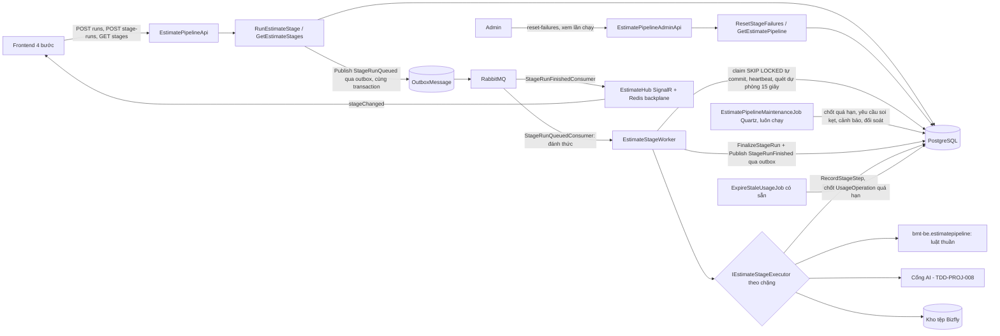
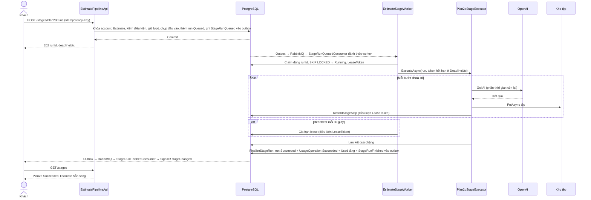
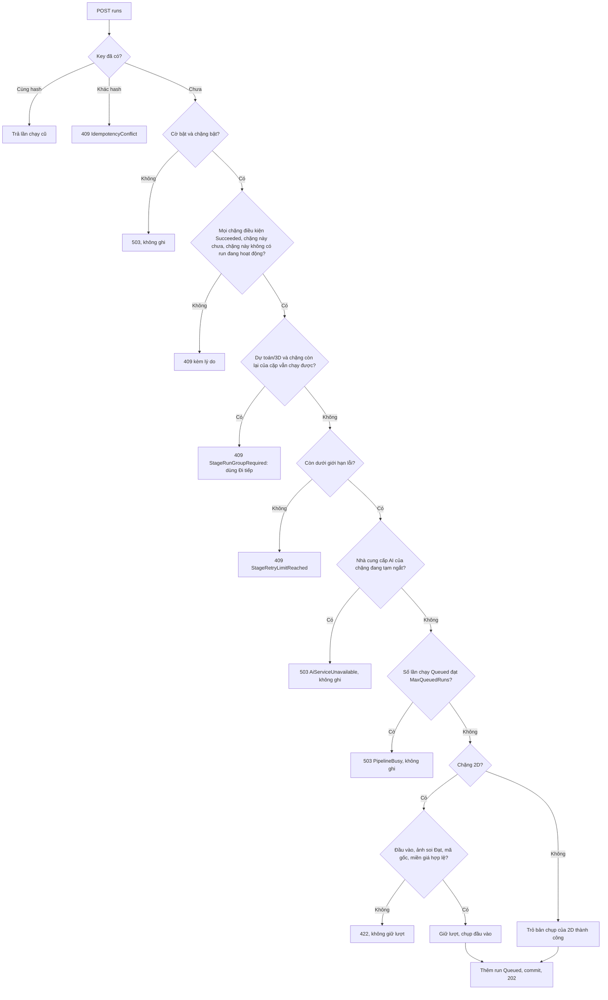
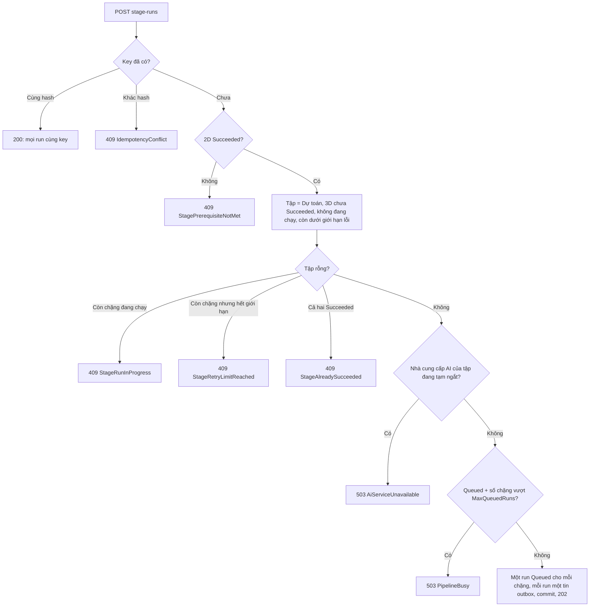
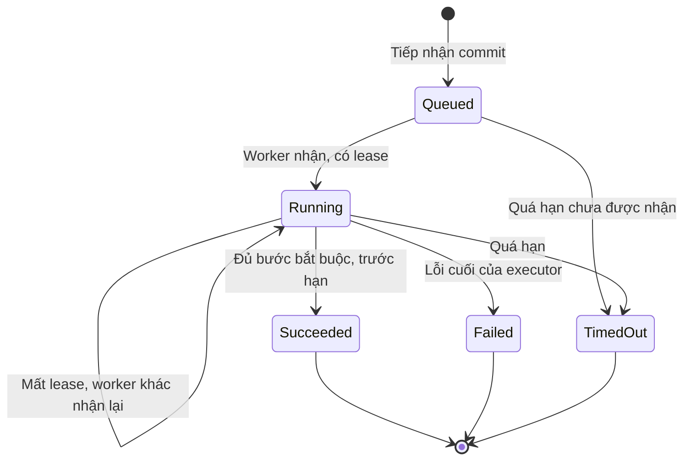
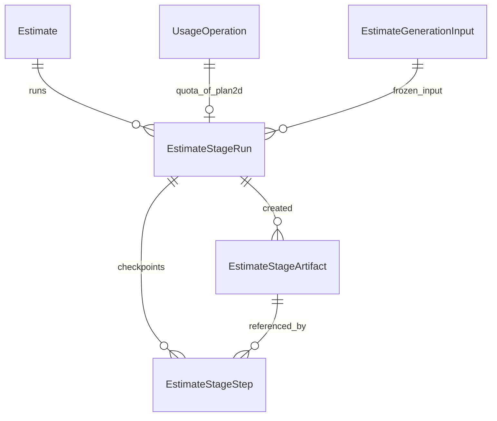

<!-- HƯỚNG DẪN CHO AI KHI ĐIỀN HOẶC CHỈNH SỬA MẪU
- Đọc toàn bộ mẫu, các comment hướng dẫn và tài liệu nguồn được cung cấp trước khi viết. Tuân thủ các quy tắc nghiệp vụ, điều kiện, ngoại lệ và giới hạn đã được xác nhận.
- Không bịa, tự chế hoặc suy đoán thành sự thật: yêu cầu, quy tắc, số liệu, API, schema, mã lỗi, nguồn tham khảo, người phụ trách và kết quả kiểm thử phải có căn cứ. Nội dung ví dụ trong mẫu không phải dữ kiện của dự án.
- Khi thiếu thông tin hoặc các nguồn mâu thuẫn, hỏi người dùng để làm rõ; giữ nguyên placeholder ở phần chưa xác định. Không tự chọn đáp án, lấp chỗ trống hay tuyên bố tài liệu đã hoàn tất.
- Chỉ thay nội dung cần điền hoặc được yêu cầu sửa. Không tự mở rộng phạm vi, sửa nghĩa quy tắc, bỏ điều kiện/ngoại lệ, xoá hay ghi đè nội dung hợp lệ đã có.
- Giữ nguyên tên, cấp và thứ tự heading, nhãn in đậm, tiền tố bullet, cấu trúc danh sách, tên/thứ tự/số cột bảng và cú pháp code fence. Không dịch, đổi tên, gộp hoặc thêm mục ngoài cấu trúc mẫu.
- Chỉ lặp khối luồng, AC hoặc API theo đúng khuôn khi có căn cứ; chỉ bỏ phần tuỳ chọn khi hướng dẫn riêng của mẫu cho phép và đã xác định không áp dụng.
- Mã tham chiếu và section phải trỏ tới tài liệu có thật đã được cung cấp hoặc kiểm chứng. Không giữ mã ví dụ như tham chiếu thật và không tự tạo tài liệu liên quan để hợp thức hoá liên kết.
- Giữ các comment hướng dẫn trong file. Xuất Markdown UTF-8, mỗi file một tài liệu; không bọc toàn bộ file trong code fence, không chèn lời dẫn hay giải thích ngoài mẫu.
- Trước khi bàn giao, đối chiếu nội dung với nguồn, kiểm tra cấu trúc, giá trị cho phép, giới hạn độ dài và tính nhất quán của mã/tham chiếu. Báo rõ phần chưa đủ thông tin; không tuyên bố đã chạy test hoặc import khi chưa thực hiện.
-->

<!-- Thay mã TDD-001 và nội dung ví dụ; giữ nguyên heading và nhãn in đậm.
Sơ đồ dùng mermaid, plantuml hoặc URL. Giữ heading Architecture, Sequence Diagram, Activity Diagram, State Diagram, Data Model.
Ví dụ API phải có heading trùng METHOD /path trong Endpoints. Xoá phần API/sơ đồ không dùng.
Version, Updated At và Change Log do lịch sử phiên bản quản lý, để trống khi nhập mới.
Author/Reviewer là tên hiển thị; gán tài khoản, phê duyệt, giả định và câu hỏi mở trên giao diện sau import.
Thiết kế phải truy vết về Story và Business Rule được cung cấp. Phân biệt thiết kế đề xuất với implementation đã kiểm chứng; không mô tả API/schema/sơ đồ ví dụ như hệ thống thật hoặc tự quyết định nghiệp vụ còn thiếu.
BẮT BUỘC KHI HOÀN THIỆN MẪU: phải có cả Reviewer và Approver, mỗi tên 1–200 ký tự sau khi bỏ khoảng trắng đầu/cuối. Không xoá hai dòng metadata, để trống, dùng tên bịa hoặc giữ placeholder rồi coi là hoàn tất.
Nếu chưa biết người review hoặc người phê duyệt, phải hỏi người dùng và báo tài liệu chưa đủ thông tin; không tự lấy Author/Owner làm người thay thế. Tên trong file không tự gán tài khoản hoặc xác nhận đã duyệt; gán thành viên trên giao diện sau import.
Đây là yêu cầu hoàn thiện mẫu; backend hiện vẫn nhận file cũ thiếu hai trường để tương thích.

VALIDATION CHO FILE NHẬP (đối chiếu ImportSnapshotValidator, MarkdownParser và ImportService):
- Mỗi file .md UTF-8 không rỗng chỉ có một heading cấp 1 chứa mã tài liệu dài 1–100 ký tự. Mã không được trùng trong cùng lần nhập hoặc thuộc loại tài liệu khác đã tồn tại.
- Không dùng tên README.md hoặc sitemap.md vì importer bỏ qua. Giao diện nhận .md/.zip, tối đa 2.000 file, tổng file tải lên 31 MiB; API giới hạn request 32 MiB và tổng nội dung đọc/giải nén 64 MiB.
- Chỉ nhập đè tài liệu cùng loại đang Draft, chưa có phiên bản và chưa lưu trữ. Import thay toàn bộ nội dung bản nháp, vì vậy phải giữ lại nội dung hợp lệ ngoài phần được yêu cầu sửa.
- Không dùng Status trong Markdown hoặc tên Approver để tự xác nhận phê duyệt; import không cấp quyền hay gán tài khoản từ tên. Chạy Kiểm tra file và xử lý lỗi/cảnh báo trước khi nhập.
- Giới hạn độ dài bên dưới tính theo string.Length của .NET (đơn vị UTF-16); không tự cắt ngắn dữ kiện quan trọng để vượt validation, hãy viết lại có căn cứ hoặc hỏi người dùng.
- Feature tối đa 300 ký tự và được dùng làm tiêu đề tài liệu. Status được parser nhận: Draft / In Review / Approved / Deprecated; tài liệu nhập mới vẫn có trạng thái phê duyệt Draft.
- Endpoint: đường dẫn tối đa 500 ký tự; tên/mô tả endpoint được lưu trong Name tối đa 300. HTTP method: GET / POST / PUT / PATCH / DELETE / HEAD / OPTIONS.
- Error Codes: mã tối đa 100 ký tự, không trùng trong tài liệu; giữ dạng - **CODE** (400): mô tả. HTTP status trong Error Codes và Response phải là số nguyên đọc được bằng Int32; không tự đặt status khác hợp đồng API.
- URL sơ đồ tối đa 1.000 ký tự. Mục sơ đồ được sử dụng phải có khối mermaid/plantuml hoặc URL theo mẫu; không để một mục sơ đồ rỗng. Nhãn mục được tách từ bullet như tên External API Fields tối đa 300 ký tự.
- Heading Examples phải khớp METHOD /path ở Endpoints. Giữ các nhãn Request:, Response 200: (thay mã theo contract) và Error Response: để parser tách đúng dữ liệu.
- Tham chiếu dạng DOC-KEY/section: ghi chú: mã đích tối đa 100 ký tự, section tối đa 100, ghi chú tối đa 1.000. Không trùng bộ mã đích + section + loại liên kết trong cùng tài liệu.
ĐỐI CHIẾU FORM TDD (src/features/tdds/validations.ts; form có thể chặt hơn import):
- Điền Feature, Author, Reviewer, Problem và ít nhất một Goal; các Goal/Non-goal/Notes đã thêm không được rỗng. API đã khai báo phải có endpoint và mô tả/mục đích; Fields phải có tên và ý nghĩa; Error Codes phải có mã, HTTP status và điều kiện.
- Form còn kiểm tra Version, Updated At và nội dung Change Log khi khai báo; với file nhập mới, giữ các trường lịch sử này trống theo hợp đồng import, không tự tạo dữ liệu lịch sử.
-->

# TDD-PROJ-006

## Document Info

- **Feature**: Tạo dự toán — luồng bốn chặng: lần chạy chặng, worker, lượt và khóa đầu vào
- **Author**: Claude
- **Reviewer**: Tân Trần
- **Approver**: Tân Trần
- **Status**: Draft
- **Version**:
- **Updated At**:

## Context & Goals

### Problem

Hệ thống thật đang tạo kết quả bằng một lần gửi AI giả `mock-v1` (TDD-PROJ-002). Người dùng chốt ngày 10–11/10/2026 chuyển sang luồng bốn chặng của app demo `design-estimate` (commit `059e876`): Bản vẽ 2D, Dự toán, Phối cảnh 3D, Hồ sơ. Một lượt cho cả bộ, tính khi 2D thành công; chặng lỗi được chạy lại có giới hạn; mỗi chặng có hạn chờ riêng (BR-PROJ-010, 011, 012, BR-SUB-003, BR-SUB-016). Ngày 13/10/2026 người dùng chốt theo yêu cầu khách hàng giảm thời gian chờ: sau 2D, khách bấm Đi tiếp một lần để Dự toán và Phối cảnh 3D chạy cùng lúc; Hồ sơ chỉ mở khi cả hai xong và tự tạo khi khách vào bước Hồ sơ (BR-PROJ-010 bản sửa 13/10/2026).

Tài liệu này thiết kế phần dùng chung cho cả bốn chặng: bảng lần chạy, cách nhận việc của worker, điểm lưu từng bước tốn tiền, quyết toán lượt ở chặng 2D, khóa đầu vào, trạng thái danh sách và các API điều khiển chặng. Nội dung từng chặng nằm ở TDD riêng: chặng 2D và đầu vào ở TDD-PROJ-007, lớp gọi AI và cấu hình ở TDD-PROJ-008; Dự toán, 3D, Hồ sơ soạn ở các đợt sau.

Luồng cũ của TDD-PROJ-002 vẫn chạy ở môi trường chưa bật cờ (production chạy luồng cũ cho tới khi người dùng quyết định, BR-PROJ-018). Vì vậy tài liệu này không sửa TDD-PROJ-002 mà đặt hai luồng loại trừ nhau bằng cấu hình.

Hiện trạng mã đã đối chiếu ngày 11/10/2026 trên nhánh `develop` của `bmt-be`: `RequestEstimateGenerationCommandHandler` giữ lượt qua `IDesignUsageCoordinator`; `EstimateGenerationStore.ClaimDispatchAsync` nhận việc bằng `UPDATE … FOR UPDATE SKIP LOCKED`; `ExpireStaleUsageJob` chốt tác vụ quá hạn; trạng thái danh sách tính trong `EstimateStore.MyEstimates.cs` từ `UsageOperation`. Mọi bảng, lớp và API mới dưới đây là thiết kế đề xuất, chưa có mã.

Hiện trạng đã kiểm tra ngày 13/10/2026 trên `develop` (`a69d4d0`) cho phần chạy cùng lúc: `PipelineStages.Ordered/Previous` xếp bốn chặng thành một dãy cố định; `RunEstimateStageCommandHandler.EnsureStageOpen` từ chối khi bản có bất kỳ lần chạy Queued/Running; chỉ mục `UX_EstimateStageRun_Active` là UNIQUE (EstimateId) nên database không cho hai lần chạy cùng hoạt động trên một bản; `StageStatusProjector` khóa chặng sau khi chặng ngay trước chưa thành công. Phần sửa cho các điểm này ghi ở mục “Chạy cùng lúc Dự toán và Phối cảnh 3D” bên dưới, là đề xuất chưa có mã.

### Goals

- Mỗi lần khách bấm chạy một chặng tạo đúng một dòng lần chạy; bấm Đi tiếp tạo đúng một dòng cho mỗi chặng được nhận trong cùng một transaction. Database chặn hai lần chạy đang hoạt động của **cùng một chặng** trên một bản dự toán và chặn chạy lại chặng đã thành công; Dự toán và Phối cảnh 3D được cùng hoạt động.
- Chặng 2D giữ một lượt cùng commit tiếp nhận, chuyển thành đã dùng cùng commit thành công, hoàn cùng commit lỗi hoặc quá hạn; ba chặng sau không chạm sổ lượt.
- Worker chết giữa chừng thì lần chạy được worker khác tiếp tục từ bước đã lưu, trong hạn chờ còn lại; mất tối đa một lời gọi AI đang chạy dở.
- Quá hạn chờ thì lần chạy lỗi trong vòng một chu kỳ quét; kết quả đến muộn không được công bố.
- Luồng cũ và luồng mới không cùng xử lý một bản dự toán.
- Hàng chờ đầy hoặc dịch vụ AI đang tạm ngắt thì từ chối ngay lúc bấm, không giữ lượt (BR-PROJ-012 khoản 8–9); chỉ lỗi do kết quả AI với đầu vào của khách mới tính vào giới hạn lỗi (BR-PROJ-011 khoản 1).
- Bấm chạy là worker nhận việc gần như ngay (qua RabbitMQ), và trình duyệt được báo khi chặng đổi trạng thái (qua SignalR); mất RabbitMQ thì luồng vẫn chạy nhờ vòng quét dự phòng.

### Non-goals

- Nội dung xử lý của từng chặng (prompt, luật, hình học, dự toán, ảnh, PDF).
- Lớp gọi OpenAI/Anthropic, cấu hình AI, bộ quy tắc AI (TDD-PROJ-008).
- Xóa bản `mock-v1` khi chuyển luồng (BR-PROJ-018): thuộc đợt 4.
- Khách hủy lần chạy; chạy cùng lúc các chặng khác ngoài cặp Dự toán và Phối cảnh 3D.

## Architecture



| Thành phần                                                                                       | Trách nhiệm                                                                                                                                                                                            |
| ------------------------------------------------------------------------------------------------ | ------------------------------------------------------------------------------------------------------------------------------------------------------------------------------------------------------ |
| `bmt-be.estimatepipeline` (project mới)                                                          | Logic thuần chuyển từ app demo: đọc mô tả, luật lô đất, hình học, đo viền nhà, luật phương án, dựng prompt, lưới an toàn dự toán. Không tham chiếu EF, HTTP hay MediatR; chỉ `application` tham chiếu. |
| `RunEstimateStageCommandHandler`                                                                 | Tiếp nhận một lần chạy: kiểm quyền, cờ, điều kiện mở chặng, giới hạn lỗi, đầu vào; với 2D thì giữ lượt và chụp đầu vào.                                                                                |
| `RunEstimateStageGroupCommandHandler` (mới, 13/10/2026)                                           | Tiếp nhận thao tác Đi tiếp/Thử lại: trong một transaction, chọn các chặng còn chạy được trong cặp Dự toán và Phối cảnh 3D, kiểm từng chặng rồi tạo đủ các lần chạy hoặc không tạo gì (BR-PROJ-010 khoản 2–3). Dùng lại toàn bộ hàm kiểm của handler trên.             |
| `EstimateStageWorker` (`BackgroundService`)                                                      | Nhận lần chạy Queued hoặc Running hết lease, gia hạn lease, gọi executor của chặng, quét lần chạy quá hạn.                                                                                             |
| `IEstimateStageExecutor`                                                                         | Một bản cài đặt cho mỗi chặng; đợt 1 chỉ có `Plan2dStageExecutor` (TDD-PROJ-007). Executor đọc điểm lưu, bỏ qua bước đã xong, gọi AI, lưu tệp, ghi bước.                                               |
| `RecordStageStepCommandHandler`                                                                  | Ghi kết quả một bước, có điều kiện đúng lease token.                                                                                                                                                   |
| `FinalizeStageRunCommandHandler`                                                                 | Chốt lần chạy Succeeded/Failed/TimedOut; với 2D chốt UsageOperation và sổ lượt cùng transaction.                                                                                                       |
| `ResetStageFailuresCommandHandler`                                                               | Admin đặt lại bộ đếm lỗi của một chặng (BR-PROJ-011 khoản 3).                                                                                                                                          |
| `GetEstimateStagesQueryHandler`, `GetStageResultQueryHandler`, `GetEstimatePipelineQueryHandler` | Đọc trạng thái chặng cho khách, kết quả chặng, chi tiết lần chạy cho Admin.                                                                                                                            |
| `StageRunQueuedConsumer`                                                                         | Nhận tin `StageRunQueued` từ RabbitMQ, đánh thức worker của instance để nhận đúng lần chạy đó; ack ngay.                                                                                               |
| `StageRunFinishedConsumer`                                                                       | Nhận tin `StageRunFinished`, đẩy sự kiện `stageChanged` tới chủ bản dự toán qua `EstimateHub`.                                                                                                         |
| `EstimateHub` (SignalR, mới)                                                                     | Hub `/api/v1/hubs/estimates`, xác thực bằng phiên đăng nhập như API; mỗi kết nối vào nhóm `user:{userId}`. Dùng Redis backplane để tin từ instance này tới được trình duyệt kết nối ở instance khác.   |

**Notes**:

- **Hai luồng loại trừ nhau.** Tùy chọn mới `EstimatePipelineOption__Mode` nhận `Off`, `Fake`, `Live`. Khi khác `Off`, `EstimateAiOption__Mode` cũ phải trống; đặt cả hai thì API dừng khởi động. Khi khác `Off`, `POST /estimates/{id}/generations` trả 409 `PipelineEnabled` và worker cũ không được đăng ký (BR-PROJ-018 khoản 6). Ví dụ: dev đặt `EstimatePipelineOption__Mode=Fake` và để trống `EstimateAiOption__Mode`; production giữ `EstimatePipelineOption__Mode=Off`, `EstimateAiOption__Mode=Mock` như hiện nay. **Ý nghĩa `Off` với dữ liệu luồng mới đã có:** `Off` chỉ ngừng nhận lần chạy mới và không đăng ký worker; job bảo trì vẫn chạy, nên lần chạy còn dở sẽ được chốt TimedOut khi tới hạn (2D hoàn lượt), không bị kẹt. **Tắt luồng an toàn (runbook):** đặt `EnabledStages` rỗng trong khi giữ `Mode` như cũ để ngừng nhận việc mới mà worker vẫn chạy nốt; chờ không còn lần chạy Queued/Running; sau đó mới đặt `Mode=Off`. Bật luồng mới: chỉ bật khi không còn `UsageOperation` của luồng cũ ở Pending (BR-PROJ-018 khoản 4); API kiểm điều kiện này lúc khởi động và ghi cảnh báo nếu chưa đạt.
- **`EnabledStages`** (`EstimatePipelineOption__EnabledStages`, ví dụ `Plan2d`) cho phép mở dần theo đợt. Chặng chưa bật trả 503 `StageUnavailable`, không giữ lượt. Chế độ `Fake` chỉ thay nhà cung cấp AI bằng phản hồi ghi sẵn; luật, kiểm tra, lưu tệp, lượt chạy thật như `Live`. API từ chối khởi động nếu `Fake` ở Production.
- **Một bảng lần chạy cho cả bốn chặng, không dùng `UsageOperation` làm lần chạy.** `UsageOperation` là sổ lượt của module Subscription, có chỉ mục `UX_UsageOperation_LiveDesignGeneration` chỉ cho một tác vụ Pending/Succeeded mỗi bản. Ba chặng sau không tính lượt nên không thể là `UsageOperation`. Vì vậy `EstimateStageRun` giữ trạng thái chạy của mọi chặng; riêng lần chạy 2D có thêm một `UsageOperation` để giữ và quyết toán lượt, nối qua `UsageOperationId`. Cách này giữ nguyên ý nghĩa sổ lượt và các job SUB đang chạy.
- **Chặn job nhận việc cũ.** `ClaimDispatchAsync` hiện nhận mọi `UsageOperation` DesignGeneration Pending có `EstimateId`. Thêm giá trị `DispatchState='Pipeline'` cho operation do luồng mới tạo và điều kiện `"DispatchState" <> 'Pipeline'` vào câu nhận việc cũ. Đây là lớp phòng thủ thứ hai, cùng với việc không đăng ký worker cũ khi luồng mới bật.
- **Thứ tự khóa giữ như TDD-PROJ-002:** `AccountCommerceState` → `Estimate` → quota (`DesignSubscription` → `DesignPeriod` → `PeriodQuota`) → `UsageOperation` → `EstimateStageRun`. Ba chặng sau không giữ lượt nhưng vẫn khóa `AccountCommerceState` rồi `Estimate`, để tiếp nhận chặng tuần tự với xóa bản dự toán (TDD-PROJ-005) và lưu đầu vào. Worker không giữ khóa dòng khi gọi AI.
- **Tiếp nhận (`RunEstimateStageCommandHandler`)** chạy trong một transaction theo thứ tự:
  1. Phiên khách hàng; Idempotency-Key bắt buộc. Hash yêu cầu = `(estimateId, stage, inputVersion)`; với chặng sau 2D, `inputVersion` là phiên bản đã chốt ở 2D nên hash ổn định.
  2. Với 2D: nạp sẵn dữ liệu địa chỉ ngoài khóa như TDD-PROJ-002 (`PrepareAsync`).
  3. Khóa `AccountCommerceState`, khóa `Estimate` chưa xóa của owner bằng `FOR NO KEY UPDATE` (404 nếu không có). Dùng `FOR NO KEY UPDATE` thay `FOR UPDATE` cho mọi đường của luồng này vì không sửa khóa chính của Estimate: khóa này không xung đột với `FOR KEY SHARE` mà PostgreSQL tự lấy khi kiểm khóa ngoại lúc `RecordStageStep` thêm artifact, nên tránh được deadlock giữa chốt quá hạn và ghi bước.
  4. Tra lần chạy cùng `(AccountId, Stage, RequestKey)` — đúng bộ cột của chỉ mục unique `UX_EstimateStageRun_RequestKey`: cùng hash trả lần chạy đó (200), khác hash (kể cả cùng key dùng cho bản dự toán khác) trả 409 `IdempotencyConflict`.
  5. Cờ và `EnabledStages` (503 `PipelineUnavailable`/`StageUnavailable`).
  6. Điều kiện mở chặng theo BR-PROJ-010 khoản 1: mọi chặng điều kiện của chặng này (`PipelineStages.Prerequisites`, xem mục “Chạy cùng lúc”) đã có lần chạy Succeeded (409 `StagePrerequisiteNotMet`); chặng này chưa Succeeded (409 `StageAlreadySucceeded`); **chặng này** không có lần chạy Queued/Running (409 `StageRunInProgress`). Với Dự toán hoặc Phối cảnh 3D gọi qua route một chặng: nếu chặng còn lại của cặp vẫn chạy được (chưa Succeeded, không có lần chạy đang hoạt động và còn dưới giới hạn lỗi) thì 409 `StageRunGroupRequired`, vì khách phải dùng thao tác Đi tiếp/Thử lại chung (BR-PROJ-010 khoản 2).
  7. Giới hạn lỗi: số lần chạy Failed có `CountsTowardLimit=true` của chặng < `RetryLimit` **của chặng đó** trong cấu hình hiện hành (bảng `EstimatePipelineStageSetting`, TDD-PROJ-008) (409 `StageRetryLimitReached`).
     7a. Tạm ngắt dịch vụ AI (BR-PROJ-012 khoản 9): đọc `IAiCircuitBreaker.IsOpenAsync(provider)` cho mọi nhà cung cấp mà các việc của chặng dùng trong cấu hình hiện hành (2D: nhà cung cấp của `plan2dSpec`, `plan2dImage`). Đang ngắt → 503 `AiServiceUnavailable` kèm header `Retry-After` (số giây còn lại của khóa ngắt). Chặng Hồ sơ không gọi AI nên bỏ qua bước này.
     7b. Hàng chờ đầy (BR-PROJ-012 khoản 8): `SELECT count(*) FROM "EstimateStageRun" WHERE "State"='Queued'` (đọc trên chỉ mục `IX_EstimateStageRun_Claim`) ≥ `MaxQueuedRuns` của cấu hình hiện hành → 503 `PipelineBusy` kèm `Retry-After: 120`. Đây là giới hạn mềm: không khóa bảng, nên khi nhiều yêu cầu cùng tới ngưỡng, số lần chạy chờ có thể vượt ngưỡng vài đơn vị; chấp nhận được vì mục tiêu là không nhận thêm khi đã đông.

  Bước 7a và 7b chạy trước khi giữ lượt, nên lần bị từ chối không tạo dòng nào, không giữ lượt và không tính lỗi. 8. Riêng 2D: kiểm `InputVersion`, đầu vào đủ (TDD-PROJ-007), ảnh lô có kết quả soi Đạt, danh mục đã gắn mã gốc, tỉnh có miền giá; rồi giữ lượt và chụp đầu vào như mục kế tiếp. Lỗi đầu vào trả 422, không giữ lượt. Trước khi giữ lượt, nếu bản dự toán còn `UsageOperation` DesignGeneration của luồng cũ ở Pending hoặc Succeeded (dữ liệu `mock-v1` chưa dọn) thì trả 409 `LegacyResultExists`, không để chỉ mục `UX_UsageOperation_LiveDesignGeneration` ném lỗi 500. 9. Thêm `EstimateStageRun` State=Queued, DeadlineUtc = now + hạn chờ của chặng trong cấu hình đã chốt; commit. Commit là mốc tiếp nhận; trả 202.

- **Chạy cùng lúc Dự toán và Phối cảnh 3D** (người dùng chốt ngày 13/10/2026, BR-PROJ-010 khoản 1–4, 6, 9; BR-PROJ-011 khoản 9).
  1. **Điều kiện mở chặng là một tập, không phải một dãy.** Thay `PipelineStages.Previous(stage)` bằng `PipelineStages.Prerequisites(stage)`: `Plan2d → []`, `Estimate → [Plan2d]`, `Render3d → [Plan2d]`, `Dossier → [Estimate, Render3d]`. `Ordered` chỉ còn dùng để hiển thị và sắp xếp. `StageStatusProjector` tính Chưa mở khi **có** chặng điều kiện chưa Succeeded, thay cho biến “chặng trước đã xong” lan truyền theo thứ tự; nhờ vậy Dự toán và 3D cùng Sẵn sàng sau 2D, Hồ sơ chỉ Sẵn sàng khi cả hai Succeeded. Ví dụ: 2D xong, 3D xong, Dự toán Lỗi → Dự toán Lỗi (còn n lần), 3D Thành công, Hồ sơ Chưa mở với `blockedReason=StagePrerequisiteNotMet`.
  2. **Một lần chạy hoạt động cho mỗi chặng, không phải mỗi bản.** Đổi chỉ mục `UX_EstimateStageRun_Active` từ UNIQUE (EstimateId) thành UNIQUE (EstimateId, Stage), vẫn với điều kiện `State IN ('Queued','Running')`. Database vì thế vẫn chặn hai lần chạy Dự toán cùng lúc (gửi lặp, hai thiết bị), nhưng cho một lần chạy Dự toán và một lần chạy 3D cùng tồn tại. Chỉ mục mới lỏng hơn chỉ mục cũ nên dữ liệu hiện có luôn thỏa; migration chỉ drop rồi create chỉ mục (xem Data Model/Notes).
  3. **Tiếp nhận nhóm (`RunEstimateStageGroupCommandHandler`)**, một transaction, cùng thứ tự khóa và cùng các hàm kiểm với tiếp nhận một chặng:
     - Phiên khách; Idempotency-Key bắt buộc. Hash = `(estimateId, "group")`. Khóa `AccountCommerceState` → `Estimate` như bước 3.
     - Tra lần chạy theo `(AccountId, Estimate, RequestKey)` và `(AccountId, Render3d, RequestKey)`: có dòng cùng hash → trả 200 với mọi lần chạy có cùng key (replay); có dòng khác hash → 409 `IdempotencyConflict`. Hai lần chạy của một lần bấm dùng **cùng** `RequestKey`; chỉ mục `UX_EstimateStageRun_RequestKey` có `Stage` trong khóa nên không trùng.
     - Cờ `Mode` và `EnabledStages` cho cả hai chặng (503).
     - Kiểm 2D đã Succeeded (409 `StagePrerequisiteNotMet`); lấy `InputOperationId` của lần 2D đó.
     - **Chọn tập chặng cần chạy** = các chặng trong {Estimate, Render3d} chưa Succeeded, **không có lần chạy Queued/Running** và có số lỗi được tính < `RetryLimit` của chặng. Backend tự chọn, body không cần liệt kê chặng, nên giao diện cũ (stale) không gây lệch với quy tắc “chạy mọi chặng chưa thành công” (BR-PROJ-010 khoản 2), “Thử lại chạy lại các chặng đang lỗi” và “chặng hết lượt thử không chặn chặng còn lại” (khoản 3). Chặng đang chạy không bị đưa vào tập và không chặn chặng kia: người dùng chốt ngày 14/10/2026 rằng khi 3D lỗi trong lúc Dự toán còn chạy, bấm Thử lại thì 3D chạy lại ngay. Tập rỗng → 409 với lý do theo thứ tự: còn chặng chưa Succeeded đang chạy → `StageRunInProgress`; còn chặng chưa Succeeded nhưng đều hết giới hạn → `StageRetryLimitReached` (khách được báo liên hệ hỗ trợ); cả hai Succeeded → `StageAlreadySucceeded`.
     - Tạm ngắt dịch vụ AI (7a) cho **hợp** các nhà cung cấp của mọi việc trong tập (Dự toán dùng Anthropic, 3D dùng OpenAI theo cấu hình hiện hành) → 503 `AiServiceUnavailable`. Hàng chờ (7b): `count(Queued) + số chặng trong tập > MaxQueuedRuns` → 503 `PipelineBusy`.
     - Mọi kiểm đạt mới ghi: với mỗi chặng một dòng `EstimateStageRun` Queued có cùng `AcceptedAtUtc`, `RequestKey`, `InputOperationId`, `ConfigRevisionId`, `RuleSetRevisionId`; `DeadlineUtc` theo hạn chờ **riêng** của từng chặng (20 phút Dự toán, 40 phút 3D); Dự toán thêm hai phiên bản luật giá như TDD-PROJ-009 mục A. Mỗi dòng một tin `StageRunQueued` vào outbox. Commit → 202. Một kiểm không đạt thì không dòng nào được ghi: đây là cách thực hiện “nhận cả hai hoặc không nhận” (BR-PROJ-010 khoản 2). Ví dụ: Anthropic đang tạm ngắt, OpenAI bình thường → lần bấm bị từ chối 503, không tạo lần chạy 3D.
  4. **Worker không đổi.** Hai lần chạy là hai dòng Queued độc lập; worker nhận theo `AcceptedAtUtc` rồi `Id`, có thể cùng một instance hoặc hai instance xử lý. Hai executor không chia sẻ trạng thái; giới hạn gọi AI vẫn là giới hạn chung theo nhà cung cấp (TDD-PROJ-008), và vì Dự toán dùng Anthropic còn 3D dùng OpenAI nên hai chặng của một bản không tranh chỗ nhau. Chốt (`FinalizeStageRun`) từng lần chạy riêng; lỗi của một chặng không đụng lần chạy của chặng kia (BR-PROJ-010 khoản 3).
  5. **Chặng 3D không chờ Dự toán.** Điều kiện của 3D là 2D; kiểu mái 3D lấy từ kết quả Dự toán nếu đã có, không thì tự tính bằng cùng quy tắc (TDD-PROJ-010 mục B). `GetStageResultQueryHandler` cho Render3d đổi điều kiện từ Dự toán Succeeded sang 2D Succeeded.
  6. **Hồ sơ tự tạo khi vào bước Hồ sơ** là hành vi của frontend (TDD-PROJ-011/Notes): gọi `POST …/stages/Dossier/runs` với Idempotency-Key cố định `dossier-auto:{estimateId}` khi chặng Hồ sơ `Ready` và `runId` rỗng. Backend giữ nguyên kiểm tiếp nhận; key cố định làm việc tải lại trang hoặc mở hai tab chỉ tạo một lần chạy (replay 200). Sau lần chạy lỗi, `runId` khác rỗng nên frontend không tự gọi; khách bấm Chạy lại với key mới.
  7. **Danh sách dự toán** (`EstimateStore.MyEstimates.cs`): thêm trường `succeededStages` (mảng tên chặng đã Succeeded) bên cạnh `lastSucceededStage` đang có, vì với hai chặng song song một tên chặng không đủ để frontend biết nên mở bước nào (ví dụ chỉ 3D xong còn Dự toán lỗi). `lastSucceededStage` giữ nguyên cho tương thích.
  8. **Frontend (`buildx-fe-web/src/features/design`)**, hiện trạng `develop` `dfdbeef`: `pipeline.logic.ts` khai báo năm bước và `STEP_OF_STAGE` Plan2d=2, Estimate=3, Render3d=4, Dossier=5; `useStageRun` gọi route một chặng; `/estimate` và `/render3d` là hai trang riêng; `resumeStep` dùng `lastSucceededStage`. Thay đổi đề xuất:
     - `PipelineStep` còn 1–4; `STEP_OF_STAGE`: Plan2d=2, Estimate=3, Render3d=3, Dossier=4. `pipelineStepStates` tính nấc 3 từ hai chặng: `done` khi cả hai Succeeded, `running` khi một chặng đang chạy, `failed` khi có chặng Lỗi và không chặng nào đang chạy, `ready` khi 2D xong, còn lại `locked`. `StepProgress` hiện nhãn “Dự toán & 3D” và dòng trạng thái gộp (ví dụ “Dự toán xong · 3D đang chạy 5/8”).
     - Route `/design/[projectId]/estimate` là màn bước Dự toán & 3D với hai tab (`?tab=estimate|render3d`), dùng lại `EstimateStageView` và `Render3dStageView` làm nội dung tab; mỗi tab giữ trạng thái riêng của chặng. Phần đầu màn có một nút Đi tiếp (khi chưa chặng nào trong cặp có lần chạy và có chặng Sẵn sàng), một nút Thử lại (khi có chặng Lỗi còn chạy lại được, kể cả khi chặng kia đang chạy) và nút Sang bước Hồ sơ (khi cả hai Succeeded). Route `/render3d` chuyển hướng về `/estimate?tab=render3d` để link cũ còn dùng được.
     - Hook mới `useStageGroupRun(projectId)` gọi `POST …/stage-runs` với Idempotency-Key theo lần bấm, cùng quy tắc giữ/đổi key và làm mới `stages` như `useStageRun`. Màn chờ của tab nào hiện mẫu 3D tham khảo theo TDD-LIB-001 (panel `kind=3d`); màn chờ 2D ở `/plan` thêm panel `kind=2d`.
     - Màn Hồ sơ tự gọi tiếp nhận theo TDD-PROJ-011/Notes. `resumeStep` dùng `succeededStages`: có Dossier → 4; có cả Estimate và Render3d → 4; có Plan2d → 3; bản có lần chạy 2D (đang chạy hoặc lỗi) → 2; còn lại → 1.
     - `GET /stages` vẫn hỏi lại mỗi 5 giây khi có chặng đang hoạt động; hai chặng chạy cùng lúc không làm tăng số request vì dùng chung một lời gọi.
- **Giữ lượt và chụp đầu vào ở 2D.** Dùng `IDesignUsageCoordinator.EnsureCanReserveAsync` và `Reserve` như TDD-PROJ-002, với `UsageOperation { UsageKind=DesignGeneration, ResourceId=EstimateId=Estimate.Id, State=Pending, DeadlineUtc = DeadlineUtc của lần chạy, DispatchState='Pipeline', InputRef='estimate-input:<operationId>' }`. Bản chụp đầu vào ghi vào bảng có sẵn `EstimateGenerationInput` với `SchemaVersion=3` (nội dung ở TDD-PROJ-007), khóa chính là `OperationId` của `UsageOperation`. Ba chặng sau trỏ `InputOperationId` tới bản chụp của lần chạy 2D thành công, nên không đọc lại đầu vào hiện tại (BR-PROJ-010 khoản 6).
- **Chốt phiên bản lúc tiếp nhận.** Lần chạy ghi `ConfigRevisionId` (cấu hình AI, TDD-PROJ-008), `RuleSetRevisionId` (bộ quy tắc AI, BR-PROJ-019) và `PipelineVersion` (phiên bản mã của chặng, ví dụ `plan2d:2d-13`). Executor chỉ đọc các phiên bản này, kể cả khi Admin lưu phiên bản mới hoặc bản phát hành mới được deploy giữa chừng (BR-PROJ-014 khoản 3). Mã giữ lại các phiên bản prompt cũ đang còn lần chạy chưa kết thúc dùng tới; lần chạy gặp `PipelineVersion` không còn trong mã thì lỗi `PipelineVersionRetired` (không tính vào bộ đếm lỗi) thay vì chạy tiếp bằng prompt mới.
- **Lease và heartbeat.** Worker nhận việc bằng một câu `UPDATE … FROM (SELECT … FOR UPDATE SKIP LOCKED)` tự commit, chạy trên `DbContext`/scope riêng của worker, **không bao giờ bên trong transaction của consumer MassTransit**, giống `ClaimDispatchAsync`: chỉ lấy lần chạy Queued, hoặc Running có `LeaseUntilUtc <= now`, và `DeadlineUtc > now`; đặt State=Running, `LeaseToken` mới, `LeaseUntilUtc = now + LeaseSeconds` (mặc định 120), tăng `ClaimCount`. Trong lúc chạy, một vòng heartbeat mỗi `HeartbeatSeconds` (mặc định 30) gia hạn lease bằng `UPDATE … WHERE Id=@id AND LeaseToken=@token AND State='Running'`. Không dòng nào bị ảnh hưởng nghĩa là đã mất lease (worker khác đã nhận, hoặc lần chạy đã bị chốt quá hạn): executor bị hủy qua `CancellationToken`, không ghi gì thêm. Mọi lệnh ghi của worker đều kèm điều kiện đúng `LeaseToken`. **SKIP LOCKED** nghĩa là khi nhiều worker cùng tìm việc, dòng đang bị một worker khóa sẽ bị bỏ qua thay vì chờ, nên hai worker không nhận cùng một lần chạy và không chặn nhau. Giới hạn: lease 120 giây nghĩa là worker chết thì lần chạy đứng yên tối đa khoảng 2 phút trước khi worker khác nhận lại.
- **Điểm lưu từng bước (`EstimateStageStep`).** Mỗi bước tốn tiền (một lời gọi AI hoặc một tệp dựng) có một khóa bước, ví dụ `spec`, `plan:technical:f1`, `plan:furniture:f2`. Executor làm theo thứ tự: kiểm bước đã có Succeeded thì dùng lại; nếu chưa, gọi AI → tải tệp lên kho → ghi bước Succeeded (kèm `ArtifactId` hoặc `OutputJson`) bằng `RecordStageStep`. Chỉ sau khi bước đã ghi mới sang bước sau. Khi worker khác nhận lại lần chạy, các bước đã ghi được bỏ qua, nên chỉ mất lời gọi đang dở. Ví dụ: 2D nhà 2 tầng có 5 bước; worker chết sau khi ghi `plan:technical:f1`; worker mới bắt đầu từ `plan:technical:f2`. `RecordStageStep` là một transaction ngắn không khóa dòng run bằng `FOR UPDATE`: thêm `EstimateStageArtifact` (nếu có), rồi thêm `EstimateStageStep` bằng `INSERT … SELECT … WHERE EXISTS (run có đúng LeaseToken và State='Running')`, cuối cùng cập nhật `ProgressDone` của run có cùng điều kiện lease. Không có dòng nào được ghi nghĩa là đã mất lease: rollback, executor dừng. Ngoại lệ ở chặng Dự toán (TDD-PROJ-009 mục B): một lượt hỏi lại của lưới an toàn bị lỗi mà executor bỏ qua để đi tiếp như app demo vẫn được ghi thành bước đã xong, với `OutputJson={"failed":true,"errorCode":"…"}`, để worker nhận lại thấy lượt đó đã có kết luận và không hỏi lại lần hai.
- **Hạn chờ cho từng lời gọi.** Executor tạo `CancellationToken` hết hạn lúc `DeadlineUtc`; mỗi lời gọi AI dùng `min(thời gian còn lại, timeout một lần gọi)` (BR-PROJ-012 khoản 7, TDD-PROJ-008).
- **Quét quá hạn và giám sát bằng job Quartz luôn chạy (`EstimatePipelineMaintenanceJob`).** Job được đăng ký bất kể `Mode` (kể cả `Off`), chu kỳ `EstimatePipelineOption__MaintenanceIntervalSeconds` (mặc định 30), `[DisallowConcurrentExecution]`. Mỗi lượt: (1) đọc tối đa `BatchSize` lần chạy Queued/Running có `DeadlineUtc <= now` và gửi `FinalizeStageRunCommand(TimedOut)` trong scope riêng; (2) xử lý yêu cầu soi ảnh quá hạn hoặc kẹt (TDD-PROJ-007 mục D); (3) tính các cảnh báo `EstimatePipelineStuck` (Queued quá 5 phút chưa được nhận) và lần chạy chờ quá 50% hạn chờ — tách khỏi worker để worker chết vẫn có cảnh báo. Với 2D, `ExpireStaleUsageJob` có sẵn có thể chốt `UsageOperation` trước (cùng `DeadlineUtc`); finalizer khi đó đọc operation đã TimedOut và chỉ chuyển lần chạy sang TimedOut, không chốt lượt lần hai.
- **Chốt (`FinalizeStageRunCommandHandler`).** Khóa `AccountCommerceState` → `Estimate` (`FOR NO KEY UPDATE`) → `UsageOperation` (2D) → `EstimateStageRun`; đọc lại State. Đã kết thúc thì không làm gì. Lấy **một** mốc `now` duy nhất bằng `now()` của PostgreSQL sau khi đủ khóa và truyền mốc này cho mọi bước, kể cả `SettleAsync`, để không có hai đồng hồ. Executor xin Succeeded chỉ được chấp nhận khi mọi bước bắt buộc đã Succeeded và kết quả chặng đã lưu; còn thiếu bước thì từ chối với lỗi bất biến `MissingRequiredSteps` (lỗi lập trình, ghi log Error), giữ lần chạy Running để job quét quá hạn xử lý, không chốt lượt. **Với 2D, sổ lượt là nguồn sự thật:** gọi `SettleAsync(ResultReady=true/false, nowUtc)` trước, rồi đặt trạng thái lần chạy theo kết quả trả về — operation Succeeded thì run Succeeded; operation TimedOut (đã qua hạn) thì run TimedOut dù executor xin Succeeded; Failed thì Failed. Nhờ vậy không thể có run Succeeded mà lượt bị hoàn. Ba chặng sau: Succeeded chỉ khi `now < DeadlineUtc`, ngược lại TimedOut. Kết quả muộn bị bỏ (BR-PROJ-012 khoản 4). Lỗi nghiệp vụ là kết quả cần commit, không ném exception (cùng nguyên tắc TDD-PROJ-002). Khi chốt Failed, finalizer đặt `CountsTowardLimit` theo `StageFailureClassifier` (chỉ nhóm lỗi do kết quả AI mới là true); TimedOut luôn false. Thêm truy vấn đối soát định kỳ trong job bảo trì: mọi run Plan2d Succeeded phải có operation Succeeded và ngược lại; lệch thì cảnh báo.
- **Khóa đầu vào** (BR-PROJ-005) tính từ dữ liệu, không thêm cờ rời: đầu vào bị khóa khi tồn tại lần chạy `Plan2d` ở Queued, Running hoặc Succeeded. `SaveEstimateInputCommandHandler.EnsureInputUnlocked` và yêu cầu soi ảnh dùng cùng hàm `IsInputLocked`. Đổi tên không bị ảnh hưởng.
- **Bộ đếm lỗi và đặt lại.** Đếm bằng truy vấn trên chỉ mục `(EstimateId, Stage, State)`. Admin đặt lại bằng một câu `UPDATE … SET CountsTowardLimit=false, LimitResetAtUtc=@now, LimitResetBy=@admin WHERE EstimateId=@e AND Stage=@s AND State IN ('Failed','TimedOut') AND CountsTowardLimit`; không xóa lịch sử. Từ chối khi chặng đang chạy hoặc đã thành công (STORY-PROJ-012/EXC-04).
- **Gián đoạn không phải lỗi** (BR-PROJ-011/Except): mất lease, khởi động lại máy chủ hay hủy token do mất lease không chốt Failed; lần chạy giữ Running và được nhận lại. Chỉ lỗi cuối của executor (ví dụ AI vẫn không trả ảnh sau lần vẽ lại) hoặc quá hạn mới chốt.
- **Số lần chạy worker lấy ra cùng lúc.** Không cấu hình riêng; mỗi instance tự tính bằng số ảnh vẽ cùng lúc toàn hệ thống (`ImageConcurrency`, TDD-PROJ-008) cộng 2. Ví dụ 8 chỗ vẽ thì nhận tối đa 10 lần chạy. Mức trần này giữ việc chưa làm tới ở lại hàng đợi theo thứ tự, thay vì nhận hết rồi ngồi chờ chỗ vẽ trong khi đồng hồ hạn chờ đã chạy. Giới hạn thật với nhà cung cấp AI là giới hạn chung qua Redis ở TDD-PROJ-008.
- **Đánh thức worker qua RabbitMQ và outbox** (người dùng chốt ngày 12/10/2026). Bảng `EstimateStageRun` vẫn là nguồn sự thật; RabbitMQ chỉ báo "có việc mới".
  1. Handler tiếp nhận gọi `Publish(new StageRunQueued(runId, estimateId, stage))` trong cùng transaction. Outbox EF của MassTransit (đã cấu hình trong `AddMessageBusInfrastructure`, bảng `OutboxMessage`) ghi tin vào DB cùng commit và chỉ đẩy lên RabbitMQ sau khi commit. **Outbox** nghĩa là tin nhắn được ghi chung transaction với dữ liệu nghiệp vụ: không có trường hợp lần chạy đã lưu mà tin bị mất, hay tin đã gửi mà lần chạy chưa lưu. RabbitMQ đang chết thì tin nằm chờ trong bảng và được gửi khi RabbitMQ sống lại.
  2. `StageRunQueuedConsumer` **không đụng DB**: chỉ ghi `runId` vào hàng tín hiệu trong RAM của worker (`Channel<Guid>`) rồi kết thúc, nên transaction inbox mà MassTransit bọc quanh mọi consumer (`UseEntityFrameworkOutbox` cho mọi endpoint) chỉ kéo dài vài mili giây. **Lý do:** MassTransit mở một transaction DB trước khi gọi `Consume()` và chỉ commit sau khi `Consume()` kết thúc; nếu claim hoặc chạy executor trong `Consume()`, kết nối DB và khóa dòng bị giữ suốt thời gian đó, lease chưa hiện ra với worker khác và heartbeat từ kết nối khác bị chặn.
  3. Worker đọc tín hiệu, tự claim đúng `runId` bằng câu claim tự commit (thêm điều kiện `Id = @runId`), rồi giao executor. Không còn chỗ hoặc lần chạy đã được nhận thì bỏ tín hiệu; lần chạy vẫn `Queued` trong DB. Tin chỉ tới một instance; instance hết chỗ thì bỏ tín hiệu, nên vòng quét dự phòng phải đủ dày (mục 5).
  4. Mỗi khi một lần chạy kết thúc trên instance, worker của instance đó tự thử nhận lần chạy `Queued` kế tiếp ngay (theo `AcceptedAtUtc`), không chờ tin hay vòng quét. Nhờ vậy việc trong hàng được nhận đúng thứ tự khi có chỗ trống.
  5. Vòng quét nhận việc dự phòng trong worker, chu kỳ 15 giây (`EstimatePipelineOption__PollIntervalSeconds`): nhặt việc mà tin bị thất lạc hoặc bị instance hết chỗ bỏ qua, nhận lại việc mất lease. Câu quét chỉ đọc partial index rất nhỏ (`IX_EstimateStageRun_Claim`) nên chi phí thấp. Mất RabbitMQ hoàn toàn thì độ trễ nhận việc tối đa 15 giây.
  6. Tin trùng không gây hại: câu claim chỉ cho một worker nhận; inbox của MassTransit bỏ tin đã xử lý.
- **Báo trạng thái về trình duyệt.** Transaction chốt (`FinalizeStageRunCommandHandler`) phát `StageRunFinished` qua outbox. Lúc lần chạy chuyển Running, không phát tin (câu claim tự commit không đi qua outbox); frontend thấy Running khi gọi lại `GET /stages`. `StageRunFinishedConsumer` (việc ngắn) gửi sự kiện `stageChanged {estimateId, stage, status, failureCode}` tới nhóm `user:{ownerId}` của `EstimateHub`. Sự kiện chỉ báo "có thay đổi"; frontend gọi lại `GET /stages` để lấy dữ liệu, nên mất một sự kiện không làm sai giao diện. Frontend vẫn hỏi lại `GET /stages` định kỳ thưa (ví dụ 30 giây) khi không có kết nối SignalR. `bmt-be` chưa có SignalR: thêm `AddSignalR().AddStackExchangeRedis(...)` dùng Redis có sẵn, `MapHub<EstimateHub>`. Cấu hình hub: chỉ dùng WebSocket (`SkipNegotiation`) để chạy được nhiều instance sau Cloudflare tunnel mà không cần sticky session; xác thực cookie như API, kiểm `Origin` như TDD-AUTH-001; bật `CloseOnAuthenticationExpiration`; khi khách đăng xuất hoặc phiên bị thu hồi thì đóng các kết nối của nhóm `user:{id}`. Ứng dụng di động (Bearer) gửi `access_token` qua query string chỉ cho đường hub; query này không được ghi vào log.
- **Triển khai** (người dùng chốt ngày 12/10/2026): worker chạy chung trong container API hiện có (`bmt-api-dev`, `bmt-api-prod`, triển khai bằng `docker compose` trên máy chủ tự quản). Mỗi môi trường hiện có đúng một container API (`container_name` cố định), nên giới hạn chung qua Redis và Redis backplane của SignalR chưa phát huy tác dụng nhưng vẫn giữ để tăng số instance sau này không phải sửa mã. Tách container chỉ chạy worker hoặc chạy nhiều container API là việc vận hành về sau, không thuộc đợt 1.
- **Tắt êm khi deploy hoặc khởi động lại.** Khi nhận `ApplicationStopping`, worker ngừng nhận việc mới, hủy token của các executor đang chạy (lời gọi AI đang dở bị bỏ, không ghi bước), rồi đặt `LeaseUntilUtc = now()` cho các lần chạy mình đang giữ (có điều kiện LeaseToken) để container mới nhận lại ngay thay vì chờ lease 120 giây hết hạn. `compose.yaml` thêm `stop_grace_period: 90s` cho `bmt-api-*`. Khi khởi động, worker chạy một lượt claim ngay. Heartbeat lỗi liên tục tới gần hết lease thì worker tự hủy executor của lần chạy đó.
- **Rủi ro khi đông đột biến** (người dùng giữ cách tính hạn chờ từ lúc tiếp nhận, BR-PROJ-012): lần chạy cuối hàng có thể quá hạn trước khi tới lượt nếu số người bấm cùng lúc vượt nhiều lần sức xử lý (ví dụ hàng trăm lần 2D cùng lúc với giới hạn 20 ảnh/phút). Theo dõi bằng metric số lần chạy `Queued` và thời gian chờ trong hàng; cảnh báo Discord khi có lần chạy chờ quá 50% hạn chờ mà chưa được nhận.
- **Thứ tự xử lý** (người dùng chốt ngày 12/10/2026, BR-PROJ-012 khoản 11): worker nhận lần chạy `Queued` theo `AcceptedAtUtc` tăng dần, không ưu tiên chặng nào (2D không chen trước 3D). Xem lại khi có số liệu tải thật.
- **Cảnh báo chi phí** (BR-PROJ-012 khoản 10): `StageRunFinishedConsumer`, sau khi đẩy sự kiện SignalR, cộng `EstimatedCostUsd` của các dòng `AiCallLog` có `RunId` của lần chạy; vượt `RunCostAlertUsd` của cấu hình đã chốt thì gửi cảnh báo Discord loại `EstimateRunCostHigh` (mã dự toán, chặng, chi phí, số lời gọi). Chỉ cảnh báo, không đổi kết quả lần chạy. Dùng inbox của consumer để không gửi trùng khi tin bị giao lại.
- **Quay lui trên production** (BR-PROJ-018 khoản 8): dùng runbook tắt luồng ở mục "Hai luồng loại trừ nhau". Các API đọc (`GET /stages`, `GET …/result`, `GET …/stage-files/…`) và trang chia sẻ không phụ thuộc `Mode`, nên vẫn chạy khi `Off`. Sau khi đã chuyển luồng, `EstimateAiOption__Mode` để trống; tắt luồng mới không bật lại cổng giả `mock-v1`.
- **Xóa bản dự toán** (BR-PROJ-009): `DeleteMyEstimatesCommandHandler` chặn bản có lần chạy Queued/Running bằng `EXISTS` dưới cùng khóa Estimate. Tiếp nhận chặng kiểm `DeletedAtUtc IS NULL` dưới khóa, nên không tiếp nhận trên bản vừa xóa.
- **Trạng thái danh sách** (BR-PROJ-008 khoản 2, TDD-PROJ-004) đổi biểu thức `CASE` trong `EstimateStore.MyEstimates.cs` khi luồng mới bật, theo thứ tự: có lần chạy Queued/Running → `Processing`; lần chạy mới nhất (theo `AcceptedAtUtc`) là Failed/TimedOut và chặng đó chưa Succeeded → `Failed`; có Dossier Succeeded → `Completed`; có Plan2d Succeeded → `InProgress`; còn lại → `Draft`. Dữ liệu luồng cũ vẫn đọc từ `UsageOperation` theo biểu thức hiện có, gộp `Succeeded` cũ vào `Completed`. Validator lọc trạng thái nhận `Draft`, `Processing`, `Failed`, `InProgress`, `Completed`; giá trị cũ `Succeeded` vẫn được nhận như bí danh của `Completed` để frontend cũ không lỗi trong lúc chuyển. Danh sách trả thêm `lastSucceededStage`.
- **Quan sát:** log theo `runId`, `estimateId`, `stage`, `stepKey`, không log mô tả, địa chỉ hay URL tệp. Metric đề xuất: số lần chạy theo chặng/kết quả, thời gian chạy, số lần nhận lại sau mất lease, số lần quá hạn. Cảnh báo Discord loại mới `EstimatePipelineStuck` khi có lần chạy Queued quá 5 phút mà chưa được nhận (worker không chạy).

## Sequence Diagram



## Activity Diagram



Thao tác Đi tiếp/Thử lại (`POST …/stage-runs`) đi cùng các nhánh trên nhưng lặp cho tập chặng backend tự chọn trong cặp Dự toán và 3D; một nhánh từ chối thì không tạo dòng nào:



## State Diagram



Chạy lại sau lỗi luôn tạo dòng mới; không có chuyển Failed → Queued trên cùng dòng. Trạng thái chặng khách thấy (BR-PROJ-010 khoản 10) tính khi đọc: Chưa mở (có chặng điều kiện chưa Succeeded: Dự toán và 3D cần 2D, Hồ sơ cần cả Dự toán và 3D), Sẵn sàng (mọi chặng điều kiện Succeeded, chặng này chưa có run hoặc run gần nhất lỗi và còn lượt chạy lại), Đang chạy (Queued/Running), Thành công, Lỗi (run gần nhất Failed/TimedOut). Trạng thái của Dự toán và 3D độc lập với nhau.

## Data Model

Ba bảng mới thuộc module Estimate; một thay đổi nhỏ ở `UsageOperation`. Bảng dùng lại: `UsageOperation`, `PeriodQuota` theo [TDD-SUB-002/Data Model](TDD-SUB-002.md#data-model); `EstimateGenerationInput` theo [TDD-PROJ-002/Data Model](TDD-PROJ-002.md#data-model) (thêm SchemaVersion 3, nội dung ở TDD-PROJ-007).

| Bảng                  | Một dòng là gì, ai ghi, khi nào                                                                                                                                                                                                                                                |
| --------------------- | ------------------------------------------------------------------------------------------------------------------------------------------------------------------------------------------------------------------------------------------------------------------------------ |
| EstimateStageRun      | Một lần khách bấm chạy (hoặc chạy lại) một chặng của một bản dự toán. Handler tiếp nhận thêm dòng Queued; worker chuyển Running, gia hạn lease; finalizer ghi trạng thái cuối. Admin chỉ sửa ba cột đặt lại bộ đếm. Không xóa.                                                 |
| EstimateStageStep     | Một bước tốn tiền đã hoàn tất trong một lần chạy, dùng làm điểm lưu để chạy tiếp. Executor ghi qua `RecordStageStep`. Bước lỗi không ghi dòng; chỉ ghi khi Succeeded, trừ lượt hỏi lại của lưới an toàn chặng Dự toán kết thúc bằng lỗi được bỏ qua (TDD-PROJ-009 mục B).                                                                                                          |
| EstimateStageArtifact | Một tệp do luồng tạo ra và đã lưu ở kho (ảnh bản vẽ, ảnh 3D, PDF, Excel). Executor ghi sau khi `PutAsync` thành công, trước khi ghi bước. Gắn với bản dự toán và chặng, không gắn cứng với lần chạy, để lần chạy lại của 3D và Hồ sơ dùng lại tệp đã có (BR-PROJ-011 khoản 8). |
| UsageOperation (sửa)  | Thêm giá trị `Pipeline` cho `DispatchState` (CHECK `CK_UsageOperation_DispatchState`); thêm điều kiện loại trừ vào câu nhận việc cũ. Không thêm cột.                                                                                                                           |

| Bảng                  | Cột, null và ràng buộc                                                                                                                                                                                                                                                                                                                                                                                                                                                                                                                                                                                                                                                                                                                                                                                                                                                                                                                                                                                                                                                                                                                                                                                                                                                                                                                                                                                                                                                                                                                        |
| --------------------- | --------------------------------------------------------------------------------------------------------------------------------------------------------------------------------------------------------------------------------------------------------------------------------------------------------------------------------------------------------------------------------------------------------------------------------------------------------------------------------------------------------------------------------------------------------------------------------------------------------------------------------------------------------------------------------------------------------------------------------------------------------------------------------------------------------------------------------------------------------------------------------------------------------------------------------------------------------------------------------------------------------------------------------------------------------------------------------------------------------------------------------------------------------------------------------------------------------------------------------------------------------------------------------------------------------------------------------------------------------------------------------------------------------------------------------------------------------------------------------------------------------------------------------------------- |
| EstimateStageRun      | Id uuid PK; AccountId uuid NN; EstimateId uuid NN; Stage varchar(16) NN CHECK IN ('Plan2d','Estimate','Render3d','Dossier'); State varchar(16) NN CHECK IN ('Queued','Running','Succeeded','Failed','TimedOut'); RequestKey varchar(100) NN; RequestHash char(64) NN; InputOperationId uuid NN; UsageOperationId uuid NULL; ConfigRevisionId uuid NN; RuleSetRevisionId uuid NN; AcceptedAtUtc timestamptz NN; DeadlineUtc timestamptz NN CHECK > AcceptedAtUtc; StartedAtUtc, FinishedAtUtc timestamptz NULL; LeaseToken uuid NULL; LeaseUntilUtc timestamptz NULL; ClaimCount int NN DEFAULT 0; FailureCode varchar(64) NULL; FailureDetail varchar(500) NULL; CountsTowardLimit boolean NN DEFAULT false (finalizer đặt theo nhóm của `FailureCode`, xem Error Codes); LimitResetAtUtc timestamptz NULL; LimitResetBy uuid NULL FK User; PipelineVersion varchar(32) NN (phiên bản mã của chặng, ví dụ `plan2d:2d-13`); ProgressDone int NN DEFAULT 0; ProgressTotal int NULL (executor đặt khi biết tổng số bước, ví dụ 5 với 2D nhà 2 tầng). UNIQUE (Id, EstimateId) làm đích cho FK ghép của artifact. FK (AccountId, EstimateId) → Estimate(OwnerId, Id); FK InputOperationId → EstimateGenerationInput(OperationId); FK UsageOperationId → UsageOperation(Id). CHECK `(Stage='Plan2d') = (UsageOperationId IS NOT NULL)`; CHECK `State IN ('Failed','TimedOut') OR FailureCode IS NULL`; CHECK `FinishedAtUtc IS NULL = State IN ('Queued','Running')`; CHECK `NOT CountsTowardLimit OR State='Failed'` (quá hạn không bao giờ tính). |
| EstimateStageStep     | RunId uuid NN FK EstimateStageRun; StepKey varchar(100) NN; Attempt int NN DEFAULT 1 CHECK ≥1 (số lần gọi AI đã dùng cho bước, 2 khi đã vẽ lại); ArtifactId uuid NULL FK EstimateStageArtifact; OutputJson jsonb NULL CHECK object; Internal boolean NN DEFAULT false (true khi `OutputJson` chỉ dùng nội bộ, không bao giờ trả cho khách, ví dụ kết quả đo viền); Model varchar(100) NULL; PromptVersion varchar(32) NULL (model và phiên bản prompt thật đã dùng cho bước có gọi AI, BR-PROJ-014); CompletedAtUtc timestamptz NN; PK(RunId, StepKey). CHECK ArtifactId IS NOT NULL OR OutputJson IS NOT NULL.                                                                                                                                                                                                                                                                                                                                                                                                                                                                                                                                                                                                                                                                                                                                                                                                                                                                                                                               |
| EstimateStageArtifact | Id uuid PK; EstimateId uuid NN FK Estimate; Stage varchar(16) NN; ItemKey varchar(100) NN; ObjectKey varchar(512) NN UNIQUE; ContentType varchar(100) NN; SizeBytes bigint NN CHECK > 0; Sha256 char(64) NN; Width, Height int NULL; CreatedByRunId uuid NN; ConfigRevisionId uuid NN; Model varchar(100) NULL; PromptVersion varchar(32) NULL; CreatedAtUtc timestamptz NN. FK (CreatedByRunId, EstimateId) → EstimateStageRun(Id, EstimateId), để artifact luôn thuộc đúng bản dự toán của lần chạy tạo ra nó. UNIQUE(EstimateId, Stage, ItemKey, CreatedByRunId).                                                                                                                                                                                                                                                                                                                                                                                                                                                                                                                                                                                                                                                                                                                                                                                                                                                                                                                                                                          |

Chỉ mục:

- `UX_EstimateStageRun_Active` UNIQUE (EstimateId, Stage) WHERE State IN ('Queued','Running') — một lần chạy hoạt động cho mỗi chặng của mỗi bản (BR-PROJ-010 khoản 6, sửa 13/10/2026; trước đó là UNIQUE (EstimateId)). Dự toán và 3D được cùng hoạt động; gửi lặp cùng chặng vẫn bị chặn ở tầng database.
- `UX_EstimateStageRun_Succeeded` UNIQUE (EstimateId, Stage) WHERE State='Succeeded' — chặng đã thành công không chạy lại (khoản 7).
- `UX_EstimateStageRun_RequestKey` UNIQUE (AccountId, Stage, RequestKey) — chống gửi lặp.
- `IX_EstimateStageRun_Claim` (State, LeaseUntilUtc, AcceptedAtUtc, Id) WHERE State IN ('Queued','Running') — worker nhận việc và quét quá hạn.
- `IX_EstimateStageRun_Estimate` (EstimateId, Stage, AcceptedAtUtc DESC, Id) — đọc trạng thái chặng, đếm lỗi.



**Mẫu dữ liệu** — dữ liệu giả định, ID là bí danh UUID, thời gian UTC, trích cột. Tình huống: khách U1, bản D1 nhà phố 2 tầng, lượt P1 hữu hạn 3; cấu hình C1 (hạn 2D 20 phút, giới hạn lỗi 3), bộ quy tắc RS1.

| Bảng                        | Bước                                                                  | Giá trị                                                                                                                                                                                                                     |
| --------------------------- | --------------------------------------------------------------------- | --------------------------------------------------------------------------------------------------------------------------------------------------------------------------------------------------------------------------- |
| PeriodQuota                 | Trước                                                                 | P1/BGEN: Limit=3; Used=0; Reserved=0                                                                                                                                                                                        |
| UsageOperation              | Tiếp nhận 2D lần 1 lúc 03:00                                          | Id=O1; AccountId=U1; EstimateId=ResourceId=D1; State=Pending; DeadlineUtc=03:20; DispatchState=Pipeline; InputRef=estimate-input:O1                                                                                         |
| EstimateGenerationInput     | Cùng commit                                                           | OperationId=O1; EstimateId=D1; InputVersion=9; SchemaVersion=3; Payload = bản chụp TDD-PROJ-007                                                                                                                             |
| EstimateStageRun            | Cùng commit                                                           | Id=R1; Stage=Plan2d; State=Queued; RequestKey=plan2d-1; InputOperationId=O1; UsageOperationId=O1; ConfigRevisionId=C1; RuleSetRevisionId=RS1; AcceptedAtUtc=03:00; DeadlineUtc=03:20; ClaimCount=0; CountsTowardLimit=false |
| PeriodQuota                 | Cùng commit                                                           | Used=0; Reserved=1                                                                                                                                                                                                          |
| EstimateStageRun            | Worker W1 nhận 03:00:05                                               | R1: State=Running; LeaseToken=L1; LeaseUntilUtc=03:02:05; StartedAtUtc=03:00:05; ClaimCount=1                                                                                                                               |
| EstimateStageStep           | Lập phương án xong 03:01                                              | (R1, `spec`): OutputJson = HouseSpec sau luật; CompletedAtUtc=03:01                                                                                                                                                         |
| EstimateStageArtifact       | Bản vẽ kỹ thuật tầng 1 03:01:40                                       | Id=A1; EstimateId=D1; Stage=Plan2d; ItemKey=plan:technical:f1; ObjectKey=estimates/D1/plan2d/R1/plan-technical-f1-3fa9c2d1.jpg; ContentType=image/jpeg; Width=864; Height=1152; CreatedByRunId=R1                           |
| EstimateStageStep           | Cùng lúc                                                              | (R1, `plan:technical:f1`): ArtifactId=A1                                                                                                                                                                                    |
| EstimateStageRun            | W1 chết 03:02; W2 nhận 03:04:10                                       | R1: LeaseToken=L2; ClaimCount=2. W2 bỏ qua `spec`, `plan:technical:f1`; chạy tiếp `plan:technical:f2`                                                                                                                       |
| EstimateStageRun            | Chốt 03:08                                                            | R1: State=Succeeded; FinishedAtUtc=03:08; LeaseToken=NULL                                                                                                                                                                   |
| UsageOperation, PeriodQuota | Cùng commit                                                           | O1: State=Succeeded; ResultRef=estimate-stage:R1. P1: Used=1; Reserved=0                                                                                                                                                    |
| EstimateStageRun            | Khách bấm Đi tiếp 05:00 (một transaction, hai dòng)                   | Id=R2; Stage=Estimate; State=Queued; RequestKey=next-1; InputOperationId=O1; UsageOperationId=NULL; AcceptedAtUtc=05:00; DeadlineUtc=05:20; PriceFrameworkVersionId=PF3; TakeoffRulesVersionId=TR2                            |
| EstimateStageRun            | Cùng commit                                                           | Id=R5; Stage=Render3d; State=Queued; RequestKey=next-1; InputOperationId=O1; UsageOperationId=NULL; AcceptedAtUtc=05:00; DeadlineUtc=05:40. Hai dòng cùng Queued thỏa chỉ mục (EstimateId, Stage)                                |
| EstimateStageRun            | 3D xong trước 05:18                                                   | R5: State=Succeeded; FinishedAtUtc=05:18. Khách xem được ảnh 3D ở tab 3D; Hồ sơ vẫn Chưa mở vì Dự toán chưa Succeeded                                                                                                          |
| EstimateStageRun            | R2 lỗi 05:06                                                          | R2: State=Failed; FailureCode=AiOutputIncomplete; CountsTowardLimit=true. Sổ lượt không đổi                                                                                                                                 |
| EstimateStageRun            | Khách bấm Thử lại 05:20 (RequestKey=retry-1); backend chỉ chọn Dự toán vì 3D đã Succeeded; Anthropic lỗi sau khi đã thử lại | R4: Stage=Estimate; State=Failed; FailureCode=AiProviderUnavailable; CountsTowardLimit=false. Bộ đếm Dự toán vẫn là 1; không có dòng Render3d mới                                                                              |
| EstimateStageRun            | Khách Thử lại 05:30, Dự toán thành công 05:36                          | R6: Stage=Estimate; State=Succeeded. Hồ sơ chuyển Sẵn sàng                                                                                                                                                                       |
| EstimateStageRun            | Khách vào bước Hồ sơ 05:37; frontend tự gọi với RequestKey=dossier-auto:D1 | R7: Stage=Dossier; State=Queued; DeadlineUtc=05:42. Tải lại trang gửi lại cùng key → trả R7 (200), không tạo dòng mới                                                                                                             |
| EstimateStageRun            | Người vận hành đặt lại 06:00                                          | R2: CountsTowardLimit=false; LimitResetAtUtc=06:00; LimitResetBy=A9                                                                                                                                                         |

Nhánh 2D lỗi: R1 Failed lúc 03:10 → O1 Failed, P1 Used=0, Reserved=0; đầu vào D1 mở sửa vì không còn run Plan2d Queued/Running/Succeeded. Khách sửa và chạy lại với key `plan2d-2` → R3 mới, O3 mới, giữ lượt mới.

**Notes**:

- **Chuẩn hóa:** trạng thái chạy chỉ ở `EstimateStageRun`; trạng thái lượt chỉ ở `UsageOperation`. Không lưu "chặng hiện tại" hay "trạng thái bản dự toán" ở `Estimate`, vì đều tính được và một cột thứ hai sẽ lệch. `AccountId` lặp ở run để FK ghép bảo đảm run thuộc đúng chủ bản.
- **Ghi phiên bản ở artifact và bước:** lần chạy lại của 3D/Hồ sơ có thể dùng lại artifact của lần chạy trước (BR-PROJ-011 khoản 8). Artifact và bước ghi model, phiên bản prompt và phiên bản cấu hình thật đã dùng, nên bộ kết quả trộn ảnh của hai lần chạy vẫn truy được từng ảnh dùng model nào (BR-PROJ-014). Người dùng chốt ngày 12/10/2026: luôn dùng lại phần đã xong, kể cả khi Admin đã đổi model, lời dặn hoặc cấu hình giữa hai lần chạy (BR-PROJ-011 khoản 8). Executor của lần chạy lại tra artifact và bước đã có theo `(EstimateId, Stage, ItemKey)`, không lọc theo `ConfigRevisionId`; chỉ phần còn thiếu dùng cấu hình đã chốt của lần chạy mới.
- **Vì sao tách Step và Artifact:** Step trả lời "bước này của lần chạy này đã xong chưa"; Artifact trả lời "tệp này có ở kho không, là tệp gì". Một tệp 3D tạo ở lần chạy R5 được lần chạy lại R6 dùng lại: R6 ghi Step mới trỏ `ArtifactId` cũ, không dựng lại.
- **Tệp lưu riêng tư** (người dùng chốt ngày 12/10/2026, BR-PROJ-006 khoản 12). Khóa tệp dạng `media/site-private/estimates/{estimateId}/{stage}/{runId}/{itemKey}-{sha8}.{ext}`, ghi bằng `IPrivateMediaObjectStore.PutPrivateAsync` (ACL Private). Tiền tố `media/site-private/` đã được `MediaConstants.IsPrivateKey` nhận, và tiến trình đối soát/dọn kho hiện có đã bỏ qua tiền tố này, nên không cần thêm nhánh vào `MediaSourceReader`. Thêm vào `IPrivateMediaObjectStore` hàm `PresignGet(key, expiresAt, downloadFileName)` (S3 `GetPreSignedURL` với `Verb=GET`, `ResponseHeaderOverrides.ContentDisposition`), hạn `EstimatePipelineOption__FileLinkMinutes` (mặc định 15). Chủ bản dự toán xem/tải qua `GET …/stage-files/{artifactId}`: backend kiểm quyền rồi trả 302 tới link có hạn, kèm `Cache-Control: no-store`. Người nhận link chia sẻ đi qua route chia sẻ của TDD-PROJ-003: backend kiểm link còn hiệu lực rồi chuyển nội dung bằng `CopyPrivateAsync` (hỗ trợ Range), không nhận link trực tiếp, để thu hồi có hiệu lực ngay (BR-PROJ-006 khoản 4). Khi cần đưa ảnh của chặng trước cho AI (ví dụ ảnh 2D vào chặng 3D), executor đọc byte qua `CopyPrivateAsync` rồi gửi dạng base64, không gửi link kho cho nhà cung cấp.
- **Tin nhắn** dùng lại ba bảng outbox/inbox có sẵn của MassTransit (`OutboxMessage`, `OutboxState`, `InboxState`); không thêm bảng. Record event đặt trong `contract/services/estimatePipeline/Event.cs` ở mức namespace theo quy ước dự án: `StageRunQueued(Guid RunId, Guid EstimateId, string Stage)`, `StageRunFinished(Guid RunId, Guid EstimateId, Guid OwnerId, string Stage, string State, string? FailureCode)`.
- **Migration đợt 1** (`EstimatePipelineStages`): thêm ba bảng, chỉ mục, sửa CHECK `DispatchState`. Không đổi dữ liệu cũ. Down xóa ba bảng khi chưa có dòng; có dòng thì dừng.
- **Migration chạy cùng lúc** (`EstimatePipelineParallelStages`, đề xuất 13/10/2026): `DROP INDEX "UX_EstimateStageRun_Active"` rồi `CREATE UNIQUE INDEX "UX_EstimateStageRun_Active" ON "EstimateStageRun" ("EstimateId", "Stage") WHERE "State" IN ('Queued','Running')`. Chỉ mục mới lỏng hơn nên không có dòng nào vi phạm; không backfill. Chỉ mục partial này rất nhỏ (chỉ các lần chạy đang hoạt động) nên tạo lại nhanh; vẫn chạy khi không có lần chạy Queued/Running để tránh một yêu cầu tiếp nhận chen vào giữa hai câu lệnh. Down tạo lại chỉ mục cũ; nếu lúc đó có bản đang có hai lần chạy hoạt động thì Down thất bại và phải chờ chúng kết thúc, không xóa dòng.
- **Kiểm chứng:** unit test cho handler tiếp nhận (mọi nhánh 409/422/503), finalizer (2D thành công/lỗi/quá hạn, kết quả muộn), đặt lại bộ đếm, tính trạng thái chặng và trạng thái danh sách. Integration test PostgreSQL cho: hai yêu cầu đồng thời cùng chặng chỉ một run được nhận, một yêu cầu Dự toán và một yêu cầu 3D cùng lúc đều được nhận (chỉ mục `UX_EstimateStageRun_Active` theo (EstimateId, Stage)); tiếp nhận nhóm rollback toàn bộ khi một chặng bị từ chối; `SKIP LOCKED` hai worker, mất lease và nhận lại, tranh chấp finalizer với `ExpireStaleUsageJob`, xóa bản trong lúc tiếp nhận. Đầu-cuối ở chế độ Fake: ST-PROJ-128 đến 139. Thêm kiểm: không có kết nối nào ở trạng thái `idle in transaction` quá 1 giây khi 10 lần chạy và 20 yêu cầu soi chạy cùng lúc (đọc `pg_stat_activity`); chốt 2D đúng mốc hạn không cho ra run Succeeded kèm operation TimedOut; tắt cờ khi còn lần chạy dở thì job bảo trì vẫn chốt đúng hạn; deploy giữa chừng thì container mới nhận lại ngay; ghi bước song song với chốt quá hạn không deadlock; tắt RabbitMQ vẫn chạy nhờ vòng quét; tin trùng không tạo hai lần nhận; worker nhận việc kế tiếp ngay khi một lần chạy kết thúc; sự kiện SignalR tới đúng chủ bản dự toán khi kết nối ở instance khác; hàng chờ đầy và tạm ngắt trả 503 mà không tạo dòng hay giữ lượt; lỗi hệ thống không làm tăng bộ đếm; lần chạy lại 3D dùng lại ảnh cũ sau khi đổi cấu hình; link tải tệp hết hạn sau 15 phút và tệp không mở được bằng đường dẫn kho.

## Internal API

### Endpoints

- **POST** `/api/v1/estimates/{estimateId}/stages/{stage}/runs` — Khách là chủ bản; Idempotency-Key bắt buộc; body `{inputVersion}` (bắt buộc với Plan2d, các chặng khác bỏ qua). 202 với `{runId, stage, state, acceptedAtUtc, deadlineUtc}` và header `Location`; gửi lặp cùng key/hash trả 200 với lần chạy cũ. Frontend dùng route này cho Plan2d và Dossier. Với Estimate hoặc Render3d, route chỉ được nhận khi chặng còn lại của cặp không còn chạy được (đã Succeeded hoặc hết giới hạn lỗi); ngược lại 409 `StageRunGroupRequired`.
- **POST** `/api/v1/estimates/{estimateId}/stage-runs` — Mới (13/10/2026). Thao tác Đi tiếp và Thử lại của bước Dự toán & 3D. Khách là chủ bản; Idempotency-Key bắt buộc; body `{}`. Backend tự chọn các chặng chạy được trong cặp Dự toán và Phối cảnh 3D và tiếp nhận tất cả trong một transaction. 202 với `{runs:[{runId, stage, state, acceptedAtUtc, deadlineUtc}]}`; gửi lặp cùng key trả 200 với các lần chạy cũ.
- **GET** `/api/v1/estimates/{estimateId}/stages` — Khách là chủ bản. Trả trạng thái bốn chặng: `{stage, status, runId, acceptedAtUtc, deadlineUtc, finishedAtUtc, failureCode, retriesLeft, blockedReason, progress}`. `progress` do executor ghi (ví dụ 3/5 bước), không phải ước lượng thời gian. Dự toán và Render3d có trạng thái độc lập; Dossier `Locked` kèm `blockedReason=StagePrerequisiteNotMet` khi một trong hai chưa Succeeded.
- **GET** `/api/v1/estimates/{estimateId}/stages/{stage}/result` — Khách là chủ bản; chỉ khi chặng Succeeded (riêng Render3d trả cả ảnh đã xong khi đang chạy). Hình dạng kết quả theo TDD của chặng; tệp được trả bằng route tải, không trả URL kho.
- **GET** `/api/v1/estimates/{estimateId}/stage-files/{artifactId}` — Khách là chủ bản; backend kiểm quyền rồi trả 302 tới link tải riêng tư có hạn 15 phút (`Cache-Control: no-store`). Query `download=true` đặt `Content-Disposition: attachment` theo tên tệp. Dùng cho ảnh bản vẽ, ảnh 3D; tệp hồ sơ tải theo TDD của chặng Hồ sơ.
- **GET** `/api/v1/admin/estimate-pipeline/runs` — Quyền `estimate.pipeline.inspect`, Cache-Control no-store. Danh sách lượt chạy của khách hàng, không có điều kiện phải tìm mã trước. Query: `search` tùy chọn tối đa 200 ký tự (chuỗi con không phân biệt hoa/thường của mã/tên dự toán hoặc tên/email khách, ký tự `%`, `_`, `\` được escape); `stage`, `state` tùy chọn thuộc enum hiện có; `pageIndex` mặc định 1, 1–1.000.000; `pageSize` mặc định 20, 1–100. Sai bộ lọc/phân trang trả 422; thiếu phiên 401, thiếu quyền 403. Response `Result<PagedResult>` gồm items/pageIndex/pageSize/totalCount/hasNextPage/hasPreviousPage. Mỗi item: runId, estimateId, estimateCode, estimateName, estimateDeleted, customerId, customerName, customerEmail, stage, state, acceptedAtUtc, finishedAtUtc nullable, failureCode nullable. Không trả prompt/raw/ảnh ở danh sách. Sắp AcceptedAtUtc DESC rồi RunId DESC; cùng bộ lọc dùng cho count và page. Read-only projection từ EstimateStageRun JOIN Estimate JOIN User, không đổi schema, giữ cả bản dự toán đã xóa mềm như API chi tiết. PromptTrial không thuộc bảng này nên không lẫn lượt chạy thử Admin.
- **GET** `/api/v1/admin/estimates/{estimateCode}/pipeline` — Quyền `estimate.pipeline.inspect`. Danh sách lần chạy, bước, lời gọi AI và phần nội bộ (TDD-PROJ-008).
- **POST** `/api/v1/admin/estimates/{estimateId}/stages/{stage}/reset-failures` — Quyền `estimate.pipeline.operate` (người dùng chốt ngày 12/10/2026, tách khỏi quyền xem); Idempotency-Key. Đặt lại bộ đếm lỗi.

### Examples

#### POST /api/v1/estimates/{estimateId}/stages/{stage}/runs

```
Request:
Idempotency-Key: plan2d-1
Origin: https://app.example.test
{"inputVersion":9}

Response 202:
{"value":{"runId":"7d1c2b9e-0000-4000-8000-000000000001","stage":"Plan2d","state":"Queued","acceptedAtUtc":"2026-10-11T03:00:00Z","deadlineUtc":"2026-10-11T03:20:00Z"},"isSuccess":true,"isFailure":false,"error":{"code":"","message":""}}

Error Response:
{"title":"Conflict","code":"Conflict","status":409,"detail":"Cần hoàn tất chặng Bản vẽ 2D trước.","messageCode":"StagePrerequisiteNotMet","errors":null}
```

#### POST /api/v1/estimates/{estimateId}/stage-runs

```
Request:
Idempotency-Key: next-1
Origin: https://app.example.test
{}

Response 202:
{"value":{"runs":[{"runId":"7d1c2b9e-0000-4000-8000-000000000002","stage":"Estimate","state":"Queued","acceptedAtUtc":"2026-10-13T05:00:00Z","deadlineUtc":"2026-10-13T05:20:00Z"},{"runId":"7d1c2b9e-0000-4000-8000-000000000005","stage":"Render3d","state":"Queued","acceptedAtUtc":"2026-10-13T05:00:00Z","deadlineUtc":"2026-10-13T05:40:00Z"}]},"isSuccess":true,"isFailure":false,"error":{"code":"","message":""}}

Error Response:
{"title":"Service Unavailable","code":"ServiceUnavailable","status":503,"detail":"Dịch vụ AI đang tạm gián đoạn, vui lòng thử lại sau.","messageCode":"AiServiceUnavailable","errors":null}
```

Khi chỉ còn một chặng chạy được (ví dụ Dự toán đã Succeeded, 3D lỗi), `runs` có một phần tử. Lỗi 503 ở ví dụ xảy ra khi Anthropic (Dự toán) đang tạm ngắt: cả lần bấm bị từ chối, không tạo lần chạy 3D.

#### GET /api/v1/estimates/{estimateId}/stages

```
Request:
GET với phiên chủ sở hữu

Response 200:
{"value":{"stages":[{"stage":"Plan2d","status":"Succeeded","runId":"7d1c2b9e-0000-4000-8000-000000000001","finishedAtUtc":"2026-10-11T03:08:00Z","retriesLeft":3},{"stage":"Estimate","status":"Failed","runId":"7d1c2b9e-0000-4000-8000-000000000002","failureCode":"AiOutputIncomplete","retriesLeft":2},{"stage":"Render3d","status":"Succeeded","runId":"7d1c2b9e-0000-4000-8000-000000000005","finishedAtUtc":"2026-10-13T05:18:00Z","retriesLeft":3},{"stage":"Dossier","status":"Locked","blockedReason":"StagePrerequisiteNotMet"}]},"isSuccess":true,"isFailure":false,"error":{"code":"","message":""}}

Error Response:
{"title":"Not Found","code":"NotFound","status":404,"detail":"Không tìm thấy bản dự toán.","messageCode":"EstimateNotFound","errors":null}
```

### Error Codes

- **PipelineUnavailable** (503): luồng bốn chặng đang tắt (`Mode=Off`); khách thấy "Tạo dự toán đang tạm bảo trì" (BR-PROJ-018 khoản 8).
- **PipelineBusy** (503): số lần chạy đang chờ đã đạt `MaxQueuedRuns`; kèm `Retry-After` (BR-PROJ-012 khoản 8).
- **AiServiceUnavailable** (503): nhà cung cấp AI mà chặng dùng đang tạm ngắt; kèm `Retry-After` (BR-PROJ-012 khoản 9).
- **StageUnavailable** (503): chặng chưa bật trong `EnabledStages`.
- **StagePrerequisiteNotMet** (409): một chặng điều kiện chưa thành công (Dự toán và 3D cần 2D; Hồ sơ cần cả Dự toán và 3D).
- **StageAlreadySucceeded** (409): chặng đã thành công; với `stage-runs`: cả Dự toán và 3D đã thành công.
- **StageRunInProgress** (409): chặng được yêu cầu đang có lần chạy Queued/Running (sửa 13/10/2026: tính theo chặng, không theo bản). Với `stage-runs`: không còn chặng nào chạy được và có chặng chưa Succeeded đang chạy.
- **StageRunGroupRequired** (409): mới 13/10/2026; gọi route một chặng cho Dự toán hoặc 3D trong khi chặng còn lại của cặp vẫn chạy được. Khách dùng thao tác Đi tiếp/Thử lại (`POST …/stage-runs`).
- **StageRetryLimitReached** (409): đã đạt giới hạn lỗi của chặng; khách liên hệ hỗ trợ. Với `stage-runs`: mọi chặng chưa thành công trong cặp đều đã đạt giới hạn.
- **IdempotencyConflict** (409): cùng key, khác nội dung.
- **InputVersionConflict** (409): đầu vào đã đổi so với phiên bản gửi lên (chặng 2D).
- **InvalidStageInput** (422): đầu vào chưa đủ hoặc không hợp lệ cho chặng 2D; chi tiết theo trường (TDD-PROJ-007).
- **PipelineEnabled** (409): gọi API tạo kết quả kiểu cũ khi luồng mới đang bật.
- **LegacyResultExists** (409): bản dự toán còn tác vụ hoặc kết quả của luồng cũ (`mock-v1`); chạy 2D theo luồng mới bị chặn cho tới khi dữ liệu cũ được dọn (BR-PROJ-018).
- **StageResetNotAllowed** (409): Admin đặt lại khi chặng đang chạy, đã thành công hoặc không có lần lỗi nào được tính.
- **EstimateNotFound** (404), **Unauthorized** (401), **AccessForbidden** (403), **CsrfInvalid** (403): như TDD-PROJ-002.
- Lượt: **SubscriptionInactive** (403), **EntitlementMissing** (403), **QuotaUnavailable** (409) như TDD-PROJ-002, chỉ với chặng 2D.

`FailureCode` của lần chạy (không phải mã HTTP), chia hai nhóm theo BR-PROJ-011 khoản 1:

- **Lỗi do kết quả AI với đầu vào của khách — tính vào giới hạn** (`CountsTowardLimit=true`): `AiOutputIncomplete` (kết quả vẫn sai cấu trúc, thiếu trường bắt buộc hoặc không có ảnh sau lần gọi lại), `AiContentBlocked`, `DrawingUnavailable` (và mã tương ứng của chặng 3D ở TDD của đợt 3).
- **Lỗi hệ thống — không tính** (`CountsTowardLimit=false`): `StageTimedOut`, `AiProviderUnavailable`, `AiOutOfCredit`, `AiOutputTruncated` (đầu ra bị cắt vì vượt giới hạn độ dài, TDD-PROJ-008 mục B), `ArtifactStoreFailed`, `PipelineVersionRetired`, `InternalError`, và mọi lỗi của chặng Hồ sơ.

Bảng phân loại là một danh sách dùng chung trong mã (`StageFailureClassifier`); mã lỗi mới phải được xếp nhóm rõ ràng, mã chưa xếp nhóm bị coi là lỗi hệ thống và ghi log Warning. Khách chỉ thấy thông báo chung theo mã; chi tiết nằm ở phần Admin.

## References

### User Stories

- STORY-PROJ-002
- STORY-PROJ-003/AC-008
- STORY-PROJ-008/AC-010
- STORY-PROJ-009/AC-008
- STORY-PROJ-009/AC-009
- STORY-PROJ-010/AC-008
- STORY-PROJ-006/AC-013
- STORY-PROJ-007
- STORY-PROJ-008
- STORY-PROJ-009
- STORY-PROJ-010
- STORY-PROJ-012

### Business Rules

- BR-PROJ-005/Then
- BR-PROJ-006/Then
- BR-PROJ-008/Then
- BR-PROJ-009/Then
- BR-PROJ-010/Then
- BR-PROJ-011/Then
- BR-PROJ-012/Then
- BR-PROJ-014/Then
- BR-PROJ-018/Then
- BR-SUB-003/Then
- BR-SUB-016/Then

### Use Cases

- STORY-PROJ-002/Main Flow
- STORY-PROJ-002/ALT-03
- STORY-PROJ-002/EXC-03

### Others

- TDD-PROJ-002/Architecture
- TDD-PROJ-004/Architecture
- TDD-PROJ-005/Architecture
- TDD-PROJ-007/Architecture
- TDD-PROJ-008/Architecture
- TDD-SUB-002/Data Model
- [Kế hoạch luồng bốn chặng](../discovery/estimate-pipeline-planning.md)

## Change Log

- 2026-10-14 (người dùng chốt khi soạn Unit Test): Tập chặng của `stage-runs` loại chặng đang có lần chạy hoạt động, nên Thử lại chạy lại ngay chặng lỗi trong khi chặng kia còn chạy; thứ tự lý do khi tập rỗng: `StageRunInProgress` → `StageRetryLimitReached` → `StageAlreadySucceeded`. Nút Thử lại của FE hiện cả khi chặng kia đang chạy.
- 2026-10-13 (người dùng chốt US/BR chạy cùng lúc Dự toán và 3D theo yêu cầu khách hàng; TDD đề xuất, chưa có mã): Điều kiện mở chặng thành tập `Prerequisites` (Hồ sơ cần cả Dự toán và 3D; 3D chỉ cần 2D). Chỉ mục `UX_EstimateStageRun_Active` đổi sang (EstimateId, Stage); `StageRunInProgress` tính theo chặng. Thêm `POST …/stage-runs` và `RunEstimateStageGroupCommandHandler` tiếp nhận cả hai hoặc không chặng nào trong một transaction; thêm mã `StageRunGroupRequired` cho route một chặng. Hồ sơ tự tạo từ frontend bằng key cố định `dossier-auto:{estimateId}`. Danh sách dự toán thêm `succeededStages`. Thanh tiến trình 4 bước. Mẫu dữ liệu và sơ đồ cập nhật theo.
- 2026-10-12 (khi thiết kế chặng Dự toán, TDD-PROJ-009): Bổ sung ngoại lệ cho quy ước điểm lưu: lượt hỏi lại của lưới an toàn chặng Dự toán bị lỗi mà executor bỏ qua để đi tiếp được ghi thành bước đã xong (`OutputJson` ghi `failed` và mã lỗi), để lần nhận lại không hỏi lại AI lần hai.
- 2026-10-12 (Người dùng chốt đầu ra AI bị cắt là lỗi hệ thống): Thêm `FailureCode` `AiOutputTruncated` vào nhóm lỗi hệ thống của `StageFailureClassifier`, không tính vào giới hạn lỗi của chặng. `AiOutputIncomplete` vẫn dùng cho kết quả sai cấu trúc, thiếu trường bắt buộc hoặc không có ảnh sau lần gọi lại và vẫn được tính.
- 2026-10-12 (sửa theo bản rà soát độc lập): Theo quyết định người dùng cùng ngày (hàng đợi DB + RabbitMQ/outbox chỉ để đánh thức và báo tin, giới hạn ảnh chung bằng Redis, worker chạy trong container API). Đổi cách nhận việc: consumer `StageRunQueued` không chạm DB, chỉ đẩy `runId` vào `Channel` của worker rồi ack; worker claim bằng câu lệnh tự commit, vòng quét dự phòng 15 giây. Ghi bước bằng transaction ngắn, khóa `FOR NO KEY UPDATE`; chuyển trạng thái và trả lượt đều có điều kiện (chỉ trả khi `QuotaHeld` đổi true→false). Chốt chặng tính lượt 2D trên sổ lượt trước, dùng một `now()` của DB. Thêm job Quartz `EstimatePipelineMaintenanceJob` luôn chạy (quá hạn, yêu cầu soi quá hạn, cảnh báo, đối soát), ý nghĩa của `Mode=Off`, dừng êm (`stop_grace_period: 90s`). Khóa chống gửi trùng tra theo (AccountId, Stage, RequestKey). Run thêm `PipelineVersion`, `ProgressDone/Total`; step và artifact ghi model, phiên bản prompt, phiên bản cấu hình, khóa ngoại kép (run, bản dự toán). Thêm mã lỗi `LegacyResultExists`, `PipelineVersionRetired`; bỏ tin `StageRunStarted`; SignalR chỉ WebSocket, ngắt khi phiên hết hạn hoặc đăng xuất.
- 2026-10-12 (câu trả lời sau rà soát): Theo quyết định người dùng cùng ngày. Thêm bước tiếp nhận 7a (503 `AiServiceUnavailable` khi nhà cung cấp đang tạm ngắt) và 7b (503 `PipelineBusy` khi số lần chạy Queued đạt `MaxQueuedRuns`), cả hai trước khi giữ lượt. Phân loại `FailureCode` thành lỗi do kết quả AI (tính giới hạn) và lỗi hệ thống (không tính) qua `StageFailureClassifier`; `CountsTowardLimit` mặc định false, chỉ true với Failed, quá hạn không tính. Lần chạy lại luôn dùng lại artifact đã có dù cấu hình đổi. Tệp chặng lưu riêng tư dưới `media/site-private/estimates/…`; chủ bản nhận 302 tới link hạn 15 phút, người nhận chia sẻ đi qua route backend. Đặt lại bộ đếm dùng quyền `estimate.pipeline.operate`. Thêm cảnh báo chi phí mỗi lần chạy trong `StageRunFinishedConsumer`, thứ tự xử lý theo thời điểm tiếp nhận, cách quay lui trên production. Bỏ record `StageRunStarted` còn sót ở Notes.
