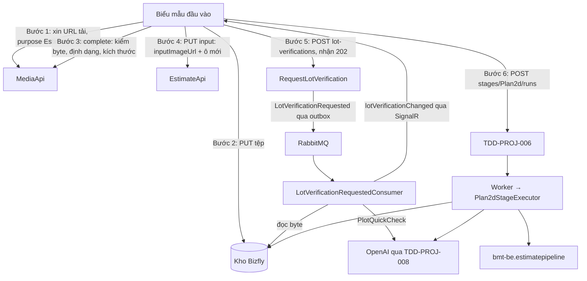
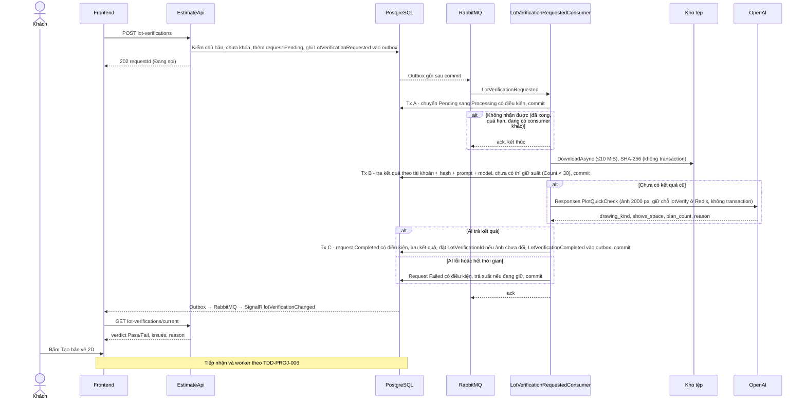
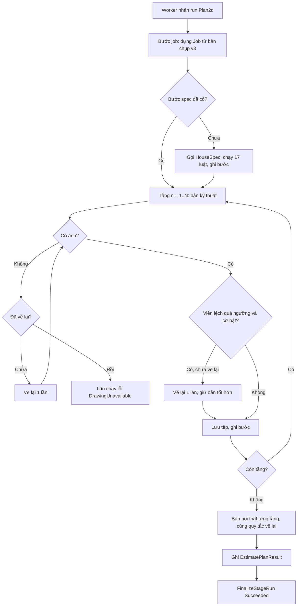
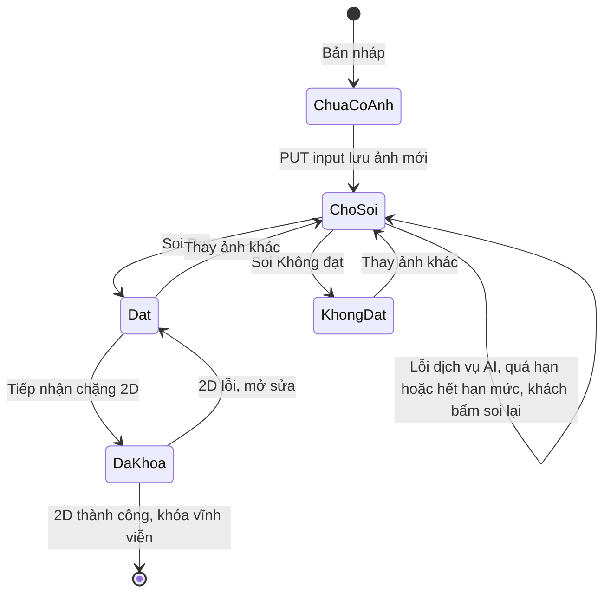
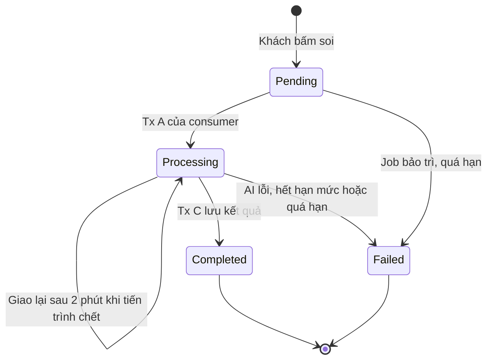
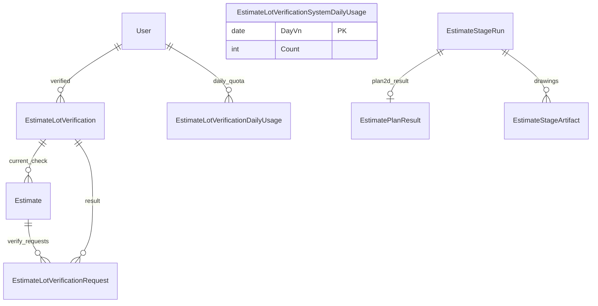

<!-- HƯỚNG DẪN CHO AI KHI ĐIỀN HOẶC CHỈNH SỬA MẪU
- Đọc toàn bộ mẫu, các comment hướng dẫn và tài liệu nguồn được cung cấp trước khi viết. Tuân thủ các quy tắc nghiệp vụ, điều kiện, ngoại lệ và giới hạn đã được xác nhận.
- Không bịa, tự chế hoặc suy đoán thành sự thật: yêu cầu, quy tắc, số liệu, API, schema, mã lỗi, nguồn tham khảo, người phụ trách và kết quả kiểm thử phải có căn cứ. Nội dung ví dụ trong mẫu không phải dữ kiện của dự án.
- Khi thiếu thông tin hoặc các nguồn mâu thuẫn, hỏi người dùng để làm rõ; giữ nguyên placeholder ở phần chưa xác định. Không tự chọn đáp án, lấp chỗ trống hay tuyên bố tài liệu đã hoàn tất.
- Chỉ thay nội dung cần điền hoặc được yêu cầu sửa. Không tự mở rộng phạm vi, sửa nghĩa quy tắc, bỏ điều kiện/ngoại lệ, xoá hay ghi đè nội dung hợp lệ đã có.
- Giữ nguyên tên, cấp và thứ tự heading, nhãn in đậm, tiền tố bullet, cấu trúc danh sách, tên/thứ tự/số cột bảng và cú pháp code fence. Không dịch, đổi tên, gộp hoặc thêm mục ngoài cấu trúc mẫu.
- Chỉ lặp khối luồng, AC hoặc API theo đúng khuôn khi có căn cứ; chỉ bỏ phần tuỳ chọn khi hướng dẫn riêng của mẫu cho phép và đã xác định không áp dụng.
- Mã tham chiếu và section phải trỏ tới tài liệu có thật đã được cung cấp hoặc kiểm chứng. Không giữ mã ví dụ như tham chiếu thật và không tự tạo tài liệu liên quan để hợp thức hoá liên kết.
- Giữ các comment hướng dẫn trong file. Xuất Markdown UTF-8, mỗi file một tài liệu; không bọc toàn bộ file trong code fence, không chèn lời dẫn hay giải thích ngoài mẫu.
- Trước khi bàn giao, đối chiếu nội dung với nguồn, kiểm tra cấu trúc, giá trị cho phép, giới hạn độ dài và tính nhất quán của mã/tham chiếu. Báo rõ phần chưa đủ thông tin; không tuyên bố đã chạy test hoặc import khi chưa thực hiện.
-->

<!-- Thay mã TDD-001 và nội dung ví dụ; giữ nguyên heading và nhãn in đậm.
Sơ đồ dùng mermaid, plantuml hoặc URL. Giữ heading Architecture, Sequence Diagram, Activity Diagram, State Diagram, Data Model.
Ví dụ API phải có heading trùng METHOD /path trong Endpoints. Xoá phần API/sơ đồ không dùng.
Version, Updated At và Change Log do lịch sử phiên bản quản lý, để trống khi nhập mới.
Author/Reviewer là tên hiển thị; gán tài khoản, phê duyệt, giả định và câu hỏi mở trên giao diện sau import.
Thiết kế phải truy vết về Story và Business Rule được cung cấp. Phân biệt thiết kế đề xuất với implementation đã kiểm chứng; không mô tả API/schema/sơ đồ ví dụ như hệ thống thật hoặc tự quyết định nghiệp vụ còn thiếu.
BẮT BUỘC KHI HOÀN THIỆN MẪU: phải có cả Reviewer và Approver, mỗi tên 1–200 ký tự sau khi bỏ khoảng trắng đầu/cuối. Không xoá hai dòng metadata, để trống, dùng tên bịa hoặc giữ placeholder rồi coi là hoàn tất.
Nếu chưa biết người review hoặc người phê duyệt, phải hỏi người dùng và báo tài liệu chưa đủ thông tin; không tự lấy Author/Owner làm người thay thế. Tên trong file không tự gán tài khoản hoặc xác nhận đã duyệt; gán thành viên trên giao diện sau import.
Đây là yêu cầu hoàn thiện mẫu; backend hiện vẫn nhận file cũ thiếu hai trường để tương thích.

VALIDATION CHO FILE NHẬP (đối chiếu ImportSnapshotValidator, MarkdownParser và ImportService):
- Mỗi file .md UTF-8 không rỗng chỉ có một heading cấp 1 chứa mã tài liệu dài 1–100 ký tự. Mã không được trùng trong cùng lần nhập hoặc thuộc loại tài liệu khác đã tồn tại.
- Không dùng tên README.md hoặc sitemap.md vì importer bỏ qua. Giao diện nhận .md/.zip, tối đa 2.000 file, tổng file tải lên 31 MiB; API giới hạn request 32 MiB và tổng nội dung đọc/giải nén 64 MiB.
- Chỉ nhập đè tài liệu cùng loại đang Draft, chưa có phiên bản và chưa lưu trữ. Import thay toàn bộ nội dung bản nháp, vì vậy phải giữ lại nội dung hợp lệ ngoài phần được yêu cầu sửa.
- Không dùng Status trong Markdown hoặc tên Approver để tự xác nhận phê duyệt; import không cấp quyền hay gán tài khoản từ tên. Chạy Kiểm tra file và xử lý lỗi/cảnh báo trước khi nhập.
- Giới hạn độ dài bên dưới tính theo string.Length của .NET (đơn vị UTF-16); không tự cắt ngắn dữ kiện quan trọng để vượt validation, hãy viết lại có căn cứ hoặc hỏi người dùng.
- Feature tối đa 300 ký tự và được dùng làm tiêu đề tài liệu. Status được parser nhận: Draft / In Review / Approved / Deprecated; tài liệu nhập mới vẫn có trạng thái phê duyệt Draft.
- Endpoint: đường dẫn tối đa 500 ký tự; tên/mô tả endpoint được lưu trong Name tối đa 300. HTTP method: GET / POST / PUT / PATCH / DELETE / HEAD / OPTIONS.
- Error Codes: mã tối đa 100 ký tự, không trùng trong tài liệu; giữ dạng - **CODE** (400): mô tả. HTTP status trong Error Codes và Response phải là số nguyên đọc được bằng Int32; không tự đặt status khác hợp đồng API.
- URL sơ đồ tối đa 1.000 ký tự. Mục sơ đồ được sử dụng phải có khối mermaid/plantuml hoặc URL theo mẫu; không để một mục sơ đồ rỗng. Nhãn mục được tách từ bullet như tên External API Fields tối đa 300 ký tự.
- Heading Examples phải khớp METHOD /path ở Endpoints. Giữ các nhãn Request:, Response 200: (thay mã theo contract) và Error Response: để parser tách đúng dữ liệu.
- Tham chiếu dạng DOC-KEY/section: ghi chú: mã đích tối đa 100 ký tự, section tối đa 100, ghi chú tối đa 1.000. Không trùng bộ mã đích + section + loại liên kết trong cùng tài liệu.
ĐỐI CHIẾU FORM TDD (src/features/tdds/validations.ts; form có thể chặt hơn import):
- Điền Feature, Author, Reviewer, Problem và ít nhất một Goal; các Goal/Non-goal/Notes đã thêm không được rỗng. API đã khai báo phải có endpoint và mô tả/mục đích; Fields phải có tên và ý nghĩa; Error Codes phải có mã, HTTP status và điều kiện.
- Form còn kiểm tra Version, Updated At và nội dung Change Log khi khai báo; với file nhập mới, giữ các trường lịch sử này trống theo hợp đồng import, không tự tạo dữ liệu lịch sử.
-->

# TDD-PROJ-007

## Document Info

- **Feature**: Tạo dự toán — đầu vào mới, ảnh lô đất và soi ảnh, chặng Bản vẽ 2D
- **Author**: Claude
- **Reviewer**: Tân Trần
- **Approver**: Tân Trần
- **Status**: Draft
- **Version**:
- **Updated At**:

## Context & Goals

### Problem

Chặng đầu tiên của luồng bốn chặng (TDD-PROJ-006) cần đầu vào mà biểu mẫu hiện tại chưa có: ảnh lô đất bắt buộc và đã được AI soi, số phòng ngủ, gara, kích thước lô thay cho Diện tích (BR-PROJ-001, 002, 015). Danh mục phải gắn mã gốc của app demo và mô tả cho AI (BR-PROJ-004 khoản 19–24). Sau đó chặng 2D phải lập phương án và vẽ bản vẽ đúng như app demo `design-estimate` ở commit `059e876`, prompt `2d-13`, quy tắc soi ảnh `drawing-v12` (STORY-PROJ-002).

Hiện trạng mã (đối chiếu 11/10/2026): `Estimate` có `AreaM2 numeric(28,2)`, `Description varchar(500)`, `InputImageUrl`; `EstimateInputPolicy.FindMissingForGeneration` đòi diện tích và "ảnh hoặc mô tả"; upload ảnh dùng purpose `Image` tối đa 5 MiB (TDD-MEDIA-001); app demo chạy 2D qua hai endpoint (`/api/plan2d/generate` vẽ bản kỹ thuật, `/api/plan2d/furniture` vẽ bản nội thất), tuần tự từng tầng, mỗi lần gọi một project mới. Mọi bảng, lớp và API dưới đây là thiết kế đề xuất.

Hai quyết định cùng ngày 11/10/2026 khác bản nháp đầu: bước soi ảnh không đọc kích thước lô (ở chế độ AI thật, app demo không đọc); bản vẽ 2D được vẽ lại 1 lần khi AI không trả ảnh hoặc viền nhà lệch tỷ lệ quá 5% so với lô, có cờ tắt phần viền lệch.

### Goals

- Lưu được đầu vào mới bằng tự lưu hiện có (InputVersion, changedFields, receipt), không phá bản nháp cũ.
- Ảnh lô được kiểm tệp ở bước hoàn tất upload và được soi bằng AI bất đồng bộ (gửi yêu cầu nhận 202, kết quả báo về qua SignalR); kết quả soi được nhớ theo tài khoản, ảnh, prompt và model; mỗi tài khoản tối đa 30 lần soi mới mỗi ngày.
- Chặng 2D tạo phương án và đủ bản vẽ kỹ thuật, bản vẽ nội thất cho mọi tầng; kết quả bằng app demo trên các bộ dữ liệu đối chiếu.
- Mọi bước tốn tiền có điểm lưu; gián đoạn chỉ mất bước đang dở.

### Non-goals

- Nhiều ảnh, mỗi ảnh một tầng; vẽ lô trên khung vẽ; sửa đồ đạc từng phòng sau 2D (các tính năng này có ở app demo).
- Sửa lỗi chất lượng đã biết của prompt `2d-13` (tự thêm giếng trời, `wc_count = 0`).
- Màn quản trị bộ quy tắc AI và prompt (STORY-PROJ-013, sau đợt 4). Đợt 1 chỉ nạp sẵn dữ liệu và đọc từ bảng.

## Architecture



**Notes**:

**A. Đầu vào mới trên `Estimate` và hợp đồng lưu**

- Thêm cột `LotFrontageM`, `LotDepthM` (`numeric(6,2)`, NULL), `EntranceSide` (NULL, không có mặc định; NULL nghĩa là khách chưa bấm cạnh nào trong khối xác nhận và chặng 2D dùng cạnh trái, ghi nhận là mặc định — BR-PROJ-002 khoản 5, chốt 12/10/2026), `DesiredBedrooms` (int NULL), `HasGarage` (bool NN, mặc định false), `LotVerificationId` (uuid NULL). `Description` nới tới 4000 ký tự (Rune). `AreaM2` giữ nguyên cột và dữ liệu cũ để tra cứu, nhưng luồng bốn chặng không đọc và không đòi (BR-PROJ-001 Except). Bản mới tạo có `FinishPackage='Standard'` (BR-PROJ-004 khoản 23).
- `EstimateInputDto` thêm `lotFrontageM`, `lotDepthM` (chuỗi thập phân như `areaM2`, tối đa 2 chữ số lẻ, > 0), `entranceSide` (`Left|Right|Top|Bottom` hoặc null; không bắt buộc; frontend chỉ gửi giá trị khi khách bấm một cạnh, chưa bấm thì gửi null như app demo gửi rỗng), `desiredBedrooms` (1–10), `hasGarage`. Các tên này vào `EstimateInputFields`, nên `changedFields` và hash chống gửi lặp tự bao phủ. Validator giữ kiểu kiểm hiện có: sai dạng trả 422 `InvalidEstimateInput` theo trường. Hai ô kích thước lô không có ràng buộc "đi cùng" ở bước lưu, vì bản nháp được dở dang (BR-PROJ-001 khoản 4); ràng buộc nằm ở bước kiểm trước 2D.
- `EstimateInputPolicy.FindMissingForStage(Plan2d, state, catalog, rules)` thay `FindMissingForGeneration` khi luồng mới bật. Trả danh sách trường thiếu: `inputImageUrl`, `lotVerification` (chưa Đạt hoặc không khớp ảnh hiện tại), `desiredBedrooms`, `lotSize` (chỉ có một ô), địa chỉ và tọa độ như cũ, `buildingTypeId`, `finishPackage`, số tầng, tum, phong cách theo nhóm bật, `catalogMapping` (loại hoặc phong cách chưa gắn mã gốc, hoặc phong cách nội thất thiếu mô tả cho AI), `pricingRegion` (tỉnh không có trong bảng miền giá). Không còn đòi `areaM2` hay `imageOrDescription`.
- **Kiểm lô trước khi giữ lượt (người dùng xác nhận 11/10/2026, BR-PROJ-001 khoản 8):** app demo từ chối lô ngoài giới hạn trước khi gọi AI (cạnh 2,5–120 m, diện tích 12–5.000 m²). Thiết kế đặt kiểm này trong `FindMissingForStage` với giới hạn đọc từ bộ quy tắc theo mã gốc; lô sai trả 422 `InvalidStageInput` trường `lotSize`, không giữ lượt. Khách biết sớm và không tốn một lần chạy.
- `SaveEstimateInputCommandHandler` giữ thứ tự kiểm cũ; `EnsureInputUnlocked` dùng `IsInputLocked` của TDD-PROJ-006. Khi `inputImageUrl` đổi, `LotVerificationId` được đặt NULL cùng lần lưu (kết quả soi đi theo ảnh, BR-PROJ-002 khoản 6).

**B. Danh mục: mã gốc và mô tả cho AI**

- `CatalogBuildingType` thêm `BaseCode` (`nha-pho|villa-biet-thu|nha-mai|nha-vuon-cap4|can-ho`, NULL được) và `DefaultBaseStyleCode` (NULL được). `DefaultBaseStyleCode` dùng khi loại không cho chọn phong cách kiến trúc (ví dụ Căn hộ: `hien-dai`), vì luật mái, bảng màu và khung giá của app demo cần một mã phong cách cho mỗi loại.
- `CatalogStyle` thêm `BaseStyleCode` (phong cách kiến trúc; phải thuộc danh sách phong cách của mã gốc trong app demo, ví dụ `nha-mai` chỉ có `mai-thai-hien-dai`, `mai-nhat-hien-dai`) và `PromptDescriptor` (phong cách nội thất; 1–1.000 ký tự có nội dung).
- `CatalogConfigurationPolicy` kiểm khi lưu: mã gốc thuộc danh sách; mã phong cách gốc hợp lệ với mọi loại mà phong cách được gán; phong cách nội thất mới hoặc sửa phải có `PromptDescriptor` (BR-PROJ-004 khoản 21). Cho phép lưu loại chưa có mã gốc (khoản 19); bản dự toán dùng loại đó bị chặn ở `FindMissingForStage` với trường `catalogMapping`.
- Số tầng: `CatalogFloor.FloorCount` thêm CHECK 1–4. Migration kiểm trước: nếu có dòng 5 (trang mẫu cũ có "Trệt + 4 lầu") thì dừng và báo, không tự xóa; người dùng quyết định cách chuyển.
- Revision danh mục là bất biến và chép toàn bộ dòng (TDD-PROJ-001), nên các cột mới cũng được chép. Bản dự toán cũ ghim revision cũ có NULL ở các cột mới; Admin lưu một revision mới có mã gốc thì bản dự toán mới mới dùng được. Bản nháp cũ chạy 2D bị chặn với `catalogMapping` cho tới khi khách tạo bản mới (BR-PROJ-004 khoản 9 giữ cấu hình cũ). Người dùng xác nhận ngày 11/10/2026: giữ nguyên tắc ghim revision, khách tạo bản mới; không sửa revision cũ.

**C. Ảnh lô đất: upload riêng**

- Thêm purpose `EstimateLotImage` vào `MediaConstants`: JPG/PNG/WebP, tối đa 10 MiB (10.485.760 byte). Yêu cầu xin URL tải với purpose này phải có `estimateId`; backend kiểm khách là chủ bản và `IsInputLocked=false` (BR-MEDIA-001 khoản 2). Cập nhật CHECK `CK_MediaUpload_Size` và `CK_MediaUpload_Type`.
- `MediaUploadPayload.PrepareAsync` với purpose này đọc kích thước ảnh qua `IMediaImageValidator.IdentifyAsync`: từ chối dưới 640×480 (cạnh dài × cạnh ngắn), trên 40 triệu điểm ảnh (chống ảnh nén "bom") và tỷ lệ cạnh dài/cạnh ngắn trên 3. Tỷ lệ 3 là giới hạn của app demo, người dùng xác nhận đưa vào BR-PROJ-015 khoản 1 ngày 11/10/2026. Ảnh bị từ chối không có URL xem, nên không tới được bước soi (BR-PROJ-015 khoản 1).

**D. Soi ảnh bất đồng bộ (`RequestLotVerificationCommandHandler` + `LotVerificationRequestedConsumer`)**

Người dùng chốt ngày 12/10/2026: soi ảnh bất đồng bộ qua RabbitMQ/outbox; consumer làm việc theo **ba transaction ngắn ngay trong flow của consumer**, tắt inbox của MassTransit cho riêng endpoint này, ack tin khi xong. Kết quả đẩy về qua SignalR.

- **Gửi yêu cầu** `POST /estimates/{id}/lot-verifications` (không body), một transaction:
  1. Phiên khách, chủ bản; khóa `Estimate` (`FOR NO KEY UPDATE`). Bản bị khóa đầu vào → 409 `EstimateInputLocked`. Không có ảnh → 422 `LotImageRequired`.
  2. Đã có yêu cầu `Pending` hoặc `Processing` cho đúng bản và đúng `InputImageUrl` hiện tại → trả yêu cầu đó (200), không tạo thêm.
  2a. Kiểm nhanh, chỉ đọc (BR-PROJ-015 khoản 10–11): nhà cung cấp của việc `lotVerify` đang tạm ngắt (`IAiCircuitBreaker`, TDD-PROJ-008) → 503 `AiServiceUnavailable`; bộ đếm chung của ngày `EstimateLotVerificationSystemDailyUsage.Count` ≥ `LotVerifySystemDailyLimit` → 503 `LotVerificationBusy`. Không tạo yêu cầu. Bước này chỉ để báo sớm; chặn thật nằm ở Tx B. Ảnh đã có kết quả cũ cũng bị báo bận ở bước này vì lúc nhận yêu cầu chưa tính hash; khách thử lại sau.
  3. Thêm `EstimateLotVerificationRequest` State=`Pending`, `DeadlineUtc` = now + `LotVerifyTimeoutSeconds` (mặc định 90); `Publish(LotVerificationRequested(requestId))` qua outbox trong cùng transaction; trả 202. Frontend hiện "Đang soi".
- **Vì sao consumer này tắt inbox:** MassTransit trong `bmt-be` bọc mọi consumer bằng `UseEntityFrameworkOutbox` — mở một transaction DB trước khi gọi `Consume()` và chỉ commit khi `Consume()` kết thúc. Nếu giữ cơ chế này, mọi transaction "ngắn" bên trong chỉ là transaction lồng, kết nối DB và khóa dòng vẫn bị giữ suốt thời gian chờ AI (tới 90 giây), dễ cạn pool kết nối. Endpoint `lot-verification-requested` được cấu hình riêng không dùng `UseEntityFrameworkOutbox`, `ConcurrentMessageLimit = 4` mỗi instance. Chống xử lý trùng không dựa vào inbox mà dựa vào điều kiện trạng thái trong DB ở từng bước (dưới đây).
- **Xử lý trong `Consume()`**, mỗi transaction dùng một scope/`DbContext` riêng và commit ngay:
  1. **Tx A — nhận việc (vài ms):** `UPDATE … SET State='Processing', ProcessingSince=now(), Attempts=Attempts+1 WHERE Id=@id AND DeadlineUtc>now() AND (State='Pending' OR (State='Processing' AND ProcessingSince < now() - interval '2 minutes'))`. Không có dòng nào được cập nhật (đã xong, đã lỗi, quá hạn, hoặc consumer khác đang làm) → ack, kết thúc. Điều kiện `Processing` quá 2 phút cho phép nhận lại khi lần giao trước bị chết giữa chừng.
  2. **Không transaction:** đổi URL sang khóa kho (ảnh phải là `MediaObject` Ready purpose `EstimateLotImage`), tải byte qua `IMediaObjectStore.DownloadAsync` giới hạn 10 MiB, tính SHA-256; dựng prompt soi đã ghép (khung trong mã + phần lời dặn từ bộ quy tắc, TDD-PROJ-008) và tính `PromptHash` = SHA-256 của văn bản prompt đã ghép.
  3. **Tx B — tra kết quả cũ và giữ suất (vài ms):** tra `EstimateLotVerification` theo `(AccountId, ImageSha256, PromptHash, RequestedModel)`. Có → nhảy tới Tx C với kết quả đó, không gọi AI, không tính hạn mức (BR-PROJ-015 khoản 6). Chưa có → giữ suất bằng `INSERT … ON CONFLICT (AccountId, DayVn) DO UPDATE SET Count=Count+1 WHERE Count < @limit RETURNING Count`; không trả dòng → yêu cầu `Failed` `LotVerificationQuotaExceeded` (cùng transaction, có điều kiện `State='Processing'`), ack. Có suất của tài khoản thì giữ tiếp suất chung bằng câu tương tự trên `EstimateLotVerificationSystemDailyUsage (DayVn)` với `@systemLimit`; không trả dòng → rollback Tx B (suất tài khoản không bị tính), rồi một transaction ngắn chuyển yêu cầu `Failed` `LotVerificationBusy`, ack. Nếu câu giữ suất chung làm `Count` vượt 80% trần lần đầu trong ngày (`UPDATE … SET AlertedAtUtc=now() WHERE DayVn=@d AND AlertedAtUtc IS NULL AND Count >= ceil(0.8*@systemLimit) RETURNING`), gửi cảnh báo Discord `LotVerificationSystemQuotaHigh` sau commit. Trả dòng → đặt `QuotaHeld=true, QuotaDayVn=@day` có điều kiện `State='Processing' AND QuotaHeld=false`. **Upsert có điều kiện** kiểm và tăng bộ đếm trong một câu lệnh nguyên tử: hai yêu cầu cùng lúc khi còn đúng 1 suất thì chỉ một bên được.
  4. **Không transaction — gọi AI:** giữ chỗ nhóm `lotVerify` ở Redis (TDD-PROJ-008), thu ảnh về cạnh dài 2000 điểm, Responses API với schema `PlotQuickCheck`, prompt `drawing-v12`. Model soi không khả dụng thì thử lại một lần bằng model văn bản, như app demo. Mỗi lời gọi chỉ dùng phần thời gian còn lại tới `DeadlineUtc`.
  5. **Tx C — lưu kết quả (~10 ms):** `UPDATE … SET State='Completed', VerificationId=@v, CompletedAtUtc=now() WHERE Id=@id AND State='Processing' RETURNING …`. Không có dòng (job bảo trì đã chốt Failed vì quá hạn) → rollback, ack; kết quả AI bỏ. Có dòng → thêm `EstimateLotVerification` (lưu cả `RequestedModel` lẫn `ModelUsed` thật khi phải dùng model dự phòng), đặt `Estimate.LotVerificationId` **chỉ khi** `InputImageUrl` vẫn là ảnh của yêu cầu và đầu vào chưa khóa (không tăng `InputVersion`), phát `LotVerificationCompleted(requestId, estimateId, ownerId)` bằng `IPublishEndpoint` lấy từ scope của chính transaction này — đi qua bus outbox đã cấu hình, nên tin chỉ được gửi khi Tx C commit. Commit, rồi ack.
  6. **Lỗi AI hoặc hết thời gian:** một transaction ngắn `UPDATE … SET State='Failed', FailureCode='LotVerificationUnavailable', QuotaHeld=false, CompletedAtUtc=now() WHERE Id=@id AND State='Processing' RETURNING (giá trị QuotaHeld trước khi đổi), QuotaDayVn`; chỉ khi giá trị cũ là true mới trả suất trong **cùng** transaction: giảm `Count` của cả `EstimateLotVerificationDailyUsage` (tài khoản) lẫn `EstimateLotVerificationSystemDailyUsage` (chung) của ngày `QuotaDayVn`. Nhờ điều kiện này, suất không bao giờ bị trả hai lần dù consumer và job bảo trì cùng chốt một yêu cầu. Ack.
  7. Ánh xạ kết quả như app demo: `drawing_kind=none` → Không đạt `not_a_plot`; `shows_space=false` → `no_layout`; `plan_count>1` và không phải trích lục → `multiple_floors`. Mã cảnh báo khác (ví dụ `illegible` khi độ rõ < 40) chỉ ghi lại, không chặn.
- **Tiến trình chết giữa chừng:** tin chưa được ack nên RabbitMQ giao lại; Tx A nhận lại yêu cầu `Processing` đã quá 2 phút. Lời gọi AI dở dang bị mất (tốn tiền một lần), suất hạn mức đã giữ vẫn giữ nguyên và được dùng cho lần làm lại.
- **Job bảo trì (`EstimatePipelineMaintenanceJob`, TDD-PROJ-006, luôn chạy):** yêu cầu `Pending`/`Processing` có `DeadlineUtc <= now` → chuyển `Failed` `LotVerificationUnavailable` bằng đúng câu lệnh có điều kiện ở bước 6 (trả suất nếu đã giữ).
- **Báo kết quả**: consumer của `LotVerificationCompleted` (việc ngắn) đẩy `lotVerificationChanged` tới nhóm `user:{ownerId}` của `EstimateHub` (TDD-PROJ-006); frontend gọi `GET lot-verifications/current`. Không có SignalR thì frontend hỏi lại mỗi 3 giây trong lúc `Pending`/`Processing`.
- Tiếp nhận 2D (TDD-PROJ-006 bước 8) kiểm `LotVerificationId` trỏ tới dòng Đạt có `ImageUrl` trùng `Estimate.InputImageUrl`. Không kiểm lại model hay prompt (BR-PROJ-015 khoản 9).

**E. Bản chụp đầu vào phiên bản 3**

`EstimateGenerationInput.Payload` (SchemaVersion=3) chụp lúc tiếp nhận 2D, gồm: `estimateId, inputVersion, catalogRevisionId, buildingType{id,name,baseCode}, architectureStyle{id,name,baseStyleCode}|null, interiorStyle{id,name,promptDescriptor}|null, effectiveBaseStyleCode, finishPackage, floorCount, hasTum, description, lot{frontageM,depthM}|null, entranceSide|null, desiredBedrooms, hasGarage, address{…như v2, có latitude, longitude}, pricingRegion{region,tableVersion}, lotImage{url,objectKey,sha256,width,height,verificationId}`. Không có tên bản dự toán. `MediaSourceReader` thêm `InputV3` vào CASE và `MediaTextExtractor` đọc `lotImage.url`, như V1/V2 đọc `inputImageUrl`.

**F. Chặng 2D: `Plan2dStageExecutor`**

Executor ghép hai endpoint của app demo thành một lần chạy, giữ đúng thứ tự và cách tham chiếu ảnh:

| Bước (StepKey) | Việc | Nguồn trong app demo | Gọi AI |
|---|---|---|---|
| `job` | Dựng Job từ bản chụp: chuẩn hóa văn bản, đọc mô tả (`BriefReader`), lô của khách (`CustomerLot`), cạnh cửa vào nếu khách đã chọn (rỗng thì dùng cạnh trái, ghi `frontage_sheet_edge_from=default` và cờ `entrance_side_default` khi ảnh là bản vẽ mặt bằng), lô đề xuất khi mô tả không nêu lô | `service.normalize_request`, `inputs.customer_lot`, `brief.read_brief` | Không |
| `spec` | Lập phương án `HouseSpec` bằng Responses API json_schema, ảnh lô làm ảnh tham chiếu; sau đó chạy `SpecRuleEngine` (17 luật theo đúng thứ tự `enforce_spec_rules`), đếm lại phòng ngủ/WC, ghi đè trường lấy từ Job | `service.build_spec`, `enforce_spec_rules`, `lot_rules.*` | 1 lần (có thử lại trong lớp AI) |
| `plan:technical:f{n}` | Vẽ bản vẽ kỹ thuật từng tầng, từ tầng 1 lên. Tầng 1: không có ảnh tham chiếu, vẽ theo phương án đã lập. Ảnh lô chỉ được gửi ở bước `spec`, giống app demo; app demo chỉ đính ảnh của khách vào bản vẽ tầng 1 khi ảnh đó là mặt bằng do khách vẽ, việc này nằm ngoài luồng sản phẩm. Tầng trên: bản kỹ thuật các tầng dưới | `service.render_floor_image`, `gate.generate_checked`, `prompts.technical_prompt` | 1 lần mỗi tầng, +1 khi vẽ lại |
| `plan:furniture:f{n}` | Vẽ bản nội thất từng tầng; tham chiếu bản kỹ thuật của tầng và bản nội thất các tầng dưới; prompt có mức đồ đạc theo gói và mô tả cho AI của phong cách nội thất | `service.draw_all_floors(furniture)`, `prompts.furniture_prompt` | 1 lần mỗi tầng, +1 khi vẽ lại |
| `result` | Ghi `EstimatePlanResult` (phần gửi khách và phần nội bộ) | `_finish`, `project.json` | Không |

- **Khổ giấy** chọn một lần cho cả nhà theo `frame.sheet_aspect` (3:4 hoặc 16:9, khổ nào vẽ lô lớn hơn); bản nội thất dùng khổ của bản kỹ thuật; ảnh 864×1152 hoặc 1280×720, JPEG nén 92.
- **Vẽ lại một lần** (BR-PROJ-011 khoản 7): lớp AI đã tự thử lại khi API trả 200 mà không có ảnh (tối đa 2 lần, TDD-PROJ-008). Nếu vẫn không có ảnh, executor vẽ lại bản đó một lần; vẫn không có thì lần chạy lỗi `DrawingUnavailable`. Với viền nhà: `OutlineMeasurer` (đo bằng xử lý ảnh, không gọi AI) so tỷ lệ viền tường ngoài với khung lô; lệch quá `PlanOutlineTolerance` (mặc định 0,05) hoặc độ trùng khớp hình dạng dưới `PlanOutlineMinOverlap` (0,93) và `PlanOutlineRedraw=true` thì vẽ lại một lần với khối "REGENERATION … Fix this" của app demo; giữ bản có độ lệch nhỏ hơn, gắn cờ nội bộ nếu vẫn lệch. Các trường hợp app demo miễn kiểm (lô có sân bên trong, tầng trên chép đúng tầng dưới, không đo được) giữ nguyên.
- **Lỗi dừng cả lần chạy:** hết tiền, sai khóa, bị từ chối quyền, chưa cấu hình (nhóm `SYSTEM_AI_CODES` của app demo) và nội dung bị chặn. App demo bỏ qua tầng lỗi và vẽ tiếp; hệ thống thật không công bố bộ thiếu (BR-PROJ-010 khoản 8), nên một bản vẽ không có ảnh sau lần vẽ lại làm cả lần chạy lỗi.
- **Kết quả gửi khách**: danh sách tầng (tên, diện tích, phòng: tên, diện tích, kích thước), tổng diện tích sàn, diện tích xây dựng, kích thước lô và nguồn của nó (khách nhập, đọc từ ảnh, đọc từ mô tả, mặc định), tóm tắt, giả định, lưu ý cho khách (gồm lý do ít phòng hơn mong muốn, không có gara), danh sách bản vẽ `{floorIndex, floorName, kind, artifactId, width, height}`. **Phần nội bộ**: cờ cho nhân viên (`bedrooms_mismatch`, `garage_missing`, `lot_irregular`, `entrance_side_default`…), các luật đã sửa, kết quả đo viền, phiên bản prompt, model.
- **Quy tắc đọc từ bảng** (BR-PROJ-019, phiên bản đã chốt ở lần chạy): lô mặc định theo mã gốc (5×20, 12×15, 10×14, 10×16, 9×10; dự phòng 6×15), giới hạn lô (cạnh 2,5–120 m, diện tích 12–5.000 m²), gara (mặt tiền 4,5 m và 3,0 m, tối thiểu 12 m²), phòng ngủ (9 m², cạnh 2,4 m), mức đồ đạc theo gói cho chặng 2D, lời dặn chung phạm vi `Plan2d`, phần lời dặn của prompt `plan2d.spec`, `plan2d.technical`, `plan2d.furniture`. Các hằng số hình học khác (cầu thang 2,2–2,6 × 4,0–4,8 m, dung sai, ngưỡng đo ảnh) giữ trong mã vì là chi tiết thuật toán.
- **Miền giá** chỉ đưa vào prompt như văn bản; app demo không rẽ nhánh luật 2D theo miền.

**G. Đối chiếu với app demo (parity)**

- Script chỉ dùng khi phát triển ở `bmt-be/test/parity/` chạy các hàm thuần của app demo (commit `059e876`) trong venv riêng, xuất bộ dữ liệu vào → ra dạng JSON vào `test/parity/fixtures/plan2d/`: `read_brief`, `customer_lot`, `enforce_spec_rules` (đầu vào là HouseSpec thô ghi từ các lần chạy thật), `frame_layout`/`sheet_aspect`, `measure`/`assess` (ảnh bản vẽ thật), các hàm dựng prompt (so nguyên văn).
- Test xUnit trong `test/bmt-be.estimatepipeline.tests` chạy lại các bộ này; prompt phải trùng từng ký tự, kết quả luật trùng từng trường; đo viền cho phép sai số dưới 1% vì ImageSharp và Pillow làm tròn khác nhau.
- Chế độ Fake phát lại phản hồi `HouseSpec` và ảnh bản vẽ ghi từ các hồ sơ mẫu còn trong `design-estimate/data/projects` (19 hồ sơ cũ).

## Sequence Diagram



## Activity Diagram



## State Diagram



Đây là vòng đời ảnh lô của một bản dự toán, tính từ `InputImageUrl`, `LotVerificationId` và lần chạy 2D; không có cột trạng thái riêng.

Vòng đời của một yêu cầu soi (`EstimateLotVerificationRequest.State`):



Chỉ `Processing → Failed` mới có thể trả suất hạn mức (khi `QuotaHeld` đang là true). Mọi chuyển trạng thái đều là câu lệnh `UPDATE` có điều kiện trạng thái cũ, nên consumer và job bảo trì chạy cùng lúc không ghi đè nhau.

## Data Model

| Bảng mới/thay đổi | Một dòng là gì, ai ghi, khi nào |
|---|---|
| Estimate (sửa) | Một bản dự toán như cũ; thêm sáu cột đầu vào và một con trỏ tới kết quả soi đang áp dụng. Ghi bởi PUT input; `LotVerificationId` ghi bởi API soi hoặc bị xóa khi ảnh đổi. |
| CatalogBuildingType, CatalogStyle, CatalogFloor (sửa) | Như TDD-PROJ-001; thêm mã gốc, mã phong cách gốc, mô tả cho AI; CHECK số tầng 1–4. Ghi khi Admin lưu revision. |
| EstimateLotVerificationRequest (mới) | Một lần khách bấm soi ảnh của một bản dự toán. Ghi bởi API (Pending); consumer chuyển Processing rồi Completed/Failed; job bảo trì chuyển Failed khi quá hạn. Là thứ frontend theo dõi khi "Đang soi". |
| EstimateLotVerification (mới) | Một kết quả AI soi một ảnh (theo nội dung) cho một tài khoản, với một phiên bản prompt và model. Ghi bởi consumer; bất biến; dùng lại khi cùng tài khoản tải lại đúng ảnh đó. |
| EstimateLotVerificationSystemDailyUsage (mới) | Bộ đếm số lần soi mới của cả hệ thống trong một ngày giờ Việt Nam (BR-PROJ-015 khoản 10). Upsert cùng Tx B với bộ đếm tài khoản; giảm cùng lúc khi trả suất. Một dòng mỗi ngày. |
| EstimateLotVerificationDailyUsage (mới) | Bộ đếm số lần soi mới của một tài khoản trong một ngày giờ Việt Nam. Upsert bởi consumer soi; giảm khi AI lỗi hoặc quá hạn. |
| EstimatePlanResult (mới) | Kết quả đã công bố của một lần chạy 2D thành công: phần gửi khách và phần nội bộ. Ghi bởi executor ở bước cuối, trước finalize; chỉ đọc qua route khi run Succeeded. |
| MediaUpload, MediaObject (sửa CHECK) | Thêm purpose `EstimateLotImage` vào CHECK kích thước và loại tệp. |

| Bảng | Cột, null và ràng buộc |
|---|---|
| Estimate — cột mới | LotFrontageM numeric(6,2) NULL CHECK NULL OR > 0; LotDepthM numeric(6,2) NULL CHECK NULL OR > 0; EntranceSide varchar(8) NULL CHECK NULL OR IN ('Left','Right','Top','Bottom'); DesiredBedrooms int NULL CHECK NULL OR BETWEEN 1 AND 10; HasGarage boolean NN DEFAULT false; LotVerificationId uuid NULL FK (OwnerId, LotVerificationId) → EstimateLotVerification(AccountId, Id). Description đổi varchar(4000). |
| CatalogBuildingType — cột mới | BaseCode varchar(32) NULL CHECK NULL OR IN (5 mã); DefaultBaseStyleCode varchar(64) NULL. |
| CatalogStyle — cột mới | BaseStyleCode varchar(64) NULL; PromptDescriptor varchar(1000) NULL CHECK NULL OR "PromptDescriptor" ~ '[^[:space:]]'; CHECK Group='Architecture' OR BaseStyleCode IS NULL; CHECK Group='Interior' OR PromptDescriptor IS NULL. |
| CatalogFloor | CHECK FloorCount BETWEEN 1 AND 4 (thay CHECK ≥ 1). |
| EstimateLotVerificationRequest | Id uuid PK; AccountId uuid NN; EstimateId uuid NN; ImageUrl varchar(2048) NN; State varchar(16) NN CHECK IN ('Pending','Processing','Completed','Failed'); ProcessingSince timestamptz NULL; Attempts int NN DEFAULT 0; VerificationId uuid NULL; FailureCode varchar(64) NULL; QuotaHeld boolean NN DEFAULT false; QuotaDayVn date NULL; RequestedAtUtc timestamptz NN; DeadlineUtc timestamptz NN CHECK > RequestedAtUtc; CompletedAtUtc timestamptz NULL. FK (AccountId, EstimateId) → Estimate(OwnerId, Id); FK (AccountId, VerificationId) → EstimateLotVerification(AccountId, Id). CHECK (State='Completed') = (VerificationId IS NOT NULL); CHECK State<>'Failed' OR FailureCode IS NOT NULL; CHECK QuotaHeld = (QuotaDayVn IS NOT NULL). CHECK State<>'Processing' OR ProcessingSince IS NOT NULL. Chỉ mục UNIQUE (EstimateId, ImageUrl) WHERE State IN ('Pending','Processing') (một yêu cầu đang soi cho mỗi ảnh của bản); (EstimateId, RequestedAtUtc DESC); (State, DeadlineUtc) WHERE State IN ('Pending','Processing') cho job bảo trì. |
| EstimateLotVerification | Id uuid PK; AccountId uuid NN FK User; ImageSha256 char(64) NN; ImageUrl varchar(2048) NN; Width int NN; Height int NN; PromptVersion varchar(32) NN; PromptHash char(64) NN (SHA-256 của prompt soi đã ghép, gồm phần lời dặn Admin sửa được); RequestedModel varchar(100) NN; ModelUsed varchar(100) NN (khác RequestedModel khi phải dùng model dự phòng); Verdict varchar(8) NN CHECK IN ('Pass','Fail'); Issues jsonb NN CHECK array; Reason varchar(1000) NN; DocumentType varchar(32) NN; PlanCount int NN CHECK ≥ 1; AiCallId uuid NULL FK AiCallLog; CreatedAtUtc timestamptz NN. UNIQUE (AccountId, ImageSha256, PromptHash, RequestedModel); UNIQUE (AccountId, Id). Khóa dùng lại tính theo prompt đã ghép và model được yêu cầu, nên Admin sửa lời dặn của prompt soi thì không dùng lại kết quả cũ, và lần soi phải dùng model dự phòng vẫn được tìm thấy ở lần sau (BR-PROJ-015 khoản 6). |
| EstimateLotVerificationDailyUsage | AccountId uuid NN FK User; DayVn date NN; Count int NN CHECK ≥ 0; PK (AccountId, DayVn). |
| EstimateLotVerificationSystemDailyUsage | DayVn date PK; Count int NN CHECK ≥ 0; AlertedAtUtc timestamptz NULL (lần cảnh báo 80% trong ngày). Mọi yêu cầu soi mới cập nhật cùng một dòng; với hạn mức hiện tại (vài chục lần soi mỗi phút), tranh chấp khóa trên dòng này không đáng kể. |
| EstimatePlanResult | RunId uuid PK FK EstimateStageRun; EstimateId uuid NN; CustomerJson jsonb NN CHECK object; InternalJson jsonb NN CHECK object; PromptVersion varchar(32) NN; SpecModel varchar(100) NN; ImageModel varchar(100) NN; CreatedAtUtc timestamptz NN. FK (RunId, EstimateId) → EstimateStageRun(Id, EstimateId). |



**Mẫu dữ liệu** — giả định, ID bí danh, giờ UTC (giờ Việt Nam = UTC+7), trích cột. Tiếp tục tình huống U1/D1 của TDD-PROJ-006.

| Bảng | Bước | Giá trị |
|---|---|---|
| Estimate | Trước | D1; InputVersion=7; InputImageUrl=NULL; LotFrontageM=NULL; LotDepthM=NULL; EntranceSide=NULL; DesiredBedrooms=NULL; HasGarage=false; FinishPackage=Standard; LotVerificationId=NULL |
| Estimate | PUT input lưu ảnh và 3 phòng ngủ (02:50) | InputVersion=8; InputImageUrl=https://cdn.example.test/estimates/lot/9f2c.jpg; DesiredBedrooms=3; LotVerificationId=NULL |
| EstimateLotVerificationRequest | Khách bấm soi (02:50:30); consumer nhận việc ở Tx A (02:50:31) | Id=VR1; AccountId=U1; EstimateId=D1; ImageUrl=…/9f2c.jpg; State=Pending → Processing; ProcessingSince=02:50:31; Attempts=1; QuotaHeld=false; RequestedAtUtc=02:50:30; DeadlineUtc=02:52:00. Outbox có một dòng `LotVerificationRequested(VR1)` cùng commit |
| EstimateLotVerificationDailyUsage | Tx B: không thấy kết quả cũ, giữ suất (02:50:32, tức 09:50 giờ VN) | U1, DayVn=2026-10-11, Count=1; VR1: QuotaHeld=true; QuotaDayVn=2026-10-11 |
| EstimateLotVerificationSystemDailyUsage | Cùng Tx B | DayVn=2026-10-11; Count=412; AlertedAtUtc=NULL (trần chung C1 là 1.000) |
| EstimateLotVerification | Cùng yêu cầu | Id=LV1; AccountId=U1; ImageSha256=S1; ImageUrl=…/9f2c.jpg; Width=1600; Height=1200; PromptVersion=drawing-v12; PromptHash=PH1; RequestedModel=gpt-5.4-nano; ModelUsed=gpt-5.4-nano; Verdict=Pass; Issues=[]; Reason="Bản vẽ tay mặt bằng lô đất có ghi kích thước"; DocumentType=hand_sketch; PlanCount=1 |
| Estimate, EstimateLotVerificationRequest | Tx C lưu kết quả (02:51) | D1.LotVerificationId=LV1; InputVersion vẫn 8. VR1: State=Completed; VerificationId=LV1; CompletedAtUtc=02:51. Outbox có `LotVerificationCompleted(VR1)` |
| Estimate | PUT input nhập lô 5 × 20 (02:55) | InputVersion=9; LotFrontageM=5.00; LotDepthM=20.00 |
| EstimateGenerationInput | Tiếp nhận 2D (03:00) | OperationId=O1; SchemaVersion=3; Payload.lot={frontageM:5,depthM:20}; Payload.lotImage={sha256:S1,verificationId:LV1,…}; Payload.pricingRegion={region:South,tableVersion:1} |
| EstimatePlanResult | Chặng xong (03:08) | RunId=R1; EstimateId=D1; CustomerJson={floors:[{index:1,name:"Tầng 1",rooms:[…]},…],lot:{widthM:5,depthM:20,source:"customer"},drawings:[{floorIndex:1,kind:"technical",artifactId:A1},…]}; InternalJson={staffFlags:[],ruleFixes:[…],outline:{…}}; PromptVersion=2d-13 |

Nhánh dùng lại kết quả soi: U1 tạo bản D2, tải đúng ảnh đó → yêu cầu VR2 → consumer tra thấy LV1 cùng hash, prompt, model → VR2 Completed với LV1, đặt D2.LotVerificationId=LV1, Count giữ 1, VR2.QuotaHeld=false. Nhánh lỗi: AI lỗi ở yêu cầu VR3 → VR3 Failed `LotVerificationUnavailable`, Count giảm lại, QuotaHeld=false. Tài khoản U2 tải cùng ảnh → không thấy (khác AccountId) → soi mới, tính vào hạn mức của U2.

**Notes**:

- **Vì sao kết quả soi là bảng riêng, không phải cột của Estimate:** một kết quả soi thuộc về một ảnh và một tài khoản, dùng lại được cho nhiều bản dự toán; cột trên Estimate chỉ là con trỏ "kết quả đang áp dụng". FK ghép `(OwnerId, LotVerificationId)` → `(AccountId, Id)` bảo đảm một bản không trỏ được tới kết quả soi của tài khoản khác.
- **Vì sao tách bảng yêu cầu soi khỏi bảng kết quả soi:** yêu cầu là việc của một bản dự toán ở một thời điểm (đang soi, xong, lỗi); kết quả là dữ kiện về một ảnh, dùng lại cho nhiều bản và nhiều yêu cầu. Gộp làm một thì không dùng lại được kết quả mà vẫn theo dõi được từng lần bấm.
- **Hạn mức theo ngày** dùng bảng đếm thay vì đếm dòng `EstimateLotVerification` trong ngày, vì cần trả suất khi AI lỗi mà không xóa dữ liệu, và vì upsert có điều kiện chống vượt hạn mức khi gửi đồng thời. Ngày tính bằng `(now AT TIME ZONE 'Asia/Ho_Chi_Minh')::date`.
- **Không lưu ảnh hay câu trả lời thô của AI ở bảng soi**; bản thô (đã bỏ ảnh) nằm ở `AiCallLog` theo TDD-PROJ-008.
- **Migration** `EstimatePipelinePlan2d`: thêm cột Estimate (mặc định `Left`/`false` cho dòng cũ), nới `Description`; thêm cột danh mục; đổi CHECK `CatalogFloor` sau bước kiểm không có số tầng 5; thêm ba bảng; sửa CHECK media. Down chỉ chạy khi các cột mới còn trống.
- **Kiểm chứng:** unit test cho validator mới, `FindMissingForStage`, `CatalogConfigurationPolicy`, ánh xạ kết quả soi, dùng lại theo hash, hạn mức (biên 30, trả suất khi lỗi). Integration PostgreSQL cho upsert hạn mức đồng thời, FK ghép kết quả soi, CHECK mới. Parity cho mọi hàm thuần ở mục G. Đầu-cuối Fake: ST-PROJ-128–139, 160–173.

## Internal API

### Endpoints

- **PUT** `/api/v1/estimates/{estimateId}/input` — Như TDD-PROJ-001; `input` thêm `lotFrontageM`, `lotDepthM`, `entranceSide` (không bắt buộc), `desiredBedrooms`, `hasGarage`; `description` tối đa 4000.
- **POST** `/api/v1/estimates/{estimateId}/lot-verifications` — Khách là chủ bản; gửi yêu cầu soi ảnh lô đang gắn với bản; bất đồng bộ. 202 với `{requestId, state:"Pending"}`; đã có yêu cầu Pending cho đúng ảnh thì 200 với yêu cầu đó.
- **GET** `/api/v1/estimates/{estimateId}/lot-verifications/current` — Yêu cầu soi mới nhất cho ảnh hiện tại: `Pending`, `Completed` kèm kết quả (`verdict`, `issues`, `reason`, `reused`, `remainingToday`), hoặc `Failed` kèm `failureCode`; chưa từng soi thì 404 `LotVerificationRequired`.
- **POST** `/api/v1/media/uploads` — Như TDD-MEDIA-001; purpose `EstimateLotImage` bắt buộc kèm `estimateId`.
- **GET** `/api/v1/estimates/{estimateId}/stages/Plan2d/result` — Kết quả 2D gửi khách (TDD-PROJ-006).
- **POST** `/api/v1/admin/estimate-catalog/building-types` và **PUT** `/api/v1/admin/estimate-catalog/building-types/{buildingTypeId}` — Như TDD-PROJ-001; thêm `baseCode`, `defaultBaseStyleCode`.
- **POST** `/api/v1/admin/estimate-catalog/styles` và **PUT** `/api/v1/admin/estimate-catalog/styles/{styleId}` — Thêm `baseStyleCode` (kiến trúc) hoặc `promptDescriptor` (nội thất).

### Examples

#### POST /api/v1/estimates/{estimateId}/lot-verifications

```
Request:
POST không body, phiên chủ sở hữu, Origin hợp lệ

Response 202:
{"value":{"requestId":"9a41…","state":"Pending","deadlineUtc":"2026-10-11T02:52:00Z"},"isSuccess":true,"isFailure":false,"error":{"code":"","message":""}}

Error Response:
{"title":"Conflict","code":"EstimateInputLocked","status":409,"detail":"Đầu vào đang bị khóa, không thể soi ảnh mới.","messageCode":"EstimateInputLocked","errors":null}
```

#### GET /api/v1/estimates/{estimateId}/lot-verifications/current

```
Request:
GET với phiên chủ sở hữu

Response 200:
{"value":{"requestId":"9a41…","state":"Completed","verdict":"Fail","issues":[{"code":"not_a_plot","message":"Ảnh chụp công trình thực tế, không phải bản vẽ."}],"reason":"Ảnh chụp ngôi nhà đang xây.","reused":false,"remainingToday":28},"isSuccess":true,"isFailure":false,"error":{"code":"","message":""}}

Error Response:
{"title":"Not Found","code":"LotVerificationRequired","status":404,"detail":"Ảnh lô chưa được soi.","messageCode":"LotVerificationRequired","errors":null}
```

#### GET /api/v1/estimates/{estimateId}/stages/Plan2d/result

```
Request:
GET với phiên chủ sở hữu

Response 200:
{"value":{"runId":"7d1c…","lot":{"widthM":5,"depthM":20,"source":"customer"},"totalFloorAreaM2":180.5,"floors":[{"index":1,"name":"Tầng 1","areaM2":95.0,"rooms":[{"name":"Phòng khách","areaM2":22.5,"size":"4,5m × 5,0m"}]}],"notes":["Mô tả có 4 phòng ngủ nhưng lô chỉ đủ 3 phòng ngủ đạt diện tích tối thiểu."],"drawings":[{"floorIndex":1,"floorName":"Tầng 1","kind":"technical","fileUrl":"/api/v1/estimates/…/stage-files/a1…","width":864,"height":1152}]},"isSuccess":true,"isFailure":false,"error":{"code":"","message":""}}

Error Response:
{"title":"Conflict","code":"StageResultNotReady","status":409,"detail":"Chặng Bản vẽ 2D chưa hoàn tất.","messageCode":"StageResultNotReady","errors":null}
```

### Error Codes

- **LotImageRequired** (422): bản chưa có ảnh lô khi soi.
- **LotImageInvalid** (422): ảnh không phải `EstimateLotImage` Ready, hoặc đọc lại byte không đạt định dạng/kích thước.
- **LotVerificationRequired** (404): chưa có kết quả soi cho ảnh hiện tại.
- **EstimateInputLocked** (409): đầu vào đang khóa theo BR-PROJ-005 (thay ảnh, soi ảnh, lưu đầu vào).
- **InvalidEstimateInput** (422): giá trị trường mới sai dạng (giữ mã cũ).
- **InvalidCatalogConfiguration** (422): mã gốc, mã phong cách gốc sai hoặc phong cách nội thất thiếu mô tả cho AI.
- **StageResultNotReady** (409): đọc kết quả khi chặng chưa thành công.
- **LotVerificationBusy** (503): cả hệ thống đã đạt trần soi ảnh mới trong ngày; kèm `Retry-After` (BR-PROJ-015 khoản 10).
- **AiServiceUnavailable** (503): nhà cung cấp AI soi ảnh đang tạm ngắt; kèm `Retry-After` (BR-PROJ-015 khoản 11).
- `InvalidStageInput` (422) với các trường của `FindMissingForStage` theo TDD-PROJ-006.

`FailureCode` của yêu cầu soi (trả trong `GET …/current`, không phải mã HTTP): `LotVerificationQuotaExceeded` (hết 30 lần soi mới trong ngày giờ Việt Nam), `LotVerificationUnavailable` (dịch vụ AI lỗi hoặc quá hạn chờ; suất hạn mức được trả lại), `LotImageInvalid` (đọc lại byte không đạt), `LotVerificationBusy` (trần chung trong ngày đã đầy khi tới Tx B; không tính suất của tài khoản).

## External API

### Endpoints

- **OpenAI Responses API** — Soi ảnh (`PlotQuickCheck`, prompt `drawing-v12`) và lập phương án (`HouseSpec`, prompt `2d-13`), đầu ra json_schema strict. Gọi qua `IStructuredTextModel` của TDD-PROJ-008.
- **OpenAI Images API** — `images.edits` khi có ảnh tham chiếu, `images.generations` khi không; `IImageModel` của TDD-PROJ-008.

### Fields

- **PlotQuickCheck** — `drawing_kind` (`hand_sketch|technical_drawing|survey_map|none`), `shows_space`, `reason`, `plan_count`, `advice[]`. Ánh xạ sang Đạt/Không đạt ở Architecture/Notes mục D.
- **HouseSpec** — Phần AI viết: `lot`, `built_area_m2`, `yard_requested`, `total_floor_area_m2`, `staircase`, `floors[].rooms[]`, `exterior`, `summary`, `assumptions[]`, `notes[]`, `area_conversion_note`, `survey_warnings[]`. Phần máy ghi đè: loại, phong cách, gói, miền, địa chỉ, số tầng, tum, số phòng ngủ/WC đếm lại.

### Error Handling

Theo TDD-PROJ-008: thử lại 2 → 4 → 8 giây khi 429/5xx/lỗi mạng, tôn trọng Retry-After, dừng ngay khi hết tiền hoặc sai khóa. Schema `HouseSpec` không đạt sau 2 lần → bước `spec` lỗi → lần chạy lỗi `AiOutputIncomplete`. Nội dung bị chặn → `AiContentBlocked`, không vẽ lại.

### Quirks

- Ở chế độ AI thật, bước soi không trả kích thước lô; kích thước trên ảnh chỉ có trong `HouseSpec.lot`.
- `temperature=0` trong lời gọi `HouseSpec` bị bỏ khi có `reasoning` (mặc định), như app demo.
- App demo ghi rằng các tầng trên được vẽ song song, nhưng mã thật vẽ tuần tự; hệ thống thật làm tuần tự như mã.

## References

### User Stories

- STORY-PROJ-001
- STORY-PROJ-002
- STORY-PROJ-005/AC-011
- STORY-PROJ-005/AC-012
- STORY-PROJ-005/AC-013

### Business Rules

- BR-PROJ-001/Then
- BR-PROJ-002/Then
- BR-PROJ-004/Then
- BR-PROJ-005/Then
- BR-PROJ-011/Then
- BR-PROJ-012/Then
- BR-PROJ-013/Then
- BR-PROJ-015/Then
- BR-PROJ-019/Then
- BR-MEDIA-001/Then

### Use Cases

- STORY-PROJ-001/EXC-07
- STORY-PROJ-001/EXC-08
- STORY-PROJ-001/EXC-09
- STORY-PROJ-002/Main Flow

### Others

- TDD-PROJ-001/Data Model
- TDD-PROJ-006/Architecture
- TDD-PROJ-008/Architecture
- TDD-MEDIA-001/Architecture

## Change Log

- 2026-10-12 (Người dùng chốt Tây Nguyên thuộc miền Trung): Bản chụp `pricingRegion` chỉ còn `region` và `tableVersion`, bỏ `highland`; sửa dữ liệu mẫu.
- 2026-10-12 (sửa theo bản rà soát độc lập): Soi ảnh lô bất đồng bộ; consumer làm ba transaction ngắn (Tx A nhận việc, Tx B tra kết quả cũ và giữ suất, Tx C lưu kết quả), gọi AI ngoài transaction, tắt inbox MassTransit cho riêng endpoint này. Bảng yêu cầu soi thêm trạng thái `Processing`, `ProcessingSince`, `Attempts`; trả suất chỉ khi `QuotaHeld` đổi true→false. Kết quả soi được dùng lại theo (tài khoản, hash ảnh, `PromptHash`, `RequestedModel`), lưu thêm `ModelUsed`. Cập nhật sơ đồ tuần tự, thêm sơ đồ trạng thái của yêu cầu soi.
- 2026-10-12 (câu trả lời sau rà soát): Thêm trần soi ảnh chung của cả hệ thống mỗi ngày: bảng `EstimateLotVerificationSystemDailyUsage`, giữ suất chung cùng Tx B, trả suất cùng lúc với suất tài khoản, cảnh báo khi đạt 80%. Gửi yêu cầu soi kiểm nhanh tạm ngắt và trần chung (503 `AiServiceUnavailable`, `LotVerificationBusy`). Thêm mã lỗi yêu cầu soi `LotVerificationBusy`.
- 2026-10-12 (khi triển khai đợt 1): Bản kỹ thuật tầng 1 không dùng ảnh lô làm ảnh tham chiếu, theo đúng app demo (ảnh lô chỉ gửi ở bước `spec`). Executor ghi đủ bước `job` và `result`; HouseSpec sai cấu trúc thì gọi lại một lần như `generate_json` của app demo.
- 2026-10-12 (người dùng chốt khi thử local): `EntranceSide` cho phép NULL, không mặc định (migration `EstimateEntranceSideOptional` đưa giá trị mặc định `Left` cũ về NULL). Cạnh có cửa vào làm như khối “Xác nhận trước khi vẽ” của app demo: hiện sau khi ảnh soi Đạt, mặc định Trái, chỉ gửi khi khách bấm; NULL thì chặng 2D dùng cạnh trái và ghi nhận là mặc định.
