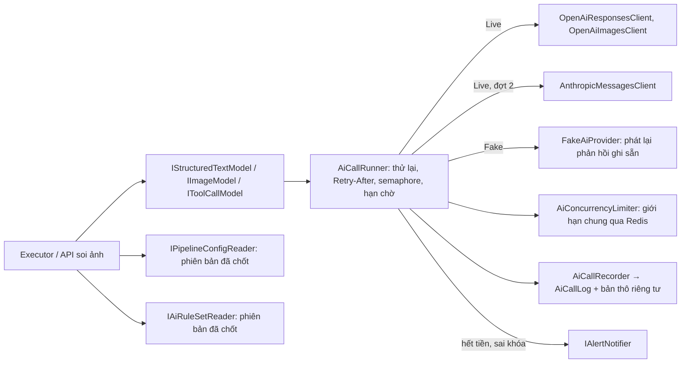
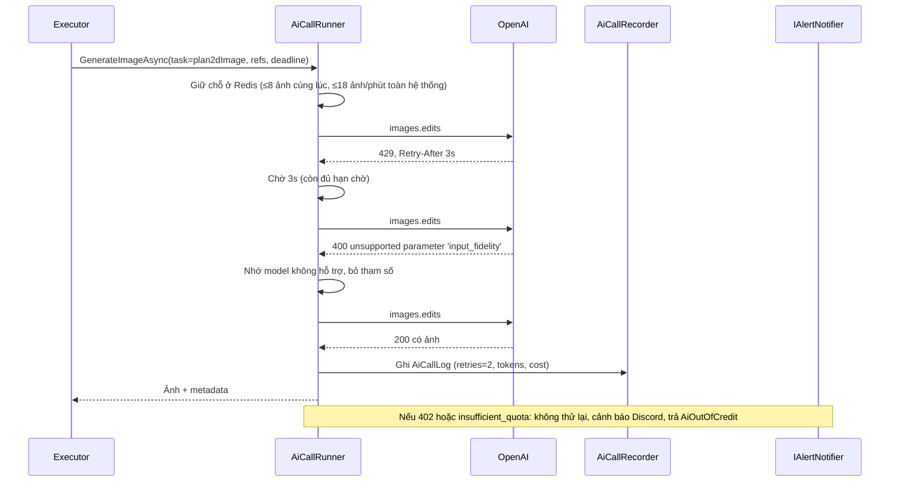
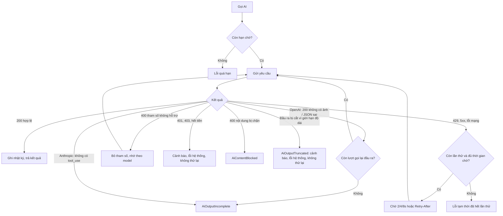
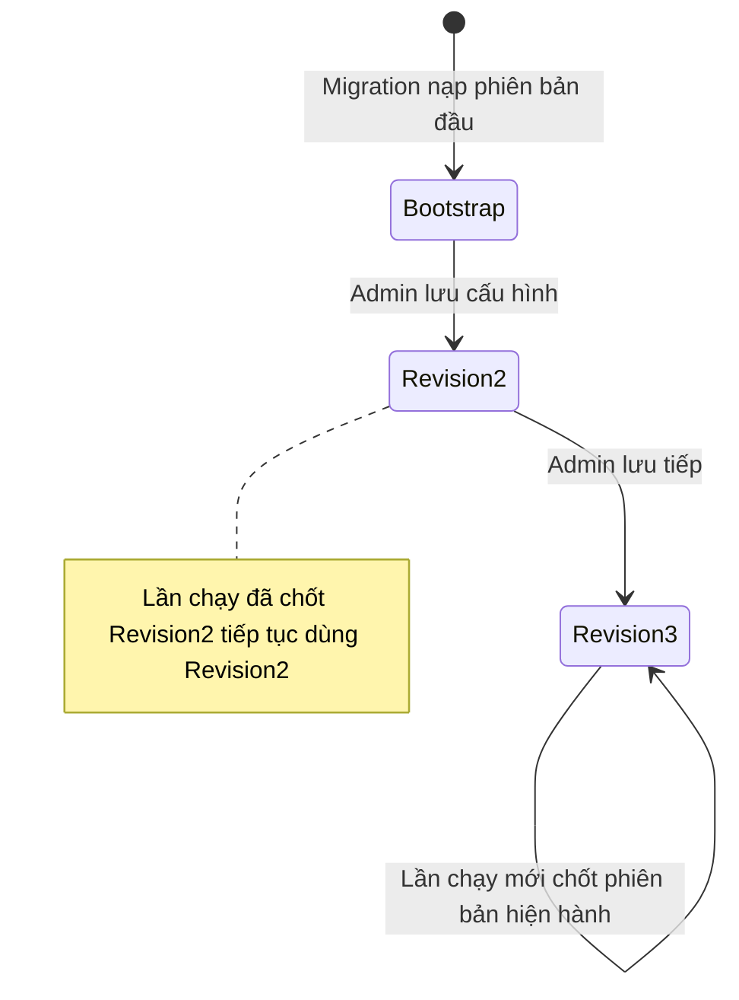
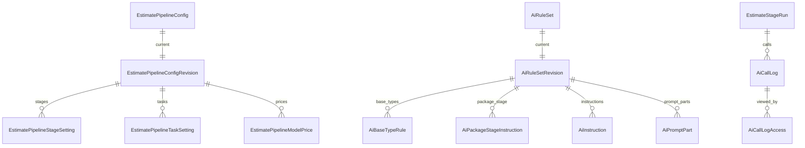

<!-- HƯỚNG DẪN CHO AI KHI ĐIỀN HOẶC CHỈNH SỬA MẪU
- Đọc toàn bộ mẫu, các comment hướng dẫn và tài liệu nguồn được cung cấp trước khi viết. Tuân thủ các quy tắc nghiệp vụ, điều kiện, ngoại lệ và giới hạn đã được xác nhận.
- Không bịa, tự chế hoặc suy đoán thành sự thật: yêu cầu, quy tắc, số liệu, API, schema, mã lỗi, nguồn tham khảo, người phụ trách và kết quả kiểm thử phải có căn cứ. Nội dung ví dụ trong mẫu không phải dữ kiện của dự án.
- Khi thiếu thông tin hoặc các nguồn mâu thuẫn, hỏi người dùng để làm rõ; giữ nguyên placeholder ở phần chưa xác định. Không tự chọn đáp án, lấp chỗ trống hay tuyên bố tài liệu đã hoàn tất.
- Chỉ thay nội dung cần điền hoặc được yêu cầu sửa. Không tự mở rộng phạm vi, sửa nghĩa quy tắc, bỏ điều kiện/ngoại lệ, xoá hay ghi đè nội dung hợp lệ đã có.
- Giữ nguyên tên, cấp và thứ tự heading, nhãn in đậm, tiền tố bullet, cấu trúc danh sách, tên/thứ tự/số cột bảng và cú pháp code fence. Không dịch, đổi tên, gộp hoặc thêm mục ngoài cấu trúc mẫu.
- Chỉ lặp khối luồng, AC hoặc API theo đúng khuôn khi có căn cứ; chỉ bỏ phần tuỳ chọn khi hướng dẫn riêng của mẫu cho phép và đã xác định không áp dụng.
- Mã tham chiếu và section phải trỏ tới tài liệu có thật đã được cung cấp hoặc kiểm chứng. Không giữ mã ví dụ như tham chiếu thật và không tự tạo tài liệu liên quan để hợp thức hoá liên kết.
- Giữ các comment hướng dẫn trong file. Xuất Markdown UTF-8, mỗi file một tài liệu; không bọc toàn bộ file trong code fence, không chèn lời dẫn hay giải thích ngoài mẫu.
- Trước khi bàn giao, đối chiếu nội dung với nguồn, kiểm tra cấu trúc, giá trị cho phép, giới hạn độ dài và tính nhất quán của mã/tham chiếu. Báo rõ phần chưa đủ thông tin; không tuyên bố đã chạy test hoặc import khi chưa thực hiện.
-->

<!-- Thay mã TDD-001 và nội dung ví dụ; giữ nguyên heading và nhãn in đậm.
Sơ đồ dùng mermaid, plantuml hoặc URL. Giữ heading Architecture, Sequence Diagram, Activity Diagram, State Diagram, Data Model.
Ví dụ API phải có heading trùng METHOD /path trong Endpoints. Xoá phần API/sơ đồ không dùng.
Version, Updated At và Change Log do lịch sử phiên bản quản lý, để trống khi nhập mới.
Author/Reviewer là tên hiển thị; gán tài khoản, phê duyệt, giả định và câu hỏi mở trên giao diện sau import.
Thiết kế phải truy vết về Story và Business Rule được cung cấp. Phân biệt thiết kế đề xuất với implementation đã kiểm chứng; không mô tả API/schema/sơ đồ ví dụ như hệ thống thật hoặc tự quyết định nghiệp vụ còn thiếu.
BẮT BUỘC KHI HOÀN THIỆN MẪU: phải có cả Reviewer và Approver, mỗi tên 1–200 ký tự sau khi bỏ khoảng trắng đầu/cuối. Không xoá hai dòng metadata, để trống, dùng tên bịa hoặc giữ placeholder rồi coi là hoàn tất.
Nếu chưa biết người review hoặc người phê duyệt, phải hỏi người dùng và báo tài liệu chưa đủ thông tin; không tự lấy Author/Owner làm người thay thế. Tên trong file không tự gán tài khoản hoặc xác nhận đã duyệt; gán thành viên trên giao diện sau import.
Đây là yêu cầu hoàn thiện mẫu; backend hiện vẫn nhận file cũ thiếu hai trường để tương thích.

VALIDATION CHO FILE NHẬP (đối chiếu ImportSnapshotValidator, MarkdownParser và ImportService):
- Mỗi file .md UTF-8 không rỗng chỉ có một heading cấp 1 chứa mã tài liệu dài 1–100 ký tự. Mã không được trùng trong cùng lần nhập hoặc thuộc loại tài liệu khác đã tồn tại.
- Không dùng tên README.md hoặc sitemap.md vì importer bỏ qua. Giao diện nhận .md/.zip, tối đa 2.000 file, tổng file tải lên 31 MiB; API giới hạn request 32 MiB và tổng nội dung đọc/giải nén 64 MiB.
- Chỉ nhập đè tài liệu cùng loại đang Draft, chưa có phiên bản và chưa lưu trữ. Import thay toàn bộ nội dung bản nháp, vì vậy phải giữ lại nội dung hợp lệ ngoài phần được yêu cầu sửa.
- Không dùng Status trong Markdown hoặc tên Approver để tự xác nhận phê duyệt; import không cấp quyền hay gán tài khoản từ tên. Chạy Kiểm tra file và xử lý lỗi/cảnh báo trước khi nhập.
- Giới hạn độ dài bên dưới tính theo string.Length của .NET (đơn vị UTF-16); không tự cắt ngắn dữ kiện quan trọng để vượt validation, hãy viết lại có căn cứ hoặc hỏi người dùng.
- Feature tối đa 300 ký tự và được dùng làm tiêu đề tài liệu. Status được parser nhận: Draft / In Review / Approved / Deprecated; tài liệu nhập mới vẫn có trạng thái phê duyệt Draft.
- Endpoint: đường dẫn tối đa 500 ký tự; tên/mô tả endpoint được lưu trong Name tối đa 300. HTTP method: GET / POST / PUT / PATCH / DELETE / HEAD / OPTIONS.
- Error Codes: mã tối đa 100 ký tự, không trùng trong tài liệu; giữ dạng - **CODE** (400): mô tả. HTTP status trong Error Codes và Response phải là số nguyên đọc được bằng Int32; không tự đặt status khác hợp đồng API.
- URL sơ đồ tối đa 1.000 ký tự. Mục sơ đồ được sử dụng phải có khối mermaid/plantuml hoặc URL theo mẫu; không để một mục sơ đồ rỗng. Nhãn mục được tách từ bullet như tên External API Fields tối đa 300 ký tự.
- Heading Examples phải khớp METHOD /path ở Endpoints. Giữ các nhãn Request:, Response 200: (thay mã theo contract) và Error Response: để parser tách đúng dữ liệu.
- Tham chiếu dạng DOC-KEY/section: ghi chú: mã đích tối đa 100 ký tự, section tối đa 100, ghi chú tối đa 1.000. Không trùng bộ mã đích + section + loại liên kết trong cùng tài liệu.
ĐỐI CHIẾU FORM TDD (src/features/tdds/validations.ts; form có thể chặt hơn import):
- Điền Feature, Author, Reviewer, Problem và ít nhất một Goal; các Goal/Non-goal/Notes đã thêm không được rỗng. API đã khai báo phải có endpoint và mô tả/mục đích; Fields phải có tên và ý nghĩa; Error Codes phải có mã, HTTP status và điều kiện.
- Form còn kiểm tra Version, Updated At và nội dung Change Log khi khai báo; với file nhập mới, giữ các trường lịch sử này trống theo hợp đồng import, không tự tạo dữ liệu lịch sử.
-->

# TDD-PROJ-008

## Document Info

- **Feature**: Tạo dự toán — lớp gọi AI, cấu hình AI có phiên bản, bộ quy tắc AI, miền giá theo tỉnh và nhật ký lời gọi
- **Author**: Claude
- **Reviewer**: Tân Trần
- **Approver**: Tân Trần
- **Status**: Draft
- **Version**:
- **Updated At**:

## Context & Goals

### Problem

Luồng bốn chặng (TDD-PROJ-006) gọi trực tiếp OpenAI (soi ảnh, phương án 2D, bản vẽ, ảnh 3D) và Anthropic (dự toán, từ đợt 2). App demo `design-estimate` làm việc này bằng `core/openai_client.py`, `core/claude_client.py`, `core/metrics.py`, và đọc cấu hình từ biến môi trường cùng một số trường sửa được qua `/api/admin/config`.

Người dùng chốt ngày 11/10/2026:

- Admin đổi model và tham số chất lượng trên giao diện; mỗi kết quả ghi model, phiên bản prompt và cấu hình đã dùng (BR-PROJ-014).
- Hạn chờ từng chặng, giới hạn lỗi và hạn mức soi ảnh do Admin cấu hình (BR-PROJ-011, 012, 015).
- Quy tắc AI theo loại công trình, gói, miền và phần lời dặn của prompt lưu thành dữ liệu có phiên bản; màn quản trị làm sau đợt 4 (BR-PROJ-019, STORY-PROJ-013).
- Miền giá theo tỉnh do Admin sửa (BR-PROJ-013); cờ cần rà và chi phí AI chỉ lưu nội bộ (BR-PROJ-017).

Tài liệu này thiết kế các phần đó cho đợt 1. Anthropic chỉ được mô tả ở mức cổng; chi tiết gọi công cụ `submit_estimate` thuộc TDD của chặng Dự toán (đợt 2). Mọi bảng, lớp và API là đề xuất.

### Goals

- Một lớp gọi AI dùng chung: thử lại có giới hạn, tôn trọng Retry-After, dừng ngay khi hết tiền hoặc sai khóa, không vượt hạn chờ còn lại của lần chạy.
- Giới hạn số ảnh mỗi phút và số lời gọi đồng thời **chung cho cả hệ thống** qua Redis, để chạy nhiều instance cũng không vượt hạn mức của tài khoản OpenAI (ví dụ 20 ảnh/phút ở hạng thấp nhất); Admin đổi con số khi nâng hạng, không sửa mã.
- Mỗi lời gọi AI để lại một dòng nhật ký (model, token, chi phí ước tính, thời gian, kết quả), không lưu ảnh và khóa API trong nhật ký.
- Cấu hình AI và bộ quy tắc AI có phiên bản bất biến; lần chạy chốt phiên bản lúc tiếp nhận.
- Chế độ Fake chạy được toàn bộ luồng mà không gọi nhà cung cấp.

### Non-goals

- Màn quản trị bộ quy tắc AI và prompt (đợt sau đợt 4); đợt 1 chỉ nạp sẵn và đọc.
- Bảng giá token lấy tự động từ nhà cung cấp; báo cáo chi phí tổng hợp.
- Hàng chờ ưu tiên khi xin chỗ gọi AI (ưu tiên lần chạy đã tốn tiền, chia quỹ ảnh theo chặng) — để sau khi có số liệu tải.

## Architecture



**Notes**:

**A. Cổng AI** (`application/abstractions/estimatePipeline/`)

| Cổng | Dùng cho | Bản cài đặt Live |
|---|---|---|
| `IStructuredTextModel.GenerateJsonAsync<T>(task, schema, instructions, content[], options, ct)` | Soi ảnh (`PlotQuickCheck`), phương án 2D (`HouseSpec`), kiểm ảnh 3D (đợt 3) | OpenAI Responses API, `text.format=json_schema`, `strict=true` |
| `IImageModel.GenerateImageAsync(task, prompt, references[], aspect, options, ct)` | Bản vẽ 2D, ảnh 3D | OpenAI `images.edits` khi có ảnh tham chiếu (tối đa 16), `images.generations` khi không |
| `IToolCallModel.CallToolAsync(task, system, content[], tool, options, ct)` | Dự toán (đợt 2) | Anthropic Messages, luôn streaming, ép gọi công cụ |

`task` là mã việc trong cấu hình (`lotVerify`, `plan2dSpec`, `plan2dImage`, `estimate`, `render3dImage`, `render3dCheck`); model và tham số lấy theo `task` từ phiên bản cấu hình đã chốt, không truyền tự do.

**B. `AiCallRunner` — thử lại, giới hạn, hạn chờ** (chuyển từ `_call_with_backoff` của app demo):

- Lịch chờ thử lại theo đúng client của từng nhà cung cấp trong app demo, tối đa 4 lần gửi. Khi 429 có header thì lần chờ kế tiếp lấy theo header, không cộng ngẫu nhiên: đọc `retry-after-ms` trước, rồi `retry-after` (số giây hoặc ngày giờ HTTP), như `provider_state.retry_after_s` của app demo.
  - **OpenAI** (`openai_client`): chờ 2 → 4 → 8 giây, cộng ngẫu nhiên ±25% (`_jitter`, nhân với 0,75–1,25; dòng 79–80, 299). Giá trị theo header dùng nguyên, không cắt.
  - **Anthropic** (`claude_client`, chi tiết ở TDD-PROJ-009 mục C): chờ đúng 2.000 → 4.000 → 8.000 ms, **không** cộng ngẫu nhiên (`CAC_BUOC_CHO_MS`, dòng 38, 600–611). Giá trị theo header thay cho bậc chờ nhưng không dài hơn hạn của một lần gọi (`min(retry_after, hạn một lần gọi)`).
  - Cả hai: nếu thời gian còn lại của hạn chờ không lớn hơn lần chờ, dừng ngay với lỗi quá hạn thay vì chờ.
- Thử lại khi: lỗi mạng, hết thời gian một lần gọi, 429 không phải hết tiền. Riêng mã 5xx theo đúng từng client của app demo: OpenAI thử lại mọi 5xx trừ 501 (`openai_client`); Anthropic chỉ thử lại 500, 502, 503, 504 và 529 (`TRANG_THAI_TAM` của `claude_client`). Với Anthropic còn thử lại khi HTTP 200 mà luồng đóng trước khi có `stop_reason` hoặc thân phản hồi, JSON công cụ không đọc được; sự kiện `error` giữa luồng được đổi sang mã HTTP theo `error.type` như app demo (`invalid_request_error` 400, `authentication_error` 401, `billing_error` 402, `permission_error` 403, `not_found_error` 404, `request_too_large` 413, `rate_limit_error` 429, `api_error` 500, `timeout_error` 504, `overloaded_error` 529) rồi xử lý như mã đó. Không thử lại khi: 401 (`AiBadKey`), 403 (`AiPermissionDenied`), 400 có dấu hiệu nội dung bị chặn của OpenAI (`AiContentBlocked`), hết tiền (`AiOutOfCredit`), đầu ra bị cắt vì vượt giới hạn độ dài (`AiOutputTruncated`), 400 khác và các mã còn lại (`AiRequestInvalid`). Ngoại lệ của Anthropic như app demo: đang gắn bộ nhớ đệm mà nhận 400 có chữ "cache" trong thông báo thì bỏ bộ nhớ đệm và gửi lại; lần đó tính là một lần thử và chờ theo lịch 2 → 4 → 8 giây.
- **Nhận diện hết tiền** như app demo: HTTP 402, hoặc mã lỗi thuộc `insufficient_quota`, `billing_hard_limit_reached`, `billing_limit_reached`, `billing_not_active`, `billing_inactive`, `payment_required` (OpenAI), `billing_error` (Anthropic). Chỉ khi không có mã lỗi mới dò chuỗi, và dò đúng như client của từng nhà cung cấp trong app demo: OpenAI chỉ nhận các cụm hết tiền cụ thể, không dò chữ "billing" đơn lẻ vì thông báo 429 thường có chữ này; Anthropic dò `credit balance is too low|insufficient…credit|billing|payment required` (`RE_HET_TIEN` của `claude_client`), giữ cả chữ "billing" như app demo. Hết tiền, sai khóa: gửi cảnh báo Discord loại mới `AiProviderAccountProblem` (một lần mỗi 10 phút mỗi nhà cung cấp) và trả lỗi hệ thống cho executor, lần chạy lỗi `AiOutOfCredit`/`AiProviderUnavailable`.
- **Nhận diện đầu ra bị cắt:** OpenAI Responses trả `status=incomplete` với `incomplete_details.reason=max_output_tokens`; Anthropic (đợt 2) trả `stop_reason=max_tokens`. `AiCallRunner` không thử lại, gửi cảnh báo Discord `AiOutputTruncated` để Admin nâng giới hạn độ dài đầu ra, rồi ném lỗi `AiOutputTruncated`. Cảnh báo dùng cùng cơ chế giới hạn tần suất với `AiProviderAccountProblem`: tối đa một lần mỗi 10 phút cho mỗi cặp nhà cung cấp và mã. Lần chạy lỗi với mã `AiOutputTruncated`, thuộc nhóm lỗi hệ thống nên không tính vào giới hạn lỗi của chặng (BR-PROJ-011 khoản 1, TDD-PROJ-006). Lỗi này không làm tăng bộ đếm của breaker.
- **Tham số không được hỗ trợ:** OpenAI trả 400 có dạng `unsupported parameter 'x'` hoặc `does not support the 'x'` với tham số tùy chọn (`input_fidelity`, `output_compression` cho ảnh; `temperature`, `reasoning` cho văn bản; `strict` của schema) thì bỏ tham số đó, gọi lại, và nhớ theo model trong bộ nhớ tiến trình. Không bỏ `size`, `quality`, `background`. Không gửi `temperature` cùng `reasoning`.
- **Giới hạn chung qua Redis (`AiConcurrencyLimiter`)** — người dùng chốt ngày 12/10/2026. Mỗi nhóm (`image`, `text`, `anthropic`, `lotVerify`) có hai giới hạn đọc từ phiên bản cấu hình hiện hành: số lời gọi đồng thời và (riêng `image`) số lời gọi trong 60 giây gần nhất.
  - **Cách giữ chỗ:** một script Lua trên Redis cache có sẵn của hệ thống (`ConnectionStrings__Redis`; cần bảo đảm chính sách eviction không xóa các khóa `ai:limit:*`, ví dụ `volatile-*` hoặc `noeviction`), chạy nguyên tử, lấy thời gian bằng `redis.call('TIME')` để mọi instance dùng chung một đồng hồ: xóa các chỗ đã hết hạn khỏi tập `ai:limit:{nhóm}:slots` (sorted set, điểm số là thời điểm hết hạn), xóa mốc cũ hơn 60 giây khỏi `ai:limit:image:window`; nếu số chỗ còn nhỏ hơn giới hạn đồng thời và số mốc trong 60 giây nhỏ hơn giới hạn mỗi phút thì thêm chỗ mới (mã ngẫu nhiên, hết hạn sau hạn tối đa của một lần gọi theo mục "Hạn chờ" bên dưới, cộng 30 giây) và thêm mốc thời gian, trả "được"; ngược lại trả "chờ" kèm thời gian chờ gợi ý.
  - **Chờ chỗ:** `AiCallRunner` thử lại sau 0,5–2 giây (tăng dần, có ngẫu nhiên) cho tới khi được hoặc hết hạn chờ của lần chạy. Chỉ giữ chỗ khi đang thật sự gọi; nhả chỗ ngay khi có phản hồi, kể cả lỗi; không giữ chỗ trong lúc chờ thử lại sau 429/5xx.
  - **Instance chết khi đang giữ chỗ:** chỗ tự hết hạn theo điểm số, không bị rò mãi. Đây là lý do dùng sorted set có thời điểm hết hạn thay vì một bộ đếm tăng/giảm.
  - **Mốc thời gian tính cả lần gọi lỗi và lần gọi lại** khi AI trả 200 mà không có ảnh, vì OpenAI vẫn tính các lần đó vào hạn mức.
  - **Redis lỗi:** rơi về giới hạn an toàn trong tiến trình (`SemaphoreSlim`: ảnh 2, văn bản 2, Anthropic 1, soi ảnh 2 mỗi instance), ghi log Warning và gửi cảnh báo Discord một lần mỗi 10 phút; luồng không dừng.
  - **Mặc định cho tài khoản 20 ảnh/phút:** 18 ảnh/phút và 8 ảnh vẽ cùng lúc (mỗi ảnh khoảng 30 giây nên 8 chỗ ≈ 16 ảnh/phút, chừa dự phòng cho lần vẽ lại); văn bản 4; Anthropic 2; soi ảnh 4.
  - **Theo dõi:** metric số ảnh mỗi phút thực tế và thời gian chờ chỗ; cảnh báo Discord khi trong 5 phút liền số ảnh mỗi phút vượt 80% giới hạn, hoặc gặp từ 10 lỗi 429 trong 5 phút — dấu hiệu cần nâng hạng tài khoản.
- **Hạn chờ:** mỗi lần gọi dùng `min(thời gian còn lại của lần chạy hoặc yêu cầu soi, hạn của một lần gọi)`. Với OpenAI, hạn của một lần gọi là `OpenAiRequestTimeoutSeconds + 5` (mặc định 240 + 5 giây). Với Anthropic, một lần gọi streaming có thể sinh hàng chục nghìn token, nên hạn tăng theo `max_tokens` như `han_chot_mot_lan` của app demo: `max(AnthropicRequestTimeoutSeconds, 60 + max_tokens / 40)` giây (mặc định 300; `max_tokens` 64.000 → 1.660 giây); `AnthropicRequestTimeoutSeconds` đồng thời là thời gian tối đa giữa hai gói dữ liệu của luồng. Chỗ giữ trong giới hạn chung hết hạn sau hạn của một lần gọi cộng 30 giây, nên một lượt dài không làm chỗ hết hạn trong lúc vẫn đang gọi. Ví dụ: lượt dự toán 64.000 token giữ chỗ tối đa 1.690 giây, nhưng vẫn bị cắt ở hạn chờ còn lại của lần chạy (tối đa 20 phút). Yêu cầu soi ảnh có hạn chờ riêng 90 giây (TDD-PROJ-007 mục D).
- **Ghi đủ lượng dùng của mọi lần thử:** `AiCallLog` vẫn một dòng cho mỗi lời gọi logic, nhưng token và chi phí cộng dồn mọi lần thử đã được nhà cung cấp tính tiền (kể cả lần gọi lại khi không có ảnh), để chi phí trong nhật ký khớp hóa đơn. Không có trần chi phí làm dừng lần chạy; lần chạy tốn quá `RunCostAlertUsd` chỉ được cảnh báo (người dùng chốt ngày 12/10/2026, BR-PROJ-012 khoản 10; cách gửi ở TDD-PROJ-006).
- **Tạm ngắt khi nhà cung cấp lỗi liên tục (`AiCircuitBreaker`)** — người dùng chốt ngày 12/10/2026 (BR-PROJ-012 khoản 9). **Circuit breaker** là công tắc tự ngắt: khi một nhà cung cấp lỗi liên tục, hệ thống tạm ngừng nhận việc mới cho nhà cung cấp đó thay vì để khách bấm rồi chờ lỗi.
  - **Đếm lỗi:** sau mỗi lời gọi logic, `AiCallRunner` báo kết quả cho breaker của nhà cung cấp (`OpenAI`, `Anthropic`). Lỗi của nhà cung cấp (mạng, hết thời gian, 5xx, 429 sau khi đã thử lại) tăng `ai:breaker:{provider}:fails` trên Redis; một lời gọi thành công đặt lại về 0. Lỗi do nội dung (`AiContentBlocked`, `AiOutputIncomplete`), đầu ra bị cắt (`AiOutputTruncated`) và lỗi tham số không tính.
  - **Ngắt:** `fails` đạt `BreakerFailureThreshold` (mặc định 10), hoặc gặp hết tiền/sai khóa (`AiOutOfCredit`, `AiBadKey`, `AiPermissionDenied`) thì ngắt ngay: `SET ai:breaker:{provider}:open 1 NX EX {BreakerOpenMinutes*60}` (mặc định 5 phút). Lệnh `NX` trả thành công thì instance này gửi cảnh báo Discord `AiProviderPaused`, nên mỗi lần ngắt chỉ có một cảnh báo.
  - **Hiệu lực:** đang ngắt thì tiếp nhận chặng (TDD-PROJ-006 bước 7a) và yêu cầu soi ảnh (TDD-PROJ-007 bước 2a) trả 503 `AiServiceUnavailable` với `Retry-After` = TTL còn lại. Lần chạy đã được tiếp nhận vẫn chạy và tự thử lại theo chính sách ở trên; lỗi của chúng là lỗi hệ thống, không tính vào giới hạn lỗi.
  - **Lời gọi dò khi hết thời gian ngắt** (chuyển `probe_credit` của app demo): khi khóa `open` của một lần ngắt do hết tiền hoặc sai khóa vừa hết hạn, yêu cầu tiếp nhận đầu tiên (giữ khóa `ai:breaker:{provider}:probing` bằng `SET NX EX 30`, các yêu cầu khác coi như còn ngắt) gửi một lời gọi dò rất nhỏ trước khi nhận lần chạy thật: Anthropic `messages` với `max_tokens=1`, nội dung "ping", model của việc `estimate`; OpenAI `responses` với `input="ping"` và số token ra tối thiểu, model văn bản. Không thử lại, hạn 30 giây như app demo. Dò thành công thì mở lại như bên dưới; dò lỗi thì ngắt tiếp một khoảng `BreakerOpenMinutes`, nên không lần chạy nào của khách phải gánh lỗi đó. App demo dò theo chu kỳ 600 giây và chỉ mở khi dò thành công; BR-PROJ-012 khoản 9 đã chốt thời gian ngắt do Admin cấu hình, nên lời gọi dò được đặt ở cuối mỗi lần ngắt thay vì mở sớm. Lời gọi dò không ghi `AiCallLog` (bảng đòi `RunId` hoặc yêu cầu soi), chỉ ghi log và metric.
  - **Mở lại:** khóa `open` tự hết hạn. Lời gọi thành công đầu tiên sau đó (kể cả lời gọi dò) xóa `ai:breaker:{provider}:alerted` (đặt cùng lúc ngắt) và gửi cảnh báo `AiProviderResumed` nếu xóa được. Nếu nhà cung cấp vẫn lỗi, `fails` lại đạt ngưỡng và ngắt tiếp.
  - **Redis lỗi:** coi như không ngắt (cho chạy) và ghi log Warning; lớp thử lại và cảnh báo `AiProviderAccountProblem` vẫn hoạt động. Chọn cho chạy vì chặn toàn bộ luồng chỉ vì Redis lỗi gây hại hơn vài lần chạy lỗi.
- **Kiểm đầu ra:** Với lời gọi OpenAI Responses theo JSON schema (`generate_json` của app demo, `openai_client.py` dòng 725–748): JSON không đọc được, không phải object, hoặc không qua schema → thử lại một lần trong cùng hạn chờ, vẫn sai thì `AiOutputIncomplete`. Lời gọi công cụ của Anthropic không theo quy tắc gọi lại này mà theo TDD-PROJ-009 mục C: không có khối `tool_use` đúng tên hoặc `input` không phải object → `AiOutputIncomplete` ngay, không gọi lại; thân phản hồi hoặc JSON công cụ không đọc được → xử lý như lỗi tạm thời và thử lại theo lịch chờ ở trên. Responses trả `incomplete` vì `content_filter` hoặc phần `refusal` → `AiContentBlocked` (tính vào giới hạn). Responses trả `incomplete` vì `max_output_tokens` → `AiOutputTruncated` như mục trên, không gọi lại. Ảnh: 200 mà không có ảnh → gọi lại tối đa 2 lần, lần thứ hai thêm câu "RETURN AN IMAGE ONLY — no text answer."; loại ảnh đọc từ byte trả về, không tin định dạng yêu cầu.
- **HttpClient:** OpenAI và Anthropic đều gọi bằng `HttpClient` có kiểu (`IHttpClientFactory`), không tự thử lại ở tầng HttpClient; mọi lần thử đều qua `AiCallRunner` và được ghi nhật ký. Anthropic gọi Messages API streaming và đọc sự kiện SSE (`AnthropicMessagesClient`, TDD-PROJ-009 mục C), thay cho NuGet `Anthropic` đã ghi ở bản trước, vì: (1) mỗi lần thử trả một kết quả để `AiCallRunner` phân loại, cùng cách với client OpenAI; (2) thân yêu cầu dựng từ đúng chuỗi JSON của schema công cụ, nên dấu vân prompt và tiền tố bộ nhớ đệm ổn định theo byte; (3) đọc được `retry-after`, sự kiện `error` giữa luồng và `usage` của từng sự kiện mà không phụ thuộc phiên bản SDK.

**C. Nhật ký lời gọi (`AiCallRecorder`)**

- Mỗi lời gọi logic (đã gộp các lần thử lại) ghi một dòng `AiCallLog`: chặng, lần chạy, bước, việc, nhà cung cấp, model, thời điểm, thời gian, thời gian tới token đầu (Anthropic), token vào/ra/đệm, số lần thử lại, kết quả, mã lỗi, chi phí ước tính theo bảng giá của phiên bản cấu hình (công thức của app demo: token vào không đệm × giá vào + token đệm × giá đệm + token ghi đệm × giá ghi đệm + token ra × giá ra).
- Bản thô (prompt hệ thống, prompt người dùng, tham số, phản hồi JSON) lưu ở kho riêng tư `media/site-private/estimate-ai/{estimateId hoặc "verify"}/{callId}.json` qua `IPrivateMediaObjectStore`; ảnh được thay bằng `{sha256, width, height}`, không lưu khóa API hay header. Dùng để rà soát và tạo bộ phản hồi ghi sẵn cho chế độ Fake. App demo chỉ lưu bản thô cho dự toán; hệ thống thật lưu cho mọi lời gọi để phục vụ kiểm chứng parity.
- Khách không đọc được bảng này. Người có quyền `estimate.pipeline.inspect` xem các cột của `AiCallLog` (token, chi phí, kết quả, mã lỗi) trong chi tiết luồng AI (TDD-PROJ-006). **Bản thô** chỉ người có quyền `estimate.pipeline.operate` đọc được, qua `GET /api/v1/admin/estimate-pipeline/ai-calls/{callId}/raw` (người dùng chốt ngày 12/10/2026, STORY-PROJ-012/ALT-03).
- **Ghi vết mỗi lần đọc bản thô:** handler thêm một dòng `AiCallLogAccess (AiCallLogId, ViewedBy, ViewedAtUtc)` và commit **trước** khi đọc tệp từ kho; ghi vết không thành công thì trả 503 và không trả nội dung. Bảng chỉ thêm, không có API sửa hay xóa. Dùng bảng riêng thay vì `AccessAuditLog` có sẵn vì bảng đó dành cho thay đổi vai trò và quyền theo BR-RBAC-012.

**D. Chế độ Fake**

- `FakeAiProvider` thay ba cổng; trả phản hồi ghi sẵn theo `task` và `stepKey`, lấy từ thư mục `EstimatePipelineOption__FakeFixturesPath`. Nhà cung cấp giả và bộ phản hồi ghi sẵn (có ảnh) nằm ở assembly riêng `bmt-be.estimatepipeline.fakes`, chỉ được nạp khi `Mode=Fake`, để thư viện logic thuần không mang dữ liệu thử vào bản production. CI kiểm bộ phản hồi ghi sẵn khớp schema hiện hành (`HouseSpec`, `PlotQuickCheck`) để chế độ Fake không lệch so với thật. Nếu không có phản hồi khớp bước, trả phản hồi mặc định của `task`. Có thể cấu hình một phản hồi lỗi cho bước cụ thể để kiểm nhánh lỗi (ví dụ không trả ảnh hai lần, hết tiền).
- Fake vẫn đi qua `AiCallRunner` và ghi `AiCallLog` với `Model='fake:<model thật>'`, chi phí 0.
- Bộ ghi sẵn ban đầu lấy từ 19 hồ sơ mẫu còn trong `design-estimate/data/projects` và các lần chạy dev có khóa thật sau này (bản thô ở mục C).

**E. Cấu hình AI có phiên bản (`EstimatePipelineConfig`)**

- Một con trỏ đơn (`EstimatePipelineConfig`, Id=1) trỏ tới phiên bản hiện hành; mỗi lần Admin lưu tạo `EstimatePipelineConfigRevision` mới và chép toàn bộ dòng con, cùng cách làm với danh mục ở TDD-PROJ-001 (`CatalogWriteFlow`): khóa con trỏ FOR UPDATE, so `expectedVersion`, chống gửi lặp bằng key/hash, tạo revision, đổi con trỏ.
- Nội dung một phiên bản: hạn chờ và giới hạn lỗi **theo từng chặng** (bảng con `EstimatePipelineStageSetting`, để thêm chặng mới chỉ là thêm dòng), hạn mức soi ảnh mỗi ngày của mỗi tài khoản và trần chung của cả hệ thống, hạn chờ yêu cầu soi, ngưỡng hàng chờ `MaxQueuedRuns`, ngưỡng và thời gian tạm ngắt (`BreakerFailureThreshold`, `BreakerOpenMinutes`), ngưỡng cảnh báo chi phí mỗi lần chạy `RunCostAlertUsd`, cờ `PlanOutlineRedraw`, ngưỡng `PlanOutlineTolerance` và `PlanOutlineMinOverlap`, timeout mỗi lời gọi theo nhà cung cấp, **giới hạn chung**: số ảnh mỗi phút, số ảnh vẽ cùng lúc, số lời gọi văn bản, Anthropic và soi ảnh cùng lúc; danh sách cài đặt theo việc (`task` → nhà cung cấp, model, tham số); bảng giá token theo model. Số lần chạy worker lấy ra cùng lúc không cấu hình, tự tính bằng số ảnh vẽ cùng lúc + 2 (TDD-PROJ-006).
- Model phải thuộc danh sách hệ thống hỗ trợ (hằng số trong mã kèm cờ khả năng: hỗ trợ `reasoning`, `temperature`, ép công cụ `ForcedToolChoice`, `input_fidelity`; với model có `ForcedToolChoice` thêm số token đầu ra tối đa `MaxOutputTokens` để kiểm các tham số giới hạn đầu ra của việc `estimate`, TDD-PROJ-009 mục O); tham số được kiểm theo cờ khả năng và khoảng cho phép. Admin không nhập tên model tùy ý (STORY-PROJ-012/EXC-02). Việc `estimate` chỉ nhận model Anthropic có cờ `ForcedToolChoice`; `claude-haiku-4-5` có cờ này vì app demo dùng nó, cờ của các model Claude khác chỉ bật sau khi chạy thử xác nhận nhận `tool_choice` ép buộc. `claude-sonnet-5` và `claude-opus-5` không có cờ `temperature` vì app demo ghi hai model này trả 400 khi có tham số đó (`estimate_temperature`).
- Phiên bản đầu (`Bootstrap`) nạp từ giá trị app demo: `gpt-5.4-nano` + `reasoning low` cho soi ảnh, `gpt-6-astra` + `reasoning low` cho phương án, `gpt-image-2.5-sunburst` + `quality high`, `input_fidelity high`, `jpeg` cho ảnh, `claude-haiku-4-5` cho dự toán; hạn chờ 20/20/40/5 phút; giới hạn lỗi 3; hạn mức soi 30; các giá trị mới đề xuất, chờ người dùng chốt số: trần soi chung 1.000/ngày, hàng chờ 40, tạm ngắt sau 10 lỗi liên tiếp trong 5 phút, cảnh báo chi phí 3 USD; cờ vẽ lại viền bật, ngưỡng 0,05/0,93; bảng giá theo `AI_PRICES_USD_PER_MTOK` của app demo, thêm dòng cho `gpt-5.4-nano` (app demo thiếu).

**F. Bộ quy tắc AI có phiên bản (BR-PROJ-019)**

- Cùng mẫu con trỏ đơn + revision chép toàn bộ. Đợt 1 có các nhóm mà chặng 2D dùng; các đợt sau thêm bảng con của nhóm mình (ma trận mái ở đợt 2–3, lời dặn theo miền ở đợt 3) trong cùng revision.
- Nhóm đợt 1: `AiBaseTypeRule` (theo ID loại công trình; revision cũ vẫn đọc mã gốc), `AiPackageStageInstruction` (gói × chặng), `AiInstruction` (lời dặn chung, phạm vi chặng + tùy chọn mã gốc/gói/miền), `AiPromptPart` (phần lời dặn sửa được của từng prompt theo mã).
- **Prompt:** mã dựng prompt nằm trong `bmt-be.estimatepipeline` và có số phiên bản (`2d-13`, `drawing-v12`). Mỗi prompt có các "chỗ chèn lời dặn" tên cố định; `AiPromptPart` giữ văn bản của từng chỗ chèn, nạp sẵn đúng văn bản của app demo. Ghép prompt = khung trong mã + văn bản từ `AiPromptPart` + `AiInstruction` khớp phạm vi. Vì khung và chỗ chèn cố định, sửa văn bản không làm hỏng cấu trúc dữ liệu AI phải trả (BR-PROJ-014 khoản 4). Một phiên bản prompt trong mã ghi danh sách chỗ chèn nó đòi; nạp phiên bản mã mới mà thiếu chỗ chèn thì migration dữ liệu **tạo một revision mới** của bộ quy tắc (chép revision hiện hành và thêm dòng mặc định), không sửa revision cũ vì revision là bất biến và có thể đang được lần chạy dùng.
- Đợt 1 không có API sửa; dữ liệu đổi qua migration của bản phát hành (BR-PROJ-019 khoản 7). API đọc cho Admin có quyền `estimate.ai-rules.manage` để kiểm tra dữ liệu nạp sẵn.

**G. Miền giá theo tỉnh (BR-PROJ-013)**

- Bảng hiện hành `PricingRegionProvince` (34 dòng), không cần revision vì giá trị đã được chụp vào đầu vào lúc chạy 2D (TDD-PROJ-007 mục E). Kiểm soát sửa đồng thời bằng `xmin` (cột hệ thống của PostgreSQL thay đổi mỗi lần dòng được cập nhật) làm token so khớp: Admin gửi `rowVersion` đọc được; khác thì 409 `VersionConflict`. Mỗi lần lưu tăng `TableVersion` ở dòng đơn `PricingRegionTable` để bản chụp ghi được phiên bản đã dùng.
- Nạp sẵn từ `ProvinceRegionCatalog` có trong `bmt-be.domain/referenceData` (34 mã tỉnh trùng mã của nguồn địa chỉ, miền north/central/south). Không có cờ Tây Nguyên: Gia Lai, Đắk Lắk, Lâm Đồng thuộc miền Trung như mọi tỉnh miền Trung khác. Danh sách cuối do nhóm dự án rà (BR-PROJ-013 Notes).

**H. Quyền mới** (nạp bằng migration theo mẫu `20261006120000_CustomerReadPermission`, gán cho vai trò Admin; `PermissionCatalogGuard` kiểm khi khởi động):

- `estimate.pipeline.config.manage` — xem và sửa cấu hình AI.
- `estimate.pipeline.inspect` — xem lần chạy, các cột của nhật ký AI, phần nội bộ.
- `estimate.pipeline.operate` — đặt lại bộ đếm lỗi và đọc bản thô của nhật ký AI (mỗi lần đọc đều ghi vết). Tách khỏi `inspect` và `config.manage` theo quyết định người dùng ngày 12/10/2026, để có thể cấp cho nhân viên hỗ trợ mà không cho sửa cấu hình.
- `estimate.pricing.manage` — miền giá (đợt 1), luật giá (đợt 2).
- `estimate.ai-rules.manage` — đọc bộ quy tắc AI (đợt 1), sửa (sau đợt 4).

**I. Biến môi trường mới** (thêm vào `.docker/.env.sample`, `.env.sample.secrets`, `env-classification.json`, `compose.yaml`, workflow deploy): `OpenAiOption__ApiKey` (bí mật), `OpenAiOption__BaseUrl`, `AnthropicOption__ApiKey` (bí mật), `EstimatePipelineOption__Mode`, `__EnabledStages`, `__LeaseSeconds`, `__HeartbeatSeconds`, `__PollIntervalSeconds` (mặc định 15, vòng quét dự phòng), `__MaintenanceIntervalSeconds` (mặc định 30, job bảo trì), `__FileLinkMinutes` (mặc định 15, hạn link tải tệp chặng), `__BatchSize`, `__FakeFixturesPath`. Tên biến trong file env: `ESTIMATE_PIPELINE_*`, `OPENAI_API_KEY`, `OPENAI_BASE_URL`, `ANTHROPIC_API_KEY`; mặc định `ESTIMATE_PIPELINE_MODE=Off`. Giới hạn đồng thời và số ảnh mỗi phút nằm trong cấu hình Admin, không phải biến môi trường; giới hạn dự phòng khi Redis lỗi là hằng số trong mã. Khóa API không có trên giao diện (STORY-PROJ-012 Non-Functional). `Mode=Live` mà thiếu khóa OpenAI thì dừng khởi động.

## Sequence Diagram



## Activity Diagram



## State Diagram



Phiên bản cấu hình và bộ quy tắc không có trạng thái riêng; con trỏ đơn quyết định phiên bản hiện hành, mọi phiên bản cũ bất biến.

## Data Model

| Bảng | Một dòng là gì, ai ghi, khi nào |
|---|---|
| EstimatePipelineConfig | Dòng đơn trỏ tới phiên bản cấu hình hiện hành. Ghi khi Admin lưu. |
| EstimatePipelineConfigRevision | Một phiên bản cấu hình (hạn chờ, giới hạn, cờ, ngưỡng). Bất biến. |
| EstimatePipelineStageSetting | Hạn chờ và giới hạn lỗi của một chặng trong một phiên bản cấu hình. |
| EstimatePipelineTaskSetting | Cài đặt model cho một việc trong một phiên bản cấu hình. |
| EstimatePipelineModelPrice | Giá token của một model trong một phiên bản cấu hình (USD/triệu token). |
| AiRuleSet | Dòng đơn trỏ tới phiên bản bộ quy tắc hiện hành. |
| AiRuleSetRevision | Một phiên bản bộ quy tắc AI. Bất biến. |
| AiBaseTypeRule | Đặc điểm và ngưỡng của một ID loại công trình trong một phiên bản quy tắc; revision cũ dùng mã gốc. |
| AiPackageStageInstruction | Lời dặn cho một gói ở một chặng trong một phiên bản quy tắc. |
| AiInstruction | Một lời dặn chung có phạm vi trong một phiên bản quy tắc. |
| AiPromptPart | Văn bản của một chỗ chèn lời dặn của một prompt trong một phiên bản quy tắc. |
| PricingRegionTable, PricingRegionProvince | Dòng đơn giữ số phiên bản bảng; mỗi tỉnh một dòng miền giá hiện hành. |
| AiCallLog | Một lời gọi AI logic (đã gộp thử lại). Ghi bởi `AiCallRecorder`; không sửa. |
| AiCallLogAccess | Một lần người vận hành mở bản thô của một lời gọi AI. Ghi bởi API đọc bản thô trước khi trả nội dung; không sửa, không xóa. |

| Bảng | Cột, null và ràng buộc |
|---|---|
| EstimatePipelineConfig | Id smallint PK CHECK=1; CurrentRevisionId uuid NN FK; Version bigint NN CHECK ≥ 1. |
| EstimatePipelineConfigRevision | Id uuid PK; Number bigint NN UNIQUE; ParentId uuid NULL FK; CreatedBy uuid NULL FK User (NULL với Bootstrap); CreatedAtUtc timestamptz NN; Note varchar(500) NULL; MutationKey varchar(100) NN; RequestHash char(64) NN; LotVerifyDailyLimit int NN CHECK BETWEEN 1 AND 1000; LotVerifySystemDailyLimit int NN CHECK BETWEEN 1 AND 1000000; MaxQueuedRuns int NN CHECK BETWEEN 1 AND 10000; BreakerFailureThreshold int NN CHECK BETWEEN 1 AND 100; BreakerOpenMinutes int NN CHECK BETWEEN 1 AND 60; RunCostAlertUsd numeric(8,2) NN CHECK > 0; LotVerifyTimeoutSeconds int NN CHECK BETWEEN 10 AND 300; PlanOutlineRedraw boolean NN; PlanOutlineTolerance numeric(4,3) NN CHECK BETWEEN 0.01 AND 0.5; PlanOutlineMinOverlap numeric(4,3) NN CHECK BETWEEN 0.5 AND 1; OpenAiRequestTimeoutSeconds, AnthropicRequestTimeoutSeconds int NN CHECK BETWEEN 30 AND 1800; ImagesPerMinute int NN CHECK BETWEEN 1 AND 10000; ImageConcurrency int NN CHECK BETWEEN 1 AND 1000; TextConcurrency, AnthropicConcurrency, LotVerifyConcurrency int NN CHECK BETWEEN 1 AND 1000; UNIQUE (CreatedBy, MutationKey). |
| EstimatePipelineStageSetting | RevisionId uuid NN FK; Stage varchar(16) NN CHECK IN ('Plan2d','Estimate','Render3d','Dossier'); TimeoutMinutes int NN CHECK BETWEEN 1 AND 240; RetryLimit int NN CHECK BETWEEN 1 AND 20; PK (RevisionId, Stage). Danh sách chặng và thứ tự mở chặng là một danh sách dùng chung trong mã (`PipelineStages`), không lặp lại ở nhiều chỗ. |
| EstimatePipelineTaskSetting | RevisionId uuid NN FK; Task varchar(32) NN CHECK IN ('lotVerify','plan2dSpec','plan2dImage','estimate','render3dImage','render3dCheck'); Provider varchar(16) NN CHECK IN ('OpenAI','Anthropic'); Model varchar(100) NN; FallbackModel varchar(100) NULL; Parameters jsonb NN CHECK object; PK (RevisionId, Task). |
| EstimatePipelineModelPrice | RevisionId uuid NN FK; Model varchar(100) NN; InputPerMTok, CachedInputPerMTok, OutputPerMTok numeric(10,4) NN CHECK ≥ 0; CacheWritePerMTok numeric(10,4) NULL; PK (RevisionId, Model). |
| AiRuleSet | Id smallint PK CHECK=1; CurrentRevisionId uuid NN FK; Version bigint NN. |
| AiRuleSetRevision | Như EstimatePipelineConfigRevision phần định danh (Id, Number, ParentId, CreatedBy, CreatedAtUtc, Note, MutationKey, RequestHash); SourceCommit varchar(40) NULL (mốc app demo của dữ liệu nạp sẵn, ví dụ `059e876`). |
| AiBaseTypeRule | Id uuid NN PK DEFAULT gen_random_uuid(); RevisionId uuid NN FK; BuildingTypeId uuid NULL FK EstimateBuildingType RESTRICT (NULL chỉ cho revision cũ); BaseCode varchar(32) NN (metadata tương thích, CHECK 5 mã chỉ khi BuildingTypeId NULL); DefaultLotWidthM, DefaultLotDepthM numeric(6,2) NN CHECK > 0; MaxFloors int NN CHECK BETWEEN 1 AND 4; HasRoof, AllowsTum, HasStructurePart boolean NN; LotMinSideM numeric(6,2) NN; LotMaxSideM numeric(6,2) NN; LotMinAreaM2 numeric(8,2) NN; LotMaxAreaM2 numeric(10,2) NN; CarFrontageMinM, GarageFrontageMinM numeric(4,2) NN; GarageMinAreaM2 numeric(5,2) NN; BedroomMinAreaM2 numeric(5,2) NN; BedroomMinSideM numeric(4,2) NN; Instruction varchar(2000) NULL; UNIQUE (RevisionId, BuildingTypeId) WHERE BuildingTypeId IS NOT NULL; UNIQUE (RevisionId, BaseCode) WHERE BuildingTypeId IS NULL; CHECK LotMinSideM < LotMaxSideM AND LotMinAreaM2 < LotMaxAreaM2. |
| AiPackageStageInstruction | RevisionId uuid NN FK; Package varchar(16) NN CHECK IN ('Basic','Standard','Vip'); Stage varchar(16) NN CHECK IN ('Plan2d','Estimate','Render3d'); Text varchar(2000) NN CHECK có nội dung; PK (RevisionId, Package, Stage). |
| AiInstruction | Id uuid NN; RevisionId uuid NN FK; Stage varchar(16) NN; BaseCode varchar(32) NULL; Package varchar(16) NULL; Region varchar(16) NULL CHECK NULL OR IN ('North','Central','South') (khớp với `PricingRegionProvince.Region` của tỉnh đã chụp vào đầu vào; tỉnh Tây Nguyên khớp phạm vi `Central`); Text varchar(2000) NN CHECK có nội dung; Enabled boolean NN; SortOrder int NN; PK (RevisionId, Id). |
| AiPromptPart | RevisionId uuid NN FK; PromptCode varchar(64) NN; SlotKey varchar(64) NN; Text text NN; PK (RevisionId, PromptCode, SlotKey). |
| PricingRegionTable | Id smallint PK CHECK=1; TableVersion bigint NN. |
| PricingRegionProvince | ProvinceCode varchar(8) PK; ProvinceName varchar(100) NN; Region varchar(16) NN CHECK IN ('North','Central','South'); ModifiedAtUtc timestamptz NN; ModifiedBy uuid NULL FK User. |
| AiCallLog | Id uuid PK; EstimateId uuid NULL; RunId uuid NULL FK EstimateStageRun; StepKey varchar(100) NULL; LotVerificationRequest boolean NN; AccountId uuid NN; Task varchar(32) NN; Provider varchar(16) NN; Model varchar(100) NN; StartedAtUtc timestamptz NN; DurationMs int NN; TimeToFirstTokenMs int NULL; InputTokens, OutputTokens, CachedInputTokens, CacheWriteTokens int NULL; Retries int NN; Outcome varchar(16) NN CHECK IN ('Ok','Error','Cancelled'); ErrorCode varchar(64) NULL; EstimatedCostUsd numeric(12,6) NULL; ConfigRevisionId uuid NN; RawObjectKey varchar(512) NULL. CHECK RunId IS NOT NULL OR LotVerificationRequest. Chỉ mục (RunId, StartedAtUtc), (AccountId, StartedAtUtc DESC). |
| AiCallLogAccess | Id uuid PK; AiCallLogId uuid NN FK AiCallLog; ViewedBy uuid NN FK User; ViewedAtUtc timestamptz NN. Chỉ mục (AiCallLogId, ViewedAtUtc DESC), (ViewedBy, ViewedAtUtc DESC). |



**Mẫu dữ liệu** — giả định, ID bí danh, trích cột.

| Bảng | Giá trị |
|---|---|
| EstimatePipelineStageSetting | (C1, Plan2d, 20, 3); (C1, Estimate, 20, 3); (C1, Render3d, 40, 3); (C1, Dossier, 5, 3) |
| EstimatePipelineConfigRevision | C1: Number=1; Bootstrap; LotVerifyDailyLimit=30; LotVerifySystemDailyLimit=1000; MaxQueuedRuns=40; BreakerFailureThreshold=10; BreakerOpenMinutes=5; RunCostAlertUsd=3.00; LotVerifyTimeoutSeconds=90; PlanOutlineRedraw=true; PlanOutlineTolerance=0.050; PlanOutlineMinOverlap=0.930; OpenAiRequestTimeoutSeconds=240; AnthropicRequestTimeoutSeconds=300; ImagesPerMinute=18; ImageConcurrency=8; TextConcurrency=4; AnthropicConcurrency=2; LotVerifyConcurrency=4 |
| EstimatePipelineTaskSetting | (C1, lotVerify, OpenAI, gpt-5.4-nano, Fallback=gpt-6-astra, {"reasoning":"low"}); (C1, plan2dSpec, OpenAI, gpt-6-astra, {"reasoning":"low"}); (C1, plan2dImage, OpenAI, gpt-image-2.5-sunburst, {"quality":"high","inputFidelity":"high","outputFormat":"jpeg"}) |
| EstimatePipelineModelPrice | (C1, gpt-6-astra, 5.0000, 0.5000, 40.0000, NULL); (C1, gpt-image-2.5-sunburst, 10.0000, 2.5000, 40.0000, NULL); (C1, claude-haiku-4-5, 1.0000, 0.1000, 5.0000, 1.2500) |
| EstimatePipelineConfigRevision | C2: Admin đổi model ảnh 3D, Number=2, ParentId=C1. Lần chạy R1 (đã chốt C1) vẫn đọc C1 |
| AiRuleSetRevision | RS1: Number=1; Bootstrap; SourceCommit=059e876 |
| AiBaseTypeRule | (RS1, nha-pho): DefaultLot 5.00 × 20.00; MaxFloors=4; HasRoof=true; AllowsTum=true; HasStructurePart=true; Lot 2.50–120.00 m, 12.00–5000.00 m²; CarFrontageMinM=4.50; GarageFrontageMinM=3.00; GarageMinAreaM2=12.00; BedroomMinAreaM2=9.00; BedroomMinSideM=2.40. (RS1, can-ho): DefaultLot 9.00 × 10.00; MaxFloors=1; HasRoof=false; AllowsTum=false; HasStructurePart=false |
| AiPackageStageInstruction | (RS1, Basic, Plan2d, "BASIC — minimal, ONLY the essential pieces…") — nguyên văn `FURNISHING_LEVELS` |
| AiPromptPart | Sáu chỗ chèn, văn bản nguyên văn app demo: (RS1, lot.verify, system) và (RS1, lot.verify, prompt) — lời dặn hệ thống và nội dung `PLOT_QUICK_PROMPT` của prompt soi; (RS1, plan2d.spec, role), (RS1, plan2d.spec, brief_defines_rooms), (RS1, plan2d.technical, general_spirit), (RS1, plan2d.furniture, walkways). Lời dặn mới không cần chỗ chèn riêng mà thêm vào `AiInstruction` |
| PricingRegionProvince | ("79", "Thành phố Hồ Chí Minh", South); ("68", "Tỉnh Lâm Đồng", Central) |
| AiCallLog | Id=AC1; EstimateId=D1; RunId=R1; StepKey=spec; Task=plan2dSpec; Provider=OpenAI; Model=gpt-6-astra; DurationMs=49600; InputTokens=2800; OutputTokens=2400; Retries=0; Outcome=Ok; EstimatedCostUsd=0.110000; ConfigRevisionId=C1; RawObjectKey=media/site-private/estimate-ai/D1/AC1.json |
| AiCallLogAccess | Người vận hành A9 mở bản thô của AC1 lúc 07:15: Id=AA1; AiCallLogId=AC1; ViewedBy=A9; ViewedAtUtc=07:15 |

**Notes**:

- **Vì sao chép toàn bộ dòng mỗi phiên bản** (copy-on-write) thay vì lưu phần chênh lệch: phiên bản nhỏ (vài chục dòng), đọc một phiên bản chỉ là lọc theo `RevisionId`, và lần chạy chỉ cần giữ một `RevisionId`. Đánh đổi là tốn dung lượng theo số lần lưu, không đáng kể ở quy mô này.
- **Vì sao miền giá không có revision:** giá trị đã chụp vào đầu vào lúc chạy 2D, nên lịch sử của bảng không cần cho việc tái hiện kết quả; `TableVersion` đủ để biết bản chụp lấy từ lần lưu nào.
- **Vì sao tham số model lưu jsonb:** mỗi nhà cung cấp và model có bộ tham số khác nhau (`reasoning`, `verbosity`, `quality`, `inputFidelity`, `temperature`); jsonb được kiểm bởi validator theo cờ khả năng của model trước khi lưu, nên không mất kiểm tra, còn bảng không cần thêm cột mỗi lần nhà cung cấp thêm tham số. Các giá trị code dùng để quyết định luồng (hạn chờ, giới hạn, cờ, ngưỡng) là cột có kiểu.
- **Nhật ký AI giữ vĩnh viễn** (người dùng xác nhận 11/10/2026 và giữ nguyên ngày 12/10/2026): cả dòng `AiCallLog` lẫn bản thô ở kho riêng tư, không có job dọn. **Xóa tài khoản (STORY-AUTH-001) cũng không xóa nhật ký AI hay bản thô**, dù bản thô chứa mô tả và thông tin nhà do khách nhập. Người dùng chấp nhận rủi ro so với yêu cầu xóa dữ liệu cá nhân của Nghị định 13/2023; bù lại, quyền đọc bản thô được tách riêng và mọi lần đọc đều ghi vết. Ảnh không nằm trong bản thô (chỉ có hash và kích thước). Bản thô khoảng vài chục KB mỗi lời gọi (prompt 2D dài nhất); khoảng 15 lời gọi một bộ, nên dung lượng tăng chậm. Bản dự toán bị xóa hẳn khi chuyển luồng (BR-PROJ-018) thì bản thô của nó xóa theo.
- **Migration** `EstimatePipelineConfig`: tạo bảng, nạp `Bootstrap` cho cấu hình, bộ quy tắc, miền giá; nạp năm quyền mới. Văn bản nạp sẵn (`FURNISHING_LEVELS`, prompt soi ảnh, chỗ chèn) sinh từ script parity để trùng nguyên văn app demo.
- **Kiểm chứng:** unit test `AiCallRunner` bằng `HttpMessageHandler` giả (429 có Retry-After, 5xx, 400 tham số không hỗ trợ, 402, `insufficient_quota`, 401, nội dung bị chặn, 200 không có ảnh, JSON sai schema, luồng Anthropic bị đứt, đầu ra bị cắt vì `max_output_tokens`/`max_tokens` (không thử lại, cảnh báo có giới hạn tần suất), hết hạn chờ giữa lần thử); validator cấu hình theo cờ khả năng; ghép prompt từ khung + chỗ chèn trùng nguyên văn app demo; công thức chi phí. Integration cho lưu cấu hình đồng thời (409), sửa miền giá với `xmin`. Thêm: breaker ngắt sau đủ số lỗi liên tiếp, ngắt ngay khi hết tiền, chỉ một cảnh báo mỗi lần ngắt, tự mở lại khi khóa hết hạn, Redis lỗi thì cho chạy; đọc bản thô thiếu quyền `operate` bị từ chối, đọc thành công luôn có dòng `AiCallLogAccess`, ghi vết lỗi thì không trả nội dung. ST-PROJ-147 (hết tiền), 185–191.

## Internal API

### Endpoints

- **GET** `/api/v1/admin/estimate-pipeline/config` — Quyền `estimate.pipeline.config.manage`. Cấu hình hiện hành, `version`, danh sách model hỗ trợ kèm cờ khả năng.
- **PUT** `/api/v1/admin/estimate-pipeline/config` — Cùng quyền; Idempotency-Key; body đủ cấu hình kèm `expectedVersion` và `note`. Tạo phiên bản mới.
- **GET** `/api/v1/admin/estimate-pipeline/config/revisions` — Cùng quyền. Danh sách phiên bản (số, người lưu, thời điểm, ghi chú).
- **GET** `/api/v1/admin/estimate-pricing/regions` — Quyền `estimate.pricing.manage`. 34 tỉnh kèm `rowVersion`.
- **PUT** `/api/v1/admin/estimate-pricing/regions` — Cùng quyền; danh sách dòng đổi kèm `rowVersion` từng dòng.
- **GET** `/api/v1/admin/estimate-ai-rules` — Quyền `estimate.ai-rules.manage`. Đọc phiên bản bộ quy tắc hiện hành (đợt 1 chỉ đọc).
- **GET** `/api/v1/admin/estimate-pipeline/ai-calls/{callId}/raw` — Quyền `estimate.pipeline.operate`. Ghi `AiCallLogAccess` rồi trả nội dung bản thô (JSON) với `Cache-Control: no-store`. Lời gọi không có bản thô trả 404 `AiCallRawNotFound`.

### Examples

#### PUT /api/v1/admin/estimate-pipeline/config

```
Request:
Idempotency-Key: cfg-2
{"expectedVersion":1,"note":"Đổi model ảnh 3D","stages":[{"stage":"Plan2d","timeoutMinutes":20,"retryLimit":3},{"stage":"Estimate","timeoutMinutes":20,"retryLimit":3},{"stage":"Render3d","timeoutMinutes":40,"retryLimit":3},{"stage":"Dossier","timeoutMinutes":5,"retryLimit":3}],"lotVerifyDailyLimit":30,"lotVerifySystemDailyLimit":1000,"maxQueuedRuns":40,"breaker":{"failureThreshold":10,"openMinutes":5},"runCostAlertUsd":3.00,"lotVerifyTimeoutSeconds":90,"planOutline":{"redraw":true,"tolerance":0.05,"minOverlap":0.93},"limits":{"imagesPerMinute":18,"imageConcurrency":8,"textConcurrency":4,"anthropicConcurrency":2,"lotVerifyConcurrency":4},"tasks":[{"task":"render3dImage","provider":"OpenAI","model":"gpt-image-2.5-sunburst","parameters":{"quality":"high"}}],"prices":[{"model":"gpt-image-2.5-sunburst","inputPerMTok":10,"cachedInputPerMTok":2.5,"outputPerMTok":40}]}

Response 200:
{"value":{"version":2,"revisionId":"c2…"},"isSuccess":true,"isFailure":false,"error":{"code":"","message":""}}

Error Response:
{"title":"Validation Failure","code":"ValidationFailure","status":422,"detail":"One or more validation errors occurred","messageCode":"InvalidPipelineConfig","errors":[{"PropertyName":"tasks[0].model","ErrorMessage":"Model không có trong danh sách hỗ trợ."}]}
```

### Error Codes

- **InvalidPipelineConfig** (422): model ngoài danh sách, tham số không hợp lệ theo cờ khả năng, số ngoài khoảng.
- **VersionConflict** (409): `expectedVersion` hoặc `rowVersion` đã cũ.
- **IdempotencyConflict** (409): cùng key, khác nội dung.
- **AiCallRawNotFound** (404): lời gọi không tồn tại hoặc không có bản thô.
- **AuditWriteFailed** (503): không ghi được vết đọc bản thô; không trả nội dung.
- **InvalidPricingRegion** (422): tỉnh không tồn tại, thiếu miền hoặc miền không hợp lệ.
- **AccessForbidden** (403): thiếu quyền tương ứng.

## External API

### Endpoints

- **OpenAI** — `POST /v1/responses` (json_schema strict, `store=true` để lưu phản hồi phía OpenAI phục vụ tra cứu log), `POST /v1/images/generations`, `POST /v1/images/edits` (multipart, tối đa 16 ảnh tham chiếu). Xác thực `Authorization: Bearer` từ `OpenAiOption__ApiKey`.
- **Anthropic** — Messages API streaming (`POST /v1/messages`, `stream:true`, đọc SSE) bằng `HttpClient` có kiểu (đợt 2); bộ nhớ đệm prompt cho lượt chính và lượt rà giá của dự toán (TDD-PROJ-009 mục C).

### Fields

- **usage** — OpenAI: `input_tokens`, `output_tokens`, `input_tokens_details.cached_tokens`. Anthropic: `input_tokens + cache_read_input_tokens + cache_creation_input_tokens` là tổng token vào. Dùng cho `AiCallLog` và chi phí.
- **error.code / error.type** — Dùng để nhận diện hết tiền, sai khóa, nội dung bị chặn trước khi dò chuỗi thông báo.
- **retry-after-ms / retry-after** — Thời gian chờ do nhà cung cấp yêu cầu khi 429.

### Error Handling

Theo Architecture/Notes mục B. Không thử lại ở tầng `HttpClient` hay SDK. Thử lại không bao giờ vượt `DeadlineUtc` của lần chạy. Lỗi hệ thống (hết tiền, sai khóa, bị từ chối quyền, đầu ra bị cắt vì vượt giới hạn độ dài) dừng cả lần chạy và gửi cảnh báo; lỗi tạm thời đã hết lần thử làm bước lỗi, executor quyết định theo luật của chặng (vẽ lại 1 lần với bản vẽ, lỗi lần chạy với phương án).

### Quirks

- Model ảnh có thể trả 200 mà không có ảnh; phải kiểm và gọi lại.
- Một số model từ chối `temperature` hoặc `input_fidelity`; phải nhớ theo model để không lặp lỗi.
- Lời gọi dự toán dùng streaming để kết nối HTTP không bị cắt vì chờ quá lâu ở lời gọi dài (`max_tokens` 64.000, vài phút); SDK Anthropic mà app demo dùng tự chặn lời gọi không streaming khi `max_tokens` lớn (từ khoảng 32.000).
- Model soi ảnh nhỏ có thể không khả dụng ở một số tài khoản; thử lại một lần bằng model văn bản như app demo.
- Bảng giá của app demo ghi một số dòng OpenAI là "chưa xác minh"; chi phí trong nhật ký là ước tính.

## References

### User Stories

- STORY-PROJ-002
- STORY-PROJ-011/ALT-01
- STORY-PROJ-012
- STORY-PROJ-013

### Business Rules

- BR-PROJ-011/Then
- BR-PROJ-012/Then
- BR-PROJ-013/Then
- BR-PROJ-014/Then
- BR-PROJ-015/Then
- BR-PROJ-017/Then
- BR-PROJ-019/Then

### Use Cases

- STORY-PROJ-012/Main Flow
- STORY-PROJ-012/ALT-02
- STORY-PROJ-012/ALT-03

### Others

- TDD-PROJ-006/Architecture
- TDD-PROJ-007/Architecture
- TDD-PROJ-001/Architecture

## Change Log

- 2026-10-12 (sửa mâu thuẫn với TDD-PROJ-009, bám sát app demo): Lịch chờ thử lại tách theo nhà cung cấp: OpenAI 2 → 4 → 8 giây cộng ngẫu nhiên ±25% như `openai_client`; Anthropic đúng 2 → 4 → 8 giây, không cộng ngẫu nhiên, giá trị `retry-after` không dài hơn hạn của một lần gọi như `claude_client`. Quy tắc gọi lại một lần khi JSON sai chỉ áp dụng cho lời gọi OpenAI Responses theo JSON schema; lời gọi công cụ của Anthropic theo TDD-PROJ-009 mục C. Thêm `MaxOutputTokens` vào cờ khả năng của model có `ForcedToolChoice`. Sơ đồ hoạt động ghi rõ nhánh của từng nhà cung cấp.
- 2026-10-12 (rà theo app demo): Thử lại theo đúng client của từng nhà cung cấp trong app demo: OpenAI mọi 5xx trừ 501, Anthropic chỉ 500/502/503/504/529, HTTP 200 đọc hỏng luồng hoặc JSON công cụ, ánh xạ `error.type` giữa luồng; 400 có chữ "cache" bỏ bộ nhớ đệm và tính một lần thử. Đọc `retry-after-ms` trước `retry-after`. Nhận diện hết tiền của Anthropic theo `RE_HET_TIEN` của app demo (có chữ "billing"). Thêm lời gọi dò 1 token (`probe_credit`) ở cuối mỗi lần ngắt do hết tiền hoặc sai khóa. Ví dụ lỗi theo đúng hình dạng của middleware (`Validation Failure`, `errors` là mảng). Sửa lý do dùng streaming.
- 2026-10-12 (khi thiết kế chặng Dự toán, TDD-PROJ-009): Anthropic gọi bằng `HttpClient` có kiểu đọc SSE thay cho NuGet `Anthropic`, nêu lý do. Hạn của một lần gọi Anthropic tăng theo `max_tokens` như app demo (`max(AnthropicRequestTimeoutSeconds, 60 + max_tokens / 40)`), chỗ giữ của giới hạn chung hết hạn sau hạn đó cộng 30 giây. Thêm cờ khả năng `ForcedToolChoice` (việc `estimate` bắt buộc có); `claude-sonnet-5`, `claude-opus-5` không có cờ `temperature`. Bộ nhớ đệm prompt trỏ sang TDD-PROJ-009 mục C.
- 2026-10-12 (Người dùng chốt đầu ra AI bị cắt là lỗi hệ thống): Thêm mã `AiOutputTruncated` cho đầu ra bị cắt vì vượt giới hạn độ dài (OpenAI `incomplete_details.reason=max_output_tokens`, Anthropic `stop_reason=max_tokens`). `AiCallRunner` không thử lại, gửi cảnh báo Discord `AiOutputTruncated` (tối đa một lần mỗi 10 phút cho mỗi cặp nhà cung cấp và mã) và không tính lỗi này vào breaker. `content_filter` vẫn là `AiContentBlocked`. Luồng streaming bị đứt khi chưa có `stop_reason` vẫn được thử lại.
- 2026-10-12 (Người dùng chốt Tây Nguyên thuộc miền Trung): Bỏ cột `Highland` và ràng buộc `CHECK NOT Highland OR Region='Central'` của `PricingRegionProvince`; `AiInstruction.Region` chỉ còn `North`, `Central`, `South`. Gia Lai, Đắk Lắk, Lâm Đồng nạp sẵn là miền Trung, dùng mọi cấu hình của miền Trung. Sửa dữ liệu mẫu và mô tả lỗi `InvalidPricingRegion`.
- 2026-10-12 (sửa theo bản rà soát độc lập): Hạn chờ và giới hạn lỗi chuyển sang bảng con `EstimatePipelineStageSetting` (một dòng mỗi chặng) thay cho bốn cột hạn chờ và `RetryLimit`; sửa dữ liệu mẫu và body ví dụ. Nhà cung cấp giả và bộ phản hồi ghi sẵn tách ra assembly `bmt-be.estimatepipeline.fakes`, chỉ nạp khi `Mode=Fake`; CI kiểm bộ phản hồi khớp schema. Limiter Redis dùng đồng hồ của Redis và yêu cầu chính sách eviction giữ khóa `ai:limit:*`. Nhật ký AI cộng token của mọi lần thử. Thêm chỗ chèn mới thì tạo revision mới, không sửa revision cũ. Sửa phần Non-goals mâu thuẫn với Goals, hạn chờ soi ảnh và ý nghĩa `Highland`.
- 2026-10-12 (câu trả lời sau rà soát): Thiết kế `AiCircuitBreaker` trên Redis (ngắt sau số lỗi liên tiếp hoặc ngay khi hết tiền, tự mở lại, một cảnh báo mỗi lần ngắt, Redis lỗi thì cho chạy). Cấu hình thêm `LotVerifySystemDailyLimit`, `MaxQueuedRuns`, `BreakerFailureThreshold`, `BreakerOpenMinutes`, `RunCostAlertUsd`. Thêm quyền `estimate.pipeline.operate`, API đọc bản thô và bảng ghi vết `AiCallLogAccess`. Ghi rõ xóa tài khoản không xóa nhật ký AI (người dùng chấp nhận rủi ro). Sửa tiền tố khóa bản thô thành `media/site-private/`.
- 2026-10-12 (khi triển khai đợt 1): Sửa mặc định `PollIntervalSeconds` thành 15 cho khớp TDD-PROJ-006; thêm `MaintenanceIntervalSeconds`, `FileLinkMinutes` và tên biến trong file env. Dữ liệu mẫu `AiPromptPart` ghi đúng sáu chỗ chèn mà mã prompt dùng. Bộ quy tắc Bootstrap nạp bằng migration riêng `EstimatePipelineAiRuleSeed`, văn bản chép cứng từ thư viện để migration không đổi khi thư viện đổi.
