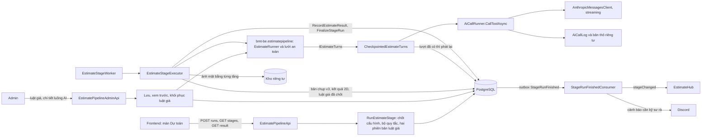
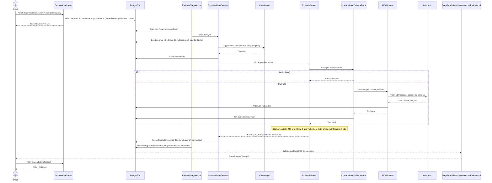
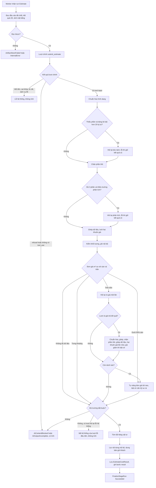
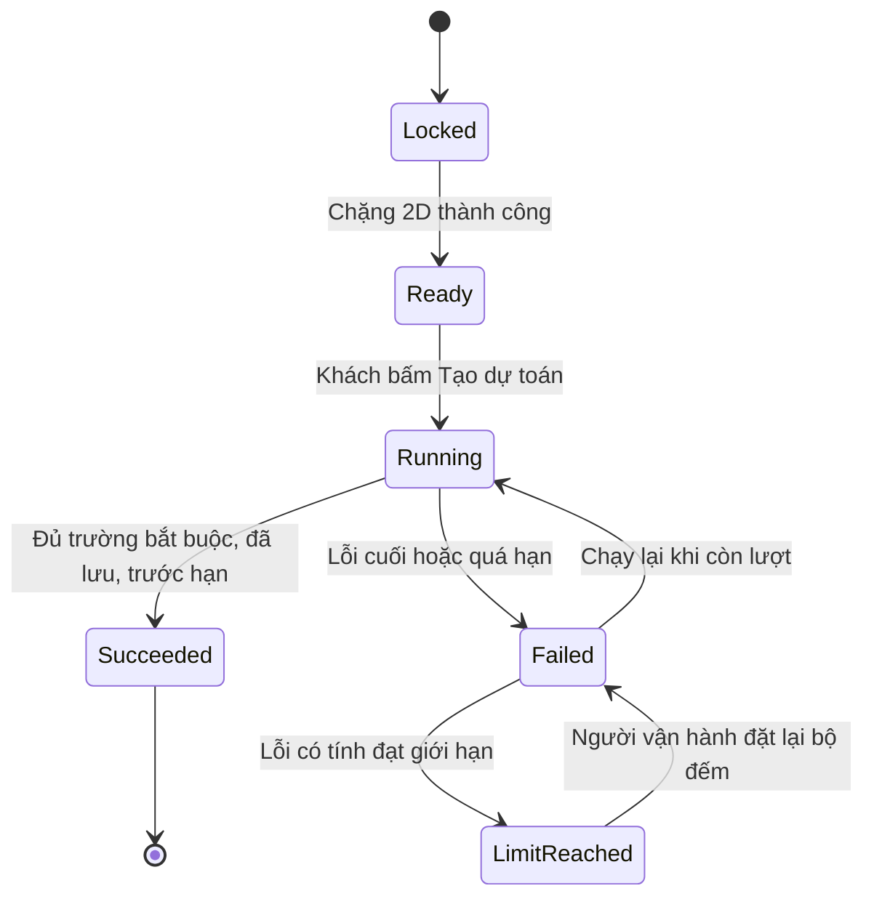
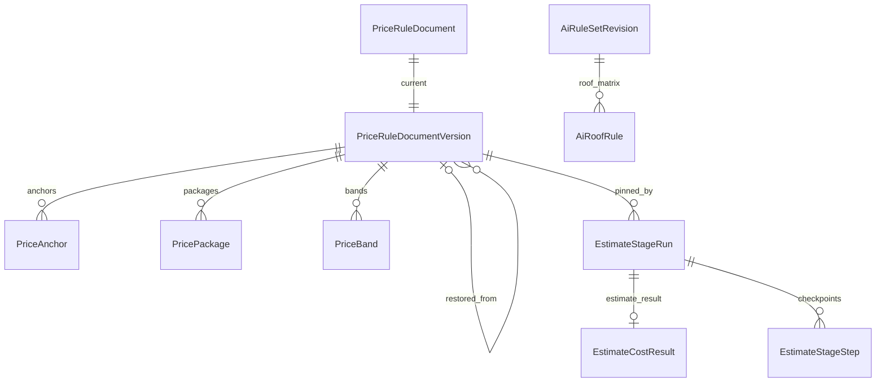

<!-- HƯỚNG DẪN CHO AI KHI ĐIỀN HOẶC CHỈNH SỬA MẪU
- Đọc toàn bộ mẫu, các comment hướng dẫn và tài liệu nguồn được cung cấp trước khi viết. Tuân thủ các quy tắc nghiệp vụ, điều kiện, ngoại lệ và giới hạn đã được xác nhận.
- Không bịa, tự chế hoặc suy đoán thành sự thật: yêu cầu, quy tắc, số liệu, API, schema, mã lỗi, nguồn tham khảo, người phụ trách và kết quả kiểm thử phải có căn cứ. Nội dung ví dụ trong mẫu không phải dữ kiện của dự án.
- Khi thiếu thông tin hoặc các nguồn mâu thuẫn, hỏi người dùng để làm rõ; giữ nguyên placeholder ở phần chưa xác định. Không tự chọn đáp án, lấp chỗ trống hay tuyên bố tài liệu đã hoàn tất.
- Chỉ thay nội dung cần điền hoặc được yêu cầu sửa. Không tự mở rộng phạm vi, sửa nghĩa quy tắc, bỏ điều kiện/ngoại lệ, xoá hay ghi đè nội dung hợp lệ đã có.
- Giữ nguyên tên, cấp và thứ tự heading, nhãn in đậm, tiền tố bullet, cấu trúc danh sách, tên/thứ tự/số cột bảng và cú pháp code fence. Không dịch, đổi tên, gộp hoặc thêm mục ngoài cấu trúc mẫu.
- Chỉ lặp khối luồng, AC hoặc API theo đúng khuôn khi có căn cứ; chỉ bỏ phần tuỳ chọn khi hướng dẫn riêng của mẫu cho phép và đã xác định không áp dụng.
- Mã tham chiếu và section phải trỏ tới tài liệu có thật đã được cung cấp hoặc kiểm chứng. Không giữ mã ví dụ như tham chiếu thật và không tự tạo tài liệu liên quan để hợp thức hoá liên kết.
- Giữ các comment hướng dẫn trong file. Xuất Markdown UTF-8, mỗi file một tài liệu; không bọc toàn bộ file trong code fence, không chèn lời dẫn hay giải thích ngoài mẫu.
- Trước khi bàn giao, đối chiếu nội dung với nguồn, kiểm tra cấu trúc, giá trị cho phép, giới hạn độ dài và tính nhất quán của mã/tham chiếu. Báo rõ phần chưa đủ thông tin; không tuyên bố đã chạy test hoặc import khi chưa thực hiện.
-->

<!-- Thay mã TDD-001 và nội dung ví dụ; giữ nguyên heading và nhãn in đậm.
Sơ đồ dùng mermaid, plantuml hoặc URL. Giữ heading Architecture, Sequence Diagram, Activity Diagram, State Diagram, Data Model.
Ví dụ API phải có heading trùng METHOD /path trong Endpoints. Xoá phần API/sơ đồ không dùng.
Version, Updated At và Change Log do lịch sử phiên bản quản lý, để trống khi nhập mới.
Author/Reviewer là tên hiển thị; gán tài khoản, phê duyệt, giả định và câu hỏi mở trên giao diện sau import.
Thiết kế phải truy vết về Story và Business Rule được cung cấp. Phân biệt thiết kế đề xuất với implementation đã kiểm chứng; không mô tả API/schema/sơ đồ ví dụ như hệ thống thật hoặc tự quyết định nghiệp vụ còn thiếu.
BẮT BUỘC KHI HOÀN THIỆN MẪU: phải có cả Reviewer và Approver, mỗi tên 1–200 ký tự sau khi bỏ khoảng trắng đầu/cuối. Không xoá hai dòng metadata, để trống, dùng tên bịa hoặc giữ placeholder rồi coi là hoàn tất.
Nếu chưa biết người review hoặc người phê duyệt, phải hỏi người dùng và báo tài liệu chưa đủ thông tin; không tự lấy Author/Owner làm người thay thế. Tên trong file không tự gán tài khoản hoặc xác nhận đã duyệt; gán thành viên trên giao diện sau import.
Đây là yêu cầu hoàn thiện mẫu; backend hiện vẫn nhận file cũ thiếu hai trường để tương thích.

VALIDATION CHO FILE NHẬP (đối chiếu ImportSnapshotValidator, MarkdownParser và ImportService):
- Mỗi file .md UTF-8 không rỗng chỉ có một heading cấp 1 chứa mã tài liệu dài 1–100 ký tự. Mã không được trùng trong cùng lần nhập hoặc thuộc loại tài liệu khác đã tồn tại.
- Không dùng tên README.md hoặc sitemap.md vì importer bỏ qua. Giao diện nhận .md/.zip, tối đa 2.000 file, tổng file tải lên 31 MiB; API giới hạn request 32 MiB và tổng nội dung đọc/giải nén 64 MiB.
- Chỉ nhập đè tài liệu cùng loại đang Draft, chưa có phiên bản và chưa lưu trữ. Import thay toàn bộ nội dung bản nháp, vì vậy phải giữ lại nội dung hợp lệ ngoài phần được yêu cầu sửa.
- Không dùng Status trong Markdown hoặc tên Approver để tự xác nhận phê duyệt; import không cấp quyền hay gán tài khoản từ tên. Chạy Kiểm tra file và xử lý lỗi/cảnh báo trước khi nhập.
- Giới hạn độ dài bên dưới tính theo string.Length của .NET (đơn vị UTF-16); không tự cắt ngắn dữ kiện quan trọng để vượt validation, hãy viết lại có căn cứ hoặc hỏi người dùng.
- Feature tối đa 300 ký tự và được dùng làm tiêu đề tài liệu. Status được parser nhận: Draft / In Review / Approved / Deprecated; tài liệu nhập mới vẫn có trạng thái phê duyệt Draft.
- Endpoint: đường dẫn tối đa 500 ký tự; tên/mô tả endpoint được lưu trong Name tối đa 300. HTTP method: GET / POST / PUT / PATCH / DELETE / HEAD / OPTIONS.
- Error Codes: mã tối đa 100 ký tự, không trùng trong tài liệu; giữ dạng - **CODE** (400): mô tả. HTTP status trong Error Codes và Response phải là số nguyên đọc được bằng Int32; không tự đặt status khác hợp đồng API.
- URL sơ đồ tối đa 1.000 ký tự. Mục sơ đồ được sử dụng phải có khối mermaid/plantuml hoặc URL theo mẫu; không để một mục sơ đồ rỗng. Nhãn mục được tách từ bullet như tên External API Fields tối đa 300 ký tự.
- Heading Examples phải khớp METHOD /path ở Endpoints. Giữ các nhãn Request:, Response 200: (thay mã theo contract) và Error Response: để parser tách đúng dữ liệu.
- Tham chiếu dạng DOC-KEY/section: ghi chú: mã đích tối đa 100 ký tự, section tối đa 100, ghi chú tối đa 1.000. Không trùng bộ mã đích + section + loại liên kết trong cùng tài liệu.
ĐỐI CHIẾU FORM TDD (src/features/tdds/validations.ts; form có thể chặt hơn import):
- Điền Feature, Author, Reviewer, Problem và ít nhất một Goal; các Goal/Non-goal/Notes đã thêm không được rỗng. API đã khai báo phải có endpoint và mô tả/mục đích; Fields phải có tên và ý nghĩa; Error Codes phải có mã, HTTP status và điều kiện.
- Form còn kiểm tra Version, Updated At và nội dung Change Log khi khai báo; với file nhập mới, giữ các trường lịch sử này trống theo hợp đồng import, không tự tạo dữ liệu lịch sử.
-->

# TDD-PROJ-009

## Document Info

- **Feature**: Tạo dự toán — chặng Dự toán: lập dự toán bằng Anthropic, lưới an toàn của app demo, luật giá có phiên bản và kết quả gửi khách
- **Author**: Claude
- **Reviewer**: Tân Trần
- **Approver**: Tân Trần
- **Status**: Draft
- **Version**:
- **Updated At**:

## Context & Goals

### Problem

Chặng Dự toán là chặng thứ hai của luồng bốn chặng (BR-PROJ-010). Sau khi chặng 2D thành công, khách bấm Tạo dự toán; backend gọi Anthropic Claude lập bảng dự toán ba phần (thô, hoàn thiện, nội thất) theo hai tài liệu luật giá, rồi chạy các lưới an toàn của app demo `design-estimate` (commit `059e876`, prompt `dt-14`) trước khi lưu kết quả (STORY-PROJ-008). Chặng này không giữ hay trừ lượt; chỉ lỗi do kết quả AI với đầu vào của khách mới tính vào giới hạn lỗi (BR-PROJ-011 khoản 1).

Nguyên tắc của tài liệu này: **làm đúng như app demo**. Hệ thống thật chỉ khác app demo ở các điểm người dùng đã chốt (mục R) và ở phần hạ tầng riêng của BMT (điểm lưu, worker, giới hạn chung, công tắc tạm ngắt, `HttpClient`, `AiCallLog`, bảng có phiên bản); phần hạ tầng không được làm đổi kết quả so với app demo.

Phần dùng chung đã có thiết kế và mã ở đợt 1, tài liệu này dùng lại, không thiết kế lại:

- Lần chạy, worker, điểm lưu bước, quá hạn, bộ đếm lỗi, phân loại `FailureCode`, cảnh báo: TDD-PROJ-006.
- Bản chụp đầu vào v3 (`EstimateGenerationSnapshotV3`), miền giá đã chốt lúc 2D, kết quả 2D (`EstimatePlanResult`): TDD-PROJ-007.
- Lớp gọi AI (`AiCallRunner`, giới hạn chung qua Redis, công tắc tạm ngắt, `AiCallLog`, bản thô), cấu hình AI có phiên bản, bộ quy tắc AI có phiên bản, quyền: TDD-PROJ-008.

Hiện trạng mã đã đối chiếu ngày 12/10/2026 trên nhánh `feature/estimate-pipeline-w1` của `bmt-be`:

- `RunEstimateStageCommandHandler.PipelineVersions` đã có `Estimate → "estimate:dt-14"`; `AiTasks.ForStage(Estimate)` trả `estimate`; `AiCallRunner.Group` xếp việc `estimate` vào nhóm giới hạn `anthropic`.
- `AiCallRunner.RunAsync` ném `AiRequestInvalid` khi nhà cung cấp khác OpenAI; chưa có `IToolCallModel` hay client Anthropic. Chỉ `RunAsync` đang lấy `OpenAiRequestTimeoutSeconds` làm hạn mỗi lần gọi cho mọi việc; `AiCallRunner.Limits` đã chọn `AnthropicRequestTimeoutSeconds` cho Anthropic, nhưng chỗ giữ sống `timeout + 35` giây, quá ngắn cho lượt dài.
- Worker chỉ đăng ký `Plan2dStageExecutor` (cài `IStageExecutor`); `EstimateStageWorker.MapAiCode` ánh xạ lỗi AI sang `FailureCode`.
- `EstimatePlanResult.InternalJson.spec` lưu phương án `HouseSpec` đã qua luật; bản vẽ nội thất và kỹ thuật từng tầng là `EstimateStageArtifact` riêng tư (`plan:furniture:f{n}`, `plan:technical:f{n}`).
- Thư viện `bmt-be.estimatepipeline` có phần 2D và `Common/Catalog.cs` (nhãn danh mục của app demo); test đối chiếu nằm ở `test/parity/` và `test/bmt-be.estimatepipeline.tests` (`Parity/`, `Ported/`).
- Bootstrap cấu hình có dòng việc `estimate` (Anthropic, `claude-haiku-4-5`, tham số `{}`) và bảng giá token của bốn model Claude. Khóa `AnthropicOption__ApiKey` đã có trong `EstimatePipelineOption.cs`, `.docker/compose.yaml`, `env-classification.json` và workflow deploy.
- Frontend đã có route `buildx-fe-web/src/app/[locale]/(main)/design/[projectId]/estimate/page.tsx`, đang hiện `PipelineLockedView` bước 3 khi luồng bốn chặng bật.

Mọi bảng, lớp, API và tên mới dưới đây là thiết kế đề xuất, chưa có mã.

### Goals

- Lần chạy Dự toán chốt bốn phiên bản lúc tiếp nhận: cấu hình AI, bộ quy tắc AI, Khung giá tham khảo (kèm giá neo và dải giá) và Quy tắc bóc tách. Admin lưu phiên bản mới thì dự toán đã có không đổi (AC-001, AC-008).
- Với cùng phản hồi AI đã ghi và cùng văn bản luật giá, kết quả sau lưới an toàn (số dòng, đơn giá, thành tiền, tổng từng phần, cờ nội bộ, văn bản gửi khách) và prompt gửi AI trùng app demo ở `059e876` tới từng ký tự, kể cả cách làm tròn. Kiểm bằng bộ dữ liệu đối chiếu sinh từ chính app demo trên văn bản luật giá gốc (mục K).
- Gọi Anthropic qua `AiCallRunner` dùng chung: streaming, ép công cụ, thử lại theo đúng `claude_client` của app demo, không vượt hạn chờ 20 phút của lần chạy. `stop_reason=max_tokens` ở lượt chính thành `AiOutputTruncated` (không thử lại, cảnh báo Discord, không tính lỗi).
- Phần gửi khách và phần nội bộ lưu tách nhau; khách chỉ đọc được phần gửi khách qua API, kể cả khi gọi thẳng backend (BR-PROJ-017).
- Worker chết giữa chừng thì chỉ mất tối đa một lời gọi AI đang chạy dở; các lượt AI đã xong được phát lại từ điểm lưu, không gọi lại.
- Lưu Khung giá tham khảo tự tính lại dải giá từ mục 3–5; phiên bản nạp sẵn cho ra đúng các dải giá đang ghim trong app demo (BR-PROJ-016).

### Non-goals

- Dựng tệp Excel, PDF và chia sẻ: thuộc chặng Hồ sơ (STORY-PROJ-010, BR-PROJ-007 khoản 4). Tài liệu này chỉ chốt hợp đồng dữ liệu và cách chuyển `fill_template.py` sang .NET (mục J) để chặng Hồ sơ dùng.
- Màn quản trị bộ quy tắc AI và prompt (STORY-PROJ-013, sau đợt 4). Đợt này chỉ nạp sẵn dữ liệu và mở API đọc.
- Sửa các lỗi chất lượng đã biết của app demo (dòng mái bị loại vì 0 đồng, các hằng số "không có căn cứ" trong `docs/LUAT-TU-SINH.md`). Chuyển đúng hành vi trước, sửa sau bằng phiên bản prompt hoặc luật mới (BR-PROJ-014 Notes, mục R).
- Khách sửa dòng dự toán, đổi gói, đổi hãng; bước duyệt của kỹ sư (STORY-PROJ-008 Out of Scope).
- Màn hình frontend: chỉ mô tả hợp đồng (mục P), không thiết kế giao diện chi tiết.

## Architecture



| Thành phần (dự kiến) | Trách nhiệm |
|---|---|
| `RunEstimateStageCommandHandler` (sửa) | Với chặng `Estimate`: đọc con trỏ hai tài liệu luật giá và ghi `PriceFrameworkVersionId`, `TakeoffRulesVersionId` vào lần chạy, cùng transaction tiếp nhận. Các bước kiểm khác giữ nguyên TDD-PROJ-006. |
| `EstimateStageExecutor` (infrastructure, mới) | Cài `IStageExecutor` cho `Estimate`, phiên bản mã `estimate:dt-14`. Dựng đầu vào, giao `EstimateRunner`, lưu kết quả. |
| `EstimateRunner` (thư viện, mới) | Chuyển `run_estimate_pipeline` của app demo (bỏ nhánh demo và bước điền Excel). Hàm thuần: mọi lượt AI đi qua `IEstimateTurns`. |
| `CheckpointedEstimateTurns` (infrastructure, mới) | Cài `IEstimateTurns`: lượt đã có bước thì trả lại kết quả đã lưu; chưa có thì gọi `IToolCallModel`, ghi bước rồi trả kết quả. |
| `IToolCallModel` + `AiCallRunner.CallToolAsync` + `AnthropicMessagesClient` | Gọi Anthropic Messages streaming, ép công cụ; thử lại, giới hạn chung, tạm ngắt, nhật ký như TDD-PROJ-008. |
| `PriceRuleStore`, `IPriceRuleReader` | Đọc và ghi hai tài liệu luật giá có phiên bản cùng giá neo và dải giá. |
| `PriceBandDeriver`, `PriceFrameworkTables` (thư viện) | Chuyển `derive_price_bands.py` và `doc_khung_don_gia`: đọc bảng đơn giá mục 3–5, tính dải giá. |
| `CustomerCopy` (thư viện) | Chuyển bộ lọc nội dung nội bộ của `fill.py`. |
| `GetStageResultQueryHandler` (sửa) | Trả phần gửi khách của chặng Dự toán. |
| `StageRunFinishedConsumer` (sửa) | Thêm cảnh báo Discord khi dự toán vừa thành công có cờ cần kỹ sư rà (mục M). |

**Notes**:

**A. Tiếp nhận và chốt phiên bản**

- Thứ tự kiểm, khóa, chống gửi lặp, hàng chờ đầy, tạm ngắt: giữ nguyên TDD-PROJ-006 bước 1–9. Bước 7a dùng nhà cung cấp của việc `estimate` trong cấu hình hiện hành, tức Anthropic; OpenAI đang tạm ngắt không chặn chặng này (ST-PROJ-199 bước 3).
- Ở bước 9, handler đọc `PriceRuleDocument` của `PriceFramework` và `TakeoffRules` (không khóa) và ghi Id phiên bản hiện hành vào `EstimateStageRun`. **Chốt phiên bản** nghĩa là lần chạy chỉ đọc đúng các phiên bản này tới khi kết thúc, kể cả khi worker khác nhận lại sau khi Admin đã lưu bản mới. Admin lưu cùng lúc với lúc tiếp nhận thì lần chạy lấy bản trước hoặc bản sau tùy commit nào xong trước; cả hai đều hợp lệ vì BR-PROJ-016 khoản 8 chỉ đòi chốt bản "đang áp dụng lúc tiếp nhận".
- Lần chạy lại sau lỗi là một dòng mới nên chốt phiên bản đang áp dụng lúc chạy lại (ALT-01, AC-007). Chặng đã thành công không chạy lại được nhờ chỉ mục `UX_EstimateStageRun_Succeeded` (AC-008).
- Không kiểm gói, không giữ lượt (BR-PROJ-010 khoản 5, ALT-02); bản chụp đầu vào là bản của lần chạy 2D thành công (`InputOperationId`).

**B. Executor, thứ tự xử lý và điểm lưu**

`EstimateStageExecutor.ExecuteAsync`:

1. Đọc bản chụp v3, lần chạy 2D thành công và `EstimatePlanResult` của nó (`InternalJson.spec` là `HouseSpec` đã qua luật), hai phiên bản luật giá đã chốt (`IPriceRuleReader`, cache theo Id vì bất biến), bộ quy tắc AI và cấu hình đã chốt (`StageExecutionContext`). Thiếu kết quả 2D hoặc phiên bản luật giá → `InternalError`.
2. Đọc ảnh mặt bằng từng tầng từ kho riêng tư bằng `CopyPrivateAsync`, như `collect_project_images`: mỗi tầng một ảnh nội thất; tầng không có ảnh nội thất thì dùng ảnh kỹ thuật kèm ghi chú; không gửi ảnh lô của khách. Lỗi đọc kho → `ArtifactStoreFailed`. Ảnh được chuẩn bị như `fit_images_for_claude` và `arrange_images_for_claude` (mục D).
3. Dựng `EstimateJob` (mục D) và ghi bước `context` (không gọi AI, `Internal=true`): loại neo giá, kiểu mái và nguồn, tổng sàn tham chiếu, số ảnh gửi và dấu vân prompt. Dấu vân prompt lưu ở khóa `prompt_fingerprint` (tên của app demo), tính như `prompt_fingerprint(system_live, main_tool)` (`prompts.py` dòng 116–122, `service.py` dòng 1380): 12 ký tự hex đầu của SHA-256 trên system prompt và công cụ `submit_estimate` đã gửi. Bước này chỉ để truy vết; khi nhận lại, executor tính lại vì mọi đầu vào đã chốt.
4. Gọi `EstimateRunner.RunAsync(job, turns, ct)`. Runner làm đúng thứ tự của `run_estimate_pipeline`:
   1. Lượt chính `estimate:main` (`submit_estimate`), rồi chuẩn hóa hình dạng (`normalize_ai_shape`).
   2. Lưới bóc tách: hỏi lại `estimate:reask:takeoff`; câu trả lời chỉ qua `recover_parts` (không qua `normalize_ai_shape`), chỉ ghép phần được hỏi.
   3. Chặn phần thô (`regroup_rough_part`, căn hộ thêm `drop_new_build_rough_lines`).
   4. Lưới phân tích: hỏi lại `estimate:reask:analysis`; câu trả lời không qua chuẩn hóa, chỉ ghép trường còn thiếu.
   5. Ghép dữ liệu (`compose_du_lieu`).
   6. Lưới hai khuôn giá (`chay_luoi_do`, có tách theo mã nhóm): hỏi lại `estimate:reask:split:structure` và `estimate:reask:split:finishing`. Lưới này sửa **ngay trên** các dòng của kết quả AI (`ai_out`): ghi `don_gia_vt`, `don_gia_nc`, xóa `don_gia`, vì `compose_du_lieu` giữ tham chiếu tới cùng danh sách. Bản .NET phải làm y như vậy, vì lượt rà giá ở bước 8 gửi lại `ai_out` đã bị sửa này cho AI.
   7. Kiểm khối lượng theo hình học và số dòng tối thiểu (chỉ ghi nội bộ, chỉ chạy một lần trên dữ liệu ở bước này).
   8. Lưới sàn giá (`ap_dung_luoi_san_gia`, mục F). Trên trần thì hỏi lại `estimate:reask:price`; câu trả lời đi qua `recompose` của app demo: chuẩn hóa hình dạng → ghép vào `ai_out` (`merge_ai_results`) → chặn phần thô → ghép dữ liệu → lưới hai khuôn giá lần nữa, có thể hỏi lại `estimate:reask:price:split:structure`, `estimate:reask:price:split:finishing`. Lưới bóc tách, lưới phân tích và kiểm khối lượng không chạy lại. Sau đó, nếu còn dưới sàn thì vẫn tự nâng đơn giá.
   9. Kiểm trường bắt buộc (`validate_du_lieu`).
   10. Tóm tắt hãng vật tư (`tom_tat_hang_vat_tu`).
   11. Làm sạch ký tự điều khiển (`lam_sach_cho_excel`) rồi dựng bản gửi khách (mục G).
5. Ghi `EstimateCostResult` bằng `RecordEstimateResultAsync` (có điều kiện đúng lease, như `RecordPlanResultAsync`), ghi bước `result`, rồi worker gọi `FinalizeStageRun(Succeeded)`.

**Lượt AI là điểm lưu.** Mỗi lượt có khóa bước cố định như trên. `CheckpointedEstimateTurns.AskAsync(key, request)`:

- Đã có bước cùng khóa: trả lại `OutputJson` (tool input thô, `Internal=true`), không gọi AI.
- Chưa có: gọi `IToolCallModel.CallToolAsync`; thành công thì ghi bước (`Model`, `PromptVersion=dt-14`) rồi trả kết quả.
- Lượt hỏi lại bị lỗi (bất kỳ loại lỗi nào, mục E) được ghi thành bước đã xong với `OutputJson={"failed":true,"errorCode":"…"}`, rồi trả lỗi cho runner để runner bỏ qua như app demo. Khi nhận lại, lưới đó thấy lượt đã có kết luận và đi tiếp đúng nhánh cũ, không hỏi lại lần hai (TDD-PROJ-006, mục "Điểm lưu từng bước").

Vì mọi phần không gọi AI là hàm thuần của đầu vào đã chốt và các phản hồi đã lưu, chạy lại runner trên cùng dữ liệu cho ra cùng kết quả. Ví dụ: worker chết sau khi ghi `estimate:main` và trong lúc chờ `estimate:reask:price`; worker mới phát lại lượt chính, tính lại các lưới, thấy cần rà giá và chỉ gọi lượt `estimate:reask:price`. Ngày lập dự toán (`ngay_lap`, lưu là `estimateDateVn`) là ngày tiếp nhận lần chạy Dự toán theo giờ Việt Nam (người dùng chốt 12/10/2026), không lấy giờ hiện tại, nên lần nhận lại qua nửa đêm không đổi kết quả; `den_ngay` = ngày đó + 90 ngày như `compose_du_lieu`. Tiến độ: `ProgressTotal` = 3 khi bắt đầu (`context`, `estimate:main`, `result`), cộng thêm mỗi lượt hỏi lại khi runner quyết định hỏi.

**C. Lời gọi Anthropic trong lớp gọi AI dùng chung**

- **Cổng** `IToolCallModel.CallToolAsync(AiCallContext, AiToolCallRequest, ct)` (TDD-PROJ-008 mục A). `AiToolCallRequest(Task, SystemPrompt, CachePrefix?, Tool{Name, Description, InputSchemaJson}, UserContent[], MaxTokens)`; nội dung là danh sách khối văn bản và ảnh theo đúng thứ tự app demo (`khoi_text`, `khoi_anh`). Mọi lượt dùng chung model của việc `estimate` (app demo dùng một `CLAUDE_MODEL` cho mọi lượt). Kết quả `AiToolCallResult(ToolInputJson, Model, CallId, Retries, StopReason)`.
- **Client**: `AnthropicMessagesClient` là `HttpClient` có kiểu, gọi `POST /v1/messages` với `stream:true`, `tool_choice:{type:"tool",name}`, đọc sự kiện SSE (lý do chọn ở TDD-PROJ-008 mục B). Không thử lại ở tầng `HttpClient`.
- **Phân loại một lần thử** (chuyển `_goi_claude_tool` của app demo):

| Tình huống | Lớp gọi AI xử lý | Căn cứ app demo |
|---|---|---|
| `stop_reason=max_tokens` | `AiOutputTruncated`: không thử lại, cảnh báo Discord có giới hạn tần suất, không tính vào công tắc tạm ngắt | `claude_client` dòng 762–767 (app demo coi là lỗi chung) |
| `stop_reason` khác `max_tokens` và có khối `tool_use` đúng tên công cụ, `input` là object | Thành công. Không đòi `stop_reason=tool_use` | dòng 768–777 |
| `stop_reason=refusal` | `AiContentBlocked` — **điểm khác app demo có chủ đích** (BR-PROJ-011 tính AI từ chối nội dung khách); app demo không có nhánh này, rơi vào dòng dưới | — |
| Không có khối `tool_use` đúng tên hoặc `input` không phải object | `AiOutputIncomplete`, không gọi lại | dòng 770–775 |
| HTTP 429, 500, 502, 503, 504, 529; lỗi mạng; HTTP 200 mà luồng đóng trước khi có `stop_reason`, thân phản hồi hoặc JSON công cụ đọc hỏng | Tạm thời: chờ đúng 2.000 → 4.000 → 8.000 ms, **không cộng ngẫu nhiên** (khác OpenAI ở TDD-PROJ-008 mục B), tối đa 4 lần gửi. Riêng 429 có header thì lần chờ kế tiếp lấy theo `retry-after-ms`, rồi `retry-after` (giây hoặc ngày giờ HTTP), thay cho bậc chờ và không dài hơn hạn của một lần gọi | `CAC_BUOC_CHO_MS`, `TRANG_THAI_TAM` dòng 38–39, 600–611, 674–676; `provider_state.retry_after_s` |
| Sự kiện `error` giữa luồng | Đổi sang mã HTTP theo `error.type` (`invalid_request_error` 400, `authentication_error` 401, `billing_error` 402, `permission_error` 403, `not_found_error` 404, `request_too_large` 413, `rate_limit_error` 429, `api_error` 500, `timeout_error` 504, `overloaded_error` 529) rồi xử lý như mã đó | dòng 443–456 |
| 402, `error.type=billing_error`, hoặc thông báo khớp `credit balance is too low\|insufficient…credit\|billing\|payment required` | `AiOutOfCredit`: không thử lại, cảnh báo, ngắt tạm ngay | `la_loi_het_tien`, `RE_HET_TIEN` dòng 440–441 |
| 401, 403 | `AiBadKey` / `AiPermissionDenied`: không thử lại, cảnh báo, ngắt tạm ngay | `_loi_key_sai` |
| 400 có chữ "cache" khi đang gắn bộ nhớ đệm | Bỏ bộ nhớ đệm, gửi lại; tính là một lần thử và chờ theo lịch | dòng 683–691 |
| 400 nói `temperature` không được hỗ trợ | Bỏ tham số, nhớ theo model (cơ chế có sẵn của BMT; app demo không gửi `temperature` theo mặc định nên không gặp) | — |
| 400 khác, 404, 413, 501 và mã còn lại | `AiRequestInvalid` (lỗi hệ thống), không thử lại | dòng 692–696 |

- **Thời hạn**: hạn một lần gọi theo `han_chot_mot_lan` của app demo, `max(AnthropicRequestTimeoutSeconds, 60 + max_tokens / 40)` giây (300 giây mặc định; 64.000 token → 1.660 giây), lấy `min` với thời gian còn lại của lần chạy (BR-PROJ-012 khoản 7); `AnthropicRequestTimeoutSeconds` cũng là thời gian tối đa giữa hai gói dữ liệu. Chỗ giữ của nhóm `anthropic` sống bằng hạn đó cộng 30 giây (TDD-PROJ-008 mục B). Đây là chỉnh sửa vào `AiCallRunner.RunAsync` và `Limits`.
- **Bộ nhớ đệm prompt**: tham số `promptCache` của việc `estimate`, **mặc định tắt** như `ESTIMATE_PROMPT_CACHE` của app demo (mục N). Khi bật, làm đúng `khoi_cache`: chỉ lượt chính và lượt rà giá (cùng system prompt, cùng công cụ, truyền `cache_tien_to`) được gắn; ước tính token của tiền tố = độ dài JSON công cụ ÷ 0,92 + độ dài phần đầu bất biến (`tien_to_bat_bien`) ÷ 1,71; chỉ gắn khi system prompt bắt đầu bằng phần đầu đó, phần đầu ngắn hơn system prompt và ước tính từ 4.096 token trở lên; gắn `cache_control: {type: ephemeral}` vào công cụ và vào khối phần đầu (system tách thành hai khối văn bản).
- **Nhật ký và chi phí**: một dòng `AiCallLog` cho mỗi lượt (Task `estimate`, `StepKey` là khóa lượt). Token vào = `input_tokens` + `cache_read_input_tokens` + `cache_creation_input_tokens`; chi phí theo công thức TDD-PROJ-008 mục C. Bản thô lưu như TDD-PROJ-008 mục C.
- **Model và tham số**: `SupportedAiModels` thêm cờ `ForcedToolChoice` và số token đầu ra tối đa `MaxOutputTokens` của model; việc `estimate` chỉ nhận model Anthropic có cờ này, ban đầu chỉ `claude-haiku-4-5` với `MaxOutputTokens` = 64.000 ("64,000 is the Claude Haiku 4.5 maximum", `service.py` dòng 129) (TDD-PROJ-008 mục E). Khoảng hợp lệ của các tham số giới hạn đầu ra ở mục O. Không gửi `temperature` theo mặc định (app demo `ESTIMATE_TEMPERATURE=-1`; khi có giá trị, app demo chỉ gửi cho model Haiku).
- **Lời gọi dò khi hết thời gian ngắt** (chuyển `probe_credit`): theo TDD-PROJ-008 mục B, một lời gọi `max_tokens=1` với model của việc `estimate` quyết định có mở lại Anthropic hay ngắt tiếp, để lần chạy của khách không phải gánh lỗi hết tiền.

**D. Dựng đầu vào cho AI (`EstimateJob`)**

`EstimateInputs.Build(snapshotV3, planResult, priceRules, ruleSet, config)` (application) dựng bộ thông tin mà app demo gọi là `form`/`tt` (`form_from_project` và khối `info` của `run_estimate_pipeline`). Bản chụp v3 đóng vai `project.input` của app demo; `HouseSpec` đóng vai `spec.json`:

| Trường app demo | Nguồn trong hệ thống thật |
|---|---|
| `loai_cong_trinh_slug`, `style_slug`, `goi_slug` | `BuildingType.BaseCode`, `EffectiveBaseStyleCode`, `FinishPackage` (Basic → `co-ban`, Standard → `tieu-chuan`, Vip → `vip`) của bản chụp v3 |
| `loai_nha`, `kieu_phong_cach`, `goi_ten` | Nhãn của app demo tra từ mã gốc qua `Common/Catalog.cs` (`BuildingTypeLabel`, `StyleLabel`, `PackageLabel`), như chặng 2D; không dùng tên danh mục Admin đặt. Ví dụ `vip` → "Cao cấp (VIP)", `nha-vuon-cap4` → "Nhà vườn/Nhà cấp 4". Nhờ vậy prompt và các câu do `_mai_doc_ro` đọc từ nhãn trùng app demo tới từng byte |
| `so_tang`, `tum` | `FloorCount`, `HasTum` của bản chụp v3 trước; thiếu thì lấy `HouseSpec.FloorCount`, `RoofRoom`; căn hộ luôn 1 tầng, không tum |
| `dia_chi` | Địa chỉ của bản chụp v3, ghép như chuỗi địa chỉ đã dùng ở 2D, cắt 200 ký tự UTF-16 |
| `vung_mien` | `PricingRegion.Region` đã chốt lúc 2D (North → `Bắc`, Central → `Trung`, South → `Nam`); không dò địa chỉ, không có cờ Tây Nguyên |
| `dien_tich_xd`, `kich_thuoc_dat`, `kich_thuoc_tong` | `HouseSpec.BuiltAreaM2`; lô của `HouseSpec` qua `locked_dimensions`, `lot_size_text` |
| `so_phong_ngu`, `so_wc` | Đếm lại từ `HouseSpec` (`count_rooms`) |
| `tong_san_tham_khao` | `HouseSpec.TotalFloorAreaM2` nếu có, không thì suy từ diện tích xây dựng (`reference_total_floor_area`, kèm ghi chú như app demo) |
| `yeu_cau_them` | Chuỗi "Mô tả ban đầu của khách ở bước GEN 2D: " + `Description` cắt 2.000 ký tự UTF-16; khi đưa vào prompt, `boc_du_lieu_khach(…, 2000)` cắt lại 2.000 ký tự tính cả phần đầu, đổi `>>>` thành `> > >` và bọc trong `<<<…>>>` |
| `danh_xung`, `ten_khach_hang` | `danh_xung` luôn "Anh/Chị" như app demo; tên khách không gửi (người dùng chốt 12/10/2026). Ô khách thấy dùng mặc định "Khách hàng" của `compose_du_lieu` |
| `ten_du_an` | Không gửi cho AI (app demo cũng không đưa vào `info`); ô gửi khách dùng mặc định "Công trình {loại}" của `compose_du_lieu` |
| `khoi_luong_co_so` | `base_quantities(spec)` qua `spec_base_quantities(spec, tong_san_tham_khao)`: chiều cao tầng theo loại neo giá của `HouseSpec` (loại, phong cách), tỷ lệ cửa 0,2 |

- **Loại neo giá** (6 loại: `nha-pho`, `nha-mai`, `biet-thu-hien-dai`, `biet-thu-tan-co-dien`, `cap-4-tron-goi`, `can-ho`) tính trong mã bằng `PriceTypeResolver.Resolve(baseCode, baseStyleCode)`, chuyển nguyên `loai_neo_gia` (so khớp chuỗi không dấu như `tan co`, `co dien`, `thai`, `nhat`, `ngoi`, `biet thu`, `san vuon`).
- **Kiểu mái** (`RoofResolver`, chuyển `mai_cua_du_an`): mặc định là kiểu mái theo loại và phong cách, tra ma trận mái của bộ quy tắc AI đã chốt (`AiRoofRule`, mục I; dữ liệu nạp sẵn bằng `suy_loai_mai`), nguồn `loai_style`. Mái do phương án nêu chỉ đi vào qua `khoi_luong_co_so.total` khi `roof_source='spec'` (`roof_from_spec` đọc `area_conversion_note`, `exterior`, `assumptions`, `summary` theo thứ tự). Nếu kiểu mái của phương án **trùng** kiểu mặc định thì dùng nguyên dòng mặc định (độ dốc 1,3 / 1,2 / 1,25, câu giả định mặc định, nguồn `loai_style`); chỉ khi khác mới dùng mái của phương án: tôn (quy đổi 0,3, dốc 1,1), ngói (0,7, dốc `roof_pitch` của phương án hoặc 1,25), BTCT (0,5). Kiểu mái và nguồn được lưu vào kết quả để chặng 3D dựng đúng kiểu mái đã tính tiền (STORY-PROJ-009/AC-003). Từ 13/10/2026 chặng 3D chạy cùng lúc với Dự toán và có thể xong trước; khi đó 3D tự tính kiểu mái bằng `RoofResolver.KindForSpec` (hàm thuần mới gói đúng ba bước trên: `BaseQuantities` → `ForProject` → `KindOf`, dùng ma trận mái của bộ quy tắc đã chốt cho lần chạy), nên cho cùng kiểu mái khi cùng phương án 2D và cùng phiên bản ma trận mái (TDD-PROJ-010 mục B.4). Chặng Dự toán không đổi cách tính.
- **Giá neo và chỉ tiêu** (mục F), **khối lượng tham chiếu** (`khoi_luong_tham_chieu`, `ket_cau_theo_loai`, `so_dong_toi_thieu`) và **khối lượng cơ sở** đều tính trong thư viện; không gọi AI.
- **Rút gọn quy tắc theo dự án** (`loc_quy_tac_theo_du_an`), đúng các bước của app demo:
  - Cả hai tệp: sửa hai con trỏ mục hỏng (`_sua_con_tro_hong`). Khung giá: bỏ khối trích dẫn đầu tệp (`_bo_ghi_chu_bien_tap`); mục 2 bỏ bảng neo tổng quát 2.1–2.2 và đoạn "Ví dụ chuẩn", thêm đoạn trỏ tới hai dòng "GIÁ NEO BẮT BUỘC ĐẠT" và "CHỈ TIÊU BẮT BUỘC"; mục 7 bỏ hai gạch đầu dòng bảo trì; mục 8 chỉ giữ cột "Mã nhóm", "Hạng mục" và cột của gói; mục 9 chỉ giữ cột "Nhóm" và cột miền; mục 10 bỏ bảng.
  - Quy tắc bóc tách: bỏ khối nhật ký phiên bản đầu tệp (`_bo_nhat_ky_phien_ban`); căn hộ thay mục 2.1–2.5 bằng đoạn chỉ sang phạm vi phần thô cải tạo và bỏ checklist xây mới; mục 5 giữ một dòng gói ở 5.1, bảng loại và một dòng phong cách ở 5.2; mục 6 giữ một dòng mùa khởi công; mục 9 bỏ các ví dụ ĐÚNG/SAI và gạch đầu dòng "Tự soát".
  - Chọn cột hoặc dòng miền theo khóa `mien bac`, `mien trung`, `mien nam` suy từ miền đã chốt. Tây Nguyên thuộc miền Trung (BR-PROJ-013), nên dự án ở Lâm Đồng nhận cột và dòng "Miền Trung".
  - Văn bản nạp sẵn đã làm sạch (mục O) làm prompt khác app demo: chỗ sửa 1 nằm trong đoạn "Kiểm tra bắt buộc" của mục 2 mà bộ rút gọn giữ lại, nên khác ở **mọi** dự án; chỗ sửa 2–3 nằm ở cột "Miền Nam" của mục 9, nên khác ở mọi dự án miền Nam; chỗ sửa 4 chỉ ở dòng bị bộ rút gọn bỏ với dự án không thuộc Tây Nguyên. Bộ đối chiếu vì vậy chạy trên văn bản gốc (mục K).
- **Prompt**: `EstimatePrompts` (phiên bản `dt-14`) dựng system prompt (`tao_system_prompt`: vai trò, cách làm việc, quy tắc số liệu, khối ô gửi khách, quy tắc nghiệp vụ đã rút gọn, khối hãng vật tư `khoi_hang_vat_tu`), thông tin công trình (`tao_thong_tin_cong_trinh`), các prompt hỏi lại và bốn công cụ (`submit_estimate`, `supplement_breakdown`, `supplement_analysis`, `fix_price_format`). Phần cấu trúc (schema, mô tả trường, tên công cụ) nằm trong mã (BR-PROJ-014 khoản 4); phần lời dặn sửa được nằm ở `AiPromptPart` (mục I). Lời dặn chung `AiInstruction` phạm vi `Estimate` và lời dặn gói × chặng `AiPackageStageInstruction` của `Estimate` chỉ được nối vào cuối system prompt khi có dòng khớp; dữ liệu nạp sẵn không có dòng nào nên prompt trùng app demo.
- **Ảnh** (`fit_images_for_claude`, `arrange_images_for_claude`): tối đa 9 ảnh; trần mỗi ảnh = `min(5 MiB − 64 KiB, 24 MiB ÷ số ảnh)` tính trên chuỗi base64. Chỉ ảnh vượt trần mới bị nén: bỏ kênh trong suốt trên nền trắng, thu cạnh dài về 1.568 px, JPEG chất lượng 90 → 80 → 70; vẫn vượt thì thu cạnh ×0,75 tới 256 px. Ảnh không giải mã được thì bỏ, kèm ghi chú, lần chạy vẫn đi tiếp. Mỗi ảnh có nhãn "Ảnh i/N: …" theo loại (nội thất hoặc kỹ thuật) và tầng. Không có ảnh nào thì gửi khối văn bản "KHÔNG có ảnh mặt bằng nào — bỏ qua mục 0, tự SUY CÔNG NĂNG CHUẨN …" như app demo.

**E. Lưới an toàn, hỏi lại và phân loại lỗi**

Mỗi lưới hỏi lại **đúng một lần mỗi lần lưới đó chạy**, như app demo (không có tham số đổi số lần). Lưới hai khuôn giá chạy hai lần nếu có lượt rà giá (bước 8 mục B), nên mỗi phần thô, hoàn thiện có thể được hỏi tách giá tối đa hai lần.

| Lưới (hàm app demo) | Khi nào chạy | Việc làm |
|---|---|---|
| Chuẩn hóa hình dạng (`normalize_ai_shape`) | Sau lượt chính và lượt rà giá | Gom trường bị trải phẳng, tách phần bị lồng hoặc ghi thành chuỗi JSON; không gọi AI |
| Bóc tách (`apply_takeoff_net`) | Thiếu ít nhất một phần và bảng kê phòng dài hơn 20 ký tự | Hỏi lại `supplement_breakdown` chỉ cho phần thiếu, không đính ảnh, `max_tokens` 24.000 khi thiếu đúng một phần thô hoặc hoàn thiện, còn lại 64.000; câu trả lời qua `recover_parts`, chỉ ghép phần được hỏi |
| Chặn phần thô (`regroup_rough_part`, `drop_new_build_rough_lines`) | Sau bóc tách và sau lượt rà giá | Chia lại nhóm phần thô chỉ khi có từ 3 dòng sai nhóm; căn hộ bỏ dòng xây mới theo `NEW_BUILD_ROUGH_RE`, nhưng nếu bỏ hết thì giữ nguyên và ghi chú |
| Phân tích (`apply_analysis_net`) | Đủ 3 phần có dòng và thiếu ít nhất một trong 12 trường `phan_tich` | Hỏi lại `supplement_analysis` (`max_tokens` 4.000), chỉ ghép trường thiếu |
| Hai khuôn giá (`chay_luoi_do`, `tach_gia_theo_ma_nhom`) | Sau khi ghép, và lại sau lượt rà giá | Tách giá gộp bằng 24 tỷ lệ theo mã nhóm vật tư; phần thô hoặc hoàn thiện có ≥ 5 dòng hoặc ≥ 30% dòng 0 đồng là "phần hỏng". Chỉ hỏi lại `fix_price_format` (`max_tokens` 8.000) khi phần hỏng còn dòng cứu được (có khối lượng và giá gộp dương). Dòng AI tách lại phải thỏa \|VT + NC − giá gộp\| ≤ 1.000 đ; không thỏa thì tách theo tỷ lệ tên nhóm (`ty_le_vat_tu_theo_nhom`: ốp lát/gạch 70/30, sơn 60/40, cửa/kính/lan can/điện 85/15, còn lại 70/30) và ghi chú dòng |
| Chuẩn hóa (`chuan_hoa`) | Trong lưới hai khuôn giá | Loại dòng 0 đồng và nhóm rỗng, khối lượng 2 số lẻ, đơn vị đếm làm tròn, ghép vật liệu với hãng (`chuan_hoa_hang_item`) |
| Kiểm khối lượng (`check_quantities`, `check_min_rows`) | Một lần, trước lưới sàn giá | So với hình học của phương án và số dòng tối thiểu; chỉ ghi phần nội bộ |
| Sàn giá (`ap_dung_luoi_san_gia`) | Luôn chạy | Mục F |
| Kiểm trường bắt buộc (`validate_du_lieu`) | Cuối cùng | Thiếu ô gửi khách bắt buộc, `tong_san_so` không phải số dương, hoặc một phần rỗng → lần chạy lỗi |
| Hãng vật tư (`tom_tat_hang_vat_tu`) | Sau kiểm | Chỉ đếm dòng có vật tư (bỏ dòng thuần nhân công và dòng vật liệu "—"); số dòng thiếu hãng > `max(5, ⌈0,1 × số dòng có vật tư⌉)` → cờ "cần nhân viên rà"; không chặn |

**Lượt hỏi lại lỗi không làm lần chạy lỗi** (như app demo, `service.py` dòng 877, 921; `dutoan.py` dòng 931, 1985): mọi lỗi của lượt hỏi lại — dịch vụ lỗi sau khi đã thử lại, hết tiền, sai khóa hoặc bị từ chối quyền, `AiRequestInvalid`, bị cắt vì `max_tokens`, bị từ chối nội dung (`refusal`), không có `tool_use` — đều được bỏ qua: giữ kết quả trước lượt đó, thêm ghi chú nội bộ, đi tiếp. Lượt hỏi lại lỗi không tự đặt mã lỗi cho lần chạy; mã lỗi cuối chỉ được chọn khi bước kiểm trường bắt buộc ở cuối thất bại, theo bảng dưới. Lớp gọi AI vẫn gửi cảnh báo như thường (`AiProviderAccountProblem`, `AiOutputTruncated`), vẫn báo công tắc tạm ngắt, và lượt vẫn được ghi bước (mục B). Chỉ lỗi của **lượt chính** làm lần chạy lỗi ngay. Ví dụ hồ sơ đối chiếu `82UWR4`: lượt bổ sung phân tích bị cắt ở 4.000 token, app demo bỏ qua rồi kiểm trường bắt buộc thất bại; hệ thống thật cho cùng kết quả (lần chạy lỗi).

Mã lỗi cuối của lần chạy (`FailureCode`, nhóm theo `StageFailureClassifier` của TDD-PROJ-006):

| Tình huống | `FailureCode` | Tính vào giới hạn lỗi |
|---|---|---|
| Lượt chính: hết tiền | `AiOutOfCredit` | Không (AC-009) |
| Lượt chính: 401, 403, lỗi tạm thời đã hết lần thử, `AiRequestInvalid` | `AiProviderUnavailable` (`EstimateStageWorker.MapAiCode`) | Không |
| Lượt chính: `stop_reason=max_tokens` | `AiOutputTruncated`, có cảnh báo | Không |
| Lượt chính: `stop_reason=refusal` | `AiContentBlocked` | Có |
| Lượt chính: không có khối `tool_use` | `AiOutputIncomplete` | Có (mục R, quyết định 7) |
| Kiểm trường bắt buộc thất bại và trong lần chạy có lượt hỏi lại lỗi vì hệ thống (dịch vụ lỗi sau khi đã thử lại, hết tiền, sai khóa hoặc bị từ chối quyền, `AiRequestInvalid`, bị cắt) | Mã hệ thống của lượt đó, ánh xạ như lượt chính: `AiOutOfCredit`, `AiOutputTruncated`, các lỗi còn lại thành `AiProviderUnavailable` (`MapAiCode`). Có nhiều lượt như vậy thì lấy lượt lỗi đầu tiên theo thứ tự chạy của runner (mục B bước 4), nên lần nhận lại cho cùng mã | Không (BR-PROJ-011 khoản 1; mục R, quyết định 9) |
| Kiểm trường bắt buộc thất bại trong các trường hợp còn lại: AI vẫn thiếu sau lượt hỏi lại; lượt hỏi lại không trả `tool_use` hoặc bị từ chối nội dung (`refusal`); app demo không hỏi lại vì bảng kê ≤ 20 ký tự, vì thiếu phần nên lưới phân tích không chạy, hoặc vì `tong_san_so` có mà không phải số dương | `AiOutputIncomplete` | Có (mục R, quyết định 7 và 9) |
| Quá hạn | `StageTimedOut` (job bảo trì chốt) | Không |
| Không đọc được ảnh 2D trong kho | `ArtifactStoreFailed` | Không |
| Thiếu kết quả 2D, thiếu phiên bản luật giá, lỗi ngoài dự kiến | `InternalError` | Không |

**F. Giá neo, dải giá và cách làm tròn**

- **Giá neo** (`PriceAnchors`, chuyển `neo_san_tr_m2`): `neo = AbsoluteTrM2` hoặc `neo(nha-pho) × TownhouseFactor`, `neo_goi = neo × AnchorFactor của gói`, tính trong số thực như app demo. Không hạ 5% cho vùng nhân công thấp (người dùng chốt 12/10/2026). Khóa `vung_re` vẫn có trong kết quả kiểm sàn và khối `san_gia` để giữ cùng hình dạng dữ liệu với app demo, nhưng luôn là `false`; vì vậy prompt không bao giờ in cụm "(đã hạ theo vùng nhân công thấp)" (`prompts.py` dòng 1364). `san_tr_m2` là `neo_goi` làm tròn 2 số lẻ. Công thức kiểm theo loại: căn hộ `ht_nt` (hoàn thiện + nội thất), `cap-4-tron-goi` `tron_goi` (cả ba phần), còn lại `xay` (thô + hoàn thiện).
- **Dải giá với tới** (`dai_voi_toi`): thô theo loại, hoàn thiện và nội thất theo loại × gói, đọc từ `PriceBand` của phiên bản Khung giá đã chốt; căn hộ không có dải thô.
- **Chỉ tiêu từng phần** (`phan_bo_neo`, `chi_tieu_du_toan`, `_noi_that_roi`): tìm một vị trí chung `t` trên dải của mọi phần sao cho tổng bằng neo **chưa làm tròn**; phần cuối hấp thụ phần làm tròn; nội thất rời của công thức `xay` lấy dải nội thất rời của gói, chặn dưới bằng đầu thấp dải nội thất. Số tiền của chỉ tiêu làm tròn tới 10 triệu.
- **Lưới sàn giá**: đơn giá m² chưa làm tròn = tiền theo công thức ÷ `tong_san_so` ÷ 10⁶, so với `san_tr_m2` đã làm tròn × 0,95; trần = `max(neo_goi chưa làm tròn, tổng đầu cao dải các phần) × 1,35`.
  - `tong_san_so` hoặc số tiền không dương → bỏ qua lưới, ghi chú nội bộ (`khong_du_du_lieu`).
  - Trong khoảng nhưng trên đầu cao dải → cờ "cần kỹ sư rà"; trên đầu cao dải × 1,8 và trên `san_tr_m2` × 1,05 → nghi bóc trùng (cảnh báo đỏ).
  - Trên trần → hỏi lại AI một lần (mục B bước 8). Lượt rà giá làm giá giảm → ghi số giảm và bật cờ cần kỹ sư rà; giảm xuống dưới sàn → cảnh báo đỏ rồi tự nâng lại. Lượt rà giá lỗi → giữ kết quả ban đầu, ghi chú.
  - Dưới sàn (kể cả sau lượt rà giá) → không hỏi AI, **tự nâng đơn giá tới 100% neo**: hệ số cần = `san_tr_m2 ÷ don_gia_tr_m2` (cả hai đã làm tròn 2 số lẻ), tối đa ×6 (vượt thì nâng tới ×6, ghi `vuot_gioi_han_nang`); chỉ nâng các dòng không phải vật liệu cơ bản (`HANG_HOA_KHONG_NANG`, so chuỗi con trên tên đã bỏ dấu, nên "lắp đặt" cũng khớp "lap dat" và giữ giá); hệ số mỗi dòng tối đa ×3, chạm trần dòng thì tổng vẫn dưới sàn, cảnh báo đỏ và bật cờ. Giữ nguyên khối lượng. Mỗi dòng được nâng có thêm ghi chú "đơn giá theo mặt bằng giá thị trường hiện nay" (gửi khách, giữ trong đợt này theo quyết định 12/10/2026). Tự nâng luôn bật cờ cần kỹ sư rà. Neo cao hơn đầu cao dải thì ghi `ngoai_tam_khung` — nhà phố gói Tiêu chuẩn luôn vậy (6,96 > 3,97 + 2,22 = 6,19).
- **Ví dụ** (ST-PROJ-142): nhà phố gói Tiêu chuẩn, `san_tr_m2` = 6,96; AI trả 4,42 tr/m² < 6,96 × 0,95 → hệ số cần 6,96 ÷ 4,42 ≈ 1,575 < ×6 → nâng đơn giá; tổng đạt khoảng 6,97 tr/m² (làm tròn nghìn đồng từng đơn giá làm số cuối lệch nhẹ).
- **Làm tròn** (phải trùng app demo vì app demo trộn quy ước của JavaScript và Python):

| Chỗ dùng | Quy tắc | Hàm app demo |
|---|---|---|
| Đọc số AI trả ("12,5", "1.234,56", "1,234") | Quy ước dấu phẩy Việt Nam, kiểu lạ thì không nhận | `ep_so` |
| Khối lượng | `Math.round(kl × 100) / 100` của JavaScript (số đúng nửa làm tròn lên) | `chuan_hoa` |
| Khối lượng đơn vị đếm | `floor(kl + 0,5)`, tối thiểu 1, thêm ghi chú dòng | `chuan_hoa` |
| Đơn giá khi tính tiền, thành tiền mỗi dòng | Làm tròn nửa về số chẵn (như `round()` của Python): làm tròn đơn giá trước, rồi thành tiền = làm tròn(khối lượng × đơn giá) | `gia_dong`, `round_half_even` |
| Tổng từng phần, tổng dự toán | Cộng thành tiền đã làm tròn | `tinh_tong_js` |
| Tách VT/NC theo tỷ lệ | Làm tròn giá gộp trước, VT = `Math.round(gộp × tỷ lệ / 1000) × 1000`, NC = gộp − VT; VT > gộp thì VT = gộp; VT ≤ 0 mà gộp > 0 thì VT = gộp | `tach_gia_theo_ty_le_so` |
| Tự nâng đơn giá | `max(Math.round(giá × hệ số / 1000) × 1000, giá cũ)` | `nhan_don_gia_phan` |
| Đơn giá m², chỉ tiêu, dải in ra | `Math.round(x × 100) / 100` | `kiem_san_gia`, `phan_bo_neo` |
| Tiền của chỉ tiêu | `Math.round(tr/m² × m² / 10) × 10` triệu | `chi_tieu_du_toan` |
| Số trong prompt | `toLocaleString('vi-VN')` (`_vi`), `toFixed` (`_to_fixed`), dấu phẩy thập phân (`_so_vn`), `Math.round` theo V8 (`_lam_tron`) | `prompts.py` |
| Khối lượng trong ghi chú | Kiểu `%g` 6 chữ số có nghĩa, dấu phẩy thập phân | `fmt_kl` |
| Tổng sàn trong ô gửi khách soạn lại | `round(x, 2)` của Python | `soan_tong_dien_tich_san` |
| Số in trong văn bản khác | `Number.prototype.toString` và `JSON.stringify` của JavaScript (thứ tự khóa, số nguyên không có `.0`) | `so_js`, `string_js`, `json_stringify` |

Thư viện thêm `Common/JsMath`, `Common/JsNumber`, `Common/JsJson` cho các quy tắc này; phần 2D dùng `PyNum` vì mã 2D của app demo là Python thuần, còn mã dự toán được chuyển từ JavaScript cũ nên mang ngữ nghĩa JavaScript. Tiền tính trong `double` như app demo, chỉ đổi sang `decimal` khi ghi cột `GrandTotalVnd`.

**G. Phần gửi khách và phần nội bộ (BR-PROJ-017)**

- Runner gọi `CustomerCopy.Build(data)` (chuyển `loc_noi_bo_khoi_ban_gui_khach`). Mỗi ô gửi khách (11 ô của `O_GUI_KHACH`, `ghi_chu` từng dòng, `bang_ke_phong`) đi qua `thu_nhan_o_gui_khach`:
  - **Kiểm hợp đồng** (`ly_do_khong_gui_khach`) gồm bốn nhóm: 18 mẫu `_MAU_NOI_BO` và 7 mẫu `_MAU_HOP_DONG` chạy trên chữ đã bỏ dấu; luật tiền (`tr`, `triệu`, `tỷ`, `tỉ`, hoặc số từ 3 chữ số kèm `đ`, `đồng`, `vnđ`) và luật phép nhân số trần (tích hai số thập phân không có đơn vị) chạy trên chữ **có dấu**, không phân biệt hoa thường.
  - Ô sạch thì giữ nguyên từng byte. Ô không sạch thì cắt theo thứ tự: phần trong ngoặc → mệnh đề tách bởi `;`, `·`, `—`, ` - ` → các vế tách bằng dấu phẩy → cả câu; mảnh còn lại phải từ 8 ký tự (`_TOI_THIEU_O_NGAN`, `fill.py` dòng 469) ở **mọi** ô gửi khách, kể cả đoạn văn tự do như `van_tu_van`, `bang_ke_phong` và các ô của khối phân tích (`fill.py` dòng 507–523, 690–746). Ngưỡng 25 ký tự (`_TOI_THIEU_KY_TU`, `fill.py` dòng 188) chỉ là mặc định khi gọi thẳng hàm lọc `loc_noi_dung_noi_bo`; luồng dự toán không dùng ngưỡng này. Bản cứu phải qua lại toàn bộ hợp đồng; không qua thì bỏ cả ô và hệ thống tự soạn lại từ dữ liệu công trình (`soan_tong_dien_tich_san`, `soan_van_tu_van`, câu dự phòng của ô ngắn, `soan_ghi_chu_dong`).
  - Ô `nhan_xet_du_toan` luôn do hệ thống soạn (`soan_nhan_xet_gui_khach`), chỉ chèn đoạn của AI khi cả đoạn sạch; báo cáo luôn có mục `placeholders.nhan_xet_du_toan` với dấu `he_tu_soan`. Trường `ghi_chu_noi_bo` của AI không bao giờ vào phần gửi khách.
- Regex chuyển sang .NET bằng `PyRe.Compile` (đã có) với `RegexOptions.CultureInvariant`; phải giữ ngữ nghĩa lookbehind, `\b`, `\d` và lớp ký tự Unicode của Python. Bộ ca lấy từ `tests/estimate/test_estimate_customer_cells.py` và các ô bị cắt trong dữ liệu đối chiếu.
- Phần gửi khách (`CustomerJson`): khối `placeholders` đã lọc (thông tin công trình theo nhãn app demo, tổng sàn quy đổi, tư vấn, nhận xét, tiến độ, mùa khởi công, ngày lập và hạn báo giá), ba phần với từng dòng đã lọc, tổng từng phần và tổng dự toán, đơn giá m² sàn quy đổi, kiểu mái. Phần nội bộ (`InternalJson`): bản chưa lọc của khối phân tích và bảng kê phòng, `luu_y`, `canh_bao`, kết quả từng lưới, `san_gia` (giữ nguyên khóa của app demo, `vung_re` luôn `false` như mục F), `hang_vat_tu`, đánh giá cho nhân viên (`StaffReviewBuilder`, chuyển `staff.py`), báo cáo các ô đã cắt, thông tin chạy (phiên bản prompt, dấu vân prompt, hash phương án, model). Chi phí AI đọc từ `AiCallLog`, không lặp lại. Màn hình demo hiện bản chưa lọc; hệ thống thật hiện bản đã lọc vì BR-PROJ-017 khoản 3 đòi màn hình chỉ dùng phần gửi khách.
- Cờ "cần kỹ sư rà" (`san_gia.can_ky_su_duyet`) và "cần nhân viên rà" (`hang_vat_tu.can_nv_ra`) lưu thành cột `NeedsEngineerReview`, `NeedsStaffReview`; không chặn chặng thành công, không tạo việc duyệt, không gửi thông báo cho khách (BR-PROJ-017 khoản 4). Cờ cần kỹ sư rà có cảnh báo Discord cho Admin (mục M).
- Đơn giá m² sàn quy đổi gửi khách (`pricePerM2Vnd`) = tổng dự toán ÷ `tong_san_so`, làm tròn tới đồng theo kiểu nửa xa số 0 (0,5 đồng làm tròn lên). Đây đúng là số khách thấy ở ô "Suất đầu tư quy đổi trên m² sàn" D22 của `template.xlsx`: công thức `=IFERROR(D20/D21,"—")` với định dạng `#,##0`. Ví dụ 2.367.900.135 ÷ 270 = 8.770.000,5 → 8.770.001. Đây không phải đơn giá dùng để kiểm sàn giá.

**H. Luật giá có phiên bản (BR-PROJ-016, STORY-PROJ-011)**

- Hai tài liệu là văn bản Markdown, mỗi lần lưu tạo một `PriceRuleDocumentVersion` bất biến; con trỏ `PriceRuleDocument` chỉ phiên bản hiện hành. Phiên bản Khung giá kèm giá neo, hệ số gói và dải giá của chính nó.
- **Lưu** (`SavePriceRuleDocumentCommandHandler`, Idempotency-Key): khóa dòng con trỏ `FOR UPDATE`, so `expectedVersion` với `Number` hiện hành (khác → 409), kiểm nội dung, thêm phiên bản `Number + 1`, đổi con trỏ, commit. Với Khung giá: chạy `PriceBandDeriver` trên nội dung mới; không đọc được dòng đơn giá cần thiết ở mục 3–5 hoặc dải không hợp lệ (thiếu dải, thấp > cao, giá không dương) → 422 kèm mục, dòng (khoản 4). Giá neo, hệ số gói và dải nội thất rời chép nguyên từ phiên bản trước, không đọc từ chữ mục 2 (quyết định 12/10/2026). Quy tắc bóc tách không tính lại dải giá (Except).
- **Thông báo lỗi 422** `InvalidPriceRuleDocument`: mỗi lỗi là một phần tử của `errors`. Lỗi của một dòng có `PropertyName` dạng `content.section{N}[{tên dòng}]`, trong đó `{N}` là số mục 3, 4 hoặc 5 và `{tên dòng}` là tên mà bộ tính dải giá dùng.
  - Dòng cần thiết của bảng mục 3–5 bị xóa hoặc đổi tên, nên không tính được dải: "Không tìm thấy dòng '{tên dòng}' ở mục {N}; giữ đúng tên dòng như phiên bản hiện hành." Mất tiêu đề `## 3.`, `## 4.` hoặc `## 5.` thì bộ tính không tìm được bảng của mục đó (`doc_khung_don_gia` của app demo tìm bảng theo tiêu đề `## {N}.`), nên mọi dòng cần thiết của mục đó nhận lỗi này.
  - Dòng có giá thấp lớn hơn giá cao: "Dải giá '{tên dòng}' có giá thấp lớn hơn giá cao."
  - Dòng còn đúng tên nhưng ô giá (VT hoặc NC ở mục 3–4, trọn gói ở mục 5) không có chữ số nào, nên không đọc được đơn giá (app demo lặng lẽ đọc thành 0, `_khoang_tien`): "Không đọc được khoảng giá của dòng '{tên dòng}' ở mục {N}." Câu này giữ ý của ví dụ lỗi trước đây ("không đọc được khoảng giá VT/NC"). Ô ghi `0`, như VT của dòng "Đào đất móng (máy + thủ công)", vẫn hợp lệ.
  - Nội dung rỗng hoặc quá 200.000 ký tự: lỗi của trường `content`.
- **Xem trước** (khoản 3): cùng hàm tính, không ghi, trả dải mới và dải hiện hành. Kèm cảnh báo trong `warnings`, không chặn xem trước và không chặn lưu: mỗi tiêu đề mục mà bộ rút gọn của Khung giá cần (`## 2.`, `## 7.`, `## 8.`, `## 9.`, `## 10.`, theo `_loc_khung_gia` của `prompts.py`) mà nội dung không có thì thêm một cảnh báo "Không thấy tiêu đề mục {N}; bộ rút gọn sẽ gửi nguyên văn phần này cho AI.", theo thứ tự số mục. Lý do: bộ rút gọn của app demo nhận mục bằng dòng bắt đầu `## {N}.` và giữ nguyên văn phần không nhận ra (`prompts.py` dòng 306–307).
- **Cảnh báo khi lưu** (quyết định kỹ thuật 12/10/2026): `PUT …/rule-documents/{kind}` trả thêm `warnings` theo cùng cách và cùng câu như xem trước; cảnh báo không chặn lưu. Khung giá kiểm tiêu đề mục 2, 7, 8, 9, 10 như trên. Quy tắc bóc tách không có API xem trước nên chỉ được cảnh báo lúc lưu, với tiêu đề mục mà bộ rút gọn của tài liệu này cần: `## 2.`, `## 5.`, `## 6.`, `## 9.` (`_loc_quy_tac_boc_tach`, `prompts.py` dòng 594–610). Đủ tiêu đề thì `warnings` rỗng. Khôi phục không trả cảnh báo vì nội dung là của một phiên bản đã lưu.
- **Khôi phục** (khoản 7): tạo phiên bản mới có nội dung của bản được khôi phục, `RestoredFromVersionId` trỏ bản đó. Với Khung giá, phiên bản mới chép giá neo, hệ số gói và dải nội thất rời **của bản được khôi phục** (không lấy của bản hiện hành), rồi tính lại dải giá từ nội dung đó; nhờ vậy khôi phục trả lại đúng toàn bộ luật giá của bản cũ. Các bản ở giữa giữ nguyên. **So sánh** (STORY-PROJ-011/ALT-03): API trả nội dung hai phiên bản, frontend tự hiển thị phần khác nhau.
- **Danh sách phiên bản** phân trang theo quy ước có sẵn của bmt-be (`PagedResult<T>.CreateAsync`, `src/bmt-be.contract/abstractions/shared/PagedResult.cs`; cùng tham số như `CommerceAdminApi`): `pageIndex` mặc định 1, `pageSize` mặc định 10, tối đa 100; `pageIndex` ≤ 0 thì dùng 1, `pageSize` ≤ 0 thì dùng 10, lớn hơn 100 thì dùng 100. Kết quả có `items`, `pageIndex`, `pageSize`, `totalCount`, `hasNextPage`, `hasPreviousPage`.
- **Tính dải giá** (`PriceBandDeriver`, chuyển `derive_price_bands.py`):
  - Đơn giá đọc từ bảng mục 3–5 lúc lưu (`doc_khung_don_gia`), tra theo tên hạng mục trùng **từng ký tự** với tên mà bộ tính dùng (ví dụ "Bê tông M250 (móng/cột/dầm/sàn)"); đổi tên dòng là thiếu dòng. Mục 5 đọc thêm giá con "cơ bản" và "VIP" trong ngoặc.
  - Khối lượng tính trên 6 dự án tham chiếu ghim trong mã (`DU_AN_THAM_CHIEU`: nhà phố và nhà mái 100 m², 5 × 20 m, 2 tầng, 3 phòng ngủ, 3 WC; hai loại biệt thự 150 m², 10 × 15 m, 2 tầng, 5 phòng ngủ, 5 WC; cấp 4 100 m², 8 × 12,5 m, 1 tầng, 3 phòng ngủ, 2 WC; căn hộ 80 m², 8 × 10 m, 2 phòng ngủ, 2 WC), chiều cao tầng 3,3 m và tỷ lệ cửa 0,2 ghim cứng, riêng biệt thự dùng bảng kết cấu biệt thự với tầng cao 3,6 m. Hệ số mái lấy từ `suy_loai_mai` ghim trong mã, **không** đọc ma trận mái `AiRoofRule`, nên Admin sửa ma trận mái không làm đổi dải giá. Các hệ số chỉ dùng để suy dải (`DIEM_DIEN_M2`, `DIEM_NUOC_WC`…) giữ trong mã.
  - Nội thất: đầu cao lấy đầu cao của dòng, kể cả giá con VIP nếu có; đầu thấp theo gói: Cơ bản lấy giá con "cơ bản" nếu có, Tiêu chuẩn = thấp + 25% khoảng, VIP = thấp + 50% khoảng.
  - Dải = tổng khối lượng × đơn giá ở hai đầu ÷ diện tích sàn quy đổi của dự án tham chiếu, làm tròn 2 số lẻ (`floor(x × 100 + 0,5) / 100`). Ví dụ: tăng 10% cả VT và NC của dòng bê tông M250 làm dải thô nhà phố đổi từ (1,94; 3,97) thành (1,97; 4,04) (chạy `derive_price_bands` của app demo).

**I. Bộ quy tắc AI bổ sung cho chặng Dự toán (BR-PROJ-019)**

- Thêm bảng con `AiRoofRule` (ma trận mái) vào phiên bản bộ quy tắc. Danh sách kiểu mái cố định trong mã và cách đổi sang kiểu mái của app demo: `ThaiTile`, `JapaneseTile`, `MansardTile` → `ngoi`; `FlatConcrete` → `btct`; `Metal` → `ton` (chỉ đến từ phương án, không có trong dữ liệu nạp sẵn); `None` → `khong`. Kiểu của app demo quyết định câu "Kéo theo" (`KEO_THEO_HE_MAI`) và tên thành phần mái trong phép quy đổi (`TEN_THANH_PHAN_MAI`). Mỗi dòng có hệ số độ dốc, hệ số quy đổi sàn, tên, câu tả, câu giả định gửi AI và câu tả cho ảnh 3D (cột này để trống ở đợt 2, đợt 3 nạp bằng phiên bản mới). Dữ liệu nạp sẵn sinh từ `suy_loai_mai`.
- `AiPromptPart` thêm đúng 9 chỗ chèn lời dặn của các prompt dự toán, nạp nguyên văn app demo. Đây là danh sách cuối cùng:
  - `estimate.system`: `role`, `working_method`, `number_rules`, `customer_cells`, `material_brands` (khối `khoi_hang_vat_tu`, `prompts.py` dòng 891).
  - `estimate.takeoff`: `system_head`.
  - `estimate.analysis`: `system_head`.
  - `estimate.price_split`: `system`.
  - `estimate.price_review`: `instruction`.

  Phép thử "ghép từ khung + chỗ chèn trùng nguyên văn app demo" của TDD-PROJ-008 áp dụng cho cả các prompt này; bộ đối chiếu (mục K) kiểm prompt ghép ra trùng app demo từng ký tự.
- Vì phiên bản bộ quy tắc là bất biến, migration tạo phiên bản mới (chép toàn bộ phiên bản hiện hành, thêm dòng mái và chỗ chèn) rồi đổi con trỏ, như TDD-PROJ-008 mục F.
- Hãng vật tư theo miền và mùa khởi công vẫn nằm trong hai tài liệu luật giá, không lặp ở bộ quy tắc (BR-PROJ-019 Notes).

**J. Excel dự toán (dùng ở chặng Hồ sơ)**

- Chặng Hồ sơ dựng Excel từ `CustomerJson` bằng `ClosedXmlEstimateWorkbookWriter` (infrastructure), chuyển `resources/excel/fill_template.py` v3.2 và dùng nguyên `template.xlsx` của app demo (nhúng làm tài nguyên). Chọn **ClosedXML** (giấy phép MIT): đủ thứ `fill_template.py` dùng, API ở mức ô gần openpyxl nên dễ đối chiếu. Không chọn EPPlus (từ bản 5 dùng giấy phép Polyform, cần trả phí khi dùng thương mại); NPOI (Apache 2.0) và DocumentFormat.OpenXml (MIT) dùng được nhưng ở mức thấp hơn.
- Bộ ghi làm đúng `fill_template.py`: dựng lại nhóm và dòng, đánh số I./II. cho nhóm phần thô và hoàn thiện, STT liên tục; thành tiền mỗi dòng là công thức `=IFERROR(D*(F+G),"—")` (hai khuôn giá) hoặc `=IFERROR(E*G,"—")` (nội thất); dòng nhóm `=SUM(...)`; dòng tổng phần là chuỗi cộng các ô tổng nhóm (`=H…+H…`); trỏ lại named range `TONG_THO`, `TONG_HT`, `TONG_NT`; điền placeholder `tong_san_so`, `dtxd_so` dạng số; tự giãn chiều cao ô A10, A23 (104 ký tự mỗi dòng).
- Bộ ghi tính lại tổng như `dung_sheet`. Lệch quá 1.000 đ so với tổng của kết quả Dự toán thì làm như app demo: cảnh báo nội bộ và lấy tổng của bảng tính làm chuẩn cho tệp (`RECONCILE_TOLERANCE_VND`, đối chiếu từng phần và số dòng). Tệp lưu riêng tư làm artifact của chặng Hồ sơ, tải qua link 15 phút (BR-PROJ-006 khoản 12). Trình tự gọi, tên tệp và khóa tệp thuộc TDD của chặng Hồ sơ.

**K. Chuyển mã và đối chiếu với app demo**

| App demo (`059e876`) | .NET (thư viện `bmt-be.estimatepipeline/Estimate/`, dự kiến) |
|---|---|
| `dutoan.loai_neo_gia`, `suy_loai_mai`, `he_so_quy_doi_san` | `PriceTypeResolver`, `RoofResolver`, `FloorAreaConversion` |
| `dutoan.neo_san_tr_m2`, `dai_voi_toi`, `phan_bo_neo`, `_noi_that_roi`, `chi_tieu_du_toan`, `kiem_san_gia` | `PriceAnchors` |
| `dutoan.ap_dung_luoi_san_gia`, `nhan_don_gia_phan`, `dem_dong_ngoai_khung`, `_tien_ngoai_khung` | `PriceFloorNet` |
| `dutoan.chay_luoi_do`, `tach_gia_theo_ma_nhom`, `tach_gia_theo_ty_le_so`, `ty_le_vat_tu_theo_nhom`, `phat_hien_phan_hong` | `PriceSplitNet` |
| `dutoan.chuan_hoa`, `ep_so`, `bo_so_thu_tu`, `chuan_hoa_hang_item`, `ghep_vat_lieu`, `validate_du_lieu`, `gia_dong`, `tinh_tong_js`, `round_half_even`, `tom_tat_hang_vat_tu`, `compose_du_lieu` | `EstimateNormalizer`, `EstimateValidator`, `EstimateTotals`, `MaterialBrands`, `EstimateComposer` |
| `quantity.base_quantities`, `check_quantities`, `check_min_rows`, `irregular_lot_measures`, `roof_from_spec` | `QuantityTakeoff` |
| `prompts.*` (`tao_system_prompt`, `loc_quy_tac_theo_du_an`, `tao_thong_tin_cong_trinh`, `dong_chi_tieu_du_toan`, `khoi_luong_tham_chieu`, `mai_cua_du_an`, các công cụ, các prompt hỏi lại, `tien_to_bat_bien`, `prompt_fingerprint`) | `EstimatePrompts`, `EstimateTools`, `ReferenceQuantities` |
| `service.normalize_ai_shape`, `recover_parts`, `merge_ai_results`, `apply_takeoff_net`, `apply_analysis_net`, `regroup_rough_part`, `drop_new_build_rough_lines`, `form_from_project`, `run_estimate_pipeline` | `ShapeNormalizer`, `TakeoffNet`, `AnalysisNet`, `RoughPartGuards`, `EstimateInputs`, `EstimateRunner` |
| `service.fit_images_for_claude`, `shrink_image_b64`, `arrange_images_for_claude` | `EstimateImages` (ImageSharp 2.1.13 đã có) |
| `fill.loc_noi_bo_khoi_ban_gui_khach` và các hàm lọc, `lam_sach_cho_excel` | `CustomerCopy` |
| `staff.py`, `service._staff_review_to_api` | `StaffReviewBuilder` |
| `tools/derive_price_bands.py` | `PriceBandDeriver`, `PriceFrameworkTables` |
| `resources/excel/fill_template.py` | `ClosedXmlEstimateWorkbookWriter` (infrastructure, chặng Hồ sơ) |
| `core/jsnum.py`, `claude_client.json_stringify`, `string_js`, `so_js`, `cat_utf16`, `chuan_so_json` | `Common/JsMath`, `JsNumber`, `JsJson` |

- **Đối chiếu cả chuỗi**: thêm `test/parity/estimate_cases.py` vào `generate.py`. Script chạy app demo ở `059e876` trong venv riêng, trên bản sao không có `.env`, thay `service.goi_claude_tool` bằng hàm phát lại tool input đã ghi theo thứ tự lượt, và xuất bộ vào → ra JSON vào `test/parity/fixtures/estimate/`: system prompt và nội dung người dùng của từng lượt (so từng ký tự), dữ liệu sau từng lưới, kết quả sàn giá, tổng, bản gửi khách, bản nội bộ.
  - Bộ hồ sơ là nhật ký thô phát lại được trong `data/logs/estimate-ai-raw/` cùng `project.json`, `spec.json` của hồ sơ đó: 7 hồ sơ (`383KZM`, `5F7XFK`, `5LK5P8`, `AEU8EN`, `C9CGTT`, `S4J9EW`, `82UWR4`). `R4HIW3` bị loại vì lượt duy nhất dừng ở trạng thái `running`, không có tool input. Nhật ký cũ dùng tên công cụ đời trước (`xuat_du_toan`, `bo_sung_phan_tich`) nhưng cùng hình dạng dữ liệu; script đổi tên trước khi phát lại.
  - Văn bản luật giá của bộ đối chiếu là bản **gốc** của app demo (chép vào `test/parity/fixtures/estimate/rules/`), không phải bản nạp sẵn đã làm sạch. Một test riêng kiểm bản nạp sẵn chỉ khác bản gốc đúng bốn chỗ của mục O và dải giá tính từ hai bản bằng nhau.
  - Ca theo hàm: `ep_so`, các hàm làm tròn, `loai_neo_gia` và `suy_loai_mai` cho mọi cặp mã gốc × phong cách, `neo_san_tr_m2` và `chi_tieu_du_toan` cho 6 loại × 3 gói, `kiem_san_gia` và `ap_dung_luoi_san_gia` ở các biên (0,95; trần; ×3; ×6; `khong_du_du_lieu`), `chay_luoi_do` có và không có lượt hỏi lại, bộ lọc gửi khách, `derive_price_bands` trên tài liệu gốc (phải ra đúng các bảng `DAI_THO_TR_M2`, `DAI_HT_TR_M2`, `DAI_NT_TR_M2` đang ghim; đã chạy thử khớp cả 18 ô).
  - Khác biệt có chủ đích không đưa vào bộ đối chiếu: địa chỉ Tây Nguyên; tên khách để trống ở cả hai phía; `stop_reason=refusal`; nhánh thiếu tệp luật giá (`khoi_gia_du_phong`) không còn vì phiên bản luôn được chốt; nhánh demo và bước điền Excel.
- **Chuyển test của app demo**: 14 tệp `tests/estimate/test_*.py` được chuyển sang `test/bmt-be.estimatepipeline.tests/Ported/Estimate/` như cách làm ở đợt 1, giữ tên ca để đối chiếu.
- Test xUnit `Parity/Estimate` chạy lại các bộ trên: prompt trùng từng ký tự, số trùng tới bit (so chuỗi JSON theo `JsJson`), văn bản gửi khách trùng từng ký tự.
- Chế độ Fake: `FakeAiProvider` cài thêm `IToolCallModel`, phát lại tool input theo `(task, stepKey)` lấy từ cùng bộ dữ liệu; CI kiểm bộ phản hồi ghi sẵn vẫn hợp schema `submit_estimate` hiện hành.

**L. Bảo mật và quyền**

- Khách: chỉ chủ bản dự toán đọc `GET …/stages/Estimate/result`; không phải chủ thì 404 như các route chặng khác. API khách không bao giờ chọn cột `InternalJson`; projection đọc riêng `CustomerJson` để một lỗi ánh xạ không làm lộ phần nội bộ.
- Admin: phần nội bộ trong `GET /api/v1/admin/estimates/{estimateCode}/pipeline` cần `estimate.pipeline.inspect`; bản thô của lời gọi AI cần `estimate.pipeline.operate` và luôn ghi vết (TDD-PROJ-008). Đọc, xem trước, lưu, khôi phục luật giá cần `estimate.pricing.manage`, tách khỏi quyền vận hành và quyền cấu hình AI (BR-PROJ-016 khoản 9). Đọc bộ quy tắc AI cần `estimate.ai-rules.manage`. Khách không thấy model, phiên bản prompt hay chi phí AI (BR-PROJ-014 khoản 7).
- Dữ liệu gửi Anthropic: thông tin công trình, mô tả khách nhập (bọc `<<<…>>>` như mục D), ảnh mặt bằng 2D dạng base64. Không gửi tên, số điện thoại, email của khách, không gửi đường dẫn kho.
- Tool input là JSON do AI sinh: đọc bằng `System.Text.Json` với giới hạn độ sâu mặc định; mọi trường đi qua `ep_so` và các hàm chuẩn hóa trước khi dùng; frontend hiển thị văn bản gửi khách như văn bản thuần.
- Nội dung luật giá do Admin nhập là Markdown, tối đa 200.000 ký tự; frontend hiển thị như văn bản hoặc Markdown đã làm sạch HTML.

**M. Quan sát và cảnh báo**

- Log theo `runId`, `estimateId`, `stepKey`; không log mô tả, địa chỉ, nội dung prompt hay tool input (đã có ở bản thô riêng tư).
- Metric đề xuất: số lần chạy Dự toán theo kết quả và `FailureCode`; số lượt hỏi lại theo lưới và kết quả; trạng thái sàn giá (đạt, tự nâng, trên trần, nghi bóc trùng); phân bố hệ số tự nâng; tỷ lệ hai cờ cần rà; số dòng mỗi phần; token vào, ra, đọc đệm, ghi đệm; thời gian lượt chính.
- Cảnh báo Discord dùng loại có sẵn: `AiOutputTruncated`, `AiProviderAccountProblem`, `AiProviderPaused`/`AiProviderResumed`, `EstimateRunCostHigh`, `EstimatePipelineStuck`, `EstimatePipelineWaitTooLong`.
- Cảnh báo mới `EstimateNeedsEngineerReview` (thêm vào `PipelineAlertSubjects`), chuyển `alerts.check_estimate_scaling` của app demo (sự kiện `estimate_scaling_over_limit`): khi lần chạy Dự toán thành công có `NeedsEngineerReview=true`, `StageRunFinishedConsumer` gửi cho Admin đúng câu của app demo (`alerts.py` dòng 196–199), thay mã hồ sơ bằng mã dự toán `BUILDX-YYYYMMDD-XXXXXX` và giới hạn bằng hằng số đã ghim `ESTIMATE_MAX_SCALE` = 6 (mục O): "[buildX] Dự toán hồ sơ {mã dự toán} có phần giá NGOÀI khung mục 3–5 (code đã tự nâng đơn giá tới neo mục 2, hoặc giá vượt khung; giới hạn tự nâng ×6) — cần kỹ sư duyệt đơn giá trước khi gửi khách." Tiền tố `[buildX]` là `brand_name` mặc định của app demo (`config.py` dòng 282). Chỉ gửi kênh Admin, không gửi khách (BR-PROJ-017 khoản 4 chỉ cấm báo khách); inbox của consumer chống gửi trùng.

**N. Hiệu năng và chi phí** (số đo của app demo, `docs/AI.md`, `docs/notes/improve.md`)

- Lượt chính trên `claude-haiku-4-5`: trung vị 181 giây, p90 237 giây, khoảng 159–342 giây với 15.000–32.000 token đầu ra (92–131 token/giây). Lượt rà giá ước khoảng 3,5 phút nhưng chưa từng chạy thật (0/10 lượt trong số đo của app demo). Một lần chạy có cả hai vẫn dưới hạn 20 phút.
- Chi phí (ước tính nội bộ của app demo theo bảng giá gõ tay): lượt chính trung vị 0,151 USD; cả lần chạy 0,135–0,290 USD tùy số lượt hỏi lại; dưới ngưỡng cảnh báo 3 USD.
- App demo không giới hạn số lượt Claude cùng lúc. Hệ thống thật đặt `AnthropicConcurrency` = 2 (giá trị nạp sẵn của BMT, TDD-PROJ-008). Phép tính theo trung vị: 2 chỗ × (3.600 ÷ 181 giây) ≈ 40 lượt chính mỗi giờ khi không có lượt hỏi lại. Lần chạy chờ chỗ vẫn chiếm chỗ của worker và đồng hồ hạn chờ vẫn chạy; theo dõi thời gian chờ chỗ `anthropic` và nâng con số theo hạng tài khoản.
- Bộ nhớ đệm prompt mặc định tắt như app demo (`config.py`, `THIET_KE.md`): tiền tố cache được là 17.867 trên 49.673 token vào của lượt chính; trượt đệm tính 1,25× (khoảng +9% tiền token vào, khoảng 3% chi phí lượt chính), trúng tính 0,1×; hòa vốn khi tỷ lệ trúng 21,7%, mà các dự toán thật của app demo không lượt nào cách nhau dưới 5 phút. Admin bật bằng tham số `promptCache` khi lượng dự toán đủ dày.
- Đọc kết quả của khách là một truy vấn theo khóa chính (`RunId` của lần chạy Succeeded); tệp kết quả tương ứng của app demo (`estimate.json`) nặng 52–78 KB.

**O. Cấu hình, triển khai và migration**

- Bật chặng: thêm `Estimate` vào `EstimatePipelineOption__EnabledStages`. Biến mới duy nhất là `AnthropicOption__BaseUrl` (mặc định `https://api.anthropic.com`), thêm vào `.docker/.env.sample`, `.docker/compose.yaml` và workflow deploy; `AnthropicOption__ApiKey` đã có. `Mode=Live` mà chặng `Estimate` đang bật và thiếu khóa Anthropic thì dừng khởi động.
- Tham số của việc `estimate` (jsonb của `EstimatePipelineTaskSetting`, kiểm theo cờ khả năng) chỉ gồm những gì Admin cần đổi: giới hạn đầu ra `maxTokens` 64000, `takeoffReaskSinglePartMaxTokens` 24000, `analysisReaskMaxTokens` 4000, `priceSplitMaxTokens` 8000 (để Admin nâng khi nhận cảnh báo `AiOutputTruncated`, STORY-PROJ-008/EXC-02), `promptCache` false, `temperature` không đặt. Giá trị mặc định là giá trị của app demo (`MAX_TOKENS_DU_TOAN`, `TAKEOFF_REASK_SINGLE_PART_TOKENS` ở `service.py` dòng 134–136; `max_tokens=4000`, `max_tokens=8000` ở dòng 1465, 1494). Bốn tham số giới hạn đầu ra phải là số nguyên từ 1 tới `MaxOutputTokens` của model đã chọn (`claude-haiku-4-5`: 64.000, mục C); `promptCache` phải là boolean. `SupportedAiModels.Validate` kiểm khi Admin lưu cấu hình, sai thì báo lỗi theo trường `tasks[i].parameters.{tên}` với câu "Giá trị tham số không hợp lệ." như các tham số có sẵn. Migration tạo phiên bản cấu hình mới chép toàn bộ phiên bản hiện hành và đặt các tham số này; không sửa phiên bản cũ.
- Các công tắc và hằng số của app demo được ghim trong mã ở giá trị mặc định của app demo: `ESTIMATE_BASE_QUANTITIES=true`, `ESTIMATE_CODE_PRICE_SPLIT=true`, `ESTIMATE_COMPACT_OUTPUT=false`, `ESTIMATE_QUANTITY_CHECK=true`, `ESTIMATE_MAX_SCALE=6`, `ESTIMATE_FLOOR_HEIGHT_M=3.3`, `ESTIMATE_OPENING_RATIO=0.2`, `DUTOAN_HANG_THIEU_PCT=0.1`, `DUTOAN_HANG_THIEU_MAX=5`; cùng các hằng số trong mã của app demo (0,95; 1,35; 1,8; 1,05; ×3 mỗi dòng; danh sách vật liệu cơ bản; 24 tỷ lệ VT/NC theo mã nhóm và 4 tỷ lệ theo tên; ngưỡng phần hỏng 30% hoặc 5 dòng; tối đa 9 ảnh). Người dùng chốt ngày 12/10/2026 chuyển nguyên trong đợt này (mục R).
- Migration `EstimatePipelineEstimateStage`: tạo bảng luật giá, `EstimateCostResult`, `AiRoofRule`; thêm hai cột và CHECK vào `EstimateStageRun` (dòng của chặng khác có hai cột NULL thỏa CHECK, không cần chuyển dữ liệu); nạp phiên bản 1 của hai tài liệu (chép cứng từ `resources/rules/*.md` ở `059e876` rồi làm sạch như dưới đây, `SourceCommit=059e876`), giá neo, hệ số gói, dải giá; tạo phiên bản cấu hình và phiên bản bộ quy tắc mới. Dữ liệu nạp sẵn chép cứng trong `EstimatePriceRuleSeedData` để migration không đổi khi thư viện đổi. Down chỉ chạy khi chưa có lần chạy Dự toán nào.
- **Làm sạch văn bản nạp sẵn** (người dùng chốt 12/10/2026; BR-PROJ-013: Tây Nguyên thuộc miền Trung, không có dấu riêng, không hạ giá riêng). Bản nạp sẵn là bản gốc ở `059e876` với đúng bốn chỗ sửa; số dòng tính theo tệp gốc:
  1. `khung_gia_tham_khao.md` dòng 54 (mục 2, đoạn "Kiểm tra bắt buộc trước khi trả kết quả"): chỉ bỏ cụm "Tây Nguyên / " trong "công trình Tây Nguyên / tỉnh lẻ có nhân công thấp hơn (mục 6)". Câu sau khi sửa: "Neo theo mặt bằng TP.HCM — công trình tỉnh lẻ có nhân công thấp hơn (mục 6) nên phần xây được phép thấp hơn neo tương ứng phần chênh nhân công; khi đó ghi rõ điều chỉnh vùng vào nhan_xet_du_toan." Phần nói về tỉnh lẻ giữ nguyên như app demo, vì người dùng chỉ chốt bỏ phần riêng cho Tây Nguyên (BR-PROJ-016 Notes); dòng 55 không đổi.
  2. `khung_gia_tham_khao.md` dòng 217 (tiêu đề bảng mục 9): `| Nhóm | Miền Nam & Tây Nguyên | Miền Bắc | Miền Trung |` → `| Nhóm | Miền Nam | Miền Bắc | Miền Trung |`.
  3. `khung_gia_tham_khao.md` dòng 223 (dòng "Gạch xây" của mục 9): ô miền Nam `lò tuynel Đồng Nai/Bình Dương; Tây Nguyên: lò tuynel Đắk Lắk, Gia Lai` → `lò tuynel Đồng Nai/Bình Dương`.
  4. `quy_tac_boc_tach.md` dòng 470 (bảng mùa khởi công mục 6): bỏ dòng `| Tây Nguyên (hành chính thuộc miền Trung, chế độ mưa giống miền Nam) | Mùa mưa T5–T10 kéo dài; đường đồi dốc khó vận chuyển mùa mưa | Khởi công mùa khô T11–T4 |`.

  Giữ nguyên hai chỗ chỉ nhắc tên Tây Nguyên mà không áp quy tắc riêng của `quy_tac_boc_tach.md`: dòng 9 (nhật ký phiên bản, bị bộ rút gọn bỏ trước khi gửi AI) và dòng 462–463 ("… KHÔNG mặc định theo Tây Nguyên"). Không chỗ sửa nào nằm ở mục 3–5 nên dải giá không đổi. `ContentSha256` tính trên bản đã làm sạch. Ảnh hưởng tới prompt ghi ở mục D.

**P. Hợp đồng màn hình khách (frontend `buildx-fe-web`)**

- Route có sẵn `src/app/[locale]/(main)/design/[projectId]/estimate/page.tsx`: khi chặng `Estimate` bật, thay `PipelineLockedView` bằng màn chặng Dự toán. Đọc trạng thái bằng `GET …/stages` (TDD-PROJ-006), nhận `stageChanged` qua `EstimateHub`, không có SignalR thì hỏi lại định kỳ.
- Trạng thái và hành động: Chưa mở (nút bị khóa kèm lý do); Sẵn sàng (nút Tạo dự toán gửi `POST …/stages/Estimate/runs` với Idempotency-Key); Đang chạy (tiến độ `progress`); Lỗi (thông báo chung theo `failureCode`, số lần chạy lại còn lại `retriesLeft`, nút Chạy lại; hết lượt thì báo liên hệ hỗ trợ; không nêu tên nhà cung cấp hay khóa, AC-009); Thành công (gọi `GET …/stages/Estimate/result`).
- Kết quả theo màn dự toán của app demo (`estimateHtml`, `partTableHtml` trong `web/app.js`): ba tab Phần thô, Hoàn thiện, Nội thất; mỗi tab là bảng 5 cột (hạng mục — kèm kích thước ở nội thất, đơn vị, khối lượng, đơn giá, thành tiền) chia theo nhóm, tổng của phần; tổng dự toán. Thêm đúng các mục STORY-PROJ-008 bước 8 đòi mà app demo không hiện: đơn giá m² sàn quy đổi, vật liệu kèm hãng nếu có, thời gian thi công dự kiến và nội dung tư vấn. Không hiện ghi chú dòng, khối phân tích, nhận xét, cờ hay cảnh báo; không có tải Excel ở chặng này.
- Có thể dùng lại `estimate-table`, `cost-donut` với bộ đọc mới cho hợp đồng `estimate-v1`. Đây là thay đổi giao diện đã được giao trong kế hoạch luồng bốn chặng; khi triển khai vẫn phải báo màn hình trước → sau theo quy định của workspace.

**Q. Truy vết Story/BR → thiết kế**

| Yêu cầu | Nơi thực hiện |
|---|---|
| STORY-PROJ-008 Main Flow 1–3, AC-001 | Mục A; Data Model `EstimateStageRun` (sửa) |
| Main Flow 4 | Mục D, F |
| Main Flow 5, AC-004 | Mục E, F; phần nội bộ ở mục G |
| Main Flow 6, AC-005 | Mục G |
| Main Flow 7, AC-003 | Mục B bước 5; TDD-PROJ-006 (finalize, chặng 3D Sẵn sàng, không tự chạy) |
| Main Flow 8 | Mục P; Internal API `GET …/stages/{stage}/result` |
| ALT-01, AC-007 | Mục A |
| ALT-02 | Mục A |
| EXC-01, AC-002 | TDD-PROJ-006 bước 1–7b; bước 7a dùng Anthropic |
| EXC-02, AC-006 | Mục C, E. Lượt chính lỗi hoặc bị cắt thì lần chạy lỗi; lượt hỏi lại lỗi thì làm như app demo (mục E) |
| EXC-03 | TDD-PROJ-006 (job bảo trì, ghi kết quả có điều kiện lease); mục B |
| EXC-04, AC-009 | Mục C (hết tiền, ngắt tạm, cảnh báo, lời gọi dò); mục E (lượt chính lỗi ngay) |
| AC-008 | Mục A, H; Data Model |
| Non-Functional: hạn chờ 20 phút | TDD-PROJ-006; mục C, N |
| Non-Functional: trùng app demo kể cả làm tròn | Mục F, K |
| Non-Functional: bộ nhớ đệm prompt | Mục C, N |
| STORY-PROJ-011 AC-001 | Internal API `GET …/rule-documents`, `…/versions`; mục L |
| STORY-PROJ-011 AC-002 | Mục H (xem trước); Internal API `POST …/PriceFramework/preview` |
| STORY-PROJ-011 AC-003, AC-008 | Mục H (lưu), mục A (chốt khi tiếp nhận) |
| STORY-PROJ-011 AC-004, EXC-02 | Mục H; lỗi `InvalidPriceRuleDocument` |
| STORY-PROJ-011 AC-005, EXC-03 | Mục H (`expectedVersion`); lỗi `VersionConflict` |
| STORY-PROJ-011 AC-006, ALT-02 | Mục H (khôi phục) |
| STORY-PROJ-011 EXC-01 | Mục L (`estimate.pricing.manage`) |
| BR-PROJ-007 khoản 1–3, 8 | Mục E, G; khoản 4 ở mục J |
| BR-PROJ-010 khoản 1, 3–8 | TDD-PROJ-006; mục A, B |
| BR-PROJ-010 khoản 2 | Mục B bước 5 (không tự chạy chặng 3D) |
| BR-PROJ-011 khoản 1, 2, 6 | Mục E; TDD-PROJ-006 |
| BR-PROJ-012 khoản 1, 3, 4, 7–11 | TDD-PROJ-006; mục C, N |
| BR-PROJ-013 khoản 2, Notes Tây Nguyên | Mục D (miền đã chốt), mục F (không hạ 5%), mục O (văn bản nạp sẵn đã làm sạch) |
| BR-PROJ-014 khoản 3–6 | Mục A, D, I; Data Model |
| BR-PROJ-014 khoản 7 | Mục G, L |
| BR-PROJ-016 khoản 1–9, Except | Mục H, O; Data Model; Internal API luật giá |
| BR-PROJ-017 khoản 1–5, Except | Mục G, L, M |
| BR-PROJ-019 khoản 1, 2, 5–8 | Mục D, I; Data Model `AiRoofRule` |

**R. Quyết định đã chốt** (12/10/2026; mục 1–3, 7 và 9 do người dùng chốt, mục 5 suy ra trực tiếp từ quyết định đã chốt "Tây Nguyên là một phần của miền Trung, không dấu, không hạ giá" của BR-PROJ-013, mục 4, 6 và 8 là quyết định kỹ thuật của nhóm dự án; người dùng yêu cầu bám sát app demo, không tự đặt thêm quy tắc)

1. **Không gửi tên khách cho AI.** AI và bộ soạn lại dùng "Anh/Chị"; tên khách chỉ in trong tệp của chặng Hồ sơ (mục D, G).
2. **Ngày lập dự toán** là ngày tiếp nhận lần chạy Dự toán theo giờ Việt Nam, lưu trong kết quả (`estimateDateVn`); hạn báo giá 90 ngày tính từ ngày đó như app demo, đổi sau khi buildX quyết định (mục B).
3. **Chuyển nguyên các hằng số không có căn cứ** của app demo (×3, ×6, 1,35, 3,3 m, 70/30…) và **giữ** câu ghi chú gửi khách "đơn giá theo mặt bằng giá thị trường hiện nay" trên dòng bị tự nâng giá trong đợt này; sửa sau bằng phiên bản luật hoặc prompt mới (mục F, O).
4. **Giá neo mục 2** là dữ liệu có kiểu trong mỗi phiên bản Khung giá, chép nguyên từ bản hiện hành khi lưu và từ bản được khôi phục khi khôi phục; không đọc từ chữ mục 2 và không cần sửa BR-PROJ-016 (mục H, Data Model).
5. **Văn bản luật giá nạp sẵn không còn quy tắc riêng cho Tây Nguyên**: bỏ đúng bốn chỗ ở mục O; bộ đối chiếu dùng văn bản gốc (mục K).
6. **Hỏi lại và API quản trị luật giá**: mỗi lưới hỏi lại đúng một lần mỗi lần chạy lưới như app demo, không có tham số đổi số lần; API quản trị luật giá (STORY-PROJ-011) làm trong đợt này.
7. **Kết quả AI không dùng được mà app demo không hỏi lại thì tính vào giới hạn lỗi của khách** (BR-PROJ-011): bảng kê phòng ≤ 20 ký tự nên không hỏi lại bóc tách; thiếu phần nên lưới phân tích không chạy; `tong_san_so` có mà không phải số dương; lượt chính không trả `tool_use`. Các trường hợp này chốt lần chạy `AiOutputIncomplete` có tính (mục E).
8. **Các điểm kỹ thuật chốt khi viết Unit Test** (12/10/2026; theo app demo khi app demo có cách làm tương ứng, còn lại theo thiết kế sẵn có của BMT): Anthropic chờ thử lại đúng 2 → 4 → 8 giây, không cộng ngẫu nhiên (mục C); lượt hỏi lại lỗi không tự đặt mã lỗi (mục E); khóa `prompt_fingerprint` (mục B); `pricePerM2Vnd` làm tròn nửa xa số 0 như ô D22 (mục G); ngưỡng 8 ký tự cho mọi ô gửi khách (mục G); `vung_re` luôn `false` (mục F); thông báo 422, kể cả câu cho ô giá không có chữ số; cảnh báo thiếu tiêu đề khi xem trước và khi lưu cả hai tài liệu; khôi phục đầy đủ; phân trang (mục H); danh sách 9 chỗ chèn (mục I); câu cảnh báo `EstimateNeedsEngineerReview` (mục M); khoảng hợp lệ của tham số (mục O).
9. **Lượt hỏi lại lỗi vì hệ thống không tính vào giới hạn lỗi** (người dùng chốt 12/10/2026, chọn "Không tính, lỗi hệ thống (Đề xuất)"). Lượt chính thiếu kết quả, lượt hỏi lại lỗi vì hệ thống (bị cắt vì `max_tokens`, dịch vụ lỗi sau khi đã thử lại, hết tiền, sai khóa hoặc bị từ chối quyền, `AiRequestInvalid`), rồi kiểm trường bắt buộc ở cuối vẫn thất bại: lần chạy lỗi **không tính** vào giới hạn lỗi của khách, mã lỗi là mã hệ thống của lượt hỏi lại lỗi đầu tiên theo thứ tự chạy (BR-PROJ-011 khoản 1). Lượt hỏi lại bị từ chối nội dung (`refusal`) hoặc không trả `tool_use` thì lần chạy lỗi `AiOutputIncomplete` **có tính** (mục E).

Không còn câu hỏi mở.

## Sequence Diagram



## Activity Diagram



Mọi lượt hỏi lại (`RT`, `RA`, `RP` và lượt tách giá trong `SP`, `RC`) lỗi vì bất kỳ lý do gì đều được ghi bước thất bại và bỏ qua như app demo; chỉ lượt chính làm lần chạy lỗi ngay.

## State Diagram

Trạng thái chặng Dự toán khách thấy (BR-PROJ-010 khoản 7), tính khi đọc từ các lần chạy như TDD-PROJ-006; không có cột trạng thái riêng.



`LimitReached` là trạng thái Lỗi với `retriesLeft = 0`; lỗi hệ thống không làm giảm số lần còn lại (BR-PROJ-011 khoản 1).

## Data Model

Bảy bảng mới, một bảng sửa; thêm dòng vào các bảng có sẵn của TDD-PROJ-008 (`AiPromptPart`, `EstimatePipelineTaskSetting` qua phiên bản mới, `AiRuleSetRevision`). Bảng dùng lại: `EstimateStageRun`, `EstimateStageStep`, `EstimateStageArtifact` theo [TDD-PROJ-006/Data Model](TDD-PROJ-006.md#data-model); `EstimatePlanResult`, `EstimateGenerationInput` theo [TDD-PROJ-007/Data Model](TDD-PROJ-007.md#data-model); `AiCallLog`, cấu hình và bộ quy tắc AI theo [TDD-PROJ-008/Data Model](TDD-PROJ-008.md#data-model).

| Bảng | Một dòng là gì, ai ghi, khi nào |
|---|---|
| PriceRuleDocument | Một trong hai tài liệu luật giá (`PriceFramework` = Khung giá tham khảo, `TakeoffRules` = Quy tắc bóc tách). Chỉ giữ con trỏ tới phiên bản hiện hành. Migration tạo đúng 2 dòng; handler lưu và khôi phục đổi con trỏ. |
| PriceRuleDocumentVersion | Một phiên bản bất biến của một tài liệu: nội dung, người lưu, ghi chú, bản gốc nếu là khôi phục. Thêm khi Admin lưu hoặc khôi phục; migration thêm phiên bản 1. Không sửa, không xóa. |
| PriceAnchor | Giá neo của một loại neo giá trong một phiên bản Khung giá, cho gói Cơ bản, mặt bằng TP.HCM. Ghi cùng lúc tạo phiên bản. |
| PricePackage | Hệ số giá neo và dải nội thất rời của một gói trong một phiên bản Khung giá. Ghi cùng lúc tạo phiên bản. |
| PriceBand | Dải giá với tới (thấp, cao, triệu đồng/m² sàn quy đổi) của một phần dự toán cho một loại neo giá (và một gói, trừ phần thô) trong một phiên bản Khung giá. Tính bằng `PriceBandDeriver` lúc lưu. |
| EstimateCostResult | Kết quả đã lưu của một lần chạy Dự toán đã tới bước cuối: phần gửi khách và phần nội bộ. Executor ghi trước khi chốt Succeeded; chỉ được đọc cho khách khi lần chạy Succeeded. |
| AiRoofRule | Một dòng ma trận mái trong một phiên bản bộ quy tắc AI: (BuildingTypeId, StyleId hoặc NULL mặc định) → kiểu mái và các hệ số. Revision cũ giữ mã gốc và `*`. Ghi bằng migration (sau đợt 4 bằng màn Admin). |
| EstimateStageRun (sửa) | Thêm hai cột chốt phiên bản luật giá của lần chạy Dự toán; NULL với chặng khác. Handler tiếp nhận ghi. |

| Bảng | Cột, null và ràng buộc |
|---|---|
| PriceRuleDocument | Kind varchar(32) PK CHECK IN ('PriceFramework','TakeoffRules'); CurrentVersionId uuid NN. FK (CurrentVersionId, Kind) → PriceRuleDocumentVersion(Id, Kind), để con trỏ không trỏ nhầm sang phiên bản của tài liệu kia. `expectedVersion` của API là `Number` của phiên bản hiện hành, không lưu cột đếm riêng. |
| PriceRuleDocumentVersion | Id uuid PK; Kind varchar(32) NN CHECK IN ('PriceFramework','TakeoffRules'); Number int NN CHECK ≥ 1; Content text NN CHECK char_length BETWEEN 1 AND 200000; ContentSha256 char(64) NN; Note varchar(500) NULL; RestoredFromVersionId uuid NULL; CreatedBy uuid NULL FK User (NULL chỉ với dữ liệu nạp sẵn); CreatedAtUtc timestamptz NN; SourceCommit varchar(40) NULL; MutationKey varchar(100) NN; RequestHash char(64) NN. UNIQUE (Kind, Number); UNIQUE (Id, Kind) làm đích FK ghép; FK (RestoredFromVersionId, Kind) → (Id, Kind); UNIQUE (CreatedBy, Kind, MutationKey) chống gửi lặp; CHECK (CreatedBy IS NULL) = (SourceCommit IS NOT NULL). |
| PriceAnchor | VersionId uuid NN; Kind varchar(32) NN DEFAULT 'PriceFramework' CHECK = 'PriceFramework'; PriceType varchar(32) NN CHECK IN ('nha-pho','nha-mai','biet-thu-hien-dai','biet-thu-tan-co-dien','cap-4-tron-goi','can-ho'); AbsoluteTrM2 numeric(6,3) NULL CHECK > 0; TownhouseFactor numeric(6,4) NULL CHECK > 0; CHECK num_nonnulls(AbsoluteTrM2, TownhouseFactor) = 1; CHECK PriceType <> 'nha-pho' OR AbsoluteTrM2 IS NOT NULL; PK (VersionId, PriceType); FK (VersionId, Kind) → PriceRuleDocumentVersion(Id, Kind). |
| PricePackage | VersionId uuid NN; Kind như trên; Package varchar(16) NN CHECK IN ('Basic','Standard','Vip'); AnchorFactor numeric(5,3) NN CHECK > 0; LooseInteriorLowTrM2 numeric(6,2) NN CHECK > 0; LooseInteriorHighTrM2 numeric(6,2) NN CHECK ≥ LooseInteriorLowTrM2; PK (VersionId, Package); FK (VersionId, Kind) như trên. |
| PriceBand | VersionId uuid NN; Kind như trên; PriceType như PriceAnchor; Part varchar(16) NN CHECK IN ('Structure','Finishing','Interior'); Package varchar(16) NN CHECK IN ('All','Basic','Standard','Vip'); CHECK (Part = 'Structure') = (Package = 'All'); LowTrM2 numeric(6,2) NN CHECK > 0; HighTrM2 numeric(6,2) NN CHECK ≥ LowTrM2; PK (VersionId, PriceType, Part, Package); FK (VersionId, Kind) như trên. Căn hộ không có dòng `Structure` (app demo ghi cặp 0). Mỗi phiên bản Khung giá có đúng 41 dòng (5 thô + 18 hoàn thiện + 18 nội thất), handler kiểm đủ trước khi commit. |
| EstimateStageRun (thêm) | PriceFrameworkVersionId uuid NULL FK PriceRuleDocumentVersion(Id); TakeoffRulesVersionId uuid NULL FK PriceRuleDocumentVersion(Id); CHECK (Stage = 'Estimate' AND PriceFrameworkVersionId IS NOT NULL AND TakeoffRulesVersionId IS NOT NULL) OR (Stage <> 'Estimate' AND PriceFrameworkVersionId IS NULL AND TakeoffRulesVersionId IS NULL). Việc hai cột trỏ đúng loại tài liệu do handler bảo đảm (đọc từ đúng con trỏ) và có integration test. |
| EstimateCostResult | RunId uuid PK; EstimateId uuid NN; FK (RunId, EstimateId) → EstimateStageRun(Id, EstimateId); ContractVersion varchar(16) NN CHECK = 'estimate-v1'; CustomerJson jsonb NN CHECK jsonb_typeof = 'object'; InternalJson jsonb NN CHECK jsonb_typeof = 'object'; GrandTotalVnd numeric(18,0) NN CHECK > 0; ConvertedFloorAreaM2 numeric NN CHECK > 0 (không cố định số lẻ, giữ đúng số AI trả như `compose_du_lieu`; `CustomerJson` là nguồn chính); NeedsEngineerReview boolean NN; NeedsStaffReview boolean NN; PromptVersion varchar(32) NN; Model varchar(100) NN; CreatedAtUtc timestamptz NN. Chỉ mục (EstimateId, CreatedAtUtc DESC). |
| AiRoofRule | Id uuid NN PK DEFAULT gen_random_uuid(); RevisionId uuid NN FK AiRuleSetRevision; BuildingTypeId uuid NULL FK EstimateBuildingType RESTRICT; StyleId uuid NULL FK EstimateStyle RESTRICT (NULL là mặc định khi có BuildingTypeId); BaseCode varchar(32) NN, BaseStyleCode varchar(64) NN chỉ giữ metadata tương thích; RoofKind varchar(16) NN CHECK IN ('ThaiTile','JapaneseTile','MansardTile','FlatConcrete','Metal','None'); SlopeFactor numeric(4,2) NN CHECK ≥ 0; ConversionFactor numeric(4,2) NN CHECK BETWEEN 0 AND 1; NameVi varchar(100) NULL; DescriptionVi varchar(500) NN; AssumptionVi varchar(1000) NULL; Render3dText varchar(1000) NULL; UNIQUE (RevisionId, BuildingTypeId, StyleId) cho cặp ID; UNIQUE (RevisionId, BuildingTypeId) riêng cho StyleId NULL; UNIQUE legacy (RevisionId, BaseCode, BaseStyleCode) khi BuildingTypeId NULL; CHECK (RoofKind = 'None') = (ConversionFactor = 0); CHECK (RoofKind IN ('FlatConcrete','None')) = (SlopeFactor = 0). Validator khi lưu kiểm: mỗi loại có dòng mặc định, phong cách kiến trúc thuộc ID loại đó trong danh mục hiện hành; giữ kiểm tra hệ số và `can-ho` chỉ có `None`. Revision lịch sử chưa có ID tiếp tục dùng quy tắc mã gốc. Chi tiết chuyển đổi tại TDD-PROJ-012/Data Model. |



**Mẫu dữ liệu** — dữ liệu giả định, không phải dữ liệu production; ID là bí danh UUID, giờ UTC (giờ Việt Nam = UTC+7), trích cột. Tiếp tục tình huống U1/D1 của TDD-PROJ-006/007: nhà phố 2 tầng hiện đại, lô 5 × 20 m, gói Tiêu chuẩn, TP.HCM (miền Nam), lần chạy 2D R1 đã thành công; phương án không ghi tổng sàn quy đổi, diện tích xây dựng giả định 90 m², nên tổng sàn tham chiếu = 90 × 3,0 (móng 0,5 + 2 tầng + mái BTCT 0,5) = 270 m². Số tiền của lần chạy chỉ dùng các số của ST-PROJ-142 và BR-PROJ-017; giá neo, dải giá lấy từ app demo; token và thời gian lấy theo số đo trung vị của app demo. A9 là Admin có quyền quản lý luật giá.

| Bảng | Bước | Giá trị |
|---|---|---|
| PriceRuleDocumentVersion | Migration | PV1: Kind=PriceFramework; Number=1; Content = `khung_gia_tham_khao.md` ở `059e876` đã làm sạch (mục O); CreatedBy=NULL; SourceCommit=059e876; MutationKey=seed. TV1: Kind=TakeoffRules; Number=1; Content = `quy_tac_boc_tach.md` đã làm sạch; SourceCommit=059e876 |
| PriceAnchor | Migration | (PV1, nha-pho, Absolute=5.800, Factor=NULL); (PV1, nha-mai, NULL, 1.2000); (PV1, biet-thu-hien-dai, NULL, 1.8000); (PV1, biet-thu-tan-co-dien, NULL, 1.4000); (PV1, cap-4-tron-goi, 5.000, NULL); (PV1, can-ho, 5.000, NULL) |
| PricePackage | Migration | (PV1, Basic, 1.000, 1.00, 1.00); (PV1, Standard, 1.200, 1.80, 3.00); (PV1, Vip, 1.400, 4.00, 7.00) |
| PriceBand | Migration | (PV1, nha-pho, Structure, All, 1.94, 3.97); (PV1, nha-pho, Finishing, Standard, 1.38, 2.22); (PV1, nha-pho, Interior, Standard, 0.71, 1.43); … tổng 41 dòng; không có (PV1, can-ho, Structure, All) |
| PriceRuleDocument | Migration | (PriceFramework, CurrentVersionId=PV1); (TakeoffRules, TV1) |
| PriceRuleDocumentVersion | A9 lưu lúc 04:30, `expectedVersion=1` | PV2: Kind=PriceFramework; Number=2; CreatedBy=A9; Note="Tăng 10% đơn giá VT và NC bê tông M250"; MutationKey=pf-2. PriceAnchor, PricePackage chép từ PV1; PriceBand tính lại, ví dụ (PV2, nha-pho, Structure, All, 1.97, 4.04). Con trỏ PriceFramework → PV2 |
| AiRoofRule | Migration (phiên bản bộ quy tắc RS2) | (RS2, nha-pho, *, FlatConcrete, 0.00, 0.50, "mái BTCT", "mái bằng BTCT (bê tông đã nằm ở dòng dầm – sàn, mái chỉ thêm chống thấm)", NULL, NULL); (RS2, nha-mai, *, ThaiTile, 1.30, 0.70, …); (RS2, nha-mai, mai-nhat-hien-dai, JapaneseTile, 1.20, 0.70, …); (RS2, villa-biet-thu, tan-co-dien, MansardTile, 1.25, 0.70, …); (RS2, can-ho, *, None, 0.00, 0.00, …) |
| AiPromptPart | Migration (RS2) | (RS2, estimate.system, role, "Bạn là KỸ SƯ DỰ TOÁN TRƯỞNG của buildX (TP. Buôn Ma Thuột, Đắk Lắk). …") và các chỗ chèn khác ở mục I, nguyên văn app demo |
| EstimatePipelineTaskSetting | Migration (phiên bản cấu hình C2) | (C2, estimate, Anthropic, claude-haiku-4-5, NULL, {"maxTokens":64000,"takeoffReaskSinglePartMaxTokens":24000,"analysisReaskMaxTokens":4000,"priceSplitMaxTokens":8000,"promptCache":false}) |
| EstimateStageRun | C1 bấm Tạo dự toán lúc 05:00 | R2: Stage=Estimate; State=Queued; InputOperationId=O1; UsageOperationId=NULL; ConfigRevisionId=C2; RuleSetRevisionId=RS2; PriceFrameworkVersionId=PV2; TakeoffRulesVersionId=TV1; PipelineVersion=estimate:dt-14; AcceptedAtUtc=05:00; DeadlineUtc=05:20 |
| EstimateStageStep | 05:00:10 | (R2, context): OutputJson={"priceType":"nha-pho","roof":{"kind":"FlatConcrete","source":"loai_style"},"referenceFloorAreaM2":270,"images":2,"prompt_fingerprint":"…"} (12 ký tự hex, mục B); Internal=true |
| AiCallLog | Lượt chính xong 05:03:11 | AC7: RunId=R2; StepKey=estimate:main; Task=estimate; Provider=Anthropic; Model=claude-haiku-4-5; DurationMs=180800; InputTokens=49673; CachedInputTokens=0; CacheWriteTokens=0; OutputTokens=20265; Retries=0; Outcome=Ok; EstimatedCostUsd=0.150998 (49.673 × 1 + 20.265 × 5, chia 10⁶; số token ra chọn để khớp chi phí trung vị 0,151 USD) |
| EstimateStageStep | Cùng lúc | (R2, estimate:main): OutputJson = tool input thô của `submit_estimate`; Internal=true; Model=claude-haiku-4-5; PromptVersion=dt-14 |
| EstimateCostResult | 05:03:20 | RunId=R2; EstimateId=D1; ContractVersion=estimate-v1; GrandTotalVnd = tổng ba phần sau khi nâng (thô + hoàn thiện ≈ 6,97 × 270 ≈ 1.882 triệu đồng, cộng nội thất); ConvertedFloorAreaM2=270 (AI ghi `tong_san_so` 270); NeedsEngineerReview=true; NeedsStaffReview=false; PromptVersion=dt-14; Model=claude-haiku-4-5; CustomerJson={placeholders:{…, ngay_lap:"11/10/2026", den_ngay:"09/01/2027"}, parts:[…], totals:{…}, roof:{kind:"FlatConcrete"}}; InternalJson={san_gia:{vung_re:false, trang_thai_dau:"duoi_san", don_gia_dau_tr_m2:4.42, san_tr_m2:6.96, tran_tr_m2:9.4, ngoai_tam_khung:true, tu_nang_he_so_can:1.575, tu_nang_kieu:"don_gia", tu_nang_do_gia_thap:true, can_ky_su_duyet:true, trang_thai_cuoi:"dat"}, luu_y:[…], nhan_vien:{…}} |
| EstimateStageRun | Chốt 05:03:21 | R2: State=Succeeded; FinishedAtUtc=05:03:21. Chặng 3D chuyển Sẵn sàng (tính khi đọc); Admin nhận cảnh báo `EstimateNeedsEngineerReview` |

Đọc dữ liệu mẫu: `san_tr_m2` 6,96 = 5,8 × 1,2; trần 9,4 = `max(6,96; 3,97 + 2,22) × 1,35` làm tròn; `ngoai_tam_khung` bật vì neo 6,96 cao hơn đầu cao dải 6,19; `tu_nang_do_gia_thap` bật vì 4,42 đã trên đầu thấp dải 1,94 + 1,38 = 3,32 (thiếu do đơn giá, không do khối lượng). Hệ số nâng của từng dòng không ghi ở đây: nó lớn hơn 1,575 một mức phụ thuộc tỷ trọng tiền của các dòng vật liệu cơ bản giữ giá trong lần chạy. `den_ngay` = 11/10/2026 + 90 ngày.

Nhánh sau đó: A9 khôi phục PV1 lúc 06:00 → PV3 (Number=3, RestoredFromVersionId=PV1; nội dung, giá neo, hệ số gói và dải giống PV1). R2 vẫn trỏ PV2, kết quả của D1 không đổi (AC-008). Nhánh lỗi: lượt chính của R2 trả `stop_reason=max_tokens` → R2 Failed `AiOutputTruncated`, CountsTowardLimit=false, không có dòng `EstimateCostResult`; khách chạy lại thành R5 chốt PV3 nếu lúc đó PV3 đang hiện hành.

**Notes**:

- **Vì sao con trỏ và phiên bản tách bảng:** con trỏ trả lời "bản nào đang áp dụng" và là chỗ khóa khi lưu đồng thời; phiên bản là dữ kiện bất biến mà lần chạy trỏ tới. Gộp làm một thì sửa nội dung sẽ đổi kết quả cũ, trái BR-PROJ-014 khoản 6. Cùng mẫu với cấu hình AI và bộ quy tắc AI (TDD-PROJ-008).
- **Vì sao giá neo, gói và dải là ba bảng có kiểu:** mỗi bảng có khóa tự nhiên khác nhau (loại; gói; loại × phần × gói). Gộp vào một bảng rộng thì giá neo bị lặp theo gói và dải thô bị lặp ba lần, sửa một chỗ quên chỗ kia (bất thường cập nhật).
- **Vì sao lưu "giá tuyệt đối hoặc hệ số của nhà phố":** app demo tính neo bằng phép nhân số thực (5,8 × hệ số loại × hệ số gói) và dùng số **chưa làm tròn** ở hai chỗ: chia neo vào các phần (`phan_bo_neo`) và trần `max(neo_goi, đầu cao dải) × 1,35`. Ví dụ 5,8 × 1,8 × 1,2 = 12,527999999999999 trong số thực. Phép so sàn thì dùng `san_tr_m2` đã làm tròn 2 số lẻ. Lưu sẵn neo đã nhân (12,53) sẽ làm hai chỗ dùng số chưa làm tròn lệch app demo, nên lưu thành phần và nhân lại trong `double`.
- **Vì sao `Part='Structure'` dùng `Package='All'`:** dải thô không đổi theo gói (khung mục 3 không có cột gói). Dùng `All` thay cho NULL để giữ khóa chính đầy đủ cột và CHECK diễn đạt được quy tắc.
- **Ràng buộc loại tài liệu bằng FK ghép:** cột `Kind` cố định `PriceFramework` ở ba bảng con, FK `(VersionId, Kind)` → `(Id, Kind)`, nên database chặn việc gắn giá neo vào phiên bản của Quy tắc bóc tách. Với `EstimateStageRun`, thêm hai cột hằng chỉ để làm FK ghép thì làm bảng dùng chung cho bốn chặng nặng thêm, nên để handler bảo đảm.
- **Phi chuẩn hóa có chủ đích ở `EstimateCostResult`:** `GrandTotalVnd`, `ConvertedFloorAreaM2` lặp lại số trong `CustomerJson`; `PromptVersion`, `Model` lặp lại số ở bước `estimate:main`. Dòng được ghi một lần cùng câu lệnh với JSON và không bao giờ sửa, nên không lệch về sau; code kiểm tổng bằng tổng các dòng trước khi ghi. Cột có kiểu dùng cho CHECK dương, cho màn Admin lọc bản cần rà và cho chặng Hồ sơ đọc nhanh, theo cùng cách `EstimatePlanResult` đang làm.
- **Vì sao dòng dự toán lưu jsonb:** khoảng vài chục dòng luôn được đọc và ghi cả khối, không có truy vấn xuyên bản dự toán theo dòng, hình dạng dòng có hai khuôn giá và giữ nguyên khóa tiếng Việt của app demo để đối chiếu.
- **Kết quả của lần chạy không thành công:** lần chạy bị quá hạn sau khi đã ghi `EstimateCostResult` vẫn giữ dòng để rà soát, nhưng API khách chỉ đọc kết quả của lần chạy Succeeded (BR-PROJ-012 khoản 4). Vì vậy không đặt UNIQUE theo `EstimateId`.
- **Chỉ mục:** đọc theo `RunId` (khóa chính) và liệt kê theo bản dự toán cho Admin (`IX_EstimateCostResult_Estimate`). Phiên bản luật giá không bao giờ xóa nên không cần chỉ mục cho FK từ `EstimateStageRun`.
- **Kiểm chứng:**
  - Unit (thư viện): bộ đối chiếu và 14 tệp test chuyển từ app demo (mục K); `PriceBandDeriver` trên văn bản gốc và văn bản nạp sẵn đều bằng dải đang ghim; bản nạp sẵn chỉ khác bản gốc đúng bốn chỗ của mục O; bảng làm tròn của mục F ở các biên `.xx5`, `x.5`.
  - Unit (application, infrastructure): handler tiếp nhận ghi đúng hai phiên bản luật giá và không kiểm gói; `CheckpointedEstimateTurns` phát lại bước đã có và ghi bước cho lượt hỏi lại thất bại; executor nhận lại sau khi đã có `estimate:main` không gọi lại AI; lượt hỏi lại hết tiền, bị cắt, dịch vụ lỗi đều được bỏ qua mà vẫn có cảnh báo; bảng mã lỗi cuối của mục E (mỗi dòng một ca); `AnthropicMessagesClient` với `HttpMessageHandler` giả theo bảng phân loại của mục C; hạn mỗi lần gọi theo `max_tokens`; chỗ giữ của limiter không hết hạn trong lúc gọi; lời gọi dò khi hết thời gian ngắt; cảnh báo `EstimateNeedsEngineerReview` chỉ gửi một lần; projection khách không chứa khóa nào của phần nội bộ; lưu luật giá (409, 422 chỉ rõ mục và dòng, khôi phục tạo bản mới).
  - Integration PostgreSQL: CHECK hai cột phiên bản theo chặng; FK ghép `(VersionId, Kind)`; lưu đồng thời hai Admin chỉ một bản thành công; `RecordEstimateResult` sau khi lần chạy đã TimedOut không ghi được; đọc kết quả của lần chạy không Succeeded trả 409.
  - Đầu-cuối ở chế độ Fake: ST-PROJ-140 đến 148, ST-PROJ-199, ST-PROJ-201, phần Dự toán của ST-PROJ-057. Chạy thật có trả phí trên dev để so số dòng, tổng, thời gian và chi phí với số đo của app demo.

## Internal API

### Endpoints

- **POST** `/api/v1/estimates/{estimateId}/stages/{stage}/runs` — Như TDD-PROJ-006. Với `stage=Estimate`: không kiểm gói và lượt, chốt thêm hai phiên bản luật giá; bỏ qua body.
- **GET** `/api/v1/estimates/{estimateId}/stages/{stage}/result` — Khách là chủ bản. Với `stage=Estimate`: trả phần gửi khách (hợp đồng `estimate-v1`) của lần chạy Succeeded, gồm đúng các mục màn hình cần (mục P); chưa thành công thì 409. Số trong ví dụ chỉ minh họa hình dạng, suy từ dữ liệu mẫu.
- **GET** `/api/v1/admin/estimates/{estimateCode}/pipeline` — Như TDD-PROJ-006, quyền `estimate.pipeline.inspect`. Lần chạy Dự toán có thêm khối `estimate`: số phiên bản hai tài liệu luật giá, loại neo giá, gói, miền, kiểu mái và nguồn, hai cờ cần rà, `luu_y`, `canh_bao`, `san_gia`, lệch khối lượng, thiếu dòng, ngoài khung, kết quả từng lưới, báo cáo các ô đã cắt khỏi bản gửi khách.
- **GET** `/api/v1/admin/estimate-pricing/rule-documents` — Quyền `estimate.pricing.manage`. Hai tài liệu hiện hành: loại, số phiên bản, nội dung, người lưu, thời điểm; kèm giá neo, gói và dải giá của Khung giá.
- **GET** `/api/v1/admin/estimate-pricing/rule-documents/{kind}/versions` — Cùng quyền. Danh sách phiên bản (số, người lưu, thời điểm, ghi chú, bản gốc nếu là khôi phục), mới trước, phân trang bằng `pageIndex`, `pageSize` theo `PagedResult` (mục H).
- **GET** `/api/v1/admin/estimate-pricing/rule-documents/{kind}/versions/{number}` — Cùng quyền. Nội dung một phiên bản và dải giá của nó, dùng để xem và so sánh.
- **POST** `/api/v1/admin/estimate-pricing/rule-documents/PriceFramework/preview` — Cùng quyền. Body `{content}`; tính dải giá từ nội dung đang sửa, trả dải mới, dải hiện hành và cảnh báo không chặn khi thiếu tiêu đề mục (mục H); không ghi gì.
- **PUT** `/api/v1/admin/estimate-pricing/rule-documents/{kind}` — Cùng quyền; Idempotency-Key. Body `{expectedVersion, content, note}`; tạo phiên bản mới, trả kèm `warnings` không chặn khi thiếu tiêu đề mục (mục H). Gửi lặp cùng key và nội dung trả lại phiên bản đã tạo.
- **POST** `/api/v1/admin/estimate-pricing/rule-documents/{kind}/versions/{number}/restore` — Cùng quyền; Idempotency-Key. Body `{expectedVersion, note}`; tạo phiên bản mới có nội dung của bản `number`, với Khung giá thì có cả giá neo, hệ số gói và dải nội thất rời của bản đó (mục H).
- **GET** `/api/v1/admin/estimate-ai-rules` — Như TDD-PROJ-008, quyền `estimate.ai-rules.manage`; thêm ma trận mái và chỗ chèn lời dặn của prompt dự toán.

### Examples

#### GET /api/v1/estimates/{estimateId}/stages/{stage}/result

```
Request:
GET /api/v1/estimates/2b7e…/stages/Estimate/result với phiên chủ sở hữu

Response 200:
{"value":{"runId":"7d1c2b9e-0000-4000-8000-000000000002","contractVersion":"estimate-v1","completedAtUtc":"2026-10-11T05:03:21Z","estimateDateVn":"2026-10-11","convertedFloorAreaM2":270,"totals":{"structure":1300000000,"finishing":581900000,"interior":486000000,"grandTotal":2367900000},"pricePerM2Vnd":8770000,"parts":[{"part":"Structure","title":"Phần thô","total":1300000000,"groups":[{"name":"PHẦN MÓNG & NỀN","items":[{"name":"Bê tông móng M250","size":null,"unit":"m³","quantity":18.5,"unitPrice":1880000,"amount":34780000,"material":"Bê tông thương phẩm M250 — Lê Phan (hoặc tương đương)"}]}]},{"part":"Interior","title":"Nội thất","total":486000000,"groups":[{"name":"TẦNG 1","items":[{"name":"Tủ bếp dưới + trên","size":"3200×600×850 mm","unit":"md","quantity":3.2,"unitPrice":5200000,"amount":16640000,"material":"MDF chống ẩm cánh Acrylic — An Cường (hoặc tương đương)"}]}]}],"schedule":{"structure":"~95 ngày","finishing":"~55 ngày","interior":"~40 ngày sản xuất song song, 10 ngày lắp","total":"~5,5 tháng"},"advice":"Kính gửi Anh/Chị, …"},"isSuccess":true,"isFailure":false,"error":{"code":"","message":""}}

Error Response:
{"title":"Conflict","code":"Conflict","status":409,"detail":"Chặng chưa hoàn tất.","messageCode":"StageResultNotReady","errors":null}
```

#### POST /api/v1/admin/estimate-pricing/rule-documents/PriceFramework/preview

```
Request:
{"content":"# Khung giá tham khảo — buildX (v2 · 08/2026)\n…\n| Bê tông M250 (móng/cột/dầm/sàn) | m³ | 1.485.000 – 1.815.000 | 308.000 – 495.000 |\n…"}

Response 200:
{"value":{"bands":[{"priceType":"nha-pho","part":"Structure","package":"All","lowTrM2":1.97,"highTrM2":4.04,"currentLowTrM2":1.94,"currentHighTrM2":3.97}],"warnings":[]},"isSuccess":true,"isFailure":false,"error":{"code":"","message":""}}

Error Response:
{"title":"Validation Failure","code":"ValidationFailure","status":422,"detail":"One or more validation errors occurred","messageCode":"InvalidPriceRuleDocument","errors":[{"PropertyName":"content.section4[Ốp gạch tường WC / bếp]","ErrorMessage":"Không tìm thấy dòng 'Ốp gạch tường WC / bếp' ở mục 4; giữ đúng tên dòng như phiên bản hiện hành."}]}
```

#### PUT /api/v1/admin/estimate-pricing/rule-documents/{kind}

```
Request:
PUT /api/v1/admin/estimate-pricing/rule-documents/PriceFramework
Idempotency-Key: pf-2
{"expectedVersion":1,"content":"# Khung giá tham khảo — buildX (v2 · 08/2026)\n…","note":"Tăng 10% đơn giá VT và NC bê tông M250"}

Response 200:
{"value":{"kind":"PriceFramework","number":2,"versionId":"5a0c…","createdAtUtc":"2026-10-11T04:30:00Z","warnings":[]},"isSuccess":true,"isFailure":false,"error":{"code":"","message":""}}

Error Response:
{"title":"Conflict","code":"Conflict","status":409,"detail":"Đã có phiên bản mới hơn, hãy tải lại nội dung mới nhất.","messageCode":"VersionConflict","errors":null}
```

### Error Codes

Mã dưới đây là giá trị của `messageCode`; `title` và `code` do middleware đặt theo loại ngoại lệ (`ConflictException` → "Conflict", `ValidationException` → "Validation Failure"/"ValidationFailure" với `errors` là mảng, `NotFoundException` → "Not Found"/"NotFound").

- **StageResultNotReady** (409): đọc kết quả khi chặng Dự toán chưa thành công (mã có sẵn, `ConflictException`).
- **AiServiceUnavailable** (503): Anthropic đang tạm ngắt khi khách bấm Tạo dự toán; kèm `Retry-After` (mã có sẵn, TDD-PROJ-006 bước 7a).
- **InvalidPriceRuleDocument** (422): mã **mới**, ném bằng `ValidationException`. Nội dung rỗng hoặc quá 200.000 ký tự; Khung giá không đọc được đơn giá cần thiết ở mục 3–5 hoặc dải tính ra không hợp lệ; `errors` chỉ rõ mục và dòng, câu thông báo theo Architecture/Notes mục H.
- **VersionConflict** (409): `expectedVersion` khác số phiên bản hiện hành (mã có sẵn, `ConflictException`).
- **IdempotencyConflict** (409): cùng Idempotency-Key nhưng khác nội dung (mã có sẵn).
- **PriceRuleDocumentNotFound** (404): mã **mới**, ném bằng `NotFoundException`. `kind` không phải `PriceFramework` hay `TakeoffRules`, hoặc phiên bản `number` không tồn tại.
- **AccessForbidden** (403): thiếu quyền tương ứng (mã có sẵn).
- **EstimateNotFound** (404): bản dự toán không tồn tại hoặc không thuộc khách (mã có sẵn).

`FailureCode` của lần chạy Dự toán dùng lại danh sách của TDD-PROJ-006, không thêm mã mới; cách chọn mã ở Architecture/Notes mục E.

## External API

### Endpoints

- **Anthropic Messages API** — `POST https://api.anthropic.com/v1/messages` (đổi được bằng `AnthropicOption__BaseUrl`), `stream: true`, header `x-api-key` từ `AnthropicOption__ApiKey`, `anthropic-version: 2023-06-01`. Thân yêu cầu như `_goi_claude_tool` của app demo: `model`, `max_tokens`, `messages: [{"role":"user","content":[khối text và image base64]}]`, `tools` (một công cụ), `tool_choice: {"type":"tool","name":…}`, `system` (chuỗi, hoặc hai khối văn bản khi gắn `cache_control`), `temperature` chỉ khi tham số có giá trị. Dùng streaming để kết nối HTTP không bị cắt ở lời gọi dài vài phút; SDK mà app demo dùng tự chặn lời gọi không streaming khi `max_tokens` lớn.

### Fields

- **content[].tool_use** — `name` phải trùng công cụ đã ép; `input` là object chứa kết quả (`bang_ke_phong`, `phan_tho`, `hoan_thien`, `noi_that`, `phan_tich` với lượt chính). Khi streaming, `input` được ghép từ các `input_json_delta` của khối đó.
- **stop_reason** — `max_tokens` → `AiOutputTruncated`; `refusal` → `AiContentBlocked` (điểm khác app demo); giá trị khác thì xét khối `tool_use` như mục C.
- **usage** — `input_tokens` (phần không đệm), `cache_read_input_tokens`, `cache_creation_input_tokens` ở `message_start`; `output_tokens` ở `message_delta`. Dùng cho `AiCallLog` và chi phí.
- **error.type** — Đổi sang mã HTTP theo bảng của mục C trước khi phân loại; thông báo của lỗi dùng để dò hết tiền như `RE_HET_TIEN`.
- **retry-after-ms, retry-after** — Header khi 429; thay cho bước chờ cố định của lần thử kế tiếp, không dài hơn hạn của một lần gọi (`min(retry_after, hạn một lần gọi)` như `claude_client`).

### Error Handling

Theo Architecture/Notes mục C và TDD-PROJ-008 mục B: thử lại sau đúng 2 → 4 → 8 giây, không cộng ngẫu nhiên, tối đa 4 lần gửi, chỉ với 429, 500, 502, 503, 504, 529, lỗi mạng và HTTP 200 đọc hỏng; không bao giờ vượt `DeadlineUtc` của lần chạy; không thử lại ở tầng `HttpClient`. Hết tiền, sai khóa, bị từ chối quyền và đầu ra bị cắt không thử lại và gửi cảnh báo; ở lượt chính chúng làm lần chạy lỗi, ở lượt hỏi lại chúng được bỏ qua như app demo (mục E). Không có khóa chống gửi trùng phía Anthropic: lời gọi bị mất giữa chừng do worker chết sẽ được gọi lại ở worker mới và tính tiền hai lần (giới hạn đã chấp nhận ở TDD-PROJ-006).

### Quirks

- Lượt chính dùng `max_tokens` 64.000; app demo đo được tới 31.620 token đầu ra cho nhà phố 2 tầng (lý do nâng từ 32.000).
- Công cụ không chạy chế độ strict nên `required` chỉ là lời nhắc: Haiku có lúc trả thiếu trường, trải phẳng `phan_tich` hoặc lồng các phần vào nhau; lưới chuẩn hóa và các lượt hỏi lại bù cho việc này, không coi là lỗi giao thức.
- Sự kiện `error` có thể tới giữa luồng với HTTP 200; ánh xạ theo `error.type` như mã trạng thái tương ứng.
- Haiku 4.5 bỏ qua bộ nhớ đệm khi tiền tố dưới 4.096 token mà không báo lỗi (`cache_creation_input_tokens = 0`).
- Một số model mới trả 400 khi có `temperature` hoặc không chấp nhận `tool_choice` ép buộc; danh sách model hỗ trợ và cờ khả năng chặn từ lúc Admin lưu cấu hình.

## References

### User Stories

- STORY-PROJ-008
- STORY-PROJ-009/AC-003
- STORY-PROJ-010
- STORY-PROJ-011
- STORY-PROJ-012/ALT-01
- STORY-PROJ-013

### Business Rules

- BR-PROJ-006/Then
- BR-PROJ-007/Then
- BR-PROJ-010/Then
- BR-PROJ-011/Then
- BR-PROJ-012/Then
- BR-PROJ-013/Then
- BR-PROJ-014/Then
- BR-PROJ-016/Then
- BR-PROJ-017/Then
- BR-PROJ-019/Then

### Use Cases

- STORY-PROJ-008/Main Flow
- STORY-PROJ-008/ALT-01
- STORY-PROJ-008/ALT-02
- STORY-PROJ-008/EXC-01
- STORY-PROJ-008/EXC-02
- STORY-PROJ-008/EXC-03
- STORY-PROJ-008/EXC-04
- STORY-PROJ-011/Main Flow
- STORY-PROJ-011/ALT-02
- STORY-PROJ-011/ALT-03

### Others

- TDD-PROJ-006/Architecture
- TDD-PROJ-007/Architecture
- TDD-PROJ-008/Architecture
- TDD-PROJ-002/Architecture
- [Kế hoạch luồng bốn chặng](../discovery/estimate-pipeline-planning.md)
- Tài liệu kỹ thuật: app demo `design-estimate` commit `059e876` — `savico/modules/estimate/` (`dutoan.py`, `service.py`, `prompts.py`, `quantity.py`, `fill.py`, `staff.py`, `router.py`), `savico/core/claude_client.py`, `savico/core/provider_state.py`, `savico/core/alerts.py`, `savico/core/config.py`, `savico/tools/derive_price_bands.py`, `resources/rules/`, `resources/excel/`, `web/app.js`, `docs/AI.md`, `docs/THIET_KE.md`, `docs/LUAT-TU-SINH.md`

## Change Log

- 2026-10-12 (người dùng chốt cách tính lỗi khi lượt hỏi lại lỗi vì hệ thống; chốt hai điểm kỹ thuật còn mở): Thêm quyết định 9 ở mục R theo câu trả lời "Không tính, lỗi hệ thống (Đề xuất)": lượt hỏi lại lỗi vì hệ thống rồi kiểm trường bắt buộc thất bại thì không tính, mã lỗi là mã của lượt hỏi lại lỗi đầu tiên; lượt hỏi lại bị từ chối nội dung hoặc không trả `tool_use` thì tính. Giữ câu lỗi 422 cho ô giá không có chữ số. Lưu cả hai tài liệu luật giá trả `warnings` không chặn khi thiếu tiêu đề mục; Quy tắc bóc tách kiểm tiêu đề mục 2, 5, 6, 9 (mục H, Internal API).
- 2026-10-12 (sửa mâu thuẫn và chốt các điểm còn mở khi viết Unit Test, bám sát app demo): Chỗ sửa 1 của văn bản nạp sẵn chỉ bỏ cụm "Tây Nguyên / ", giữ phần tỉnh lẻ, khớp BR-PROJ-016 Notes (mục O). Bản gửi khách dùng ngưỡng 8 ký tự cho mọi ô như `fill.py`; 25 ký tự chỉ là mặc định của hàm lọc (mục G). Anthropic chờ thử lại đúng 2 → 4 → 8 giây, không cộng ngẫu nhiên; `retry-after` chỉ đọc khi 429 (mục C). Lượt hỏi lại lỗi không tự đặt mã lỗi; nhiều lượt hỏi lại lỗi hệ thống thì lấy lượt đầu tiên; lượt hỏi lại bị từ chối nội dung tính như thiếu kết quả (mục E). Thêm khóa `prompt_fingerprint`, `vung_re` luôn `false`, cách làm tròn `pricePerM2Vnd` theo ô D22, thông báo lỗi 422, cảnh báo xem trước, khôi phục cả giá neo và hệ số gói của bản cũ, phân trang theo `PagedResult`, danh sách 9 chỗ chèn, câu cảnh báo `EstimateNeedsEngineerReview`, cờ `MaxOutputTokens` và khoảng hợp lệ của bốn tham số giới hạn đầu ra. Thêm quyết định 8 ở mục R.
- 2026-10-12 (rà theo app demo; người dùng chốt cách tính lỗi): Người dùng yêu cầu bám sát app demo, không tự đặt quy tắc. Sửa theo mã `059e876`: lượt hỏi lại mọi loại lỗi đều được bỏ qua, chỉ lượt chính làm lần chạy lỗi; lưới hai khuôn giá chạy lại sau lượt rà giá với khóa bước riêng; lưới này sửa ngay trên `ai_out`; bỏ tham số `maxReasks`; phân loại lần thử Anthropic, mã thử lại, `retry-after-ms`, dò hết tiền, 400 có chữ "cache" theo `claude_client`; thêm lời gọi dò; bộ nhớ đệm prompt mặc định tắt; đầu vào AI (nhãn danh mục của app demo, `so_tang`/`tum` lấy từ đầu vào trước, `yeu_cau_them`, kiểu mái của phương án trùng mặc định thì dùng mặc định); đủ các bước rút gọn quy tắc; ảnh; ngưỡng thiếu hãng; chi tiết lưới sàn giá, tách VT/NC, làm tròn, bộ lọc gửi khách, tính dải giá, Excel theo app demo; thêm kiểu mái `Metal`, chỗ chèn `material_brands`, cảnh báo `EstimateNeedsEngineerReview`; số đo hiệu năng và chi phí lấy từ tài liệu của app demo; bỏ số liệu mẫu tự đặt; bộ đối chiếu dùng 7 hồ sơ nhật ký thô và chuyển 14 tệp test của app demo; ví dụ lỗi theo đúng middleware. Người dùng chốt: các trường hợp app demo không hỏi lại mà kết quả AI không dùng được thì tính vào giới hạn lỗi (mục R, quyết định 7).
- 2026-10-12 (Người dùng chốt các câu hỏi mở của bản nháp đầu): Không gửi tên khách cho AI, dùng "Anh/Chị". Ngày lập dự toán là ngày tiếp nhận lần chạy Dự toán theo giờ Việt Nam, lưu trong kết quả; chặng Hồ sơ in hiệu lực 90 ngày tính từ ngày đó. Chuyển nguyên các hằng số không có căn cứ của app demo và giữ câu ghi chú "đơn giá theo mặt bằng giá thị trường hiện nay" trên dòng tự nâng giá trong đợt này. Giá neo mục 2 là dữ liệu có kiểu theo phiên bản Khung giá, chép nguyên khi lưu. Văn bản luật giá nạp sẵn bỏ bốn chỗ riêng cho Tây Nguyên (mục O); bộ đối chiếu dùng văn bản gốc của app demo. Giữ bốn lưới hỏi lại, mỗi lưới một lần, và API quản trị luật giá trong đợt này. Mục R chuyển thành danh sách quyết định đã chốt.
- 2026-10-13 (chạy cùng lúc Dự toán và 3D, người dùng chốt US/BR): Ghi rõ cách tính kiểu mái được tách thành hàm thuần `RoofResolver.KindForSpec` để chặng 3D dùng chung khi chưa có kết quả Dự toán (TDD-PROJ-010 mục B.4). Không đổi thuật toán, prompt hay kết quả của chặng Dự toán.
