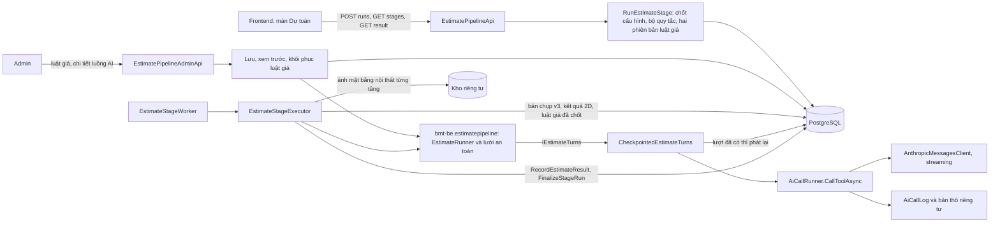
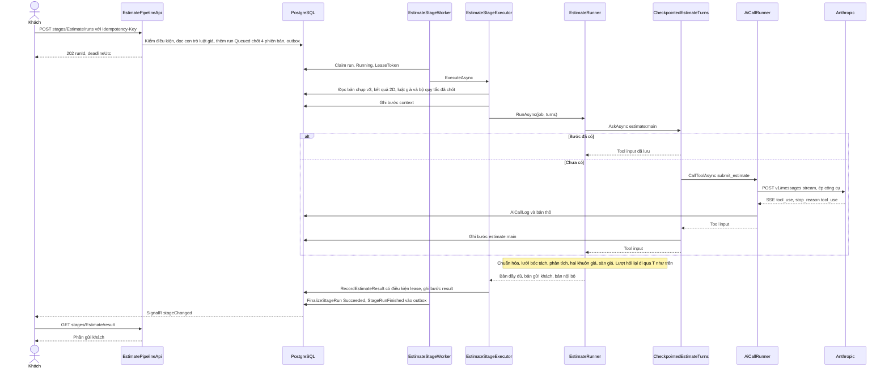
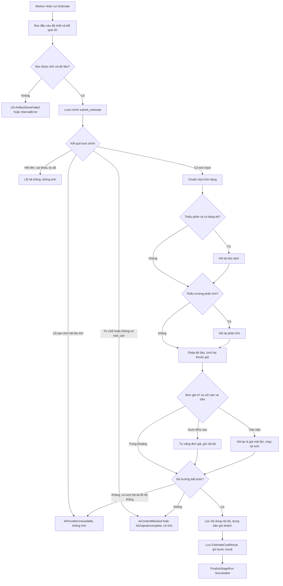
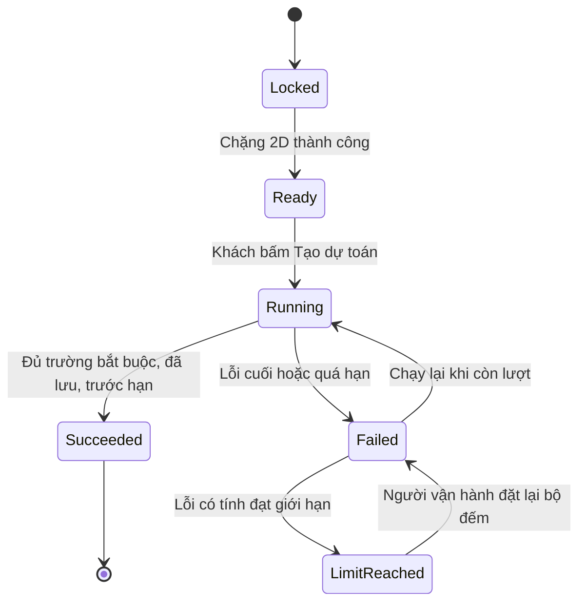
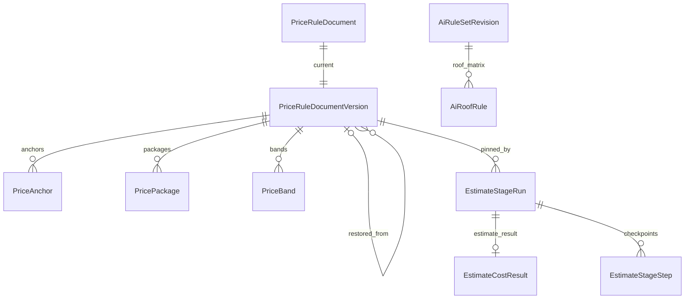

<!-- HƯỚNG DẪN CHO AI KHI ĐIỀN HOẶC CHỈNH SỬA MẪU
- Đọc toàn bộ mẫu, các comment hướng dẫn và tài liệu nguồn được cung cấp trước khi viết. Tuân thủ các quy tắc nghiệp vụ, điều kiện, ngoại lệ và giới hạn đã được xác nhận.
- Không bịa, tự chế hoặc suy đoán thành sự thật: yêu cầu, quy tắc, số liệu, API, schema, mã lỗi, nguồn tham khảo, người phụ trách và kết quả kiểm thử phải có căn cứ. Nội dung ví dụ trong mẫu không phải dữ kiện của dự án.
- Khi thiếu thông tin hoặc các nguồn mâu thuẫn, hỏi người dùng để làm rõ; giữ nguyên placeholder ở phần chưa xác định. Không tự chọn đáp án, lấp chỗ trống hay tuyên bố tài liệu đã hoàn tất.
- Chỉ thay nội dung cần điền hoặc được yêu cầu sửa. Không tự mở rộng phạm vi, sửa nghĩa quy tắc, bỏ điều kiện/ngoại lệ, xoá hay ghi đè nội dung hợp lệ đã có.
- Giữ nguyên tên, cấp và thứ tự heading, nhãn in đậm, tiền tố bullet, cấu trúc danh sách, tên/thứ tự/số cột bảng và cú pháp code fence. Không dịch, đổi tên, gộp hoặc thêm mục ngoài cấu trúc mẫu.
- Chỉ lặp khối luồng, AC hoặc API theo đúng khuôn khi có căn cứ; chỉ bỏ phần tuỳ chọn khi hướng dẫn riêng của mẫu cho phép và đã xác định không áp dụng.
- Mã tham chiếu và section phải trỏ tới tài liệu có thật đã được cung cấp hoặc kiểm chứng. Không giữ mã ví dụ như tham chiếu thật và không tự tạo tài liệu liên quan để hợp thức hoá liên kết.
- Giữ các comment hướng dẫn trong file. Xuất Markdown UTF-8, mỗi file một tài liệu; không bọc toàn bộ file trong code fence, không chèn lời dẫn hay giải thích ngoài mẫu.
- Trước khi bàn giao, đối chiếu nội dung với nguồn, kiểm tra cấu trúc, giá trị cho phép, giới hạn độ dài và tính nhất quán của mã/tham chiếu. Báo rõ phần chưa đủ thông tin; không tuyên bố đã chạy test hoặc import khi chưa thực hiện.
-->

<!-- Thay mã TDD-001 và nội dung ví dụ; giữ nguyên heading và nhãn in đậm.
Sơ đồ dùng mermaid, plantuml hoặc URL. Giữ heading Architecture, Sequence Diagram, Activity Diagram, State Diagram, Data Model.
Ví dụ API phải có heading trùng METHOD /path trong Endpoints. Xoá phần API/sơ đồ không dùng.
Version, Updated At và Change Log do lịch sử phiên bản quản lý, để trống khi nhập mới.
Author/Reviewer là tên hiển thị; gán tài khoản, phê duyệt, giả định và câu hỏi mở trên giao diện sau import.
Thiết kế phải truy vết về Story và Business Rule được cung cấp. Phân biệt thiết kế đề xuất với implementation đã kiểm chứng; không mô tả API/schema/sơ đồ ví dụ như hệ thống thật hoặc tự quyết định nghiệp vụ còn thiếu.
BẮT BUỘC KHI HOÀN THIỆN MẪU: phải có cả Reviewer và Approver, mỗi tên 1–200 ký tự sau khi bỏ khoảng trắng đầu/cuối. Không xoá hai dòng metadata, để trống, dùng tên bịa hoặc giữ placeholder rồi coi là hoàn tất.
Nếu chưa biết người review hoặc người phê duyệt, phải hỏi người dùng và báo tài liệu chưa đủ thông tin; không tự lấy Author/Owner làm người thay thế. Tên trong file không tự gán tài khoản hoặc xác nhận đã duyệt; gán thành viên trên giao diện sau import.
Đây là yêu cầu hoàn thiện mẫu; backend hiện vẫn nhận file cũ thiếu hai trường để tương thích.

VALIDATION CHO FILE NHẬP (đối chiếu ImportSnapshotValidator, MarkdownParser và ImportService):
- Mỗi file .md UTF-8 không rỗng chỉ có một heading cấp 1 chứa mã tài liệu dài 1–100 ký tự. Mã không được trùng trong cùng lần nhập hoặc thuộc loại tài liệu khác đã tồn tại.
- Không dùng tên README.md hoặc sitemap.md vì importer bỏ qua. Giao diện nhận .md/.zip, tối đa 2.000 file, tổng file tải lên 31 MiB; API giới hạn request 32 MiB và tổng nội dung đọc/giải nén 64 MiB.
- Chỉ nhập đè tài liệu cùng loại đang Draft, chưa có phiên bản và chưa lưu trữ. Import thay toàn bộ nội dung bản nháp, vì vậy phải giữ lại nội dung hợp lệ ngoài phần được yêu cầu sửa.
- Không dùng Status trong Markdown hoặc tên Approver để tự xác nhận phê duyệt; import không cấp quyền hay gán tài khoản từ tên. Chạy Kiểm tra file và xử lý lỗi/cảnh báo trước khi nhập.
- Giới hạn độ dài bên dưới tính theo string.Length của .NET (đơn vị UTF-16); không tự cắt ngắn dữ kiện quan trọng để vượt validation, hãy viết lại có căn cứ hoặc hỏi người dùng.
- Feature tối đa 300 ký tự và được dùng làm tiêu đề tài liệu. Status được parser nhận: Draft / In Review / Approved / Deprecated; tài liệu nhập mới vẫn có trạng thái phê duyệt Draft.
- Endpoint: đường dẫn tối đa 500 ký tự; tên/mô tả endpoint được lưu trong Name tối đa 300. HTTP method: GET / POST / PUT / PATCH / DELETE / HEAD / OPTIONS.
- Error Codes: mã tối đa 100 ký tự, không trùng trong tài liệu; giữ dạng - **CODE** (400): mô tả. HTTP status trong Error Codes và Response phải là số nguyên đọc được bằng Int32; không tự đặt status khác hợp đồng API.
- URL sơ đồ tối đa 1.000 ký tự. Mục sơ đồ được sử dụng phải có khối mermaid/plantuml hoặc URL theo mẫu; không để một mục sơ đồ rỗng. Nhãn mục được tách từ bullet như tên External API Fields tối đa 300 ký tự.
- Heading Examples phải khớp METHOD /path ở Endpoints. Giữ các nhãn Request:, Response 200: (thay mã theo contract) và Error Response: để parser tách đúng dữ liệu.
- Tham chiếu dạng DOC-KEY/section: ghi chú: mã đích tối đa 100 ký tự, section tối đa 100, ghi chú tối đa 1.000. Không trùng bộ mã đích + section + loại liên kết trong cùng tài liệu.
ĐỐI CHIẾU FORM TDD (src/features/tdds/validations.ts; form có thể chặt hơn import):
- Điền Feature, Author, Reviewer, Problem và ít nhất một Goal; các Goal/Non-goal/Notes đã thêm không được rỗng. API đã khai báo phải có endpoint và mô tả/mục đích; Fields phải có tên và ý nghĩa; Error Codes phải có mã, HTTP status và điều kiện.
- Form còn kiểm tra Version, Updated At và nội dung Change Log khi khai báo; với file nhập mới, giữ các trường lịch sử này trống theo hợp đồng import, không tự tạo dữ liệu lịch sử.
-->

# TDD-PROJ-009

## Document Info

- **Feature**: Tạo dự toán — chặng Dự toán: lập dự toán bằng Anthropic, lưới an toàn của app demo, luật giá có phiên bản và kết quả gửi khách
- **Author**: Claude
- **Reviewer**: Tân Trần
- **Approver**: Tân Trần
- **Status**: Draft
- **Version**:
- **Updated At**:

## Context & Goals

### Problem

Chặng Dự toán là chặng thứ hai của luồng bốn chặng (BR-PROJ-010). Sau khi chặng 2D thành công, khách bấm Tạo dự toán; backend gọi Anthropic Claude lập bảng dự toán ba phần (thô, hoàn thiện, nội thất) theo hai tài liệu luật giá, rồi chạy các lưới an toàn của app demo `design-estimate` (commit `059e876`, prompt `dt-14`) trước khi lưu kết quả (STORY-PROJ-008). Chặng này không giữ hay trừ lượt; chỉ lỗi do kết quả AI với đầu vào của khách mới tính vào giới hạn lỗi (BR-PROJ-011 khoản 1).

Phần dùng chung đã có thiết kế và mã ở đợt 1, tài liệu này dùng lại, không thiết kế lại:

- Lần chạy, worker, điểm lưu bước, quá hạn, bộ đếm lỗi, phân loại `FailureCode`, cảnh báo: TDD-PROJ-006.
- Bản chụp đầu vào v3 (`EstimateGenerationSnapshotV3`), miền giá đã chốt lúc 2D, kết quả 2D (`EstimatePlanResult`): TDD-PROJ-007.
- Lớp gọi AI (`AiCallRunner`, giới hạn chung qua Redis, công tắc tạm ngắt, `AiCallLog`, bản thô), cấu hình AI có phiên bản, bộ quy tắc AI có phiên bản, quyền: TDD-PROJ-008.

Hiện trạng mã đã đối chiếu ngày 12/10/2026 trên nhánh `feature/estimate-pipeline-w1` của `bmt-be`:

- `RunEstimateStageCommandHandler.PipelineVersions` đã có `Estimate → "estimate:dt-14"`; `AiTasks.ForStage(Estimate)` trả `estimate`; `AiCallRunner.Group` xếp việc `estimate` vào nhóm giới hạn `anthropic`.
- `AiCallRunner.RunAsync` ném `AiRequestInvalid` khi nhà cung cấp khác OpenAI; chưa có `IToolCallModel` hay client Anthropic. Thời hạn mỗi lần gọi đang lấy `OpenAiRequestTimeoutSeconds` cho mọi việc.
- Worker chỉ đăng ký `Plan2dStageExecutor` (cài `IStageExecutor`); `EstimateStageWorker.MapAiCode` ánh xạ lỗi AI sang `FailureCode`.
- `EstimatePlanResult.InternalJson.spec` lưu phương án `HouseSpec` đã qua luật; bản vẽ nội thất và kỹ thuật từng tầng là `EstimateStageArtifact` riêng tư (`plan:furniture:f{n}`, `plan:technical:f{n}`).
- Thư viện `bmt-be.estimatepipeline` mới có phần 2D; test đối chiếu app demo nằm ở `test/parity/` (`generate.py` + `fixtures/`) và `test/bmt-be.estimatepipeline.tests`.
- Bootstrap cấu hình có dòng việc `estimate` (Anthropic, `claude-haiku-4-5`, tham số `{}`) và bảng giá token của bốn model Claude.

Mọi bảng, lớp, API và tên mới dưới đây là thiết kế đề xuất, chưa có mã.

### Goals

- Lần chạy Dự toán chốt bốn phiên bản lúc tiếp nhận: cấu hình AI, bộ quy tắc AI, Khung giá tham khảo (kèm dải giá) và Quy tắc bóc tách. Admin lưu phiên bản mới thì dự toán đã có không đổi (AC-001, AC-008).
- Với cùng phản hồi AI đã ghi, kết quả sau lưới an toàn (số dòng, đơn giá, thành tiền, tổng từng phần, cờ nội bộ, văn bản gửi khách) trùng app demo ở mốc `059e876`, kể cả cách làm tròn; với cùng văn bản luật giá, prompt gửi AI trùng từng ký tự. Kiểm bằng bộ dữ liệu đối chiếu sinh từ chính app demo trên văn bản luật giá gốc của app demo (mục K).
- Gọi Anthropic qua `AiCallRunner` dùng chung: streaming, ép công cụ `submit_estimate`, thử lại theo chính sách TDD-PROJ-008, `stop_reason=max_tokens` thành `AiOutputTruncated` (không thử lại, cảnh báo Discord, không tính lỗi), không vượt hạn chờ 20 phút của lần chạy.
- Phần gửi khách và phần nội bộ lưu tách nhau; khách chỉ đọc được phần gửi khách qua API, kể cả khi gọi thẳng backend (BR-PROJ-017).
- Worker chết giữa chừng thì chỉ mất tối đa một lời gọi AI đang chạy dở; các lượt AI đã xong được phát lại từ điểm lưu, không gọi lại.
- Lưu Khung giá tham khảo tự tính lại dải giá từ mục 3–5; phiên bản nạp sẵn cho ra đúng các dải giá đang ghim trong app demo (BR-PROJ-016).

### Non-goals

- Dựng tệp Excel, PDF và chia sẻ: thuộc chặng Hồ sơ (STORY-PROJ-010, BR-PROJ-007 khoản 4). Tài liệu này chỉ chốt hợp đồng dữ liệu và cách chuyển `fill_template.py` sang .NET (mục J) để chặng Hồ sơ dùng.
- Màn quản trị bộ quy tắc AI và prompt (STORY-PROJ-013, sau đợt 4). Đợt này chỉ nạp sẵn dữ liệu và mở API đọc.
- Sửa các lỗi chất lượng đã biết của app demo (dòng mái bị loại vì 0 đồng, các hằng số "không có căn cứ" trong `docs/LUAT-TU-SINH.md`). Chuyển đúng hành vi trước, sửa sau bằng phiên bản prompt hoặc luật mới (BR-PROJ-014 Notes).
- Khách sửa dòng dự toán, đổi gói, đổi hãng; bước duyệt của kỹ sư (STORY-PROJ-008 Out of Scope).
- Màn hình frontend: chỉ mô tả hợp đồng (mục P), không thiết kế giao diện chi tiết.

## Architecture



| Thành phần (dự kiến) | Trách nhiệm |
|---|---|
| `RunEstimateStageCommandHandler` (sửa) | Với chặng `Estimate`: đọc con trỏ hai tài liệu luật giá và ghi `PriceFrameworkVersionId`, `TakeoffRulesVersionId` vào lần chạy, cùng transaction tiếp nhận. Các bước kiểm khác giữ nguyên TDD-PROJ-006. |
| `EstimateStageExecutor` (infrastructure, mới) | Cài `IStageExecutor` cho `Estimate`, phiên bản mã `estimate:dt-14`. Dựng đầu vào, giao `EstimateRunner`, lưu kết quả. |
| `EstimateRunner` (thư viện, mới) | Chuyển `run_estimate_pipeline` của app demo (bỏ nhánh demo và bước điền Excel). Hàm thuần: mọi lượt AI đi qua `IEstimateTurns`. |
| `CheckpointedEstimateTurns` (infrastructure, mới) | Cài `IEstimateTurns`: lượt đã có bước thì trả lại kết quả đã lưu; chưa có thì gọi `IToolCallModel`, ghi bước rồi trả kết quả. |
| `IToolCallModel` + `AiCallRunner.CallToolAsync` + `AnthropicMessagesClient` | Gọi Anthropic Messages streaming, ép công cụ; thử lại, giới hạn chung, tạm ngắt, nhật ký như TDD-PROJ-008. |
| `PriceRuleStore`, `IPriceRuleReader` | Đọc và ghi hai tài liệu luật giá có phiên bản cùng giá neo và dải giá. |
| `PriceBandDeriver`, `PriceFrameworkTables` (thư viện) | Chuyển `derive_price_bands.py` và `doc_khung_don_gia`: đọc bảng đơn giá mục 3–5, tính dải giá. |
| `CustomerCopy` (thư viện) | Chuyển bộ lọc nội dung nội bộ của `fill.py`. |
| `GetStageResultQueryHandler` (sửa) | Trả phần gửi khách của chặng Dự toán. |

**Notes**:

**A. Tiếp nhận và chốt phiên bản**

- Thứ tự kiểm, khóa, chống gửi lặp, hàng chờ đầy, tạm ngắt: giữ nguyên TDD-PROJ-006 bước 1–9. Bước 7a dùng nhà cung cấp của việc `estimate` trong cấu hình hiện hành, tức Anthropic; OpenAI đang tạm ngắt không chặn chặng này (ST-PROJ-199 bước 3).
- Ở bước 9, handler đọc `PriceRuleDocument` của `PriceFramework` và `TakeoffRules` (không khóa) và ghi Id phiên bản hiện hành vào `EstimateStageRun`. **Chốt phiên bản** nghĩa là lần chạy chỉ đọc đúng các phiên bản này tới khi kết thúc, kể cả khi worker khác nhận lại sau khi Admin đã lưu bản mới. Admin lưu cùng lúc với lúc tiếp nhận thì lần chạy lấy bản trước hoặc bản sau tùy commit nào xong trước; cả hai đều hợp lệ vì BR-PROJ-016 khoản 8 chỉ đòi chốt bản "đang áp dụng lúc tiếp nhận".
- Lần chạy lại sau lỗi là một dòng mới nên chốt phiên bản đang áp dụng lúc chạy lại (ALT-01, AC-007). Chặng đã thành công không chạy lại được nhờ chỉ mục `UX_EstimateStageRun_Succeeded` (AC-008).
- Không kiểm gói, không giữ lượt (BR-PROJ-010 khoản 5, ALT-02); bản chụp đầu vào là bản của lần chạy 2D thành công (`InputOperationId`).

**B. Executor, lượt AI và điểm lưu**

`EstimateStageExecutor.ExecuteAsync` làm theo thứ tự:

1. Đọc bản chụp v3 (`Input`), lần chạy 2D thành công của bản dự toán và `EstimatePlanResult` của nó (`InternalJson.spec` là `HouseSpec` đã qua luật), hai phiên bản luật giá đã chốt (`IPriceRuleReader`, cache theo Id vì bất biến), bộ quy tắc AI và cấu hình đã chốt (`StageExecutionContext`). Thiếu kết quả 2D hoặc phiên bản luật giá → `InternalError`.
2. Đọc ảnh bản vẽ nội thất từng tầng từ kho riêng tư bằng `CopyPrivateAsync`; tầng không có ảnh nội thất thì dùng bản kỹ thuật, kèm ghi chú như `collect_project_images`. Lỗi đọc kho → `ArtifactStoreFailed`. Ảnh vượt trần của app demo (mỗi ảnh base64 ≤ 5 MiB − 64 KiB, tổng ≤ 24 MiB, tối đa 9 ảnh) được thu về cạnh dài 1568 px, JPEG chất lượng 90 → 80 → 70 (ImageSharp, chuyển `shrink_image_b64`).
3. Dựng `EstimateJob` (mục D) và ghi bước `context` (không gọi AI, `Internal=true`): loại neo giá, kiểu mái và nguồn, tổng sàn tham chiếu, dấu vân prompt (`prompt_fingerprint`), số ảnh gửi. Bước này chỉ để truy vết; khi nhận lại, executor tính lại vì mọi đầu vào đã chốt.
4. Gọi `EstimateRunner.RunAsync(job, turns, ct)`. Runner chạy đúng thứ tự của app demo: lượt chính → chuẩn hóa hình dạng → lưới bóc tách → chặn phần thô → lưới phân tích → ghép dữ liệu → lưới hai khuôn giá → kiểm khối lượng (chỉ ghi nội bộ) → lưới sàn giá → kiểm trường bắt buộc → tóm tắt hãng vật tư → bản gửi khách.
5. Ghi `EstimateCostResult` bằng `RecordEstimateResultAsync` (có điều kiện đúng lease, như `RecordPlanResultAsync`), ghi bước `result`, rồi worker gọi `FinalizeStageRun(Succeeded)`.

**Lượt AI là điểm lưu.** Mỗi lượt có khóa bước cố định: `estimate:main`, `estimate:reask:takeoff`, `estimate:reask:analysis`, `estimate:reask:split:structure`, `estimate:reask:split:finishing`, `estimate:reask:price`. `CheckpointedEstimateTurns.AskAsync(key, request)`:

- Đã có bước cùng khóa: trả lại `OutputJson` (tool input thô, `Internal=true`), không gọi AI.
- Chưa có: gọi `IToolCallModel.CallToolAsync`; thành công thì ghi bước (`Model`, `PromptVersion=dt-14`) rồi trả kết quả.
- Lượt hỏi lại bị lỗi mà app demo bỏ qua để đi tiếp (xem mục E) cũng được ghi bước với `OutputJson={"failed":true,"errorCode":"…"}`. Như vậy khi nhận lại, lưới đó thấy lượt hỏi lại đã thất bại và đi tiếp đúng nhánh cũ, không hỏi lại lần hai. TDD-PROJ-006 (mục "Điểm lưu từng bước") ghi ngoại lệ này: với lưới an toàn, một lượt hỏi lại đã có kết luận (kể cả thất bại được bỏ qua) là một bước đã xong.

Vì mọi phần không gọi AI là hàm thuần của đầu vào đã chốt và các phản hồi đã lưu, chạy lại runner trên cùng dữ liệu cho ra cùng kết quả. Ví dụ: worker chết sau khi ghi `estimate:main` và trong lúc chờ `estimate:reask:price`; worker mới phát lại lượt chính, tính lại lưới, thấy cần rà giá và chỉ gọi lượt `estimate:reask:price`. Ngày lập dự toán (`ngay_lap`, lưu là `estimateDateVn` trong kết quả) là ngày tiếp nhận lần chạy Dự toán, tức `AcceptedAtUtc` đổi sang giờ Việt Nam (người dùng chốt 12/10/2026); không lấy giờ hiện tại, nên lần nhận lại qua nửa đêm không đổi kết quả. Chặng Hồ sơ in hiệu lực báo giá 90 ngày tính từ ngày này như app demo (`den_ngay`); con số 90 đổi sau khi buildX quyết định. Tiến độ: `ProgressTotal` = 3 khi bắt đầu (`context`, `estimate:main`, `result`), cộng thêm mỗi lượt hỏi lại khi runner quyết định hỏi.

**C. Lời gọi Anthropic trong lớp gọi AI dùng chung**

- **Cổng** `IToolCallModel.CallToolAsync(AiCallContext, AiToolCallRequest, ct)` (TDD-PROJ-008 mục A). `AiToolCallRequest(Task, SystemPrompt, CachePrefix?, Tool{Name, Description, InputSchemaJson}, UserContent[], MaxTokens)`; nội dung là danh sách khối văn bản và ảnh theo đúng thứ tự app demo (`khoi_text`, `khoi_anh`). Kết quả `AiToolCallResult(ToolInputJson, Model, CallId, Retries, StopReason)`.
- **Client**: `AnthropicMessagesClient` là `HttpClient` có kiểu (`IHttpClientFactory`), gọi `POST /v1/messages` với `stream:true`, `tool_choice:{type:"tool",name}`, header `x-api-key`, `anthropic-version: 2023-06-01`, đọc sự kiện SSE. Chọn `HttpClient` thay cho NuGet `Anthropic` mà bản trước của TDD-PROJ-008 đã ghi (TDD-PROJ-008 mục B đã sửa theo lựa chọn này ngày 12/10/2026), vì: (1) cùng cách làm với `OpenAiResponsesClient`, mỗi lần thử trả một `AiAttemptResult` để `AiCallRunner` phân loại; (2) thân yêu cầu được dựng từ đúng chuỗi JSON của schema công cụ, nên dấu vân prompt và tiền tố bộ nhớ đệm ổn định theo byte; (3) đọc được header `retry-after`, sự kiện `error` giữa luồng và `usage` của từng sự kiện mà không phụ thuộc phiên bản SDK. Không thử lại ở tầng `HttpClient`.
- **Phân loại một lần thử** (chuyển `goi_claude_tool` của app demo):

| Tình huống | Kết quả của lần thử | Lớp gọi AI xử lý |
|---|---|---|
| `stop_reason=tool_use` và có khối `tool_use` tên đúng, `input` là object | `Success` | Trả kết quả |
| `stop_reason=max_tokens` | `Truncated` | `AiOutputTruncated`: không thử lại, cảnh báo Discord có giới hạn tần suất (TDD-PROJ-008 mục B), không tính vào công tắc tạm ngắt |
| `stop_reason=refusal`, hoặc 400 có dấu hiệu nội dung bị chặn | `ContentBlocked` | `AiContentBlocked` |
| `stop_reason` khác mà không có khối `tool_use` đúng tên | (mới) `NoToolUse` | `AiOutputIncomplete`, không gọi lại, như app demo |
| HTTP 429, 500, 502, 503, 504, 529; sự kiện `error` loại `overloaded_error`, `api_error`, `rate_limit_error`; lỗi mạng; luồng đóng trước khi có `stop_reason` | `Transient` | Chờ 2 → 4 → 8 giây (tôn trọng `retry-after`), tối đa 4 yêu cầu |
| 402, `error.type=billing_error`, hoặc thông báo khớp `credit balance is too low` / `insufficient … credit` | `OutOfCredit` | `AiOutOfCredit`, cảnh báo, ngắt tạm ngay. Không dò chữ "billing" đơn lẻ |
| 401 / 403 | `BadKey` / `PermissionDenied` | Như TDD-PROJ-008 |
| 400 nói `cache_control` không hợp lệ | `UnsupportedParameter` | Bỏ bộ nhớ đệm, gửi lại một lần (như `dung_cache=False` của app demo) |
| 400 nói `temperature` không được hỗ trợ | `UnsupportedParameter` | Bỏ tham số, nhớ theo model (cơ chế có sẵn) |
| 400 khác, 404, 413 | `Invalid` / `ModelNotFound` | `AiRequestInvalid` |

- **Thời hạn**: một lần gọi `max_tokens=64000` sinh tới hàng chục nghìn token. App demo đặt hạn mỗi lần gọi là `max(300, 60 + max_tokens/40)` giây (`han_chot_mot_lan`) và hạn giữa hai gói dữ liệu là 300 giây. Thiết kế dùng đúng công thức đó với `AnthropicRequestTimeoutSeconds` thay cho 300, rồi lấy `min` với thời gian còn lại của lần chạy (BR-PROJ-012 khoản 7). Thời hạn sống của chỗ giữ trong `AiConcurrencyLimiter` nhóm `anthropic` cũng phải bằng hạn này cộng 30 giây; hiện mã tính `timeout + 35` giây nên một lượt dài 10 phút sẽ làm chỗ giữ hết hạn trong lúc vẫn đang gọi, và limiter cho thêm lời gọi vượt giới hạn. Đây là chỉnh sửa vào `AiCallRunner.Limits` và `RunAsync` (đang lấy `OpenAiRequestTimeoutSeconds` cho mọi việc); công thức chung ghi ở TDD-PROJ-008 mục B.
- **Bộ nhớ đệm prompt** (STORY-PROJ-008 Non-Functional): tham số `promptCache` của việc `estimate`. Khi bật, chỉ lượt chính và lượt rà giá (cùng system prompt và cùng công cụ) gắn `cache_control` loại `ephemeral` vào công cụ và vào phần đầu bất biến của system prompt (`tien_to_bat_bien`), và chỉ khi phần đầu ước tính từ 4.096 token trở lên (`khoi_cache` của app demo). Các lượt hỏi lại khác khai báo công cụ khác nên không gắn.
- **Nhật ký và chi phí**: một dòng `AiCallLog` cho mỗi lượt (Task `estimate`, `StepKey` là khóa lượt). Token vào = `input_tokens` + `cache_read_input_tokens` + `cache_creation_input_tokens`; chi phí theo công thức TDD-PROJ-008 mục C với giá `claude-haiku-4-5` trong bảng giá của phiên bản cấu hình. `TimeToFirstTokenMs` đo tới sự kiện `message_start`. Bản thô (system prompt, nội dung người dùng với ảnh thay bằng hash và kích thước, tên công cụ, tham số, tool input trả về) lưu như TDD-PROJ-008 mục C.
- **Model và tham số**: `SupportedAiModels` thêm cờ khả năng `ForcedToolChoice`; việc `estimate` chỉ nhận model Anthropic có cờ này, ban đầu chỉ `claude-haiku-4-5` (TDD-PROJ-008 mục E). Cờ `Temperature` của `claude-sonnet-5` và `claude-opus-5` đổi thành false vì app demo ghi hai model này trả 400 khi có `temperature` (`estimate_temperature`). Mặc định không gửi `temperature` (app demo `ESTIMATE_TEMPERATURE=-1`).

**D. Dựng đầu vào cho AI (`EstimateJob`)**

`EstimateInputs.Build(snapshotV3, planResult, priceRules, ruleSet, config)` (application) dựng bộ thông tin mà app demo gọi là `form`/`tt`:

| Trường app demo | Nguồn trong hệ thống thật |
|---|---|
| `loai_cong_trinh`, `style` | `BuildingType.BaseCode`, `EffectiveBaseStyleCode` của bản chụp v3 |
| `goi` | `FinishPackage` (Basic → `co-ban`, Standard → `tieu-chuan`, Vip → `vip`) |
| `vung_mien` | `PricingRegion.Region` đã chốt lúc 2D (North → `Bắc`, Central → `Trung`, South → `Nam`). Không dò địa chỉ (`detect_region`), không có cờ Tây Nguyên (`is_highland` luôn false). |
| `dia_chi` | Địa chỉ của bản chụp v3, ghép như chuỗi địa chỉ đã dùng ở 2D, cắt 200 ký tự UTF-16 (`TRAN_TEN_DIA_CHI`) |
| `so_tang`, `tum` | `HouseSpec.FloorCount`, `RoofRoom`; căn hộ luôn 1 tầng, không tum |
| `dien_tich_xd`, `kich_thuoc_dat`, `kich_thuoc_tong` | `HouseSpec.BuiltAreaM2`, lô của `HouseSpec` (`locked_dimensions`, `lot_size_text`) |
| `so_phong_ngu`, `so_wc` | Đếm lại từ `HouseSpec` (`count_rooms`) |
| `tong_san_tham_khao` | `HouseSpec.TotalFloorAreaM2` nếu có, không thì suy từ diện tích xây dựng (`reference_total_floor_area`, `he_so_quy_doi_san`) |
| `yeu_cau_them` | `Description` của bản chụp v3, cắt 2.000 ký tự UTF-16 như app demo |
| `danh_xung`, `ten_khach_hang`, `ten_du_an` | Không gửi tên khách cho AI (người dùng chốt 12/10/2026). AI và bộ soạn lại của mục G dùng danh xưng "Anh/Chị", tên khách để trống ("Khách hàng" theo mặc định của app demo). Tên khách chỉ in trong tệp của chặng Hồ sơ |
| `khoi_luong_co_so` | `QuantityTakeoff.BaseQuantities(spec)` với chiều cao tầng theo loại neo giá và tỷ lệ cửa 0,2 |

- **Loại neo giá** (6 loại: `nha-pho`, `nha-mai`, `biet-thu-hien-dai`, `biet-thu-tan-co-dien`, `cap-4-tron-goi`, `can-ho`) tính trong mã bằng `PriceTypeResolver.Resolve(baseCode, baseStyleCode)`, chuyển nguyên `loai_neo_gia` (so khớp chuỗi không dấu như `tan co`, `co dien`, `thai`, `nhat`, `ngoi`, `biet thu`, `san vuon`). Ví dụ `nha-vuon-cap4` + `nha-vuon-mai-thai` → `nha-mai`; `nha-vuon-cap4` + `cap4-hien-dai` → `cap-4-tron-goi`.
- **Kiểu mái** (`RoofResolver`, chuyển `mai_cua_du_an` + `roof_from_spec` + `suy_loai_mai`): mái do `HouseSpec` nêu (đọc `area_conversion_note`, `exterior`, `assumptions`, `summary` theo đúng thứ tự và regex của app demo) thắng; nếu phương án không nêu mái thì tra ma trận mái của bộ quy tắc AI đã chốt (`AiRoofRule`, mục I) theo `(mã gốc, mã phong cách gốc)`, không có dòng riêng thì dùng dòng mặc định `*` của mã gốc. Mái tôn chỉ có thể đến từ phương án; hệ số của mái lấy từ phương án (tôn 0,3 dốc 1,1; ngói 0,7 dốc theo `roof_pitch` hoặc 1,25; BTCT 0,5) là hằng số thuật toán trong mã như app demo. Kết quả lưu vào phần nội bộ và phần gửi khách (`roof.kind`, `roof.source`) để chặng 3D dựng đúng kiểu mái đã tính tiền (STORY-PROJ-009/AC-003).
- **Giá neo và chỉ tiêu** (mục F), **khối lượng tham chiếu** (`khoi_luong_tham_chieu`, `ket_cau_theo_loai`, `so_dong_toi_thieu`) và **khối lượng cơ sở** đều tính trong thư viện từ dữ liệu trên; không gọi AI.
- **Rút gọn quy tắc theo dự án** (`loc_quy_tac_theo_du_an`): chỉ giữ dòng của gói, miền, loại công trình, phong cách đang dùng; bỏ bảng neo tổng quát mục 2.1–2.2 (thay bằng hai dòng "GIÁ NEO BẮT BUỘC ĐẠT" và "CHỈ TIÊU BẮT BUỘC" tính sẵn), bỏ bảng mục 10 và hai gạch đầu dòng bảo trì của mục 7; Quy tắc bóc tách giữ mục 2 (trừ căn hộ), một dòng gói ở 5.1, một bảng loại và một dòng phong cách ở 5.2, một dòng mùa khởi công ở mục 6. Chọn cột hoặc dòng miền theo khóa `mien bac`, `mien trung`, `mien nam` suy từ miền đã chốt. Vì Tây Nguyên thuộc miền Trung (BR-PROJ-013), dự án ở Lâm Đồng nhận cột "Miền Trung" của mục 9 Khung giá và dòng "Miền Trung" của mục 6 Quy tắc bóc tách. Văn bản luật giá nạp sẵn đã bỏ các chỗ riêng cho Tây Nguyên (mục O), nên không còn cột hay dòng Tây Nguyên để chọn; app demo thì chọn cột "Miền Nam & Tây Nguyên". Đây là khác biệt có chủ đích, bộ đối chiếu loại trừ địa chỉ Tây Nguyên.
- **Prompt**: `EstimatePrompts` (phiên bản `dt-14`) dựng system prompt, thông tin công trình, các prompt hỏi lại và bốn công cụ (`submit_estimate`, `supplement_breakdown`, `supplement_analysis`, `fix_price_format`). Phần cấu trúc (schema, mô tả trường, tên công cụ) nằm trong mã (BR-PROJ-014 khoản 4). Phần lời dặn sửa được nằm ở `AiPromptPart` (mục I). Lời dặn chung `AiInstruction` phạm vi `Estimate` và lời dặn gói × chặng `AiPackageStageInstruction` của `Estimate` được nối thành khối "LỜI DẶN THÊM" ở cuối system prompt chỉ khi có dòng khớp; dữ liệu nạp sẵn không có dòng nào nên prompt trùng app demo.
- **Ảnh**: mỗi ảnh đi kèm nhãn "Ảnh i/N: …" như `arrange_images_for_claude`; ảnh lô của khách không gửi (app demo chỉ dùng phương án 2D đã chốt). Không gửi đường dẫn kho cho nhà cung cấp.

**E. Lưới an toàn, hỏi lại và phân loại lỗi**

Runner giữ nguyên thứ tự và điều kiện của app demo. Mỗi lưới hỏi lại tối đa số lần cấu hình trong tham số `maxReasks` của việc `estimate`, mặc định bằng app demo là 1 lần mỗi lưới (lưới hai khuôn giá hỏi 1 lần cho mỗi phần hỏng):

| Lưới (hàm app demo) | Khi nào chạy | Việc làm |
|---|---|---|
| Chuẩn hóa hình dạng (`normalize_ai_shape`, `recover_parts`) | Mọi phản hồi | Gom trường bị trải phẳng, tách phần bị lồng hoặc ghi thành chuỗi JSON; không gọi AI |
| Bóc tách (`apply_takeoff_net`) | Thiếu ít nhất một phần và đã có bảng kê phòng dài hơn 20 ký tự | Hỏi lại `supplement_breakdown` chỉ cho phần thiếu, không đính ảnh, `max_tokens` 24.000 khi thiếu đúng một phần thô hoặc hoàn thiện, còn lại 64.000 (`takeoff_reask_max_tokens`); chỉ ghép phần được hỏi (`merge_ai_results`) |
| Chặn phần thô (`regroup_rough_part`, `drop_new_build_rough_lines`) | Sau bóc tách và sau lượt rà giá | Xếp lại nhóm phần thô; căn hộ bỏ dòng xây mới theo regex `NEW_BUILD_ROUGH_RE` |
| Phân tích (`apply_analysis_net`) | Đủ 3 phần nhưng thiếu ít nhất một trong 12 trường `phan_tich` | Hỏi lại `supplement_analysis` (`max_tokens` 4.000), chỉ ghép trường thiếu |
| Hai khuôn giá (`chay_luoi_do`, `tach_gia_theo_ma_nhom`) | Sau khi ghép (`compose_du_lieu`) | Tách giá gộp theo tỷ lệ chuẩn của mã nhóm vật tư; phần thô hoặc hoàn thiện có ≥ 5 dòng hoặc ≥ 30% dòng 0 đồng thì hỏi lại `fix_price_format` (`max_tokens` 8.000); mỗi dòng AI tách lại phải thỏa \|VT + NC − giá gộp\| ≤ 1.000 đ, không thỏa thì tách theo tỷ lệ tên nhóm (`ty_le_vat_tu_theo_nhom`) và ghi chú dòng |
| Chuẩn hóa (`chuan_hoa`) | Trong lưới hai khuôn giá | Loại dòng 0 đồng và nhóm rỗng, khối lượng 2 số lẻ, đơn vị đếm làm tròn |
| Kiểm khối lượng (`check_quantities`, `check_min_rows`) | Luôn chạy | So khối lượng với hình học của phương án và số dòng tối thiểu; chỉ ghi phần nội bộ |
| Sàn giá (`ap_dung_luoi_san_gia`, `kiem_san_gia`, `nhan_don_gia_phan`) | Luôn chạy | Mục F |
| Kiểm trường bắt buộc (`validate_du_lieu`) | Cuối cùng | Thiếu trường gửi khách bắt buộc, `tong_san_so` không phải số dương, hoặc một phần rỗng → lần chạy lỗi |
| Hãng vật tư (`tom_tat_hang_vat_tu`) | Sau kiểm | Thiếu hãng ≥ 10% hoặc ≥ 5 dòng → cờ "cần nhân viên rà"; không chặn |

Phân loại lỗi cuối của lần chạy (ghi vào `FailureCode`, nhóm theo `StageFailureClassifier` của TDD-PROJ-006):

| Tình huống | `FailureCode` | Tính vào giới hạn lỗi |
|---|---|---|
| Bất kỳ lượt nào (chính hoặc hỏi lại): hết tiền | `AiOutOfCredit` — lỗi ngay, không đi tiếp lưới (AC-009) | Không |
| Bất kỳ lượt nào: 401, 403 | `AiProviderUnavailable` — lỗi ngay (`EstimateStageWorker.MapAiCode`) | Không |
| Bất kỳ lượt nào: `stop_reason=max_tokens` | `AiOutputTruncated` — lỗi ngay, có cảnh báo | Không |
| Lượt chính: lỗi tạm thời đã hết lần thử | `AiProviderUnavailable` | Không |
| Lượt chính: AI từ chối (`refusal`, nội dung bị chặn) | `AiContentBlocked` | Có |
| Lượt chính: không có khối `tool_use` | `AiOutputIncomplete` | Có |
| Lượt hỏi lại: lỗi tạm thời, nội dung bị chặn, không có `tool_use` | Như app demo: giữ kết quả lượt chính, ghi ghi chú nội bộ, đi tiếp. Nếu cuối cùng kiểm trường bắt buộc vẫn hỏng thì dùng mã của lỗi lượt hỏi lại đó: `AiProviderUnavailable` (không tính), `AiContentBlocked` hoặc `AiOutputIncomplete` (tính) | Theo mã |
| Kiểm trường bắt buộc hỏng sau lưới, không có lượt hỏi lại nào lỗi hệ thống | `AiOutputIncomplete` (AI vẫn trả thiếu sau lượt hỏi lại) | Có |
| Quá hạn | `StageTimedOut` (job bảo trì chốt) | Không |
| Không đọc được ảnh 2D trong kho | `ArtifactStoreFailed` | Không |
| Thiếu kết quả 2D, thiếu phiên bản luật giá, lỗi ngoài dự kiến | `InternalError` | Không |

Hai điểm khác app demo, đều để đúng STORY-PROJ-008: (1) hết tiền, sai khóa hoặc đầu ra bị cắt ở lượt hỏi lại làm lần chạy lỗi ngay (AC-009, EXC-02), còn app demo bỏ qua lỗi và đi tiếp; (2) lượt hỏi lại lỗi vì dịch vụ AI mà làm kết quả cuối thiếu trường thì lỗi hệ thống, không tính cho khách (BR-PROJ-011 khoản 1). Trường hợp lượt hỏi lại lỗi mà kết quả vẫn đủ, số liệu trùng app demo.

**F. Giá neo, dải giá và cách làm tròn**

- **Giá neo** (`PriceAnchors`, chuyển `neo_san_tr_m2`): `neo = AbsoluteTrM2` hoặc `neo(nha-pho) × TownhouseFactor` (phép nhân số thực như app demo: 5,8 × 1,2), `neo_goi = neo × AnchorFactor của gói`. Không hạ 5% cho vùng nhân công thấp (người dùng chốt 12/10/2026). Công thức kiểm theo loại: căn hộ `ht_nt` (hoàn thiện + nội thất), `cap-4-tron-goi` `tron_goi` (cả ba phần), còn lại `xay` (thô + hoàn thiện).
- **Dải giá với tới** (`dai_voi_toi`): thô theo loại, hoàn thiện và nội thất theo loại × gói, đọc từ `PriceBand` của phiên bản Khung giá đã chốt; căn hộ không có dải thô.
- **Chỉ tiêu từng phần** (`phan_bo_neo`, `chi_tieu_du_toan`, `_noi_that_roi`): tìm một vị trí chung `t` trên dải của mọi phần sao cho tổng bằng neo; phần cuối hấp thụ phần làm tròn; nội thất rời của công thức `xay` lấy dải nội thất rời của gói, chặn dưới bằng đầu thấp dải nội thất. In vào thông tin công trình cho AI.
- **Lưới sàn giá**: đơn giá m² = tiền theo công thức ÷ `tong_san_so` (tổng sàn quy đổi AI ghi trong `phan_tich`) ÷ 10⁶. Dưới 95% neo → không hỏi lại AI, tự nâng đơn giá các dòng không phải vật liệu cơ bản (`HANG_HOA_KHONG_NANG`), hệ số mỗi dòng tối đa ×3, hệ số tổng tối đa ×6, giữ nguyên khối lượng, mỗi dòng nâng được thêm ghi chú "đơn giá theo mặt bằng giá thị trường hiện nay" (gửi khách, giữ trong đợt này theo quyết định 12/10/2026); hệ số, lý do và danh sách dòng nâng chỉ vào phần nội bộ (AC-004). Trên trần `max(neo_goi, tổng đầu cao dải của các phần trong công thức) × 1,35` → hỏi lại AI đúng một lần bằng lượt `estimate:reask:price` (cùng system prompt, cùng công cụ chính), ghép lại qua toàn bộ chuỗi lưới; vẫn trên trần thì chỉ cảnh báo nội bộ. Trong khoảng nhưng trên đầu cao dải → cờ "cần kỹ sư rà"; trên đầu cao dải × 1,8 và trên neo × 1,05 → cờ nghi bóc trùng.
- **Ví dụ** (ST-PROJ-142): nhà phố gói Tiêu chuẩn, neo 5,8 × 1,2 = 6,96 tr/m²; AI trả 4,42 tr/m² < 6,96 × 0,95 = 6,612 → hệ số cần 6,96 ÷ 4,42 ≈ 1,575 < ×6 → hệ thống nâng đơn giá các dòng không phải vật liệu cơ bản; tổng đạt khoảng 6,97 tr/m² (làm tròn nghìn đồng từng đơn giá làm số cuối lệch nhẹ so với neo).
- **Làm tròn** (phải trùng app demo vì app demo trộn quy ước của JavaScript và Python):

| Chỗ dùng | Quy tắc | Hàm app demo |
|---|---|---|
| Đọc số AI trả ("12,5", "1.234,56", "1,234") | Quy ước dấu phẩy Việt Nam, kiểu lạ thì không nhận | `ep_so` |
| Khối lượng | `Math.round(kl × 100) / 100` của JavaScript (số đúng nửa thì làm tròn lên) | `chuan_hoa` |
| Khối lượng đơn vị đếm | `floor(kl + 0,5)`, tối thiểu 1, thêm ghi chú dòng | `chuan_hoa` |
| Đơn giá khi tính tiền, thành tiền mỗi dòng | Làm tròn nửa về số chẵn (như `round()` của Python): đơn giá VT, NC hoặc trọn gói làm tròn trước, rồi thành tiền = làm tròn(khối lượng × đơn giá) | `gia_dong`, `round_half_even` |
| Tổng từng phần, tổng dự toán | Cộng thành tiền đã làm tròn | `tinh_tong_js` |
| Tách VT/NC theo tỷ lệ | VT = `Math.round(gộp × tỷ lệ / 1000) × 1000`, NC = gộp − VT | `tach_gia_theo_ty_le_so` |
| Tự nâng đơn giá | `max(Math.round(giá × hệ số / 1000) × 1000, giá cũ)` | `nhan_don_gia_phan` |
| Đơn giá m², chỉ tiêu, dải giá in ra | `Math.round(x × 100) / 100` | `kiem_san_gia`, `phan_bo_neo` |
| Số in trong văn bản và prompt | Cách `Number.prototype.toString` và `JSON.stringify` của JavaScript (thứ tự khóa, số nguyên không có `.0`) | `so_js`, `string_js`, `json_stringify` |

Thư viện thêm `Common/JsMath`, `Common/JsNumber`, `Common/JsJson` cho các quy tắc này; phần 2D đang dùng `PyNum` vì mã 2D của app demo là Python thuần, còn mã dự toán được chuyển từ JavaScript cũ nên mang ngữ nghĩa JavaScript. Số tiền lưu là VNĐ nguyên; tính trong `double` như app demo (không dùng `decimal` để tránh lệch ở biên làm tròn), chỉ đổi sang `decimal` khi ghi cột `GrandTotalVnd`.

**G. Phần gửi khách và phần nội bộ (BR-PROJ-017)**

- Sau lưới và kiểm, runner gọi `CustomerCopy.Build(data)` (chuyển `loc_noi_bo_khoi_ban_gui_khach`, `thu_nhan_o_gui_khach`, `ly_do_khong_gui_khach`, `loc_noi_dung_noi_bo`, các hàm `soan_*`). Bộ lọc chạy trên chữ đã bỏ dấu với 18 nhóm mẫu regex của `_MAU_NOI_BO` và các mẫu `_MAU_HOP_DONG` (neo, chỉ tiêu, khung giá, mục số, số dòng tối thiểu, khối lượng tham chiếu, câu nâng giá…). Câu hoặc vế câu bị khớp được cắt; ô còn trống hoặc quá ngắn thì hệ thống soạn lại từ dữ liệu công trình. Ô `nhan_xet_du_toan` luôn do hệ thống soạn, chỉ giữ đoạn của AI khi cả đoạn sạch. Trường `ghi_chu_noi_bo` của AI và nhãn "ngoài khung mục 3–5" không bao giờ vào phần gửi khách. Chữ cũng được làm sạch ký tự điều khiển (`lam_sach_cho_excel`) để màn hình và Excel ở chặng Hồ sơ in cùng một chuỗi.
- Regex chuyển sang .NET bằng `PyRe.Compile` (đã có) với `RegexOptions.CultureInvariant`; phải giữ ngữ nghĩa lookbehind, `\b`, `\d` và lớp ký tự Unicode của Python. Bộ ca lọc lấy từ `tests/estimate/test_estimate_customer_cells.py` và các ô đã bị cắt trong dữ liệu đối chiếu.
- Phần gửi khách (`CustomerJson`): thông tin công trình đã gán nhãn, tổng sàn quy đổi, ba phần với từng dòng, tổng từng phần và tổng dự toán, đơn giá m² sàn quy đổi, tiến độ, mùa khởi công, tư vấn, nhận xét, ngày lập, kiểu mái. Phần nội bộ (`InternalJson`): bản chưa lọc của khối phân tích và bảng kê phòng, ghi chú (`luu_y`), cảnh báo (`canh_bao`), kết quả từng lưới, kết quả sàn giá (hệ số, dòng bị nâng), lệch khối lượng, thiếu dòng, ngoài khung, hãng vật tư, báo cáo những ô đã cắt, thông tin chạy (phiên bản prompt, dấu vân prompt, hash phương án, model). Chi phí AI đọc từ `AiCallLog`, không lặp lại.
- Cờ "cần kỹ sư rà" (`can_ky_su_duyet`) và "cần nhân viên rà" (`can_nv_ra`) lưu thành cột `NeedsEngineerReview`, `NeedsStaffReview`; không chặn chặng thành công, không tạo việc duyệt, không gửi thông báo cho khách (BR-PROJ-017 khoản 4).
- Đơn giá m² sàn quy đổi gửi khách = tổng dự toán ÷ `tong_san_so`, đúng công thức ô "suất đầu tư" (`D20/D21`) của `template.xlsx`; làm tròn tới đồng. Đây không phải đơn giá dùng để kiểm sàn giá (công thức theo loại ở mục F).

**H. Luật giá có phiên bản (BR-PROJ-016, STORY-PROJ-011)**

- Hai tài liệu là văn bản Markdown, mỗi lần lưu tạo một `PriceRuleDocumentVersion` bất biến; con trỏ `PriceRuleDocument` chỉ phiên bản hiện hành của từng loại. Phiên bản Khung giá kèm giá neo, hệ số gói và dải giá của chính nó.
- **Lưu** (`SavePriceRuleDocumentCommandHandler`, Idempotency-Key): khóa dòng con trỏ `FOR UPDATE`, so `expectedVersion` với `Number` hiện hành (khác → 409 `VersionConflict`, BR-PROJ-016 khoản 6), kiểm nội dung, thêm phiên bản `Number + 1`, đổi con trỏ, commit. Với Khung giá: chạy `PriceBandDeriver` trên nội dung mới; không đọc được dòng đơn giá cần thiết ở mục 3–5 hoặc dải tính ra không hợp lệ (thiếu dải, thấp > cao, giá không dương) → 422 `InvalidPriceRuleDocument` kèm mục, dòng (khoản 4). Giá neo, hệ số gói và dải nội thất rời chép nguyên từ phiên bản trước; không đọc từ chữ của mục 2 (quyết định 12/10/2026, mục R). Quy tắc bóc tách không tính lại dải giá (Except).
- **Xem trước** (khoản 3): cùng hàm tính, không ghi, trả dải mới và dải hiện hành để so; kèm cảnh báo không chặn khi nội dung mất tiêu đề mục mà bộ rút gọn prompt cần (mục 2, 5, 6, 7, 8, 9, 10), vì khi đó bộ rút gọn của app demo bỏ qua phần không nhận ra và gửi nguyên văn phần đó cho AI.
- **Khôi phục** (khoản 7): tạo phiên bản mới có cùng nội dung với bản cũ, `RestoredFromVersionId` trỏ bản cũ, dải giá tính lại từ nội dung đó; các bản ở giữa giữ nguyên.
- **So sánh** (STORY-PROJ-011/ALT-03): API trả nội dung hai phiên bản; frontend tự hiển thị phần khác nhau.
- **Tính dải giá** (`PriceBandDeriver`, chuyển `derive_price_bands.py`): đơn giá đọc từ bảng mục 3–5 lúc lưu; khối lượng lấy từ dự án tham chiếu của từng loại neo giá (`DU_AN_THAM_CHIEU`), chiều cao tầng tham chiếu 3,3 m và tỷ lệ cửa 0,2 ghim cứng, các hệ số chỉ dùng để suy dải (`DIEM_DIEN_M2`, `DIEM_NUOC_WC`…) giữ trong mã như app demo. Dải = khối lượng × đơn giá ở hai đầu ÷ diện tích sàn quy đổi của dự án tham chiếu, làm tròn 2 số lẻ.

**I. Bộ quy tắc AI bổ sung cho chặng Dự toán (BR-PROJ-019)**

- Thêm bảng con `AiRoofRule` (ma trận mái) vào phiên bản bộ quy tắc. Danh sách kiểu mái cố định trong mã: `ThaiTile`, `JapaneseTile`, `MansardTile`, `FlatConcrete`, `None`. Mỗi dòng có hệ số độ dốc, hệ số quy đổi sàn, tên, câu tả, câu giả định gửi AI và câu tả cho ảnh 3D (cột này để trống ở đợt 2, đợt 3 nạp bằng phiên bản mới).
- `AiPromptPart` thêm chỗ chèn lời dặn của các prompt dự toán, nạp nguyên văn app demo: `estimate.system` (`role`, `working_method`, `number_rules`, `customer_cells`), `estimate.takeoff` (`system_head`), `estimate.analysis` (`system_head`), `estimate.price_split` (`system`), `estimate.price_review` (`instruction`). Danh sách cuối chốt cùng script đối chiếu; phép thử "ghép từ khung + chỗ chèn trùng nguyên văn app demo" của TDD-PROJ-008 áp dụng cho cả các prompt này.
- Vì phiên bản bộ quy tắc là bất biến, migration tạo phiên bản mới (chép toàn bộ phiên bản hiện hành, thêm dòng mái và chỗ chèn) rồi đổi con trỏ, như TDD-PROJ-008 mục F.
- Hãng vật tư theo miền và mùa khởi công vẫn nằm trong hai tài liệu luật giá, không lặp ở bộ quy tắc (BR-PROJ-019 Notes).

**J. Excel dự toán (dùng ở chặng Hồ sơ)**

- Chặng Hồ sơ dựng Excel từ `CustomerJson` của kết quả Dự toán bằng `ClosedXmlEstimateWorkbookWriter` (infrastructure), chuyển `resources/excel/fill_template.py` v3.2 và dùng nguyên `template.xlsx` của app demo (nhúng làm tài nguyên). Chọn **ClosedXML** (giấy phép MIT): hỗ trợ đủ thứ `fill_template.py` dùng (chép kiểu ô, gộp ô, chiều cao dòng, công thức `=SUM`, named range `TONG_THO`/`TONG_HT`/`TONG_NT`), API ở mức ô gần với openpyxl nên chuyển dễ đối chiếu. Không chọn EPPlus (từ bản 5 dùng giấy phép Polyform, cần trả phí khi dùng thương mại); NPOI (Apache 2.0) và DocumentFormat.OpenXml (MIT) dùng được nhưng ở mức thấp hơn, phải tự làm phần chép kiểu và named range.
- Bộ ghi tính lại tổng theo đúng `dung_sheet` và phải ra cùng tổng từng phần với `CustomerJson` (cùng hàm `EstimateTotals`); lệch thì lần dựng tệp lỗi `InternalError` thay vì giao Excel khác màn hình (BR-PROJ-007 khoản 2). Tệp lưu riêng tư làm artifact của chặng Hồ sơ, tải qua link 15 phút (BR-PROJ-006 khoản 12). Trình tự gọi, tên tệp và khóa tệp thuộc TDD của chặng Hồ sơ.
- Kiểm chứng: so ô, công thức, named range và tổng với tệp do `fill_template.py` sinh từ cùng dữ liệu đối chiếu.

**K. Chuyển mã và đối chiếu với app demo**

| App demo (`059e876`) | .NET (thư viện `bmt-be.estimatepipeline/Estimate/`, dự kiến) |
|---|---|
| `dutoan.loai_neo_gia`, `suy_loai_mai`, `he_so_quy_doi_san` | `PriceTypeResolver`, `RoofResolver`, `FloorAreaConversion` |
| `dutoan.neo_san_tr_m2`, `dai_voi_toi`, `phan_bo_neo`, `_noi_that_roi`, `chi_tieu_du_toan`, `kiem_san_gia` | `PriceAnchors` |
| `dutoan.ap_dung_luoi_san_gia`, `nhan_don_gia_phan`, `dem_dong_ngoai_khung`, `_tien_ngoai_khung` | `PriceFloorNet` |
| `dutoan.chay_luoi_do`, `tach_gia_theo_ma_nhom`, `tach_gia_theo_ty_le_so`, `ty_le_vat_tu_theo_nhom`, `phat_hien_phan_hong` | `PriceSplitNet` |
| `dutoan.chuan_hoa`, `ep_so`, `bo_so_thu_tu`, `chuan_hoa_hang_item`, `validate_du_lieu`, `gia_dong`, `tinh_tong_js`, `round_half_even`, `tom_tat_hang_vat_tu`, `ghep_vat_lieu`, `compose_du_lieu` | `EstimateNormalizer`, `EstimateValidator`, `EstimateTotals`, `MaterialBrands`, `EstimateComposer` |
| `quantity.base_quantities`, `check_quantities`, `check_min_rows`, `irregular_lot_measures`, `roof_from_spec` | `QuantityTakeoff` |
| `prompts.*` (`tao_system_prompt`, `loc_quy_tac_theo_du_an`, `tao_thong_tin_cong_trinh`, `dong_chi_tieu_du_toan`, `khoi_luong_tham_chieu`, các công cụ, các prompt hỏi lại, `tien_to_bat_bien`, `prompt_fingerprint`) | `EstimatePrompts`, `EstimateTools`, `ReferenceQuantities` |
| `service.normalize_ai_shape`, `recover_parts`, `merge_ai_results`, `apply_takeoff_net`, `apply_analysis_net`, `regroup_rough_part`, `drop_new_build_rough_lines`, `run_estimate_pipeline` | `ShapeNormalizer`, `TakeoffNet`, `AnalysisNet`, `RoughPartGuards`, `EstimateRunner` |
| `service.fit_images_for_claude`, `arrange_images_for_claude` | `EstimateImages` (thư viện, ImageSharp 2.1.13 đã có) |
| `fill.loc_noi_bo_khoi_ban_gui_khach` và các hàm lọc, `lam_sach_cho_excel` | `CustomerCopy` |
| `staff.py`, `service._staff_review_to_api` | `StaffReviewBuilder` |
| `tools/derive_price_bands.py` | `PriceBandDeriver`, `PriceFrameworkTables` |
| `resources/excel/fill_template.py` | `ClosedXmlEstimateWorkbookWriter` (infrastructure, chặng Hồ sơ) |
| `core/jsnum.py`, `claude_client.json_stringify`, `string_js`, `so_js`, `cat_utf16`, `chuan_so_json` | `Common/JsMath`, `JsNumber`, `JsJson` |

- **Đối chiếu** theo cách đợt 1: thêm `test/parity/estimate_cases.py` vào `generate.py`. Script chạy hàm thuần của app demo ở `059e876` trong venv riêng, trên bản sao không có `.env`, và xuất bộ vào → ra JSON vào `test/parity/fixtures/estimate/`:
  - Cả chuỗi sau AI: với mỗi hồ sơ có nhật ký thô trong `data/logs/estimate-ai-raw/` (8 hồ sơ, có `project.json`, `spec.json`) và lần chạy thử ngày 11/10/2026 (84 dòng), thay `call_claude` bằng hàm phát lại tool input đã ghi theo thứ tự lượt; ghi system prompt và nội dung người dùng (so từng ký tự), dữ liệu sau từng lưới, kết quả sàn giá, tổng, bản gửi khách, bản nội bộ. Nhật ký cũ dùng tên công cụ đời trước (`xuat_du_toan`, `bo_sung_phan_tich`) nhưng cùng hình dạng dữ liệu; script đổi tên trước khi phát lại.
  - Ca theo hàm: `ep_so`, các hàm làm tròn, `loai_neo_gia` và `suy_loai_mai` cho mọi cặp mã gốc × phong cách, `neo_san_tr_m2` và `chi_tieu_du_toan` cho 6 loại × 3 gói, `kiem_san_gia` và `ap_dung_luoi_san_gia` ở các biên (0,95 neo, trần, ×3, ×6), `chay_luoi_do` có và không có lượt hỏi lại, bộ lọc gửi khách, `derive_price_bands` trên tài liệu nạp sẵn (phải ra đúng các bảng `DAI_THO_TR_M2`, `DAI_HT_TR_M2`, `DAI_NT_TR_M2` đang ghim).
  - Văn bản luật giá dùng trong bộ đối chiếu là bản **gốc** của app demo ở `059e876` (chép vào `test/parity/fixtures/estimate/rules/`), không phải bản nạp sẵn đã làm sạch của mục O. Nhờ vậy prompt và kết quả vẫn so được từng ký tự với app demo. Một test riêng kiểm bản nạp sẵn bằng đúng bản gốc trừ bốn chỗ sửa của mục O, và dải giá tính từ hai bản bằng nhau (mục 3–5 không đổi).
  - Khác biệt có chủ đích không đưa vào bộ đối chiếu: địa chỉ Tây Nguyên (không hạ 5%, chọn cột miền Trung); thông tin danh tính khách để trống ở cả hai phía; lỗi hệ thống ở lượt hỏi lại (mục E); nhánh thiếu tệp luật giá (`khoi_gia_du_phong`) không còn vì phiên bản luôn được chốt; nhánh demo và bước điền Excel.
- Test xUnit trong `test/bmt-be.estimatepipeline.tests/Parity/Estimate` chạy lại các bộ này: prompt trùng từng ký tự, số trùng tới bit (so chuỗi JSON theo `JsJson`), văn bản gửi khách trùng từng ký tự.
- Chế độ Fake: `FakeAiProvider` cài thêm `IToolCallModel`, phát lại tool input theo `(task, stepKey)` lấy từ cùng bộ dữ liệu; CI kiểm bộ phản hồi ghi sẵn vẫn hợp schema `submit_estimate` hiện hành.

**L. Bảo mật và quyền**

- Khách: chỉ chủ bản dự toán đọc `GET …/stages/Estimate/result`; không phải chủ thì 404 như các route chặng khác. API khách không bao giờ chọn cột `InternalJson`; projection đọc riêng `CustomerJson` để một lỗi ánh xạ không làm lộ phần nội bộ.
- Admin: phần nội bộ của chặng Dự toán trong `GET /api/v1/admin/estimates/{estimateCode}/pipeline` cần `estimate.pipeline.inspect`; bản thô của lời gọi AI cần `estimate.pipeline.operate` và luôn ghi vết (TDD-PROJ-008). Đọc, xem trước, lưu, khôi phục luật giá cần `estimate.pricing.manage`, tách khỏi quyền vận hành và quyền cấu hình AI (BR-PROJ-016 khoản 9). Đọc bộ quy tắc AI cần `estimate.ai-rules.manage`.
- Dữ liệu gửi Anthropic: thông tin công trình, mô tả khách nhập (bọc trong khung dữ liệu khách `<<<…>>>` và cắt độ dài như `boc_du_lieu_khach` để giảm rủi ro chèn lệnh), ảnh bản vẽ 2D dạng base64. Không gửi tên, số điện thoại, email của khách, không gửi đường dẫn kho.
- Tool input là JSON do AI sinh: đọc bằng `System.Text.Json` với giới hạn độ sâu mặc định; mọi trường đi qua `ep_so` và các hàm chuẩn hóa trước khi dùng; văn bản gửi khách được frontend hiển thị như văn bản thuần.
- Nội dung luật giá do Admin nhập là Markdown; giới hạn 200.000 ký tự; frontend hiển thị như văn bản hoặc Markdown đã làm sạch HTML.

**M. Quan sát và cảnh báo**

- Log theo `runId`, `estimateId`, `stepKey`; không log mô tả, địa chỉ, nội dung prompt hay tool input (đã có ở bản thô riêng tư).
- Metric đề xuất: số lần chạy Dự toán theo kết quả và `FailureCode`; số lượt hỏi lại theo lưới và kết quả; trạng thái sàn giá (đạt, tự nâng, trên trần, nghi bóc trùng); phân bố hệ số tự nâng; tỷ lệ cờ cần kỹ sư rà, cần nhân viên rà; số dòng mỗi phần; token vào, ra, đọc đệm, ghi đệm và tỷ lệ đọc đệm; thời gian tới token đầu và thời gian lượt chính.
- Cảnh báo Discord dùng loại có sẵn: `AiOutputTruncated`, `AiProviderAccountProblem`, `AiProviderPaused`/`AiProviderResumed`, `EstimateRunCostHigh`, `EstimatePipelineStuck`. Không thêm cảnh báo cho cờ cần rà vì BR-PROJ-017 không yêu cầu.

**N. Hiệu năng và chi phí**

- Lượt chính trên `claude-haiku-4-5` mất khoảng 4–6 phút với 22.000–32.000 token đầu ra (số đo của app demo, khoảng 95 token/giây); lượt rà giá viết lại toàn bộ khoảng 3,5 phút. Một lần chạy có cả hai vẫn dưới hạn 20 phút.
- Chi phí ước tính một lần chạy (giá Haiku trong bảng giá Bootstrap, khoảng 50.000 token vào, 25.000 token ra): khoảng 0,2 USD cho lượt chính; dưới ngưỡng cảnh báo 3 USD. Đây là ước tính, chưa đo trên hệ thống thật.
- Giới hạn chung `AnthropicConcurrency` mặc định 2 nghĩa là tối đa 2 lượt Claude cùng lúc toàn hệ thống, khoảng 20–30 dự toán mỗi giờ. Lần chạy chờ chỗ vẫn chiếm một chỗ của worker và đồng hồ hạn chờ vẫn chạy; khi đông, lần chạy cuối hàng có thể quá hạn. Theo dõi thời gian chờ chỗ `anthropic`; nâng con số theo hạng tài khoản Anthropic qua cấu hình, không sửa mã.
- Bộ nhớ đệm prompt: app demo đo phần tiền tố cache được khoảng 18.600 token trên 50.900 token vào; ghi đệm đắt hơn 25%, đọc đệm rẻ 90%, hòa vốn khi tỷ lệ đọc trúng khoảng 22%. Khi các dự toán cách nhau quá 5 phút, bật đệm làm chi phí tăng khoảng 9%. Theo STORY-PROJ-008, Bootstrap bật đệm; theo dõi tỷ lệ đọc trúng và tắt bằng cấu hình nếu không đạt.
- Đọc kết quả của khách là một truy vấn theo khóa chính (`RunId` của lần chạy Succeeded), `CustomerJson` khoảng 50–150 KB với 84 dòng.

**O. Cấu hình, triển khai và migration**

- Bật chặng: thêm `Estimate` vào `EstimatePipelineOption__EnabledStages`. Biến `AnthropicOption__ApiKey` (bí mật) và `AnthropicOption__BaseUrl` (mới, mặc định `https://api.anthropic.com`) thêm vào `.docker/.env.sample`, `.env.sample.secrets`, `env-classification.json`, `compose.yaml`, workflow deploy; `Mode=Live` mà chặng `Estimate` đang bật và thiếu khóa Anthropic thì dừng khởi động.
- Tham số của việc `estimate` (jsonb của `EstimatePipelineTaskSetting`, kiểm theo cờ khả năng): `maxTokens` 64000, `takeoffReaskSinglePartMaxTokens` 24000, `analysisReaskMaxTokens` 4000, `priceSplitMaxTokens` 8000, `promptCache` true, `maxImages` 9, `maxReasks` mỗi lưới 1. Migration tạo phiên bản cấu hình mới chép toàn bộ phiên bản hiện hành và đặt các tham số này cho việc `estimate`; không sửa phiên bản cũ.
- Các hằng số còn lại của lưới an toàn (0,95; 1,35; 1,8; 1,05; ×3 mỗi dòng; ×6 tổng; danh sách vật liệu cơ bản; 24 tỷ lệ VT/NC theo mã nhóm và 70/30 cho dòng lạ; chiều cao tầng 3,3 m; tỷ lệ cửa 0,2; ngưỡng thiếu hãng 10% hoặc 5 dòng; ngưỡng phần hỏng 30% hoặc 5 dòng) nằm trong mã như app demo, vì BR-PROJ-019 khoản 2 xếp lưới an toàn vào phần thuật toán. Người dùng chốt ngày 12/10/2026 chuyển nguyên các hằng số này trong đợt này và sửa sau bằng phiên bản luật hoặc prompt mới.
- Migration `EstimatePipelineEstimateStage`: tạo bảng luật giá, `EstimateCostResult`, `AiRoofRule`; thêm hai cột và CHECK vào `EstimateStageRun` (bảng đã có dòng của chặng khác, hai cột NULL thỏa CHECK, không cần chuyển dữ liệu); nạp phiên bản 1 của hai tài liệu (nội dung chép cứng từ `resources/rules/*.md` ở `059e876` rồi làm sạch như dưới đây, `SourceCommit=059e876`), giá neo, hệ số gói, dải giá; tạo phiên bản cấu hình và phiên bản bộ quy tắc mới. Dữ liệu nạp sẵn chép cứng trong lớp `EstimatePriceRuleSeedData` để migration không đổi khi thư viện đổi; test kiểm `PriceBandDeriver(tài liệu nạp sẵn)` bằng đúng dải đã nạp. Down chỉ chạy khi chưa có lần chạy Dự toán nào.
- **Làm sạch văn bản nạp sẵn** (người dùng chốt 12/10/2026; BR-PROJ-013: Tây Nguyên là một phần của miền Trung, không có dấu riêng, không hạ giá riêng). Bản nạp sẵn là bản gốc ở `059e876` với đúng bốn chỗ sửa; số dòng tính theo tệp gốc:
  1. `khung_gia_tham_khao.md` dòng 54–55 (mục 2, trong đoạn "Kiểm tra bắt buộc trước khi trả kết quả"): bỏ đúng cụm "Tây Nguyên / " trong câu "Neo theo mặt bằng TP.HCM — công trình Tây Nguyên / tỉnh lẻ có nhân công thấp hơn (mục 6)…", còn lại "công trình tỉnh lẻ có nhân công thấp hơn (mục 6)…". Phần tỉnh lẻ giữ như app demo vì người dùng chỉ chốt bỏ chỗ riêng của Tây Nguyên.
  2. `khung_gia_tham_khao.md` dòng 217 (tiêu đề bảng mục 9): `| Nhóm | Miền Nam & Tây Nguyên | Miền Bắc | Miền Trung |` → `| Nhóm | Miền Nam | Miền Bắc | Miền Trung |`.
  3. `khung_gia_tham_khao.md` dòng 223 (dòng "Gạch xây" của mục 9): ô miền Nam `lò tuynel Đồng Nai/Bình Dương; Tây Nguyên: lò tuynel Đắk Lắk, Gia Lai` → `lò tuynel Đồng Nai/Bình Dương`.
  4. `quy_tac_boc_tach.md` dòng 470 (bảng mùa khởi công của mục 6): bỏ dòng `| Tây Nguyên (hành chính thuộc miền Trung, chế độ mưa giống miền Nam) | Mùa mưa T5–T10 kéo dài; đường đồi dốc khó vận chuyển mùa mưa | Khởi công mùa khô T11–T4 |`.

  Giữ nguyên hai chỗ chỉ nhắc tên Tây Nguyên mà không áp quy tắc riêng của `quy_tac_boc_tach.md`: dòng 9 (nhật ký phiên bản đầu tệp, bị bộ rút gọn bỏ trước khi gửi AI) và dòng 462–463 ("… KHÔNG mặc định theo Tây Nguyên"). Không chỗ sửa nào nằm ở mục 3–5 nên dải giá không đổi. `ContentSha256` tính trên bản đã làm sạch; `SourceCommit` vẫn ghi mốc gốc `059e876`.

**P. Hợp đồng màn hình khách (frontend `buildx-fe-web`)**

- Màn Dự toán là bước thứ ba của thanh tiến trình 5 bước (route dự kiến `design/[projectId]/estimate` trong `src/features/design`). Đọc trạng thái bằng `GET …/stages` (TDD-PROJ-006), nhận `stageChanged` qua `EstimateHub`, không có SignalR thì hỏi lại định kỳ.
- Trạng thái và hành động: Chưa mở (chưa xong 2D, nút bị khóa kèm lý do); Sẵn sàng (nút Tạo dự toán gửi `POST …/stages/Estimate/runs` với Idempotency-Key); Đang chạy (tiến độ `progress`); Lỗi (thông báo chung theo `failureCode`, số lần chạy lại còn lại `retriesLeft`, nút Chạy lại; hết lượt thì báo liên hệ hỗ trợ); Thành công (gọi `GET …/stages/Estimate/result`).
- Kết quả hiển thị đúng STORY-PROJ-008 bước 8: tổng dự toán, đơn giá m² sàn quy đổi, ba phần (mỗi dòng: hạng mục, đơn vị, khối lượng, đơn giá VT/NC hoặc trọn gói, thành tiền, vật liệu và hãng nếu có, ghi chú), tiến độ ba phần, tổng thời gian, mùa khởi công, tư vấn và nhận xét. Không có tải Excel ở chặng này. Thông báo lỗi không nêu tên nhà cung cấp hay khóa (AC-009).
- Có thể dùng lại `estimate-table`, `cost-donut` với bộ đọc mới cho hợp đồng `estimate-v1`. Đây là thay đổi giao diện đã được giao trong kế hoạch luồng bốn chặng; khi triển khai vẫn phải báo màn hình trước → sau theo quy định của workspace.

**Q. Truy vết Story/BR → thiết kế**

| Yêu cầu | Nơi thực hiện |
|---|---|
| STORY-PROJ-008 Main Flow 1–3, AC-001 | Mục A; Data Model `EstimateStageRun` (sửa) |
| Main Flow 4 | Mục D, mục F (khối lượng tham chiếu, chỉ tiêu) |
| Main Flow 5, AC-004 | Mục E, F; phần nội bộ ở mục G |
| Main Flow 6, AC-005 | Mục G |
| Main Flow 7, AC-003 | Mục B bước 5; TDD-PROJ-006 (finalize, chặng 3D Sẵn sàng, không tự chạy) |
| Main Flow 8 | Mục P; Internal API `GET …/stages/{stage}/result` |
| ALT-01, AC-007 | Mục A (lần chạy mới chốt phiên bản lúc chạy lại) |
| ALT-02 | Mục A (không kiểm gói, không giữ lượt) |
| EXC-01, AC-002 | TDD-PROJ-006 bước 1–7b; bước 7a dùng nhà cung cấp Anthropic |
| EXC-02, AC-006 | Mục C (phân loại), mục E (bảng lỗi cuối) |
| EXC-03 | TDD-PROJ-006 (job bảo trì, ghi kết quả có điều kiện lease); mục B |
| EXC-04, AC-009 | Mục C (`OutOfCredit`, ngắt tạm, cảnh báo); mục E |
| AC-008 | Mục A, mục H; Data Model (phiên bản bất biến) |
| Non-Functional: hạn chờ 20 phút | TDD-PROJ-006; mục C (thời hạn mỗi lần gọi) |
| Non-Functional: trùng app demo kể cả làm tròn | Mục F (bảng làm tròn), mục K |
| Non-Functional: bộ nhớ đệm prompt | Mục C, mục N |
| BR-PROJ-007 khoản 1–3, 8 | Mục E, G; khoản 4 ở mục J |
| BR-PROJ-010 khoản 1, 3–8 | TDD-PROJ-006; mục A, B |
| BR-PROJ-011 khoản 1, 2, 6 | Mục E; TDD-PROJ-006 |
| BR-PROJ-012 khoản 1, 3, 4, 7–11 | TDD-PROJ-006; mục C (thời hạn), mục N |
| BR-PROJ-013 khoản 2, Notes Tây Nguyên | Mục D (miền đã chốt, không cờ Tây Nguyên), mục F (không hạ 5%), mục O (văn bản nạp sẵn không còn chỗ riêng cho Tây Nguyên) |
| BR-PROJ-014 khoản 3–7 | Mục A, D, I; Data Model |
| BR-PROJ-016 khoản 1–9, Except | Mục H; mục O (dữ liệu nạp sẵn); Data Model; Internal API luật giá |
| BR-PROJ-017 khoản 1–5, Except | Mục G, L |
| BR-PROJ-019 khoản 1 (ma trận mái, gói × chặng, lời dặn chung, prompt), 2, 5–8 | Mục D, I; Data Model `AiRoofRule` |

**R. Quyết định đã chốt và câu hỏi còn mở**

Chốt ngày 12/10/2026: người dùng chốt mục 1–3; mục 5 suy ra trực tiếp từ quyết định đã chốt "Tây Nguyên là một phần của miền Trung, không dấu, không hạ giá" (BR-PROJ-013); mục 4 và 6 là quyết định kỹ thuật của nhóm dự án.

1. **Không gửi tên khách cho AI.** AI và bộ soạn lại dùng danh xưng "Anh/Chị"; tên khách chỉ in trong tệp của chặng Hồ sơ (mục D, G).
2. **Ngày lập dự toán** là ngày tiếp nhận lần chạy Dự toán theo giờ Việt Nam, lưu trong kết quả (`estimateDateVn`). Chặng Hồ sơ in hiệu lực 90 ngày tính từ ngày đó như app demo; đổi con số sau khi buildX quyết định (mục B).
3. **Chuyển nguyên các hằng số không có căn cứ** trong tài liệu của app demo (×3 mỗi dòng, ×6 tổng, 1,35, 3,3 m, 70/30…) và **giữ** câu ghi chú gửi khách "đơn giá theo mặt bằng giá thị trường hiện nay" trên dòng bị tự nâng giá trong đợt này; sửa sau bằng phiên bản luật hoặc prompt mới (mục F, O).
4. **Giá neo mục 2** (giá neo theo loại, hệ số gói, dải nội thất rời) là dữ liệu có kiểu trong mỗi phiên bản Khung giá, chép nguyên sang phiên bản sau khi lưu; không đọc từ chữ mục 2 và không cần sửa BR-PROJ-016 (mục H, Data Model).
5. **Văn bản luật giá nạp sẵn không còn quy tắc riêng cho Tây Nguyên**: bỏ đúng bốn chỗ ở mục O. Bộ đối chiếu vẫn dùng văn bản gốc của app demo để so từng ký tự (mục K).
6. **Hỏi lại**: bốn lưới hỏi lại (bóc tách, phân tích, hai khuôn giá, rà giá), mỗi lưới hỏi một lần (lưới hai khuôn giá hỏi một lần cho mỗi phần hỏng), cấu hình được qua `maxReasks`, mặc định 1. API quản trị luật giá (STORY-PROJ-011) làm trong đợt này (mục H, Internal API).

Câu hỏi còn mở: không còn câu hỏi nghiệp vụ nào chặn thiết kế của chặng này.

## Sequence Diagram



## Activity Diagram



Mọi lượt hỏi lại (`RT`, `RA`, `RP` và lượt tách giá trong `SP`) lỗi vì hết tiền, sai khóa hoặc bị cắt thì đi thẳng tới lỗi hệ thống như lượt chính. Lỗi khác của lượt hỏi lại được ghi lại rồi đi tiếp như app demo.

## State Diagram

Trạng thái chặng Dự toán khách thấy (BR-PROJ-010 khoản 7), tính khi đọc từ các lần chạy như TDD-PROJ-006; không có cột trạng thái riêng.



`LimitReached` là trạng thái Lỗi với `retriesLeft = 0`; lỗi hệ thống không làm giảm số lần còn lại (BR-PROJ-011 khoản 1).

## Data Model

Năm bảng mới, một bảng sửa; thêm dòng vào ba bảng có sẵn của TDD-PROJ-008 (`AiPromptPart`, `EstimatePipelineTaskSetting` qua phiên bản mới, `AiRuleSetRevision`). Bảng dùng lại: `EstimateStageRun`, `EstimateStageStep`, `EstimateStageArtifact` theo [TDD-PROJ-006/Data Model](TDD-PROJ-006.md#data-model); `EstimatePlanResult`, `EstimateGenerationInput` theo [TDD-PROJ-007/Data Model](TDD-PROJ-007.md#data-model); `AiCallLog`, cấu hình và bộ quy tắc AI theo [TDD-PROJ-008/Data Model](TDD-PROJ-008.md#data-model).

| Bảng | Một dòng là gì, ai ghi, khi nào |
|---|---|
| PriceRuleDocument | Một trong hai tài liệu luật giá (`PriceFramework` = Khung giá tham khảo, `TakeoffRules` = Quy tắc bóc tách). Chỉ giữ con trỏ tới phiên bản hiện hành. Migration tạo đúng 2 dòng; handler lưu và khôi phục đổi con trỏ. |
| PriceRuleDocumentVersion | Một phiên bản bất biến của một tài liệu: nội dung, người lưu, ghi chú, bản gốc nếu là khôi phục. Thêm khi Admin lưu hoặc khôi phục; migration thêm phiên bản 1. Không sửa, không xóa. |
| PriceAnchor | Giá neo của một loại neo giá trong một phiên bản Khung giá, cho gói Cơ bản, mặt bằng TP.HCM. Ghi cùng lúc tạo phiên bản. |
| PricePackage | Hệ số giá neo và dải nội thất rời của một gói trong một phiên bản Khung giá. Ghi cùng lúc tạo phiên bản. |
| PriceBand | Dải giá với tới (thấp, cao, triệu đồng/m² sàn quy đổi) của một phần dự toán cho một loại neo giá (và một gói, trừ phần thô) trong một phiên bản Khung giá. Tính bằng `PriceBandDeriver` lúc lưu. |
| EstimateCostResult | Kết quả đã lưu của một lần chạy Dự toán đã tới bước cuối: phần gửi khách và phần nội bộ. Executor ghi trước khi chốt Succeeded; chỉ được đọc cho khách khi lần chạy Succeeded. |
| AiRoofRule | Một dòng ma trận mái trong một phiên bản bộ quy tắc AI: (mã gốc, mã phong cách gốc hoặc `*`) → kiểu mái và các hệ số. Ghi bằng migration (sau đợt 4 bằng màn Admin). |
| EstimateStageRun (sửa) | Thêm hai cột chốt phiên bản luật giá của lần chạy Dự toán; NULL với chặng khác. Handler tiếp nhận ghi. |

| Bảng | Cột, null và ràng buộc |
|---|---|
| PriceRuleDocument | Kind varchar(32) PK CHECK IN ('PriceFramework','TakeoffRules'); CurrentVersionId uuid NN. FK (CurrentVersionId, Kind) → PriceRuleDocumentVersion(Id, Kind), để con trỏ không trỏ nhầm sang phiên bản của tài liệu kia. `expectedVersion` của API là `Number` của phiên bản hiện hành, không lưu cột đếm riêng. |
| PriceRuleDocumentVersion | Id uuid PK; Kind varchar(32) NN CHECK IN ('PriceFramework','TakeoffRules'); Number int NN CHECK ≥ 1; Content text NN CHECK char_length BETWEEN 1 AND 200000; ContentSha256 char(64) NN; Note varchar(500) NULL; RestoredFromVersionId uuid NULL; CreatedBy uuid NULL FK User (NULL chỉ với dữ liệu nạp sẵn); CreatedAtUtc timestamptz NN; SourceCommit varchar(40) NULL; MutationKey varchar(100) NN; RequestHash char(64) NN. UNIQUE (Kind, Number); UNIQUE (Id, Kind) làm đích FK ghép; FK (RestoredFromVersionId, Kind) → (Id, Kind) để chỉ khôi phục được bản cùng loại; UNIQUE (CreatedBy, Kind, MutationKey) chống gửi lặp; CHECK (CreatedBy IS NULL) = (SourceCommit IS NOT NULL). |
| PriceAnchor | VersionId uuid NN; Kind varchar(32) NN DEFAULT 'PriceFramework' CHECK = 'PriceFramework'; PriceType varchar(32) NN CHECK IN ('nha-pho','nha-mai','biet-thu-hien-dai','biet-thu-tan-co-dien','cap-4-tron-goi','can-ho'); AbsoluteTrM2 numeric(6,3) NULL CHECK > 0; TownhouseFactor numeric(6,4) NULL CHECK > 0; CHECK num_nonnulls(AbsoluteTrM2, TownhouseFactor) = 1; CHECK PriceType <> 'nha-pho' OR AbsoluteTrM2 IS NOT NULL; PK (VersionId, PriceType); FK (VersionId, Kind) → PriceRuleDocumentVersion(Id, Kind). |
| PricePackage | VersionId uuid NN; Kind như trên; Package varchar(16) NN CHECK IN ('Basic','Standard','Vip'); AnchorFactor numeric(5,3) NN CHECK > 0; LooseInteriorLowTrM2 numeric(6,2) NN CHECK > 0; LooseInteriorHighTrM2 numeric(6,2) NN CHECK ≥ LooseInteriorLowTrM2; PK (VersionId, Package); FK (VersionId, Kind) như trên. |
| PriceBand | VersionId uuid NN; Kind như trên; PriceType như PriceAnchor; Part varchar(16) NN CHECK IN ('Structure','Finishing','Interior'); Package varchar(16) NN CHECK IN ('All','Basic','Standard','Vip'); CHECK (Part = 'Structure') = (Package = 'All'); LowTrM2 numeric(6,2) NN CHECK > 0; HighTrM2 numeric(6,2) NN CHECK ≥ LowTrM2; PK (VersionId, PriceType, Part, Package); FK (VersionId, Kind) như trên. Căn hộ không có dòng `Structure`. Mỗi phiên bản Khung giá có đúng 41 dòng (5 dải thô + 18 hoàn thiện + 18 nội thất), handler lưu kiểm đủ trước khi commit. |
| EstimateStageRun (thêm) | PriceFrameworkVersionId uuid NULL FK PriceRuleDocumentVersion(Id); TakeoffRulesVersionId uuid NULL FK PriceRuleDocumentVersion(Id); CHECK (Stage = 'Estimate' AND PriceFrameworkVersionId IS NOT NULL AND TakeoffRulesVersionId IS NOT NULL) OR (Stage <> 'Estimate' AND PriceFrameworkVersionId IS NULL AND TakeoffRulesVersionId IS NULL). Việc hai cột trỏ đúng loại tài liệu do handler bảo đảm (đọc từ đúng con trỏ) và có integration test; không thêm cột hằng chỉ để làm FK ghép. |
| EstimateCostResult | RunId uuid PK; EstimateId uuid NN; FK (RunId, EstimateId) → EstimateStageRun(Id, EstimateId); ContractVersion varchar(16) NN CHECK = 'estimate-v1'; CustomerJson jsonb NN CHECK jsonb_typeof = 'object'; InternalJson jsonb NN CHECK jsonb_typeof = 'object'; GrandTotalVnd numeric(18,0) NN CHECK > 0; ConvertedFloorAreaM2 numeric(10,2) NN CHECK > 0; NeedsEngineerReview boolean NN; NeedsStaffReview boolean NN; PromptVersion varchar(32) NN; Model varchar(100) NN; CreatedAtUtc timestamptz NN. Chỉ mục (EstimateId, CreatedAtUtc DESC). |
| AiRoofRule | RevisionId uuid NN FK AiRuleSetRevision; BaseCode varchar(32) NN CHECK IN (5 mã gốc); BaseStyleCode varchar(64) NN ('*' là dòng mặc định của mã gốc); RoofKind varchar(16) NN CHECK IN ('ThaiTile','JapaneseTile','MansardTile','FlatConcrete','None'); SlopeFactor numeric(4,2) NN CHECK ≥ 0; ConversionFactor numeric(4,2) NN CHECK BETWEEN 0 AND 1; NameVi varchar(100) NULL; DescriptionVi varchar(500) NN; AssumptionVi varchar(1000) NULL; Render3dText varchar(1000) NULL; PK (RevisionId, BaseCode, BaseStyleCode); CHECK (RoofKind = 'None') = (ConversionFactor = 0); CHECK (RoofKind IN ('FlatConcrete','None')) = (SlopeFactor = 0). Validator khi nạp kiểm: mỗi mã gốc có dòng `*`; mã phong cách thuộc `CatalogAiCodes.StylesByBaseCode`; `can-ho` chỉ có `None`. |



**Mẫu dữ liệu** — dữ liệu giả định, không phải dữ liệu production; ID là bí danh UUID, giờ UTC (giờ Việt Nam = UTC+7), trích cột. Tiếp tục tình huống U1/D1 của TDD-PROJ-006/007: nhà phố 2 tầng hiện đại, lô 5 × 20 m, gói Tiêu chuẩn, TP.HCM (miền Nam), lần chạy 2D R1 đã thành công. A9 là Admin có quyền quản lý luật giá. Tiền là VNĐ, giá neo và dải giá là triệu đồng/m² sàn quy đổi.

| Bảng | Bước | Giá trị |
|---|---|---|
| PriceRuleDocumentVersion | Migration | PV1: Kind=PriceFramework; Number=1; Content = `khung_gia_tham_khao.md` ở `059e876` đã bỏ ba chỗ riêng cho Tây Nguyên (mục O); CreatedBy=NULL; SourceCommit=059e876; MutationKey=seed. TV1: Kind=TakeoffRules; Number=1; Content = `quy_tac_boc_tach.md` đã bỏ dòng Tây Nguyên của bảng mùa khởi công; SourceCommit=059e876 |
| PriceAnchor | Migration | (PV1, nha-pho, Absolute=5.800, Factor=NULL); (PV1, nha-mai, NULL, 1.2000); (PV1, biet-thu-hien-dai, NULL, 1.8000); (PV1, biet-thu-tan-co-dien, NULL, 1.4000); (PV1, cap-4-tron-goi, 5.000, NULL); (PV1, can-ho, 5.000, NULL) |
| PricePackage | Migration | (PV1, Basic, 1.000, 1.00, 1.00); (PV1, Standard, 1.200, 1.80, 3.00); (PV1, Vip, 1.400, 4.00, 7.00) |
| PriceBand | Migration | (PV1, nha-pho, Structure, All, 1.94, 3.97); (PV1, nha-pho, Finishing, Standard, 1.38, 2.22); (PV1, nha-pho, Interior, Standard, 0.71, 1.43); … tổng 41 dòng; không có (PV1, can-ho, Structure, All) |
| PriceRuleDocument | Migration | (PriceFramework, CurrentVersionId=PV1); (TakeoffRules, TV1) |
| PriceRuleDocumentVersion | A9 lưu lúc 04:30, `expectedVersion=1` | PV2: Kind=PriceFramework; Number=2; CreatedBy=A9; Note="Tăng đơn giá bê tông M250 10%"; MutationKey=pf-2. PriceAnchor, PricePackage chép từ PV1; PriceBand tính lại, ví dụ (PV2, nha-pho, Structure, All, 1.99, 4.05). Con trỏ PriceFramework → PV2 |
| AiRoofRule | Migration (phiên bản bộ quy tắc RS2) | (RS2, nha-pho, *, FlatConcrete, 0.00, 0.50, "mái BTCT", "mái bằng BTCT (bê tông đã nằm ở dòng dầm – sàn, mái chỉ thêm chống thấm)", NULL, NULL); (RS2, nha-mai, *, ThaiTile, 1.30, 0.70, …); (RS2, nha-mai, mai-nhat-hien-dai, JapaneseTile, 1.20, 0.70, …); (RS2, villa-biet-thu, tan-co-dien, MansardTile, 1.25, 0.70, …); (RS2, can-ho, *, None, 0.00, 0.00, …) |
| AiPromptPart | Migration (RS2) | (RS2, estimate.system, role, "Bạn là KỸ SƯ DỰ TOÁN TRƯỞNG của buildX (TP. Buôn Ma Thuột, Đắk Lắk). …") và các chỗ chèn khác ở mục I, nguyên văn app demo |
| EstimatePipelineTaskSetting | Migration (phiên bản cấu hình C2) | (C2, estimate, Anthropic, claude-haiku-4-5, NULL, {"maxTokens":64000,"takeoffReaskSinglePartMaxTokens":24000,"analysisReaskMaxTokens":4000,"priceSplitMaxTokens":8000,"promptCache":true,"maxImages":9,"maxReasks":{"takeoff":1,"analysis":1,"priceSplit":1,"priceReview":1}}) |
| EstimateStageRun | C1 bấm Tạo dự toán lúc 05:00 | R2: Stage=Estimate; State=Queued; InputOperationId=O1; UsageOperationId=NULL; ConfigRevisionId=C2; RuleSetRevisionId=RS2; PriceFrameworkVersionId=PV2; TakeoffRulesVersionId=TV1; PipelineVersion=estimate:dt-14; AcceptedAtUtc=05:00; DeadlineUtc=05:20 |
| EstimateStageStep | 05:00:10 | (R2, context): OutputJson={"priceType":"nha-pho","roof":{"kind":"FlatConcrete","source":"matrix"},"referenceFloorAreaM2":270,"promptFingerprint":"3f9a0c1d2b4e","images":2}; Internal=true |
| AiCallLog | Lượt chính xong 05:04:32 | AC7: RunId=R2; StepKey=estimate:main; Task=estimate; Provider=Anthropic; Model=claude-haiku-4-5; DurationMs=262000; TimeToFirstTokenMs=2100; InputTokens=31200; CachedInputTokens=0; CacheWriteTokens=18583; OutputTokens=24100; Retries=0; Outcome=Ok; EstimatedCostUsd=0.174929 (31.200 × 1 + 18.583 × 1,25 + 24.100 × 5, chia 10⁶) |
| EstimateStageStep | Cùng lúc | (R2, estimate:main): OutputJson = tool input thô của `submit_estimate`; Internal=true; Model=claude-haiku-4-5; PromptVersion=dt-14 |
| (tính, không lưu) | Lưới sàn giá | Thô + hoàn thiện ban đầu 1.193.400.000 ÷ 270 m² = 4,42 tr/m² < 6,612 → hệ số cần 1,575; tự nâng 40 dòng, giữ nguyên 13 dòng vật liệu cơ bản (bê tông, thép, cốp pha, đào đất) |
| EstimateCostResult | 05:05:01 | RunId=R2; EstimateId=D1; ContractVersion=estimate-v1; GrandTotalVnd=2194410000; ConvertedFloorAreaM2=270.00; NeedsEngineerReview=true; NeedsStaffReview=false; PromptVersion=dt-14; Model=claude-haiku-4-5; CustomerJson={totals:{structure:1236540000, finishing:645390000, interior:312480000, grandTotal:2194410000}, pricePerM2Vnd:8127444, parts:[…84 dòng…], advice:"…", roof:{kind:"FlatConcrete"}, estimateDateVn:"2026-10-11"}; InternalJson={priceFloor:{status:"below_floor", requiredFactor:1.575, appliedPriceFactor:1.612, raisedRows:40, heldCommodityRows:13}, staffNotes:[…], notes:[…], customerCopyReport:[{cell:"placeholders.van_tu_van", markers:["neo"]}], run:{promptVersion:"dt-14", promptFingerprint:"3f9a0c1d2b4e"}} |
| EstimateStageRun | Chốt 05:05:02 | R2: State=Succeeded; FinishedAtUtc=05:05:02. Chặng 3D chuyển Sẵn sàng (tính khi đọc) |

Đọc dữ liệu mẫu: (1 236 540 000 + 645 390 000) ÷ 270 = 6,97 tr/m², khớp ví dụ của BR-PROJ-017; 2 194 410 000 ÷ 270 ≈ 8 127 444 đ/m² là đơn giá m² gửi khách (gồm cả nội thất). Hệ số mỗi dòng 1,612 lớn hơn hệ số cần 1,575 vì 13 dòng vật liệu cơ bản giữ giá, 40 dòng còn lại phải gánh phần tăng.

Nhánh sau đó: A9 khôi phục PV1 lúc 06:00 → PV3 (Number=3, RestoredFromVersionId=PV1, Content giống PV1, dải tính lại bằng PV1). R2 vẫn trỏ PV2, kết quả của D1 không đổi (AC-008). Nhánh lỗi: nếu lượt chính của R2 trả `stop_reason=max_tokens` thì R2 Failed `AiOutputTruncated`, CountsTowardLimit=false, không có dòng `EstimateCostResult`; khách chạy lại thành R5 chốt PV3 nếu lúc đó PV3 đang hiện hành.

**Notes**:

- **Vì sao con trỏ và phiên bản tách bảng:** con trỏ trả lời "bản nào đang áp dụng" và là chỗ khóa khi lưu đồng thời; phiên bản là dữ kiện bất biến mà lần chạy trỏ tới. Gộp làm một thì sửa nội dung sẽ đổi kết quả cũ, trái BR-PROJ-014 khoản 6. Cùng mẫu với cấu hình AI và bộ quy tắc AI (TDD-PROJ-008).
- **Vì sao giá neo, gói và dải là ba bảng có kiểu:** mỗi bảng có khóa tự nhiên khác nhau (loại; gói; loại × phần × gói). Gộp vào một bảng rộng thì giá neo bị lặp theo gói và dải thô bị lặp ba lần, sửa một chỗ quên chỗ kia (bất thường cập nhật). Giá neo lưu "giá tuyệt đối hoặc hệ số của nhà phố" đúng như app demo tính (5,8 × 1,2 trong số thực), nên số neo khớp app demo tới bit; lưu sẵn 6,96 thì ở biên so sánh `don_gia < san × 0,95` có thể lệch.
- **Vì sao `Part='Structure'` dùng `Package='All'`:** dải thô không đổi theo gói (khung mục 3 không có cột gói). Dùng giá trị `All` thay cho NULL để giữ khóa chính đầy đủ cột và CHECK diễn đạt được quy tắc.
- **Ràng buộc loại tài liệu bằng FK ghép:** cột `Kind` cố định `PriceFramework` ở ba bảng con, FK `(VersionId, Kind)` → `(Id, Kind)`. Nhờ đó database chặn việc gắn giá neo vào phiên bản của Quy tắc bóc tách. Với `EstimateStageRun`, thêm hai cột hằng chỉ để làm FK ghép thì làm bảng dùng chung cho bốn chặng nặng thêm, nên để handler bảo đảm.
- **Phi chuẩn hóa có chủ đích ở `EstimateCostResult`:** `GrandTotalVnd`, `ConvertedFloorAreaM2` lặp lại số đã có trong `CustomerJson`; `PromptVersion`, `Model` lặp lại số đã có ở bước `estimate:main`. Dòng được ghi một lần trong cùng câu lệnh với JSON và không bao giờ sửa, nên không thể lệch về sau; code kiểm tổng bằng tổng các dòng trước khi ghi. Cột có kiểu dùng cho CHECK dương, cho màn Admin lọc bản cần rà và cho chặng Hồ sơ đọc nhanh, theo cùng cách `EstimatePlanResult` đang làm.
- **Vì sao dòng dự toán lưu jsonb, không tách bảng dòng:** khoảng 84 dòng luôn được đọc và ghi cả khối, không có truy vấn xuyên bản dự toán theo dòng, và hình dạng dòng có hai khuôn giá. jsonb giữ đúng bản đã kiểm; nếu sau này cần báo cáo theo hạng mục thì làm bảng chiếu riêng.
- **Kết quả của lần chạy không thành công:** lần chạy bị quá hạn sau khi đã ghi `EstimateCostResult` (ghi trước khi chốt, rồi job bảo trì chốt TimedOut) vẫn giữ dòng để rà soát, nhưng API khách chỉ đọc kết quả của lần chạy Succeeded, nên kết quả muộn không được công bố (BR-PROJ-012 khoản 4). Vì vậy không đặt UNIQUE theo `EstimateId`.
- **Chỉ mục:** truy vấn chính là đọc theo `RunId` (khóa chính) và liệt kê theo bản dự toán cho Admin (`IX_EstimateCostResult_Estimate`). Phiên bản luật giá không bao giờ xóa nên không cần chỉ mục cho FK từ `EstimateStageRun`.
- **Kiểm chứng:**
  - Unit (thư viện, đối chiếu): toàn bộ bộ dữ liệu của mục K (trên văn bản luật giá gốc của app demo); `PriceBandDeriver` trên tài liệu nạp sẵn và trên bản gốc đều bằng dải đang ghim; bản nạp sẵn chỉ khác bản gốc đúng bốn chỗ của mục O; `CustomerCopy` trên các ca cắt; bảng làm tròn của mục F ở các biên `.xx5`, `x.5`.
  - Unit (application, infrastructure): handler tiếp nhận ghi đúng hai phiên bản luật giá và không kiểm gói; `CheckpointedEstimateTurns` phát lại bước đã có, ghi bước cho lượt hỏi lại thất bại; executor nhận lại sau khi đã có `estimate:main` không gọi lại AI; bảng phân loại lỗi ở mục E (mỗi dòng một ca); `AnthropicMessagesClient` với `HttpMessageHandler` giả: luồng đầy đủ, `max_tokens`, `refusal`, không có `tool_use`, sự kiện `error` giữa luồng loại `overloaded_error`, luồng đứt trước `stop_reason`, 402 và thông báo hết credit, 400 `cache_control`, 401; thời hạn mỗi lần gọi theo `max_tokens`; chỗ giữ của limiter không hết hạn trong lúc gọi; projection khách không chứa khóa nào của phần nội bộ; lưu luật giá (409, 422 chỉ rõ mục và dòng, khôi phục tạo bản mới).
  - Integration PostgreSQL: CHECK hai cột phiên bản theo chặng; FK ghép `(VersionId, Kind)`; lưu đồng thời hai Admin chỉ một bản thành công; `RecordEstimateResult` sau khi lần chạy đã TimedOut không ghi được; đọc kết quả của lần chạy không Succeeded trả 409.
  - Đầu-cuối ở chế độ Fake: ST-PROJ-140 đến 148, ST-PROJ-199, ST-PROJ-201, phần Dự toán của ST-PROJ-057. Chạy thật có trả phí trên dev với đầu vào của lần chạy ngày 11/10/2026 để so số dòng, tổng và thời gian với app demo.

## Internal API

### Endpoints

- **POST** `/api/v1/estimates/{estimateId}/stages/{stage}/runs` — Như TDD-PROJ-006. Với `stage=Estimate`: không kiểm gói và lượt, chốt thêm hai phiên bản luật giá; bỏ qua body.
- **GET** `/api/v1/estimates/{estimateId}/stages/{stage}/result` — Khách là chủ bản. Với `stage=Estimate`: trả phần gửi khách (hợp đồng `estimate-v1`) của lần chạy Succeeded; chưa thành công thì 409 `StageResultNotReady`.
- **GET** `/api/v1/admin/estimates/{estimateCode}/pipeline` — Như TDD-PROJ-006, quyền `estimate.pipeline.inspect`. Lần chạy Dự toán có thêm khối `estimate`: số phiên bản hai tài liệu luật giá, loại neo giá, gói, miền, kiểu mái và nguồn, hai cờ cần rà, ghi chú và cảnh báo nội bộ, kết quả sàn giá, lệch khối lượng, thiếu dòng, ngoài khung, kết quả từng lưới, báo cáo các ô đã cắt khỏi bản gửi khách.
- **GET** `/api/v1/admin/estimate-pricing/rule-documents` — Quyền `estimate.pricing.manage`. Hai tài liệu hiện hành: loại, số phiên bản, nội dung, người lưu, thời điểm; kèm giá neo, gói và dải giá của Khung giá.
- **GET** `/api/v1/admin/estimate-pricing/rule-documents/{kind}/versions` — Cùng quyền. Danh sách phiên bản (số, người lưu, thời điểm, ghi chú, bản gốc nếu là khôi phục), mới trước, phân trang.
- **GET** `/api/v1/admin/estimate-pricing/rule-documents/{kind}/versions/{number}` — Cùng quyền. Nội dung một phiên bản và dải giá của nó, dùng để xem và so sánh.
- **POST** `/api/v1/admin/estimate-pricing/rule-documents/PriceFramework/preview` — Cùng quyền. Body `{content}`; tính dải giá từ nội dung đang sửa, trả dải mới, dải hiện hành và cảnh báo không chặn; không ghi gì.
- **PUT** `/api/v1/admin/estimate-pricing/rule-documents/{kind}` — Cùng quyền; Idempotency-Key. Body `{expectedVersion, content, note}`; tạo phiên bản mới. Gửi lặp cùng key và nội dung trả lại phiên bản đã tạo.
- **POST** `/api/v1/admin/estimate-pricing/rule-documents/{kind}/versions/{number}/restore` — Cùng quyền; Idempotency-Key. Body `{expectedVersion, note}`; tạo phiên bản mới có nội dung của bản `number`.
- **GET** `/api/v1/admin/estimate-ai-rules` — Như TDD-PROJ-008, quyền `estimate.ai-rules.manage`; thêm ma trận mái và chỗ chèn lời dặn của prompt dự toán.

### Examples

#### GET /api/v1/estimates/{estimateId}/stages/{stage}/result

```
Request:
GET /api/v1/estimates/2b7e…/stages/Estimate/result với phiên chủ sở hữu

Response 200:
{"value":{"runId":"7d1c2b9e-0000-4000-8000-000000000002","contractVersion":"estimate-v1","completedAtUtc":"2026-10-11T05:05:02Z","estimateDateVn":"2026-10-11","building":{"typeName":"Nhà phố","floorsText":"2 tầng (2 mặt bằng)","styleName":"Hiện đại","packageName":"Tiêu chuẩn","builtAreaText":"~90 m² (đất 5m × 20m)","areaText":"Phường Thủ Đức, Thành phố Hồ Chí Minh"},"convertedFloorAreaM2":270,"convertedFloorAreaText":"~270 m² quy đổi (từ diện tích xây dựng ~90 m² và hệ số quy đổi của móng, các sàn và mái)","totals":{"structure":1236540000,"finishing":645390000,"interior":312480000,"grandTotal":2194410000},"pricePerM2Vnd":8127444,"roof":{"kind":"FlatConcrete","name":"mái BTCT"},"parts":[{"part":"Structure","title":"Phần thô","priceShape":"MaterialLabor","total":1236540000,"groups":[{"name":"PHẦN MÓNG & NỀN","items":[{"name":"Bê tông móng M250","unit":"m³","quantity":18.5,"material":"Bê tông thương phẩm M250","brand":"Lê Phan","productLine":null,"materialDisplay":"Bê tông thương phẩm M250 — Lê Phan (hoặc tương đương)","materialUnitPrice":1500000,"laborUnitPrice":380000,"unitPrice":1880000,"amount":34780000,"note":"Móng băng theo bản vẽ 2D đã chốt"}]}]},{"part":"Interior","title":"Nội thất","priceShape":"Turnkey","total":312480000,"groups":[{"name":"TẦNG 1","items":[{"name":"Tủ bếp dưới + trên","size":"3200×600×850 mm","unit":"md","quantity":3.2,"material":"MDF chống ẩm cánh Acrylic","brand":"An Cường","productLine":null,"materialDisplay":"MDF chống ẩm cánh Acrylic — An Cường (hoặc tương đương)","unitPrice":5200000,"amount":16640000,"note":"Theo bố trí bếp tầng 1"}]}]}],"schedule":{"structure":{"duration":"~95 ngày","scope":"Móng, khung BTCT, xây tô, chống thấm, điện nước âm"},"finishing":{"duration":"~55 ngày","scope":"…"},"interior":{"duration":"~40 ngày sản xuất song song, 10 ngày lắp","scope":"…"},"total":"~5,5 tháng","startSeason":"Thuận lợi nhất mùa khô T11–T4"},"advice":"Kính gửi Anh/Chị, …","remarks":"Dự toán lập cho Nhà phố 2 tầng — …"},"isSuccess":true,"isFailure":false,"error":{"code":"","message":""}}

Error Response:
{"title":"Conflict","code":"StageResultNotReady","status":409,"detail":"Chặng Dự toán chưa hoàn tất.","messageCode":"StageResultNotReady","errors":null}
```

#### POST /api/v1/admin/estimate-pricing/rule-documents/PriceFramework/preview

```
Request:
{"content":"# Khung giá tham khảo — buildX (v2 · 08/2026)\n…\n| Bê tông M250 (móng/cột/dầm/sàn) | m³ | 1.485.000 – 1.815.000 | 280.000 – 450.000 |\n…"}

Response 200:
{"value":{"bands":[{"priceType":"nha-pho","part":"Structure","package":"All","lowTrM2":1.99,"highTrM2":4.05,"currentLowTrM2":1.94,"currentHighTrM2":3.97}],"warnings":[]},"isSuccess":true,"isFailure":false,"error":{"code":"","message":""}}

Error Response:
{"title":"Unprocessable Entity","code":"InvalidPriceRuleDocument","status":422,"detail":"Không đọc được đơn giá cần thiết ở mục 4.","messageCode":"InvalidPriceRuleDocument","errors":{"section4.row[Ốp gạch tường WC / bếp]":["Thiếu dòng hoặc không đọc được khoảng giá VT/NC."]}}
```

#### PUT /api/v1/admin/estimate-pricing/rule-documents/{kind}

```
Request:
PUT /api/v1/admin/estimate-pricing/rule-documents/PriceFramework
Idempotency-Key: pf-2
{"expectedVersion":1,"content":"# Khung giá tham khảo — buildX (v2 · 08/2026)\n…","note":"Tăng đơn giá bê tông M250 10%"}

Response 200:
{"value":{"kind":"PriceFramework","number":2,"versionId":"5a0c…","createdAtUtc":"2026-10-11T04:30:00Z"},"isSuccess":true,"isFailure":false,"error":{"code":"","message":""}}

Error Response:
{"title":"Conflict","code":"VersionConflict","status":409,"detail":"Đã có phiên bản mới hơn, hãy tải lại nội dung mới nhất.","messageCode":"VersionConflict","errors":null}
```

### Error Codes

- **StageResultNotReady** (409): đọc kết quả khi chặng Dự toán chưa thành công (mã có sẵn của TDD-PROJ-007).
- **AiServiceUnavailable** (503): Anthropic đang tạm ngắt khi khách bấm Tạo dự toán; kèm `Retry-After` (mã có sẵn, TDD-PROJ-006 bước 7a).
- **InvalidPriceRuleDocument** (422): nội dung rỗng hoặc quá 200.000 ký tự; Khung giá không đọc được đơn giá cần thiết ở mục 3–5 hoặc dải tính ra không hợp lệ; lỗi chỉ rõ mục và dòng.
- **VersionConflict** (409): `expectedVersion` khác số phiên bản hiện hành (mã có sẵn).
- **IdempotencyConflict** (409): cùng Idempotency-Key nhưng khác nội dung (mã có sẵn).
- **PriceRuleDocumentNotFound** (404): `kind` không phải `PriceFramework` hay `TakeoffRules`, hoặc phiên bản `number` không tồn tại.
- **AccessForbidden** (403): thiếu quyền tương ứng (mã có sẵn).
- **EstimateNotFound** (404): bản dự toán không tồn tại hoặc không thuộc khách (mã có sẵn).

`FailureCode` của lần chạy Dự toán dùng lại danh sách của TDD-PROJ-006, không thêm mã mới; cách chọn mã ở Architecture/Notes mục E.

## External API

### Endpoints

- **Anthropic Messages API** — `POST https://api.anthropic.com/v1/messages`, `stream: true`, header `x-api-key` từ `AnthropicOption__ApiKey`, `anthropic-version: 2023-06-01`. Thân yêu cầu: `model`, `max_tokens`, `system` (chuỗi, hoặc hai khối văn bản khi có `cache_control`), `tools` (một công cụ), `tool_choice: {"type":"tool","name":…}`, `messages: [{"role":"user","content":[khối text và image base64]}]`, `temperature` chỉ khi tham số có và model hỗ trợ.

### Fields

- **content[].tool_use** — `name` phải trùng công cụ đã ép; `input` là object chứa kết quả (`bang_ke_phong`, `phan_tho`, `hoan_thien`, `noi_that`, `phan_tich` với lượt chính). Khi streaming, `input` được ghép từ các `input_json_delta` của khối đó.
- **stop_reason** — `tool_use` là thành công; `max_tokens` → `AiOutputTruncated`; `refusal` → `AiContentBlocked`; giá trị khác mà không có khối `tool_use` → `AiOutputIncomplete`.
- **usage** — `input_tokens` (phần không đệm), `cache_read_input_tokens`, `cache_creation_input_tokens` ở `message_start`; `output_tokens` ở `message_delta`. Dùng cho `AiCallLog` và chi phí.
- **error.type** — `billing_error` (hết tiền), `authentication_error`, `permission_error`, `rate_limit_error`, `overloaded_error`, `api_error`, `invalid_request_error`; dùng trước khi dò chuỗi thông báo.
- **retry-after** — Header khi 429; thay cho bước chờ cố định của lần thử kế tiếp.

### Error Handling

Theo Architecture/Notes mục C và TDD-PROJ-008 mục B: thử lại 2 → 4 → 8 giây tối đa 4 yêu cầu với 429, 5xx, 529, lỗi mạng và luồng đứt trước `stop_reason`; không bao giờ vượt `DeadlineUtc` của lần chạy; không thử lại ở tầng `HttpClient`. Hết tiền, sai khóa, bị từ chối quyền và đầu ra bị cắt dừng cả lần chạy và gửi cảnh báo. Không có khóa chống gửi trùng phía Anthropic: một lời gọi bị mất giữa chừng do worker chết sẽ được gọi lại ở worker mới và tính tiền hai lần; đây là giới hạn đã chấp nhận ở TDD-PROJ-006 (mất tối đa một lời gọi).

### Quirks

- Anthropic đòi streaming khi `max_tokens` lớn (từ 32.000); lượt chính dùng 64.000. Lượt chính đo được tới 31.620 token đầu ra cho nhà phố 2 tầng ở app demo.
- `tool_choice` ép buộc không đảm bảo hình dạng lồng nhau: Haiku có thể trải phẳng `phan_tich` hoặc lồng các phần vào nhau; lưới chuẩn hóa hình dạng sửa tại chỗ, không coi là lỗi.
- Sự kiện `error` có thể tới giữa luồng với HTTP 200; ánh xạ theo `error.type` như mã trạng thái tương ứng.
- Haiku 4.5 bỏ qua đệm khi tiền tố dưới 4.096 token mà không báo lỗi (`cache_creation_input_tokens = 0`).
- Một số model mới trả 400 khi có `temperature` hoặc không chấp nhận `tool_choice` ép buộc; danh sách model hỗ trợ và cờ khả năng chặn từ lúc Admin lưu cấu hình.

## References

### User Stories

- STORY-PROJ-008
- STORY-PROJ-009/AC-003
- STORY-PROJ-010
- STORY-PROJ-011
- STORY-PROJ-012/ALT-01
- STORY-PROJ-013

### Business Rules

- BR-PROJ-006/Then
- BR-PROJ-007/Then
- BR-PROJ-010/Then
- BR-PROJ-011/Then
- BR-PROJ-012/Then
- BR-PROJ-013/Then
- BR-PROJ-014/Then
- BR-PROJ-016/Then
- BR-PROJ-017/Then
- BR-PROJ-019/Then

### Use Cases

- STORY-PROJ-008/Main Flow
- STORY-PROJ-008/ALT-01
- STORY-PROJ-008/ALT-02
- STORY-PROJ-008/EXC-01
- STORY-PROJ-008/EXC-02
- STORY-PROJ-008/EXC-03
- STORY-PROJ-008/EXC-04
- STORY-PROJ-011/Main Flow
- STORY-PROJ-011/ALT-02
- STORY-PROJ-011/ALT-03

### Others

- TDD-PROJ-006/Architecture
- TDD-PROJ-007/Architecture
- TDD-PROJ-008/Architecture
- TDD-PROJ-002/Architecture
- [Kế hoạch luồng bốn chặng](../discovery/estimate-pipeline-planning.md)
- Tài liệu kỹ thuật: app demo `design-estimate` commit `059e876` — `savico/modules/estimate/` (`dutoan.py`, `service.py`, `prompts.py`, `quantity.py`, `fill.py`, `staff.py`), `savico/core/claude_client.py`, `savico/tools/derive_price_bands.py`, `resources/rules/`, `resources/excel/`, `docs/LUAT-TU-SINH.md`

## Change Log

- 2026-10-12 (Người dùng chốt các câu hỏi mở của bản nháp đầu): Không gửi tên khách cho AI, dùng "Anh/Chị". Ngày lập dự toán là ngày tiếp nhận lần chạy Dự toán theo giờ Việt Nam, lưu trong kết quả; chặng Hồ sơ in hiệu lực 90 ngày tính từ ngày đó. Chuyển nguyên các hằng số không có căn cứ của app demo và giữ câu ghi chú "đơn giá theo mặt bằng giá thị trường hiện nay" trên dòng tự nâng giá trong đợt này. Giá neo mục 2 là dữ liệu có kiểu theo phiên bản Khung giá, chép nguyên khi lưu. Văn bản luật giá nạp sẵn bỏ bốn chỗ riêng cho Tây Nguyên (mục O); bộ đối chiếu dùng văn bản gốc của app demo. Giữ bốn lưới hỏi lại, mỗi lưới một lần, và API quản trị luật giá trong đợt này. Mục R chuyển thành danh sách quyết định đã chốt.
