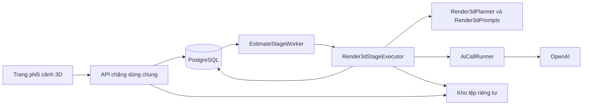
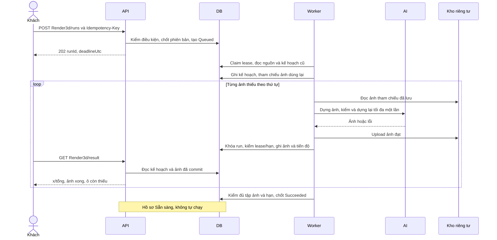
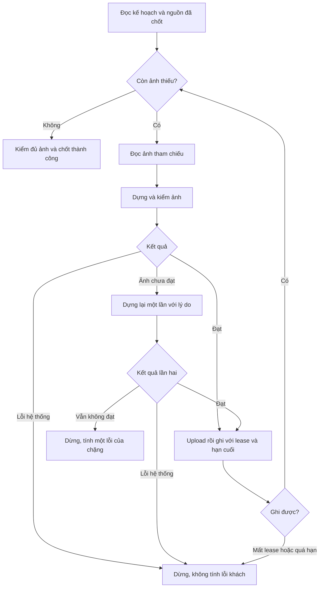
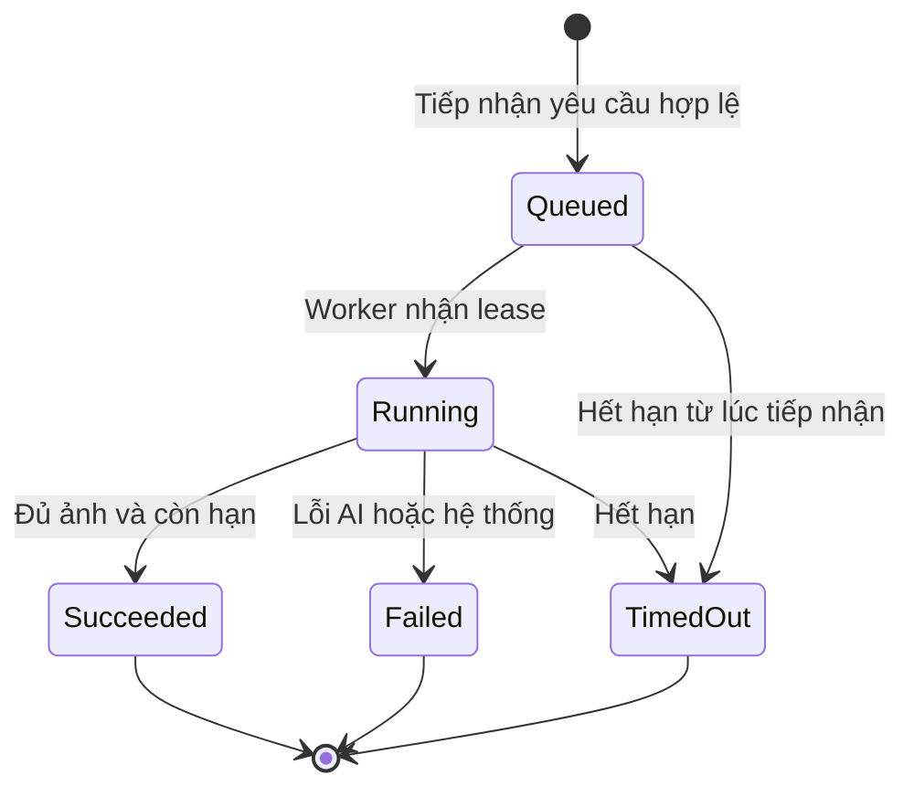
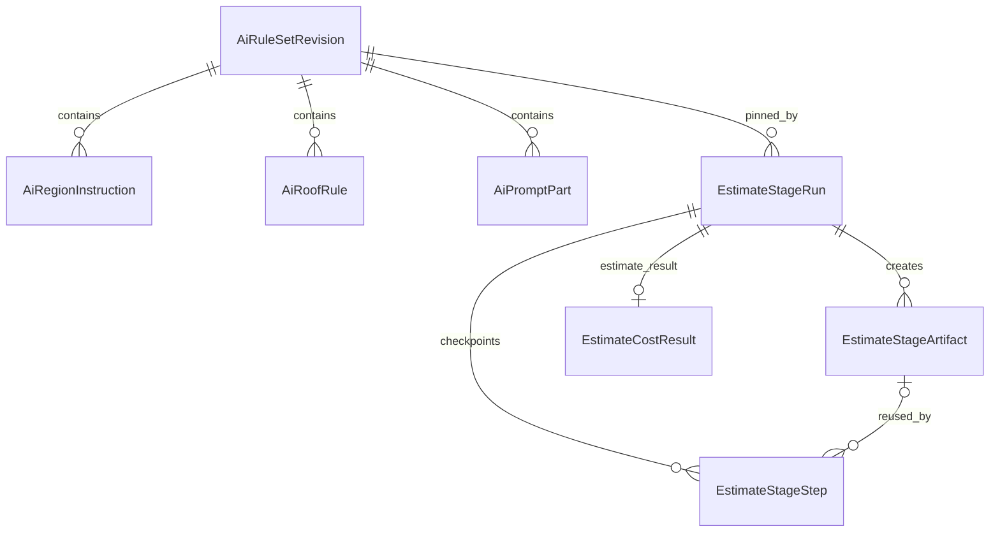

B<!-- HƯỚNG DẪN CHO AI KHI ĐIỀN HOẶC CHỈNH SỬA MẪU
- Đọc toàn bộ mẫu, các comment hướng dẫn và tài liệu nguồn được cung cấp trước khi viết. Tuân thủ các quy tắc nghiệp vụ, điều kiện, ngoại lệ và giới hạn đã được xác nhận.
- Không bịa, tự chế hoặc suy đoán thành sự thật: yêu cầu, quy tắc, số liệu, API, schema, mã lỗi, nguồn tham khảo, người phụ trách và kết quả kiểm thử phải có căn cứ. Nội dung ví dụ trong mẫu không phải dữ kiện của dự án.
- Khi thiếu thông tin hoặc các nguồn mâu thuẫn, hỏi người dùng để làm rõ; giữ nguyên placeholder ở phần chưa xác định. Không tự chọn đáp án, lấp chỗ trống hay tuyên bố tài liệu đã hoàn tất.
- Chỉ thay nội dung cần điền hoặc được yêu cầu sửa. Không tự mở rộng phạm vi, sửa nghĩa quy tắc, bỏ điều kiện/ngoại lệ, xoá hay ghi đè nội dung hợp lệ đã có.
- Giữ nguyên tên, cấp và thứ tự heading, nhãn in đậm, tiền tố bullet, cấu trúc danh sách, tên/thứ tự/số cột bảng và cú pháp code fence. Không dịch, đổi tên, gộp hoặc thêm mục ngoài cấu trúc mẫu.
- Chỉ lặp khối luồng, AC hoặc API theo đúng khuôn khi có căn cứ; chỉ bỏ phần tuỳ chọn khi hướng dẫn riêng của mẫu cho phép và đã xác định không áp dụng.
- Mã tham chiếu và section phải trỏ tới tài liệu có thật đã được cung cấp hoặc kiểm chứng. Không giữ mã ví dụ như tham chiếu thật và không tự tạo tài liệu liên quan để hợp thức hoá liên kết.
- Giữ các comment hướng dẫn trong file. Xuất Markdown UTF-8, mỗi file một tài liệu; không bọc toàn bộ file trong code fence, không chèn lời dẫn hay giải thích ngoài mẫu.
- Trước khi bàn giao, đối chiếu nội dung với nguồn, kiểm tra cấu trúc, giá trị cho phép, giới hạn độ dài và tính nhất quán của mã/tham chiếu. Báo rõ phần chưa đủ thông tin; không tuyên bố đã chạy test hoặc import khi chưa thực hiện.
-->

<!-- Thay mã TDD-001 và nội dung ví dụ; giữ nguyên heading và nhãn in đậm.
Sơ đồ dùng mermaid, plantuml hoặc URL. Giữ heading Architecture, Sequence Diagram, Activity Diagram, State Diagram, Data Model.
Ví dụ API phải có heading trùng METHOD /path trong Endpoints. Xoá phần API/sơ đồ không dùng.
Version, Updated At và Change Log do lịch sử phiên bản quản lý, để trống khi nhập mới.
Author/Reviewer là tên hiển thị; gán tài khoản, phê duyệt, giả định và câu hỏi mở trên giao diện sau import.
Thiết kế phải truy vết về Story và Business Rule được cung cấp. Phân biệt thiết kế đề xuất với implementation đã kiểm chứng; không mô tả API/schema/sơ đồ ví dụ như hệ thống thật hoặc tự quyết định nghiệp vụ còn thiếu.
BẮT BUỘC KHI HOÀN THIỆN MẪU: phải có cả Reviewer và Approver, mỗi tên 1–200 ký tự sau khi bỏ khoảng trắng đầu/cuối. Không xoá hai dòng metadata, để trống, dùng tên bịa hoặc giữ placeholder rồi coi là hoàn tất.
Nếu chưa biết người review hoặc người phê duyệt, phải hỏi người dùng và báo tài liệu chưa đủ thông tin; không tự lấy Author/Owner làm người thay thế. Tên trong file không tự gán tài khoản hoặc xác nhận đã duyệt; gán thành viên trên giao diện sau import.
Đây là yêu cầu hoàn thiện mẫu; backend hiện vẫn nhận file cũ thiếu hai trường để tương thích.

VALIDATION CHO FILE NHẬP (đối chiếu ImportSnapshotValidator, MarkdownParser và ImportService):
- Mỗi file .md UTF-8 không rỗng chỉ có một heading cấp 1 chứa mã tài liệu dài 1–100 ký tự. Mã không được trùng trong cùng lần nhập hoặc thuộc loại tài liệu khác đã tồn tại.
- Không dùng tên README.md hoặc sitemap.md vì importer bỏ qua. Giao diện nhận .md/.zip, tối đa 2.000 file, tổng file tải lên 31 MiB; API giới hạn request 32 MiB và tổng nội dung đọc/giải nén 64 MiB.
- Chỉ nhập đè tài liệu cùng loại đang Draft, chưa có phiên bản và chưa lưu trữ. Import thay toàn bộ nội dung bản nháp, vì vậy phải giữ lại nội dung hợp lệ ngoài phần được yêu cầu sửa.
- Không dùng Status trong Markdown hoặc tên Approver để tự xác nhận phê duyệt; import không cấp quyền hay gán tài khoản từ tên. Chạy Kiểm tra file và xử lý lỗi/cảnh báo trước khi nhập.
- Giới hạn độ dài bên dưới tính theo string.Length của .NET (đơn vị UTF-16); không tự cắt ngắn dữ kiện quan trọng để vượt validation, hãy viết lại có căn cứ hoặc hỏi người dùng.
- Feature tối đa 300 ký tự và được dùng làm tiêu đề tài liệu. Status được parser nhận: Draft / In Review / Approved / Deprecated; tài liệu nhập mới vẫn có trạng thái phê duyệt Draft.
- Endpoint: đường dẫn tối đa 500 ký tự; tên/mô tả endpoint được lưu trong Name tối đa 300. HTTP method: GET / POST / PUT / PATCH / DELETE / HEAD / OPTIONS.
- Error Codes: mã tối đa 100 ký tự, không trùng trong tài liệu; giữ dạng - **CODE** (400): mô tả. HTTP status trong Error Codes và Response phải là số nguyên đọc được bằng Int32; không tự đặt status khác hợp đồng API.
- URL sơ đồ tối đa 1.000 ký tự. Mục sơ đồ được sử dụng phải có khối mermaid/plantuml hoặc URL theo mẫu; không để một mục sơ đồ rỗng. Nhãn mục được tách từ bullet như tên External API Fields tối đa 300 ký tự.
- Heading Examples phải khớp METHOD /path ở Endpoints. Giữ các nhãn Request:, Response 200: (thay mã theo contract) và Error Response: để parser tách đúng dữ liệu.
- Tham chiếu dạng DOC-KEY/section: ghi chú: mã đích tối đa 100 ký tự, section tối đa 100, ghi chú tối đa 1.000. Không trùng bộ mã đích + section + loại liên kết trong cùng tài liệu.
ĐỐI CHIẾU FORM TDD (src/features/tdds/validations.ts; form có thể chặt hơn import):
- Điền Feature, Author, Reviewer, Problem và ít nhất một Goal; các Goal/Non-goal/Notes đã thêm không được rỗng. API đã khai báo phải có endpoint và mô tả/mục đích; Fields phải có tên và ý nghĩa; Error Codes phải có mã, HTTP status và điều kiện.
- Form còn kiểm tra Version, Updated At và nội dung Change Log khi khai báo; với file nhập mới, giữ các trường lịch sử này trống theo hợp đồng import, không tự tạo dữ liệu lịch sử.
-->

# TDD-PROJ-010

## Document Info

- **Feature**: Chặng Phối cảnh 3D: lập danh sách ảnh, dựng tuần tự, lưu từng ảnh và chạy tiếp phần còn thiếu
- **Author**: Codex
- **Reviewer**: Tân Trần
- **Approver**: Tân Trần
- **Status**: Draft
- **Version**:
- **Updated At**:

## Context & Goals

### Problem

Đợt 2 đã có chặng Dự toán và lưu kiểu mái đã tính tiền. Chặng 3D còn thiếu executor, hợp đồng kết quả từng phần và màn xem ảnh. Thiết kế này tiếp tục [TDD-PROJ-006](TDD-PROJ-006.md), [TDD-PROJ-007](TDD-PROJ-007.md), [TDD-PROJ-008](TDD-PROJ-008.md) và [TDD-PROJ-009](TDD-PROJ-009.md); các lớp, bảng và hợp đồng mới dưới đây là **đề xuất, chưa triển khai**.

Hiện trạng đã kiểm tra: BE `feature/estimate-pipeline-w2` tại `3c1700c`, FE cùng nhánh tại `b722cad`, app demo `design-estimate` tại `059e876`. Các đường dẫn BE/FE trong tài liệu tính từ gốc repo tương ứng; đường dẫn demo tính từ `design-estimate/`.

- BE đã có worker, cấu hình theo phiên bản, điểm lưu từng bước, tệp riêng tư, `render3dImage` và `render3dCheck`. `GetStageResultQueryHandler` hiện chỉ nhận Plan2d/Estimate đã thành công. `EstimatePipelineStore.RecordStepAsync` đếm tất cả bước thành tiến độ, chưa kiểm hạn cuối ngay trong SQL ghi bước.
- Kiểu mái nằm trong `EstimateCostResult.CustomerJson.roof.kind/source`, được viết bởi `EstimateResultDocuments.Customer`; **không có cột RoofKind riêng** trên bảng này. Chặng 3D phải đọc kết quả của lần chạy Dự toán thành công.
- FE đã có trạng thái Render3d và bước số 4 trong `pipeline.logic.ts`, nhưng chưa có route riêng cho màn 3D. Cần thêm `/design/[projectId]/render3d` và nối điều hướng từ kết quả Dự toán.

### Goals

- Thực hiện STORY-PROJ-009: tiếp nhận chặng sau Dự toán, không giữ/trừ lượt hoặc kiểm quyền gói 3D; hiển thị ảnh ngay sau khi lưu.
- Giữ thuật toán chọn phòng, góc máy và ảnh tham chiếu của demo; áp dụng các khác biệt đã chốt về hai nhóm phong cách, mái, miền, lỗi và lưu kết quả.
- Lưu ảnh riêng tư từng bước; chạy lại chỉ dựng ảnh thiếu, kể cả khi model hoặc bộ quy tắc đã đổi. Không nhận kết quả đến sau hạn 40 phút mặc định.
- Ghi được model, prompt, cấu hình, quy tắc và lời gọi tạo ra từng ảnh để Admin truy vết.

### Non-goals

- Mô hình 3D tương tác, chọn số ảnh/phòng, thêm góc sau khi chặng đã thành công, dựng lại vì không thích ảnh.
- PDF/Excel, chia sẻ hồ sơ, màn Admin sửa quy tắc/prompt, thay đổi gói đăng ký hoặc đưa nhánh lên develop.
- Đổi chất lượng thẩm mỹ hoặc tự bật các kiểm tra có phí vốn đang tắt trong demo. Không có cam kết mọi ảnh đúng hình học chỉ dựa vào việc AI trả được ảnh.

## Architecture



**Notes**:

**A. Thành phần và thứ tự triển khai dự kiến**

| Thành phần | Trách nhiệm và nơi dự kiến |
|---|---|
| `Render3dPlanner`, `Render3dPrompts`, `Render3dQuality` | Hàm thuần ở `src/bmt-be.estimatepipeline/Render3d/`; chọn ảnh, dựng prompt, phân loại phòng và đo ảnh trùng. Dùng lại `HouseSpec`, hình học và các hàm mô phỏng Python hiện có. |
| `Render3dStageExecutor` | `src/bmt-be.infrastructure/estimatePipeline/render3d/`; đọc đầu vào đã chốt, tạo kế hoạch, gọi AI tuần tự và ghi từng ảnh. Đăng ký `IStageExecutor`, phiên bản dự kiến `render3d:r3d-1`. |
| Kho điểm lưu | Mở rộng `IEstimatePipelineStore`, `StageCheckpoints` và `EstimatePipelineStore` để ghi kế hoạch, phục hồi ảnh và đếm riêng ảnh 3D; không đưa HTTP hay xử lý ảnh vào repository. |
| `Render3dResultProjection` | Projection gửi khách đọc danh sách dự kiến và ảnh đã có, không trả JSON nội bộ hoặc thông tin model. Dùng từ `GetStageResultQueryHandler`. |
| FE | Schema `render3d-v1`, API `getRender3dResult`, hook và `Render3dStageView` trong `src/features/design/`; route mới dưới `src/app/[locale]/(main)/design/[projectId]/render3d/`. |

Thứ tự sau khi TDD được chốt: đặc tả Unit Test → thư viện thuần và đối chiếu demo → dữ liệu nạp sẵn và repository → executor/API → FE → kiểm thử Fake → một lần chạy thật ở local. Mã Unit Test kế tiếp bắt đầu từ UT-PROJ-429; chưa tạo các đặc tả này khi TDD còn chờ duyệt.

- **Đã xác nhận:** nghiệp vụ của STORY-PROJ-009 và các BR được dẫn; một lượt cho cả bộ, lưu từng ảnh, chạy tiếp phần thiếu, mái theo Dự toán, tách hai phong cách.
- **Đề xuất chưa chốt:** thiết kế chi tiết trong bản TDD này, gồm kế hoạch lưu bằng Step JSON, bảng lời dặn theo miền và hợp đồng `render3d-v1`.
- **Cần làm rõ:** không đặt thêm quyết định nghiệp vụ mới cho đợt 3; bản TDD hoàn chỉnh vẫn cần người dùng chốt trước khi viết đặc tả Unit Test. Các ngưỡng vận hành chung còn mở được giữ nguyên trạng ở mục H.

**B. Tiếp nhận và đầu vào bất biến**

1. Dùng `POST …/stages/Render3d/runs`, khóa chống gửi lặp và thứ tự kiểm của TDD-PROJ-006. Bản phải thuộc khách; Dự toán đã thành công; không có chặng đang chạy; Render3d chưa thành công; chưa hết giới hạn lỗi. Không hỏi gói còn hạn, quota hay `design.render3d`.
2. Chốt cấu hình và bộ quy tắc hiện hành vào lần chạy; `UsageOperationId=NULL`, hai phiên bản luật giá cũng NULL. `InputOperationId` vẫn là bản chụp v3 của chặng 2D thành công. Hạn cuối tính từ lúc tiếp nhận, gồm cả thời gian chờ hàng đợi.
3. Executor đọc `EstimatePlanResult.InternalJson.spec`, danh sách ảnh 2D trong CustomerJson và bản chụp v3. Đọc `EstimateCostResult` của lần chạy Estimate thành công, không dùng kết quả dở dang. Thiếu dữ liệu nguồn là lỗi hệ thống `InternalError`, không gọi lại 2D/Dự toán để chữa ngầm.
4. Miền dùng `snapshot.pricingRegion.region` (North/Central/South), không tra lại tỉnh hiện hành hoặc tin miền AI tự viết. Mái dùng `cost.CustomerJson.roof.kind`; `roof.source` giữ để truy vết. Cờ cần kỹ sư rà của Dự toán không chặn 3D.
5. Khi đã có kế hoạch từ lần chạy trước, sao đúng kế hoạch đó vào điểm lưu của lần chạy mới. Không chọn lại phòng theo phiên bản thuật toán mới rồi bỏ các ảnh cũ. Nếu phiên bản kế hoạch không còn được hỗ trợ, báo `PipelineVersionRetired`, không tính lỗi khách.

**C. Danh sách ảnh và nhãn**

Nguồn: `savico/modules/render3d/service.py:38–280`. Thuật toán giữ trong mã; không biến số ảnh thành lựa chọn của khách.

| Bước | Quy tắc |
|---|---|
| Hai ảnh đầu | `exterior_day`, `exterior_night`, theo thứ tự. Nhà: “Ngoại thất — Ban ngày/đêm”; căn hộ: “Toàn cảnh căn hộ — Ban ngày/đêm”. Ảnh đêm phụ thuộc ảnh ngày. |
| Phòng chính | Tách tên theo regex demo, bỏ dấu; loại khi tất cả phần tên là không gian phụ. Chỉ chọn phòng có danh sách đồ đạc. Kho nhỏ là tên có “nhỏ” hoặc diện tích dưới 8 m². Không dùng so khớp tên danh mục do Admin đặt. |
| Sắp xếp | Diện tích giảm dần, NULL như 0; bằng diện tích giữ thứ tự trong phương án. Chọn tối đa một phòng mỗi nhóm tên `room_family`: bỏ chữ số, lấy hai từ đầu sau chuẩn hóa. |
| Dự phòng | Chỉ khi không có phòng chính: các không gian có tên, nhóm có đồ trước rồi nhóm không đồ, mỗi nhóm sắp theo diện tích. Tiếp tục lọc một phòng mỗi nhóm tên. |
| Đủ ba góc/tầng | Lấy tối đa ba phòng khác nhóm. Vẽ góc 1 của từng phòng trước. Thiếu thì thêm góc 2 của phòng lớn nhất, rồi góc tiếp theo theo `room_views`. Một phòng → góc 1, 2, 3; hai phòng → phòng 1, phòng 2, góc 2 của phòng 1. Áp dụng cả tum. |
| Không gian trống | Tầng không có không gian có tên để chọn thì không thêm ảnh cho tầng đó, kèm lưu ý như `plan_notes`; không tự tạo phòng. Tổng = 2 + số góc thực tế, không luôn nhân số tầng yêu cầu với 3. |
| Mã và thứ tự | `floor{n}_room{k}` hoặc `floor{n}_room{k}_v{v}`; n bắt đầu 1, k là thứ hạng phòng đã chọn, `roomIndex` là vị trí gốc bắt đầu 0. Nhãn lấy `room_label`, tên trùng thêm (1)/(2); giữ thứ tự cho UI và Hồ sơ sau này. |

Ví dụ minh họa: hai tầng đều có phòng để chọn → 8 ảnh. Tum chỉ có một phòng thờ → thêm ba góc của phòng thờ, thành 11 ảnh. Hai phòng ngủ trên cùng tầng thuộc cùng nhóm: chỉ lấy phòng lớn hơn rồi bổ sung góc, không mặc định dựng cả hai phòng.

Kế hoạch không gọi AI. Lưu cả nhãn, thứ tự, phòng, góc, quan hệ phụ thuộc và lưu ý để lần chạy lại không bị đổi tên. Không đưa câu demo “Muốn thêm thì báo để render bổ sung” ra UI vì trái Out of Scope của STORY-PROJ-009.

**D. Ảnh tham chiếu và prompt**

Nguồn: `service.py:369–532`, `prompts.py:130–900`.

| Ảnh | Nguồn hình và lời dặn |
|---|---|
| Nhà ban ngày | Mỗi tầng ưu tiên bản bố trí nội thất, nếu chưa có metadata thì bản kỹ thuật; theo thứ tự tầng, tối đa `MAX_FLOOR_COUNT+1` = 5 ảnh. Đọc mặt tiền từ cùng hướng trang đã dùng cho 2D; không tự coi cạnh dưới là cửa vào. Giữ ngữ cảnh nhà liền kề, lô góc, hẻm, sân và hình lô bất quy tắc. |
| Căn hộ ban ngày | Bắt buộc bản nội thất tầng 1. Góc nhìn bên trong khu khách–bếp–ăn; không vẽ nhà độc lập, mái, sân hoặc cổng. |
| Ban đêm | Bắt buộc bytes của **ảnh ngày đã ghi thành công** cho chính dự án này, kể cả ảnh được giữ từ lần chạy trước. Chỉ đổi ánh sáng/bầu trời; giữ góc máy, đồ đạc, hình khối. Không gọi text-to-image cho ảnh đêm. |
| Phòng | Bắt buộc bản nội thất cùng tầng. Dùng chỉ số phòng để xác định mục tiêu; các phòng cùng tên không đi vào danh sách tên bị cấm. Giữ xử lý không gian bán ngoài trời, không đồ đạc, mô tả đồ đạc tự do dài hơn 60 ký tự và khu chung căn hộ. |
| Góc thêm | Nếu `renderViewReference=true`, đính kèm ảnh góc 1 đã lưu làm ảnh thứ hai khi đọc được; ảnh 2 chỉ làm mẫu vật liệu/đồ đạc, ảnh 1 là nguồn hình học. Khi thiếu ảnh tham chiếu tùy chọn, ghi lưu ý như demo và tiếp tục. |

Bản vẽ có metadata nhưng lỗi đọc kho là `ArtifactStoreFailed`, không tự đổi thành không có bản vẽ để vẽ bằng lời. Nếu thực sự thiếu bản bắt buộc trong kết quả 2D thành công, báo lỗi dữ liệu hệ thống. Nhánh ngoại thất không có ảnh nào vì thiếu metadata vẫn dựng từ phương án và ghi lưu ý như demo; điều này không làm ảnh đêm hay ảnh phòng được bỏ nguồn bắt buộc.

Các khác biệt có căn cứ so với demo:

- **Hai phong cách:** ngoại thất lấy `architectureStyle` và `effectiveBaseStyleCode` đã chốt; nội thất/căn hộ lấy tên và `interiorStyle.promptDescriptor`. Loại bỏ câu ép nội thất cùng bảng màu ngoại thất. Nhóm nội thất không áp dụng thì không tự sao phong cách kiến trúc sang; mô tả trung tính theo nhóm bị tắt của TDD-PROJ-007. BR-PROJ-004 khoản 21 và STORY-PROJ-009/AC-003 là căn cứ.
- **Mái đã tính tiền:** không gọi `roof_kind` của demo để quyết định lại kiểu mái. Lời dặn và QC cùng nhận kind của kết quả Estimate. Dòng `AiRoofRule.Render3dText` hiện hành chỉ dùng khi BaseCode/BaseStyleCode (hoặc dòng `*`) và RoofKind đều khớp. Nếu Admin đổi ma trận mái khiến kind khác, dùng mô tả cố định theo kind ở slot `render3d.roof`; không nhận kiểu mái mới. `None` dành cho căn hộ, `Metal` dựng mái tôn theo kết quả phương án. Câu mô tả không được làm thay đổi kind đã chốt.
- **Thời tiết:** giữ câu khí hậu của `REGION_WEATHER` và lời dặn thoát nước trong `roof_rule`; lấy miền từ bản chụp 2D. Đây là lời dặn thiết kế chống nắng/mưa, không phải gọi API dự báo thời tiết hay biến tất cả ảnh thành cảnh mưa.
- **Lời dặn có phiên bản:** tách các đoạn tĩnh của prompt vào `AiPromptPart`; chèn `AiPackageStageInstruction` cho Render3d, `AiRegionInstruction` chủ đề `Render3dWeather`, rồi các `AiInstruction` khớp phạm vi theo quy tắc TDD-PROJ-008. Schema QC và cách chọn ảnh nằm trong mã. Nội dung khách là dữ liệu thiết kế, không phải lệnh điều khiển lưu trữ/quyền.

Giữ các ngưỡng rút gọn văn bản và câu sửa lỗi từ demo: ghi chú phòng 160 ký tự, mô tả mặt tiền 600, giả định mặt tiền/hướng tối đa hai câu (mỗi câu 120), phần đầu bố trí tầng trệt 140; nguồn `prompts.py:77–113, 374–434`. Không rút gọn ô mô tả nội thất 1.000 ký tự bằng các ngưỡng này.

**E. Kiểm ảnh, dựng lại và phân loại lỗi**

Mỗi mục ảnh có một lần dựng ban đầu và tối đa một lần dựng lại ở cấp executor. Dùng task `render3dImage`, kích thước yêu cầu `1280x720` (`savico/core/config.py:391`). Kiểm bytes là ảnh đọc được và kích thước đầu ra đúng NFR của Story; không kéo giãn ảnh sai tỷ lệ để coi là đạt.

Các công tắc giữ mặc định demo (`savico/core/config.py:160–172`): `renderViewReference=false`, `renderDuplicateGuard=false`, `renderDuplicateMaxDistance=10`, `renderQc=false`. Đưa vào Parameters của task ảnh trong cấu hình có phiên bản; các tham số này chỉ điều khiển executor, không gửi thẳng tới OpenAI. Validator nhận đúng boolean; khoảng cách nguyên 0–64 vì dHash 64 bit. Màn cấu hình AI hiện có cần đọc/ghi đúng tham số; chưa làm màn quản lý quy tắc/prompt.

- Khi bật chống trùng, dùng dHash: ảnh xám, thu về 9×8 với LANCZOS, so mỗi cặp điểm cạnh nhau; khoảng cách Hamming ≤ ngưỡng là trùng. So ảnh phòng với các góc đã lưu của cùng phòng và phòng cùng nhóm tên trong nhà. Tối đa ba nhãn phòng cùng nhóm đưa vào prompt, theo demo `service.py:66, 490–532`; không tự áp ngưỡng này thành giới hạn số ảnh so sánh.
- Khi bật QC, task `render3dCheck` nhận ảnh vừa dựng với JSON schema đóng. Nội thất: `no_text`, `eye_level_view`, `ceiling_and_floor_visible`, `matches_room_function`. Ngoại thất: `no_text`, `eye_level_street_view`, `floor_count_matches`, `roof_matches_type`. Bán ngoài trời kiểm sàn và trời thay trần; chỗ không đồ không bị yêu cầu thêm đồ; QC ảnh đêm giữ hình/góc của ảnh ngày. Nguồn `quality.py:21–118`, `prompts.py:906–1100`.
- Lần đầu bị trùng/QC không đạt: dựng lại một lần với `regeneration_prompt`, chỉ rõ lỗi theo loại ảnh. Nếu lần hai vẫn không đạt, báo `DrawingUnavailable`, giữ các ảnh đã lưu trước đó, không công bố hai ảnh lỗi. **Khác demo giữ ảnh tốt hơn dù cả hai lỗi**: áp dụng BR-PROJ-011 và STORY-PROJ-009/AC-004 đã chốt.
- Nếu QC tùy chọn gặp lỗi dịch vụ và chưa có bằng chứng ảnh hỏng, giữ hành vi demo: ghi lưu ý kiểm tra chưa thực hiện được, không biến lỗi dịch vụ thành kết luận ảnh sai. Nếu đã biết ảnh đầu hỏng mà lần dựng lại lỗi hệ thống, dừng với mã hệ thống gốc, không giữ ảnh đã biết hỏng và không tính bộ đếm lỗi khách. Chỉ chấp nhận ảnh thứ hai khi không còn lỗi đã phát hiện; QC không thực hiện được không được dùng để xóa một lỗi QC đã biết của ảnh đầu.
- Từ chối nội dung → `AiContentBlocked`, dừng và tính một lỗi; không cố né từ chối bằng lời dặn khác. Lỗi mạng, quota nhà cung cấp, sai khóa, quá hạn, lưu tệp, model không còn hỗ trợ → lỗi hệ thống theo TDD-PROJ-006/008; không dựng lại ở executor để nhân số lần thử hệ thống.

Phân biệt **dựng lại ảnh** với **thử lại giao tiếp AI**: lớp `AiCallRunner` đang có tối đa hai lần gọi lại khi HTTP 200 không có ảnh, bên trong một lời gọi logic; giữ hợp đồng TDD-PROJ-008. Sau khi lớp này kết thúc `AiOutputIncomplete`, executor có thể dựng lại một lần. Vì vậy “dựng lại một lần” không đồng nghĩa tối đa hai HTTP request; riêng chuỗi phản hồi 200 rỗng có thể là 3 + 3 request. Không thêm vòng lặp gọi lại ở FE. Nhật ký phải giữ được các request con và hai attempt của mục ảnh.

**F. Điểm lưu, chạy tiếp và hạn cuối**

Kế hoạch lưu thành StepKey `render3d:plan`, Internal=true, OutputJson có `schemaVersion=1`, `inputOperationId`, `planRunId`, `estimateRunId`, `items`, `notes`. Dữ liệu có cấu trúc biến đổi theo phiên bản và luôn đọc cả khối, nên dùng điểm lưu JSON hiện có thay vì thêm bảng kết quả 3D trùng dữ liệu tệp.

1. Giữ thứ tự trong kế hoạch: ngày → đêm → từng tầng, các góc chính trước góc thêm. Worker chạy tiếp kể cả khách đóng browser.
2. Mỗi ảnh đã có của đúng Estimate/Render3d/itemKey và cùng InputOperationId được dùng lại, không kiểm lại bằng model mới, không dựng lại. Ghi Step `render3d:image:{itemKey}` của lần chạy hiện tại trỏ ArtifactId cũ; Model/PromptVersion vẫn là nguồn cũ. Dùng điểm lưu đã công bố, không tìm tệp mồ côi trong bucket để coi là hoàn thành.
3. Với ảnh thiếu: dựng, kiểm, upload riêng tư, rồi một transaction ghi Artifact + Step + tiến độ. OutputJson của Step ảnh giữ `callId`, `referenceArtifactIds`, `notes`, kết quả kiểm nội bộ và attempt (1/2). Artifact giữ model/cấu hình/prompt gốc; bộ quy tắc đọc qua CreatedByRunId. Không chép các metadata gốc thành cấu hình của lần chạy lại.
4. Cập nhật bộ nhớ của executor sau mỗi commit. `ExistingArtifacts` hiện là ảnh chụp lúc nhận việc; phải ghép ảnh mới vào map theo itemKey ngay, để ảnh đêm và góc thêm đọc được ảnh vừa lưu.
5. Chỉ với Render3d, `ProgressDone` đếm Step ảnh có ArtifactId, không đếm kế hoạch/QC; `ProgressTotal=items.Count`. Khi phục hồi, ghi các tham chiếu cũ trước khi dựng ảnh thiếu. Ví dụ giữ 6 ảnh cũ → lần mới bắt đầu dựng ảnh thứ 7 ở tiến độ 6/8. Hai chặng hiện có giữ cách tính tiến độ của chúng.
6. Trước ghi kế hoạch/ảnh, repository khóa dòng run, kiểm lease token, Running, lease chưa hết hạn và `DeadlineUtc > clock_timestamp()` bằng giờ DB; lặp kiểm hạn ngay trước bước cập nhật cuối. Nếu hết hạn/mất lease, rollback toàn transaction. Không chỉ dựa vào CancellationToken, vì upload hoặc callback có thể hoàn tất muộn. Áp dụng điều kiện này vào đường ghi điểm lưu dùng chung; kiểm hồi quy 2D/Dự toán.
7. Upload nằm ngoài transaction SQL: tệp đã upload mà ghi DB thất bại không có route công bố, không được tính tiến độ. Giữ cách xử lý tệp chưa có tham chiếu của hạ tầng hiện tại; không quét/xóa kho thật trong đợt này. Đây là giới hạn không thể có một transaction chung giữa DB và object store.
8. Trước Succeeded, kiểm tập itemKey đã có tệp đúng bằng kế hoạch, không chỉ so số lượng. Việc chốt thành công cũng kiểm lease và hạn cuối. Thiếu một ảnh thì chưa mở Hồ sơ. Nếu bị dừng ngay sau ảnh cuối nhưng trước chốt, lần chạy sau dùng lại toàn bộ ảnh và chỉ chốt, không gọi AI.

API kết quả lấy kế hoạch sớm nhất đã lưu hợp lệ của chuỗi chạy và hợp nhất ảnh đã commit từ các lần chạy, kể cả lần Failed/TimedOut. Chọn theo itemKey; nếu có nhiều ảnh do phục hồi bất thường thì lấy ảnh hợp lệ được công bố đầu tiên theo CreatedAtUtc, Id, ghi cảnh báo nội bộ. Không thay ảnh đã thấy bằng ảnh sinh muộn. SQL đọc một snapshot nhất quán để `done`, `total` và items không lệch nhau trong cùng phản hồi.

**G. Giao diện và quan sát vận hành**

Trước → sau khi triển khai: từ chưa có màn dựng 3D → trang bước 4 có nút chạy, tiến độ và thư viện ảnh theo nhóm. Kết quả Dự toán thêm đường dẫn sang 3D; dữ liệu Dự toán vẫn đọc bằng contract hiện có.

| Trạng thái | Hiển thị/hành động |
|---|---|
| Chưa mở | Điều kiện cần hoàn tất Dự toán; không có nút gọi AI. |
| Sẵn sàng | Nút “Tạo phối cảnh 3D”, nói rõ không tính thêm lượt. |
| Đang chạy | Tiến độ `x/tổng ảnh`; khi chưa lập kế hoạch thì “Đang chuẩn bị danh sách ảnh”. Placeholder cho ảnh thiếu; ảnh xong mở xem được ngay. |
| Thất bại | Giữ thư viện ảnh, câu lỗi phù hợp, số lần lỗi còn lại; “Chạy tiếp các ảnh còn thiếu” khi được phép. Không gợi ý mua gói để chạy 3D. |
| Thành công | Đủ ảnh, không có nút dựng lại. Hồ sơ chỉ chuyển trạng thái Sẵn sàng; việc dựng tệp thuộc đợt 4. |

Thứ tự nhóm theo demo `web/app.js:5899–6003`: ngoại thất (căn hộ gọi “Toàn cảnh căn hộ”), rồi tên tầng từ phương án. Ảnh 16:9, nhãn/alt rõ tên không gian và góc; lưu ý tiếng Việt loại trùng giữ thứ tự. Không hiển thị khóa bước, bucket key, prompt, model, chi phí AI hay dữ liệu QC thô.

Tái sử dụng polling `useStages` và chống gửi lặp của `use-stage-run`; tải kết quả từng phần trong lúc chạy và tải lại một lần khi chuyển Failed/Succeeded. Hủy request đọc khi đổi dự án, bỏ phản hồi cũ; điều này không hủy worker. Mất mạng không xóa ảnh đã tải. `fileUrl` là route cùng domain có kiểm quyền; tải lại route để lấy URL ký mới khi link hết hạn, không lưu signed URL làm dữ liệu dự án.

Admin dùng màn tra cứu hiện có: liệt kê artifact, lần chạy gốc, config/rules, model/prompt, CallId và ảnh được dùng lại. Nhật ký thô giữ quyền operate và audit theo TDD-PROJ-008. Metric dùng AiCallLog (thời gian, token/chi phí, retry), không tự suy tốc độ token từ thời gian dựng ảnh. Cảnh báo quá chi phí và công tắc tạm ngắt dùng khung chung; không đặt lại các ngưỡng chưa được người dùng chốt.

**H. Đối chiếu nguồn và kiểm chứng dự kiến**

| Phạm vi | Nguồn demo `059e876` / quyết định | Cách kiểm |
|---|---|---|
| Chọn phòng, nhãn, thứ tự | `service.py:38–280` | Bộ đối chiếu hàm thuần: căn hộ, tầng trống, tum, phòng cùng nhóm, diện tích bằng nhau; so từng item. |
| Nguồn ảnh và góc máy | `service.py:369–532`; `prompts.py:130–900` | So nguyên văn prompt với demo cho phần giữ nguyên; đối chiếu riêng các đoạn đã đổi theo BR004/013/019. |
| dHash và sửa lỗi | `quality.py:21–118`; `prompts.py:906–1100`; `service.py:592–726` | Ảnh ghi sẵn thật, kiểm hash/nhánh ở ngưỡng; chênh Pillow/ImageSharp phải xử lý trước khi bật guard, không nới ngưỡng để che sai khác. |
| Chạy tiếp và tiến độ | STORY-PROJ-009/AC-004, AC-006, AC-007 | PostgreSQL thật: transaction, hai worker, mất lease, retry sau đổi model, không nhận tệp quá hạn. |
| Quyền, lỗi và nguồn mái | AC-001, AC-003, AC-005; ST-PROJ-149 đến 154, 204 | Fake phát lại phản hồi thật đã ghi; kiểm số lời gọi, tham chiếu ban đêm, nguồn model từng ảnh, gói hết hạn và chủ khác. |
| UI và chất lượng đầu ra | `web/app.js:5899–6090`; Story NFR | Browser kiểm partial/reload/retry/mobile; một lần Live sau Fake để rà mái, tầng, phong cách và thời gian/chi phí thực tế. |

Không dùng phản hồi AI tự bịa làm bằng chứng chất lượng. Bộ đối chiếu chạy từ bản sao demo không có `.env`, như `test/parity/generate.py` hiện hành. Chưa chạy kiểm thử 3D, chưa áp migration và chưa có xác nhận TDD. Các số mặc định queue/breaker/cost alert/trần soi ảnh chung còn mở trong kế hoạch gốc, không được coi là đã chốt qua tài liệu này.

## Sequence Diagram



## Activity Diagram



Sơ đồ mô tả vòng dựng ảnh chính. Nội dung bị chặn dừng ngay; kiểm QC tùy chọn chưa thực hiện được theo mục E. Các ảnh đã commit luôn được giữ ở cả hai nhánh lỗi.

## State Diagram



Đây là trạng thái của **một lần chạy**, dùng bảng hiện có. Khách chạy tiếp tạo lần chạy mới, không đổi Failed thành Running. Ảnh đã lưu là đầu vào phục hồi của lần chạy mới. Trạng thái chặng Chưa mở/Sẵn sàng/Đang chạy/Thất bại/Thành công tính theo TDD-PROJ-006.

## Data Model

Thêm một bảng quy tắc `AiRegionInstruction`. Không thêm bảng ảnh hoặc bảng kết quả 3D. PostgreSQL và EF Core giữ phiên bản đang dùng của repo; chưa tạo migration trong bước thiết kế.

| Bảng | Một dòng là gì, người ghi và thời điểm |
|---|---|
| `AiRegionInstruction` (mới) | Một lời dặn cho một miền và một chủ đề trong một phiên bản bộ quy tắc. Migration đợt 3 tạo dữ liệu khí hậu; đợt Admin mới có màn sửa. |
| `AiRuleSetRevision`, `AiRuleSet` | Phiên bản bất biến và con trỏ hiện hành. Tạo phiên bản mới bằng cách sao toàn bộ quy tắc hiện hành, thêm phần 3D rồi đổi con trỏ trong cùng transaction; không sửa phiên bản lần chạy cũ đang giữ. Schema/mẫu tại TDD-PROJ-008/Data Model. |
| `AiRoofRule`, `AiPromptPart`, `AiPackageStageInstruction` | Dòng mái, đoạn prompt và lời dặn gói/chặng trong revision mới. Giữ khóa/schema TDD-PROJ-008/009; bổ sung nội dung 3D, không thêm cột. `Render3dText=NULL` vẫn hợp lệ ở revision cũ. |
| `EstimatePipelineTaskSetting` | Tham số ảnh/QC trong revision cấu hình mới; thêm bốn khóa render đã nêu ở E. Không viết lại revision cũ. Schema/mẫu tại TDD-PROJ-008/Data Model. |
| `EstimateStageRun`, `EstimateStageStep`, `EstimateStageArtifact` | Lần chạy, kế hoạch/điểm lưu ảnh, metadata tệp riêng tư. Schema/FK/mẫu nền tại TDD-PROJ-006/Data Model; thay ý nghĩa tiến độ riêng Render3d như F, không thêm cột. |
| `EstimateGenerationInput`, `EstimatePlanResult`, `EstimateCostResult`, `AiCallLog` | Nguồn bất biến và nhật ký dùng lại từ TDD-PROJ-007/008/009; không thay schema. |

| Cột mới của `AiRegionInstruction` | Kiểu, null và ràng buộc |
|---|---|
| `RevisionId` | uuid NOT NULL, FK AiRuleSetRevision(Id), ON DELETE RESTRICT. |
| `Region` | varchar(16) NOT NULL, CHECK IN ('North','Central','South'). |
| `Topic` | varchar(32) NOT NULL, CHECK = 'Render3dWeather' trong đợt này. Mở chủ đề khác bằng migration khi thực sự dùng. |
| `Text` | varchar(2000) NOT NULL, có ký tự khác khoảng trắng; tối đa 2.000 ký tự theo BR-PROJ-019. |
| Khóa | PK (RevisionId, Region, Topic). Không cần index thứ hai: mọi lần đọc theo RevisionId rồi Region/Topic. |

Trước phát hành revision dùng cho 3D, validator yêu cầu đủ ba miền của chủ đề này; thiếu là lỗi cấu hình, không dùng miền suy đoán. Không có cột tỉnh hoặc cờ Tây Nguyên vì bảng tỉnh → miền là nguồn khác đã chốt ở 2D. Không có UpdatedAt trên dòng bất biến; thời điểm và người tạo thuộc revision cha.



Các quan hệ cũ giữ delete behavior của TDD-PROJ-006/008/009; không thêm cascade từ khách sang nhật ký AI. FK của Step tới Artifact có thể NULL với kế hoạch hoặc bước không sinh tệp. Quan hệ Step–Artifact cho phép nhiều lần chạy dùng cùng ảnh; mỗi Step ảnh có đúng một ArtifactId. Việc ảnh thuộc cùng Estimate/Render3d/input được repository kiểm trong transaction, vì FK ArtifactId đơn lẻ chưa chứng minh điều này.

**Mẫu dữ liệu lưu** — dữ liệu minh họa, ID ngắn là bí danh UUID, giờ UTC, chỉ trích cột cần thiết. D1 là nhà phố hai tầng, O1 là đầu vào 2D đã chốt South; R1 và R2 lần lượt đã thành công 2D/Dự toán. C2/RS2 là cấu hình/quy tắc cũ, C3/RS3 là revision được tạo khi triển khai đợt 3.

| Bảng | Giá trị lưu |
|---|---|
| AiRuleSetRevision / AiRuleSet | RS3 có số kế tiếp, ParentId=RS2, CreatedBy=NULL với seed, SourceCommit=059e876; con trỏ hiện hành → RS3; RS2 giữ nguyên. MutationKey/RequestHash theo mẫu seed có sẵn. |
| AiRegionInstruction | (RS3, North, Render3dWeather, `northern Vietnam (long humid drizzle, hot rainy summers)`); (RS3, Central, Render3dWeather, `central Vietnam (storm season, driving rain)`); (RS3, South, Render3dWeather, `southern Vietnam (harsh tropical sun, heavy downpours)`). |
| AiRoofRule | Dòng (RS3, nha-pho, *) giữ RoofKind=FlatConcrete, SlopeFactor=0, ConversionFactor=0.50, thêm Render3dText mô tả mái phẳng sau tường chắn như `prompts.py:245`. Dòng RS2 tương ứng vẫn NULL. |
| AiPromptPart | (RS3, render3d.exterior.day, role, `Render ONE photorealistic exterior perspective — DAYTIME — of the building below.`); các đoạn tĩnh khác lấy từ hàm tương ứng. |
| AiPackageStageInstruction | Seed ba dòng (RS3, Basic/Standard/Vip, Render3d), lấy cụm `worthy of the "{package}" package` trong `prompts.py:576` với nhãn Cơ bản/Tiêu chuẩn/Cao cấp (VIP) từ `core/config.py:442–445`. Đây là phần mức gói trong prompt hiện có, không sao quy tắc bố trí đồ đạc 2D sang 3D hoặc tự thêm bộ vật liệu. Nếu đã có lời dặn tùy chỉnh cho Render3d thì giữ nguyên. |
| EstimatePipelineTaskSetting | (C3, render3dImage): giữ provider/model/quality của cấu hình hiện hành; Parameters thêm `renderViewReference:false`, `renderDuplicateGuard:false`, `renderDuplicateMaxDistance:10`, `renderQc:false` khi chưa có. Task render3dCheck giữ model/schema tương thích từ khung chung. |
| EstimateStageRun | R3: EstimateId=D1, Stage=Render3d, InputOperationId=O1, UsageOperationId=NULL, ConfigRevisionId=C3, RuleSetRevisionId=RS3, PriceFrameworkVersionId=NULL, TakeoffRulesVersionId=NULL, AcceptedAtUtc=2026-10-13T03:00:00Z, DeadlineUtc=03:40:00Z, PipelineVersion=render3d:r3d-1. |
| EstimateStageStep | (R3, render3d:plan), ArtifactId=NULL, Internal=true, OutputJson theo mẫu dưới; ProgressTotal của R3=8, ProgressDone=0. |
| EstimateStageArtifact | A1: EstimateId=D1, Stage=Render3d, ItemKey=exterior_day, CreatedByRunId=R3, ConfigRevisionId=C3, Model=M1 (bí danh model thực chạy), PromptVersion=r3d-1, ContentType=image/jpeg, Width=1280, Height=720, ObjectKey theo quy ước TDD006; SizeBytes/Sha256 từ bytes thực. |
| EstimateStageStep | (R3, render3d:image:exterior_day), Attempt=1, ArtifactId=A1, Internal=true; OutputJson=`{"callId":"AC1","referenceArtifactIds":["P1","P2"],"notes":[]}`. AC1 là lời gọi ảnh ngày; P1/P2 là artifact 2D của R1. ProgressDone=1. |
| AiCallLog | AC1: RunId=R3, Task=render3dImage, StepKey=render3d:image:exterior_day, Model=M1; các số đo được điền từ lời gọi thật, không đặt số token giả. |
| Lần chạy lại | R3 lỗi ở ảnh 7 sau khi đã lưu 6 ảnh. R4 dùng C4/RS4 mới, sao kế hoạch R3, tạo 6 Step trỏ A1…A6 cũ; metadata nguồn vẫn R3/C3/M1. Hai ảnh mới A7/A8 trỏ R4/C4/M2; R4 ProgressDone=8, ProgressTotal=8 rồi Succeeded. |

OutputJson của kế hoạch (trích hai mục; bản lưu phải chứa đủ tám mục của ví dụ):

```json
{
  "schemaVersion": 1,
  "inputOperationId": "O1",
  "planRunId": "R1",
  "estimateRunId": "R2",
  "items": [
    {"itemKey":"exterior_day","label":"Ngoại thất — Ban ngày","kind":"ExteriorDay","floorIndex":null,"floorName":null,"roomIndex":null,"view":1,"requires":[]},
    {"itemKey":"exterior_night","label":"Ngoại thất — Ban đêm","kind":"ExteriorNight","floorIndex":null,"floorName":null,"roomIndex":null,"view":1,"requires":["exterior_day"]}
  ],
  "notes": []
}
```

Các giá trị O1/R1/R2 trong ví dụ trên thay bằng UUID khi lưu thật. Tầng/phòng chỉ NULL với hai ảnh đầu; ảnh phòng có `floorIndex`, `floorName`, `roomIndex`, view đầy đủ. Không lưu fileUrl/signed URL trong kế hoạch. Thứ tự items là thứ tự hiển thị và dựng; jsonb giữ thứ tự mảng, prompt không phụ thuộc thứ tự khóa object.

**Notes**:

- Chuẩn hóa: khóa (revision, miền, chủ đề) quyết định Text; không lặp lời dặn theo từng tỉnh/dự án. Mái vẫn do EstimateCostResult quyết định; không thêm một cột mái có thể sửa riêng trên dự án 3D. Kế hoạch là bản chụp bất biến có chủ đích, không phải bản sao danh mục phải đồng bộ mỗi khi Admin sửa.
- `ProgressDone` là dữ liệu tính sẵn từ Step ảnh và được cập nhật cùng transaction. API result tính lại từ cùng tập ảnh để tránh con số tạm trong lúc phục hồi; test kiểm con số cuối của run khớp tập artifact.
- Migration dự kiến `EstimatePipelineRender3dStage`: thêm bảng mới, tạo revision quy tắc/cấu hình mới bằng cách sao revision hiện hành; thêm dữ liệu còn thiếu, giữ tùy chỉnh hiện có. Seed đóng gói cố định trong migration từ demo `059e876`, không gọi code thư viện có thể đổi về sau.
- Nội dung roof/prompt mới: ma trận mái lấy lời tả từ `prompts.py:229–305`, các slot ngoại thất/căn hộ/phòng/kiểm/sửa lỗi từ các hàm tương ứng; riêng trường hợp đã chốt khác demo (mái tôn từ Estimate, tách phong cách) ghi rõ trong manifest seed. Không tạo một kiểu mái hoặc kiểu phong cách mới.
- Trước migration: kiểm revision hiện hành, đủ bảng/cột của đợt 2 và chưa có schema Render3d trùng; nếu dữ liệu quy tắc đã tồn tại mà mâu thuẫn, dừng để xử lý, không ghi đè. Sau migration: ba miền đủ, FK không mồ côi, revision cũ và các kết quả/ảnh cũ không đổi, đọc được tất cả prompt slot bắt buộc.
- Bảng mới nhỏ, chỉ seed dữ liệu cấu hình; không backfill lịch sử dự án, không viết lại bảng ảnh. Chưa có số liệu production để cam kết thời gian khóa; đo migration trên DB thử trước triển khai.
- Triển khai code mới khi Render3d còn tắt; sau kiểm tra mới thêm Render3d vào EnabledStages ở local. Quay lui bằng tắt chặng/Mode=Off và giữ dữ liệu; không chạy Down để xóa revision đã được lần chạy tham chiếu. Code cũ vẫn đọc kết quả 2D/Dự toán; không cho worker cũ nhận Render3d mới.

## Internal API

### Endpoints

- **POST** `/api/v1/estimates/{estimateId}/stages/Render3d/runs` — tiếp nhận hoặc trả lần chạy trùng theo TDD-PROJ-006.
- **GET** `/api/v1/estimates/{estimateId}/stages/Render3d/result` — kế hoạch và ảnh đã lưu, kể cả đang chạy hoặc lỗi; bổ sung cho endpoint dùng chung.
- **GET** `/api/v1/estimates/{estimateId}/stage-files/{artifactId}` — route tệp riêng tư dùng lại, ký link 15 phút.

### Examples

#### POST /api/v1/estimates/{estimateId}/stages/Render3d/runs

```text
Request:
Idempotency-Key: render3d-click-1
{}

Response 202:
{"runId":"R3","stage":"Render3d","state":"Queued","acceptedAtUtc":"2026-10-13T03:00:00Z","deadlineUtc":"2026-10-13T03:40:00Z"}

Error Response:
{"code":"StagePrerequisiteNotMet"}
```

Ví dụ trích payload, UUID dùng bí danh; envelope dùng Result của API hiện có. Trường `state` là trạng thái run theo `Response.StageRunAccepted`, khác `status` của màn chặng. Gửi lại cùng khóa/nội dung trả 200 và cùng runId; lần bấm chạy tiếp mới dùng khóa mới.

#### GET /api/v1/estimates/{estimateId}/stages/Render3d/result

```text
Request:
GET /api/v1/estimates/D1/stages/Render3d/result

Response 200:
{"contractVersion":"render3d-v1","runId":"R3","status":"Running","planReady":true,"progress":{"done":1,"total":8},"items":[{"itemKey":"exterior_day","label":"Ngoại thất — Ban ngày","groupKey":"overview","groupLabel":"Ngoại thất","floorIndex":null,"view":1,"fileUrl":"/api/v1/estimates/D1/stage-files/A1","width":1280,"height":720},{"itemKey":"exterior_night","label":"Ngoại thất — Ban đêm","groupKey":"overview","groupLabel":"Ngoại thất","floorIndex":null,"view":1,"fileUrl":null,"width":null,"height":null}],"notes":[]}

Error Response:
{"code":"EstimateNotFound"}
```

Ví dụ trích hai items; phản hồi thật có đủ tám items. `fileUrl=NULL` nghĩa chưa có ảnh; không trả signed URL hoặc artifact nội bộ. `runId/status` theo lần chạy mới nhất (hoặc lần thành công). Trước khi có lần chạy, sau khi Estimate thành công: `runId=null`, `status=Ready`, `planReady=false`, `progress={done:0,total:null}`, `items=[]`. Khi Queued chưa có kế hoạch cũng trả 200 với trạng thái Running và planReady=false. Nếu chạy tiếp đã có kế hoạch cũ thì trả ngay kế hoạch/ảnh cũ, không đợi worker sao điểm lưu. Chưa xong Estimate trả 409 StagePrerequisiteNotMet. Response đặt Cache-Control: no-store.

#### GET /api/v1/estimates/{estimateId}/stage-files/{artifactId}

```text
Request:
GET /api/v1/estimates/D1/stage-files/A1

Response 302:
Location: <URL riêng tư đã ký, hạn 15 phút>
Cache-Control: no-store

Error Response:
{"code":"StageFileNotFound"}
```

Chỉ ký artifact đã công bố thuộc đúng bản của chủ đang đăng nhập. Khách khác hoặc artifact không thuộc bản nhận 404. Ảnh 3D từ lần chạy lỗi vẫn xem được nếu đã commit trước hạn. Giữ tham số download hiện có; PDF phối cảnh chưa có trong đợt này.

### Error Codes

- **EstimateNotFound** (404): không tồn tại hoặc không thuộc khách.
- **StageFileNotFound** (404): tệp không thuộc bản hoặc chưa được công bố.
- **StagePrerequisiteNotMet** (409): Dự toán chưa thành công.
- **StageRunInProgress** (409): có chặng đang được xử lý theo contract chung.
- **StageAlreadySucceeded** (409): 3D đã hoàn tất.
- **StageRetryLimitReached** (409): hết giới hạn lỗi có tính của chặng 3D.
- **IdempotencyConflict** (409): dùng lại khóa với nội dung khác theo contract chung.
- **StageUnavailable** (503): chặng chưa bật hoặc thiếu executor tương thích.
- **PipelineUnavailable** (503): luồng đang tắt.
- **PipelineBusy** (503): hàng đợi đầy.
- **AiServiceUnavailable** (503): công tắc tạm ngắt đang mở.

Lỗi sau khi đã tiếp nhận trả qua trạng thái lần chạy, không đổi phản hồi POST trước đó: `DrawingUnavailable`, `AiContentBlocked` có tính; các mã hệ thống và `StageTimedOut` không tính. Không đưa chi tiết provider/raw JSON vào câu lỗi khách.

## External API

### Endpoints

- **OpenAI Images** — adapter `OpenAiImagesClient` và `AiCallRunner` hiện có của TDD-PROJ-008; edit khi có ảnh tham chiếu, generate khi ngoại thất không có ảnh.
- **OpenAI Responses** — `IStructuredTextModel` cho QC khi bật; không thêm SDK hoặc client mới.

### Fields

- **Task** — `render3dImage` hoặc `render3dCheck`; cấu hình lấy đúng revision của run.
- **Image request** — prompt, bytes ảnh tham chiếu theo D, size `1280x720`, các tham số chất lượng tương thích model từ task setting.
- **QC schema** — hai tập boolean ở E; schema đóng nằm trong mã, không cho prompt slot thay schema.
- **Call context** — RunId, StepKey, ConfigRevisionId, DeadlineUtc, PromptVersion; attempt dựng lại có StepKey lời gọi riêng để phân biệt với ảnh đầu.

### Error Handling

Dùng lịch chờ, fallback model, giới hạn đồng thời và cảnh báo của TDD-PROJ-008. Mỗi request và thời gian chờ bị chặn bởi thời gian còn lại của cả chặng. Không thêm retry ngoài E; lỗi lưu tệp không gọi lại AI như thể provider chưa tạo ảnh. Tệp upload thành công chỉ trở thành ảnh dùng được sau khi ghi điểm lưu có điều kiện.

### Quirks

- Lời gọi dựng ảnh không cho biết tiến độ phần trăm thật; UI chỉ dùng số ảnh đã lưu.
- ContentType lấy từ bytes thật, không tin đuôi `.jpg` cố định trong demo `service.py:592–597`.
- Không truyền signed URL hay khóa object cho AI; backend đọc bytes qua kho riêng tư.
- Chi phí tăng khi bật QC, chống trùng hoặc tham chiếu góc 1; mặc định giữ tắt như demo. Bật các cờ không thay ảnh đã lưu.

## References

### User Stories

- [STORY-PROJ-009](../userstory/STORY-PROJ-009.md): toàn bộ chặng 3D và AC-001 đến AC-007.
- [STORY-PROJ-008](../userstory/STORY-PROJ-008.md): kết quả Dự toán là điều kiện đầu vào.
- [STORY-PROJ-012](../userstory/STORY-PROJ-012.md): cấu hình và truy vết lần chạy, không mở rộng màn ngoài phạm vi.

### Business Rules

- [BR-PROJ-004](../businessrule/BR-PROJ-004.md): hai nhóm phong cách, mã gốc và mô tả nội thất.
- [BR-PROJ-006](../businessrule/BR-PROJ-006.md): tệp riêng tư, liên kết có hạn.
- [BR-PROJ-010](../businessrule/BR-PROJ-010.md): thứ tự chặng và giữ nguồn đã thành công.
- [BR-PROJ-011](../businessrule/BR-PROJ-011.md): dựng lại, chạy tiếp và bộ đếm lỗi.
- [BR-PROJ-012](../businessrule/BR-PROJ-012.md): thời hạn, hàng đợi và kết quả muộn.
- [BR-PROJ-013](../businessrule/BR-PROJ-013.md): miền đã chốt, Tây Nguyên thuộc miền Trung.
- [BR-PROJ-014](../businessrule/BR-PROJ-014.md): model/prompt và phiên bản.
- [BR-PROJ-017](../businessrule/BR-PROJ-017.md): cờ rà soát không chặn chặng sau.
- [BR-PROJ-019](../businessrule/BR-PROJ-019.md): quy tắc có phiên bản, dữ liệu nạp từ demo.
- [BR-SUB-008](../businessrule/BR-SUB-008.md): quyền 3D đã bỏ, không kiểm lại gói.

### Use Cases

- Tiếp nhận, worker, lưu điểm hoàn thành và đọc kết quả theo TDD-PROJ-006; không tạo use case độc lập cho từng nút dựng ảnh của demo.

### Others

- [TDD-PROJ-006](TDD-PROJ-006.md), [TDD-PROJ-007](TDD-PROJ-007.md), [TDD-PROJ-008](TDD-PROJ-008.md), [TDD-PROJ-009](TDD-PROJ-009.md).
- [ST-PROJ-149](../systemtest/ST-PROJ-149.md), [ST-PROJ-150](../systemtest/ST-PROJ-150.md), [ST-PROJ-151](../systemtest/ST-PROJ-151.md), [ST-PROJ-152](../systemtest/ST-PROJ-152.md), [ST-PROJ-153](../systemtest/ST-PROJ-153.md), [ST-PROJ-154](../systemtest/ST-PROJ-154.md), [ST-PROJ-204](../systemtest/ST-PROJ-204.md); [ST-PROJ-057](../systemtest/ST-PROJ-057.md) cho luồng bốn chặng sau đợt 4.
- [Kế hoạch và quyết định đã chốt](../discovery/estimate-pipeline-planning.md), [mốc duyệt TDD và độ phủ Unit Test](../discovery/estimate-unit-test-coverage.md).
- App demo `059e876`: `savico/modules/render3d/{service,prompts,quality,router}.py`, `savico/core/config.py:160–172,391`, `web/app.js:5899–6090`; từng phần thiết kế dẫn vị trí nguồn ở trên.

## Change Log
