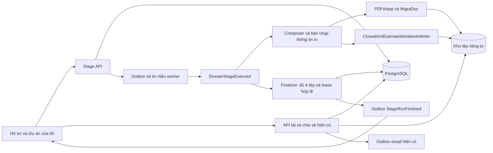
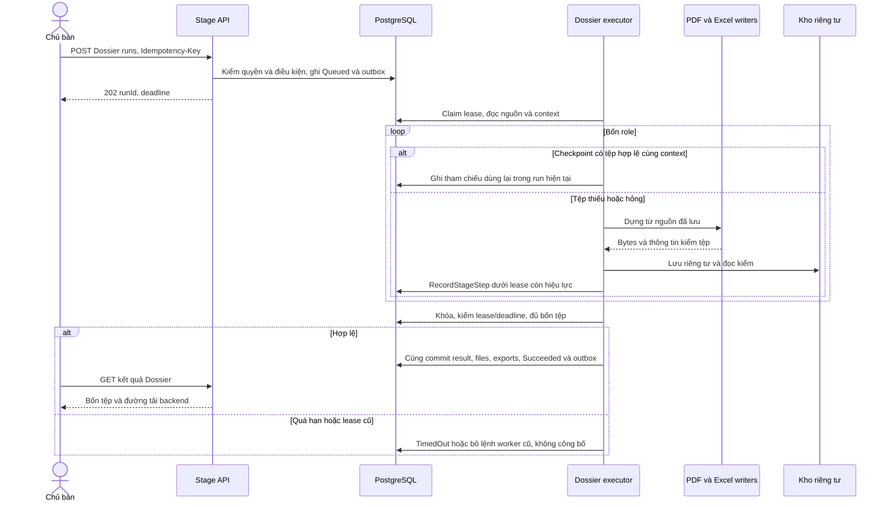
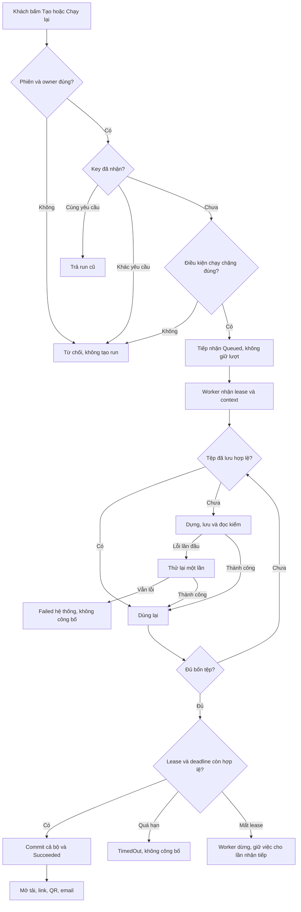
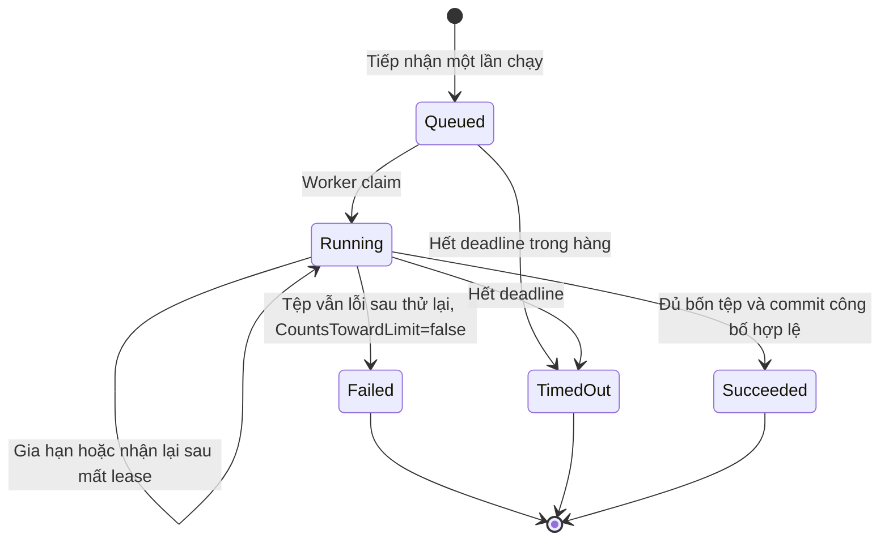
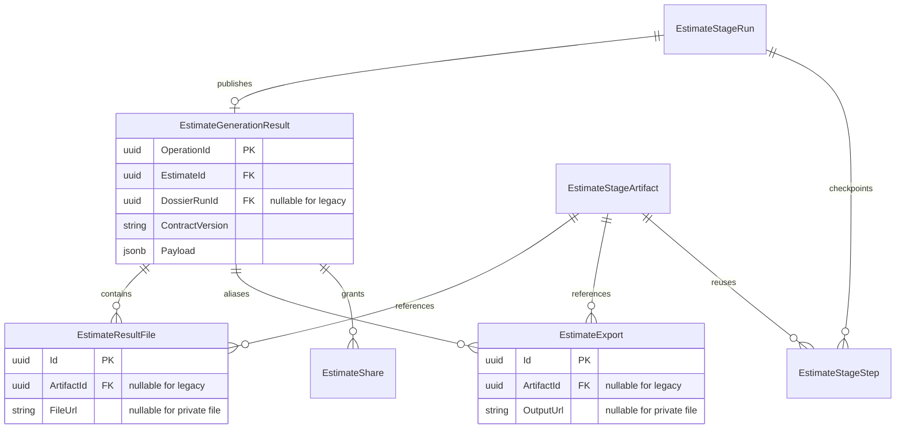

<!-- HƯỚNG DẪN CHO AI KHI ĐIỀN HOẶC CHỈNH SỬA MẪU
- Đọc toàn bộ mẫu, các comment hướng dẫn và tài liệu nguồn được cung cấp trước khi viết. Tuân thủ các quy tắc nghiệp vụ, điều kiện, ngoại lệ và giới hạn đã được xác nhận.
- Không bịa, tự chế hoặc suy đoán thành sự thật: yêu cầu, quy tắc, số liệu, API, schema, mã lỗi, nguồn tham khảo, người phụ trách và kết quả kiểm thử phải có căn cứ. Nội dung ví dụ trong mẫu không phải dữ kiện của dự án.
- Khi thiếu thông tin hoặc các nguồn mâu thuẫn, hỏi người dùng để làm rõ; giữ nguyên placeholder ở phần chưa xác định. Không tự chọn đáp án, lấp chỗ trống hay tuyên bố tài liệu đã hoàn tất.
- Chỉ thay nội dung cần điền hoặc được yêu cầu sửa. Không tự mở rộng phạm vi, sửa nghĩa quy tắc, bỏ điều kiện/ngoại lệ, xoá hay ghi đè nội dung hợp lệ đã có.
- Giữ nguyên tên, cấp và thứ tự heading, nhãn in đậm, tiền tố bullet, cấu trúc danh sách, tên/thứ tự/số cột bảng và cú pháp code fence. Không dịch, đổi tên, gộp hoặc thêm mục ngoài cấu trúc mẫu.
- Chỉ lặp khối luồng, AC hoặc API theo đúng khuôn khi có căn cứ; chỉ bỏ phần tuỳ chọn khi hướng dẫn riêng của mẫu cho phép và đã xác định không áp dụng.
- Mã tham chiếu và section phải trỏ tới tài liệu có thật đã được cung cấp hoặc kiểm chứng. Không giữ mã ví dụ như tham chiếu thật và không tự tạo tài liệu liên quan để hợp thức hoá liên kết.
- Giữ các comment hướng dẫn trong file. Xuất Markdown UTF-8, mỗi file một tài liệu; không bọc toàn bộ file trong code fence, không chèn lời dẫn hay giải thích ngoài mẫu.
- Trước khi bàn giao, đối chiếu nội dung với nguồn, kiểm tra cấu trúc, giá trị cho phép, giới hạn độ dài và tính nhất quán của mã/tham chiếu. Báo rõ phần chưa đủ thông tin; không tuyên bố đã chạy test hoặc import khi chưa thực hiện.
-->

<!-- Thay mã TDD-001 và nội dung ví dụ; giữ nguyên heading và nhãn in đậm.
Sơ đồ dùng mermaid, plantuml hoặc URL. Giữ heading Architecture, Sequence Diagram, Activity Diagram, State Diagram, Data Model.
Ví dụ API phải có heading trùng METHOD /path trong Endpoints. Xoá phần API/sơ đồ không dùng.
Version, Updated At và Change Log do lịch sử phiên bản quản lý, để trống khi nhập mới.
Author/Reviewer là tên hiển thị; gán tài khoản, phê duyệt, giả định và câu hỏi mở trên giao diện sau import.
Thiết kế phải truy vết về Story và Business Rule được cung cấp. Phân biệt thiết kế đề xuất với implementation đã kiểm chứng; không mô tả API/schema/sơ đồ ví dụ như hệ thống thật hoặc tự quyết định nghiệp vụ còn thiếu.
BẮT BUỘC KHI HOÀN THIỆN MẪU: phải có cả Reviewer và Approver, mỗi tên 1–200 ký tự sau khi bỏ khoảng trắng đầu/cuối. Không xoá hai dòng metadata, để trống, dùng tên bịa hoặc giữ placeholder rồi coi là hoàn tất.
Nếu chưa biết người review hoặc người phê duyệt, phải hỏi người dùng và báo tài liệu chưa đủ thông tin; không tự lấy Author/Owner làm người thay thế. Tên trong file không tự gán tài khoản hoặc xác nhận đã duyệt; gán thành viên trên giao diện sau import.
Đây là yêu cầu hoàn thiện mẫu; backend hiện vẫn nhận file cũ thiếu hai trường để tương thích.

VALIDATION CHO FILE NHẬP (đối chiếu ImportSnapshotValidator, MarkdownParser và ImportService):
- Mỗi file .md UTF-8 không rỗng chỉ có một heading cấp 1 chứa mã tài liệu dài 1–100 ký tự. Mã không được trùng trong cùng lần nhập hoặc thuộc loại tài liệu khác đã tồn tại.
- Không dùng tên README.md hoặc sitemap.md vì importer bỏ qua. Giao diện nhận .md/.zip, tối đa 2.000 file, tổng file tải lên 31 MiB; API giới hạn request 32 MiB và tổng nội dung đọc/giải nén 64 MiB.
- Chỉ nhập đè tài liệu cùng loại đang Draft, chưa có phiên bản và chưa lưu trữ. Import thay toàn bộ nội dung bản nháp, vì vậy phải giữ lại nội dung hợp lệ ngoài phần được yêu cầu sửa.
- Không dùng Status trong Markdown hoặc tên Approver để tự xác nhận phê duyệt; import không cấp quyền hay gán tài khoản từ tên. Chạy Kiểm tra file và xử lý lỗi/cảnh báo trước khi nhập.
- Giới hạn độ dài bên dưới tính theo string.Length của .NET (đơn vị UTF-16); không tự cắt ngắn dữ kiện quan trọng để vượt validation, hãy viết lại có căn cứ hoặc hỏi người dùng.
- Feature tối đa 300 ký tự và được dùng làm tiêu đề tài liệu. Status được parser nhận: Draft / In Review / Approved / Deprecated; tài liệu nhập mới vẫn có trạng thái phê duyệt Draft.
- Endpoint: đường dẫn tối đa 500 ký tự; tên/mô tả endpoint được lưu trong Name tối đa 300. HTTP method: GET / POST / PUT / PATCH / DELETE / HEAD / OPTIONS.
- Error Codes: mã tối đa 100 ký tự, không trùng trong tài liệu; giữ dạng - **CODE** (400): mô tả. HTTP status trong Error Codes và Response phải là số nguyên đọc được bằng Int32; không tự đặt status khác hợp đồng API.
- URL sơ đồ tối đa 1.000 ký tự. Mục sơ đồ được sử dụng phải có khối mermaid/plantuml hoặc URL theo mẫu; không để một mục sơ đồ rỗng. Nhãn mục được tách từ bullet như tên External API Fields tối đa 300 ký tự.
- Heading Examples phải khớp METHOD /path ở Endpoints. Giữ các nhãn Request:, Response 200: (thay mã theo contract) và Error Response: để parser tách đúng dữ liệu.
- Tham chiếu dạng DOC-KEY/section: ghi chú: mã đích tối đa 100 ký tự, section tối đa 100, ghi chú tối đa 1.000. Không trùng bộ mã đích + section + loại liên kết trong cùng tài liệu.
ĐỐI CHIẾU FORM TDD (src/features/tdds/validations.ts; form có thể chặt hơn import):
- Điền Feature, Author, Reviewer, Problem và ít nhất một Goal; các Goal/Non-goal/Notes đã thêm không được rỗng. API đã khai báo phải có endpoint và mô tả/mục đích; Fields phải có tên và ý nghĩa; Error Codes phải có mã, HTTP status và điều kiện.
- Form còn kiểm tra Version, Updated At và nội dung Change Log khi khai báo; với file nhập mới, giữ các trường lịch sử này trống theo hợp đồng import, không tự tạo dữ liệu lịch sử.
-->

# TDD-PROJ-011

## Document Info

- **Feature**: Chặng Hồ sơ — dựng ba PDF và Excel, công bố kết quả và chia sẻ tệp riêng tư
- **Author**: Codex
- **Reviewer**: Tân Trần
- **Approver**: Tân Trần
- **Status**: Draft
- **Version**:
- **Updated At**:

## Context & Goals

### Problem

Ba chặng 2D, Dự toán và Phối cảnh 3D đã có kết quả lưu bền vững. Chặng Hồ sơ chưa có executor; finalizer hiện không cho Dossier thành công. Frontend đã có route Hồ sơ và các thành phần xem/tải/chia sẻ, nhưng luồng hiện tại chưa dùng kết quả của cả bốn chặng. Bộ chia sẻ cũ đọc `EstimateGenerationResult`, `EstimateResultFile.FileUrl` và `EstimateExport.OutputUrl`, trong khi luồng mới lưu tệp ở kho riêng tư bằng `EstimateStageArtifact.ObjectKey`.

Tài liệu này là **thiết kế đề xuất của đợt 4**, chưa phải báo cáo triển khai. Căn cứ khảo sát: backend worktree `bmt-be-w3` tại `cdddaae`, frontend `buildx-fe-w3` tại `296ccca`, demo `design-estimate` tại `059e876`. Nghiệp vụ theo STORY-PROJ-010 và các quyết định trong HANDOFF-CODEX.md, mục D.

**Đã xác nhận:** bốn tệp, backend dựng PDF trực tiếp với PDFsharp/MigraDoc, Excel theo mẫu demo, không AI hoặc lượt mới, dùng thông tin tài khoản chủ bản, bộ hồ sơ chỉ mở khi đủ tệp. Ngày 13/10/2026 người dùng chốt thứ tự PDF gộp theo từng tầng: 2D kỹ thuật → 2D nội thất → 3D của tầng; hết các tầng mới tới 3D ngoại thất. Lỗi Hồ sơ là lỗi hệ thống và không tăng bộ đếm. Vật liệu/Hãng được in trong PDF dự toán và Excel theo demo; màn kết quả Dự toán vẫn không hiện cột hãng. Người dùng xác nhận sửa lại phạm vi này ngày 13/10/2026; ngày lập báo giá và hiệu lực 90 ngày lấy từ chặng Dự toán đã chốt.

**Đề xuất chưa chốt:** cấu trúc lưu tham chiếu tệp riêng tư, bản chụp thông tin in, giao dịch công bố và hợp đồng đọc trình bày dưới đây. Chờ người dùng duyệt bản TDD hoàn chỉnh trước khi viết đặc tả Unit Test và code.

**Cần làm rõ:** không còn câu hỏi nghiệp vụ đang chờ trả lời trong phạm vi này. Phiên bản gói PDF, bộ font có quyền nhúng và cấu hình thương hiệu thực tế phải được kiểm tra khi triển khai; đây là việc kỹ thuật, không phải quyền tự điền số điện thoại, người ký hay tên doanh nghiệp.

### Goals

- Dựng đủ `dossier-pdf`, `render3d-pdf`, `architecture-pdf`, `estimate-xlsx` từ dữ liệu đã lưu; không gọi nhà cung cấp AI.
- Các trang đúng thứ tự demo đã chốt, PDF A3 ngang, đọc được tiếng Việt; Excel dùng writer và mẫu bốn sheet đã port ở đợt 2.
- Chỉ công bố khi bốn tệp đã lưu và đọc kiểm tra được; chốt kết quả, tham chiếu tệp và trạng thái thành công trong cùng transaction.
- Dùng lại tệp hợp lệ sau lỗi/khởi động lại; bảo vệ trước worker mất lease, quá hạn và yêu cầu gửi lặp.
- Chủ bản tải tệp riêng tư; người có link xem/tải qua backend với quyền được kiểm ở mỗi request. Đổi tên chỉ đổi tên tệp tải về.
- Hoàn tất trạng thái danh sách dự án và luồng FE, gồm phục hồi sau F5, lỗi, chạy lại, link, QR, email và đọc khi Mode=Off.

### Non-goals

- Gọi lại AI, chỉnh kết quả 2D/3D/dự toán, tính lại giá theo luật mới hoặc mở thêm một lần Live.
- Bản vẽ kết cấu, điện nước; tùy chọn bố cục/trang; ZIP; bộ dựng PDF trong trình duyệt.
- Dựng lại hồ sơ đã thành công để cập nhật tên, thông tin tài khoản hoặc thương hiệu.
- Thay nghiệp vụ hạn link, gửi nhiều email, đính kèm tệp hoặc báo email đã được đọc.
- Tự bật production, tự xóa dữ liệu mock, chạy migration dùng chung, push hay merge.

## Architecture

| Thành phần | Hiện trạng và thay đổi đề xuất |
|---|---|
| `RunEstimateStageCommandHandler`, worker, checkpoint, heartbeat, outbox | Dùng lại TDD-PROJ-006. Dossier không có UsageOperation mới, bỏ qua circuit breaker AI và kiểm gói. Vẫn kiểm hàng chờ, owner, chặng trước, chặng đã xong, giới hạn lỗi và một lần chạy đang hoạt động. |
| `DossierStageExecutor` | Mới ở infrastructure: đọc nguồn đã thành công, tạo/đọc bản chụp thông tin in, dựng tệp còn thiếu, lưu riêng tư, ghi checkpoint; xin finalizer chốt. Không gọi share/email hoặc AI. |
| `DossierDocumentComposer` | Mới, logic thuần: chuyển dữ liệu gửi khách thành danh sách trang và khối bảng; sắp tầng/ảnh; chuẩn hóa nhãn, số tiền và mã bản vẽ. Không biết EF, HTTP, kho tệp hay font hệ điều hành. |
| `IDossierPdfWriter` / `PdfSharpDossierWriter` | Cổng application và adapter infrastructure mới. PDFsharp/MigraDoc dựng và ghép các trang A3 ngang, nhúng font từ tài nguyên đóng gói; không chạy Chrome. |
| `IEstimateWorkbookWriter` / `ClosedXmlEstimateWorkbookWriter` | Dùng lại code đợt 2, template và đối chiếu tổng. Nhận bản sao CustomerCopy đã làm sạch, bổ sung thông tin in từ context; không sửa kết quả nguồn. |
| `DossierPublishedState`, phần mở rộng finalizer/store | Mới: kiểm manifest, đủ bốn role, đúng nguồn, đúng hash và lease; ghi kết quả chia sẻ và hai export Ready cùng trạng thái Dossier Succeeded. |
| `IEstimateResultContract` phiên bản `dossier-v1` | Mới: chỉ chiếu dữ liệu được phép gửi khách, khai báo role PDF/Excel cho API cũ. Đăng ký cả khi pipeline Off. |
| `EstimateSharingStore`, `EstimateDossierBuilder`, file query handlers | Mở rộng các đường đọc hiện có để nhận tham chiếu ArtifactId; gate thêm Dossier Succeeded cho `dossier-v1`. Giữ nguyên nghiệp vụ link/QR/email TDD-PROJ-003. |
| Bộ đọc tệp riêng tư | Mở rộng cổng storage hiện có bằng đọc stream/Range theo ObjectKey đã được DB xác minh. Owner dùng link ký hạn 15 phút; public stream qua API, không lộ link ký hoặc ObjectKey. |
| FE feature `design` và My Projects | Nối route `/design/[projectId]/dossier` hiện có vào stage API; dùng lại thành phần tổng quan, bốn thẻ tệp, chia sẻ và email. Không để luồng render giả hoặc PDF client xử lý hồ sơ pipeline mới. |



**Notes**:

- **Nguồn bất biến.** Từ InputOperationId của lần chạy, đọc lần thành công Plan2d, Estimate, Render3d cùng EstimateId và cùng đầu vào. Chỉ đọc CustomerJson/CustomerCopy đã công bố; không lấy prompt, raw AI, InternalJson, ghi chú kỹ sư hay cờ cần rà. Cờ nội bộ không chặn tạo Hồ sơ. Thiếu nguồn/artifact bắt buộc là lỗi hệ thống; không tự chèn ảnh mẫu hoặc số 0 để tạo bộ hồ sơ có vẻ hoàn chỉnh.
- **Bản chụp thông tin in.** Checkpoint nội bộ `dossier:context` được ghi bằng RecordStageStep dưới lease trước khi dựng tệp đầu tiên. Nó ghim tên dự án, mã BUILDX, tên/số điện thoại tài khoản chủ bản, thông tin thương hiệu, ngày báo giá, ba mã lần chạy nguồn, danh sách ảnh theo thứ tự và phiên bản bố cục/template/font. Bố cục mới dùng `dossier:2`; checkpoint `dossier:1` tiếp tục qua renderer cũ khi phục hồi để không trộn định dạng trong cùng bộ hồ sơ. Không nhận tên khách hoặc số điện thoại từ body chạy chặng. Chạy lại dùng cùng context nếu nguồn không đổi: ví dụ ba tệp đã in “Nhà A” thì tệp thứ tư không tự in “Nhà B” sau khi đổi tên. Context chỉ phục vụ dựng tệp; không trả toàn bộ checkpoint qua API khách hoặc ghi vào log.
- **Bố cục PDF gộp.** Trang bìa → thông tin dự án và tổng hợp dự toán → từng tầng từ thấp lên cao, mỗi tầng gồm 2D kỹ thuật, 2D nội thất, các phối cảnh nội thất của tầng → ngoại thất theo thứ tự ngày/đêm đã lưu → dự toán chi tiết phần thô/hoàn thiện/nội thất → cảm ơn. Không sắp thứ tự bằng chuỗi nhãn để tránh “Lầu 10” đứng trước “Lầu 2”; dùng chỉ số tầng và thứ tự ảnh của manifest 3D. Không tạo trang rỗng cho nhóm ngoại thất không có trong kết quả nguồn hợp lệ, ví dụ căn hộ.
- **Hai PDF chuyên đề.** PDF kiến trúc lọc các trang 2D kỹ thuật/nội thất theo tầng; PDF 3D lọc nội thất theo tầng rồi ngoại thất. Cả hai dùng cùng trang bản vẽ và khung tên như PDF gộp; không kèm bảng giá. Dùng cùng danh sách trang nguồn để tránh thiếu ảnh hoặc đổi thứ tự giữa ba PDF. Mỗi ảnh nguồn tương ứng một trang, không cắt mép bản vẽ. Ba PDF đều A3 ngang (420 × 297 mm).
- **Hình thức theo demo.** Bìa ưu tiên ngoại thất ban ngày, rồi ngoại thất còn lại, nội thất, 2D. Giữ các khối thương hiệu, tên/công trình/địa chỉ, thông tin khách, thẻ quy mô/phong cách/gói, khung tên bản vẽ và trang cảm ơn. Khung tên có “Chưa thẩm định”, giai đoạn Concept Design và tỷ lệ NTS; không thêm chữ ký hay tên người thẩm định không có cấu hình. Mã bản vẽ có tiền tố BUILDX, phần tên bỏ dấu tối đa 12 ký tự như demo, nhóm MB/3D và số thứ tự riêng; mã hồ sơ vẫn là Estimate.Code. Tổng bản vẽ chỉ đếm trang 2D/3D, không đếm bìa và bảng giá. Bảng dài tự sang trang và lặp hàng tiêu đề; không chèn ngắt trang giữa nhãn hạng mục và dòng đầu tiên của nó. Bố cục bám `pdf.py`: bìa và cảm ơn nền kem, nhấn xanh/vàng, ảnh hero và khối thông tin; trang dự án hai cột; bản vẽ có viền cách mép 7 mm và khung tên rộng 64 mm, đủ bảng hiệu chỉnh 00/ngày lập, mục đích phát hành, đơn vị thi công, thiết kế/vẽ, tên công trình/địa điểm/hạng mục. Không in tên giám đốc hard-code. Bảng dự toán dùng nền tiêu đề sáng, lưới mảnh, số căn phải; phần thô và hoàn thiện tách ĐG vật tư/ĐG nhân công từ CustomerCopy đã lưu, nội thất dùng một đơn giá. Không suy ra hay tính lại hai đơn giá từ tổng. Font Be Vietnam Pro và bản Playfair Display 800 tĩnh (đổi tên thành BMT Dossier Serif theo Reserved Font Name) cùng giấy phép được đóng gói; PDFsharp vẽ trang cố định và phân trang bảng theo chiều cao nội dung, giữ nhóm với dòng đầu, lặp tiêu đề.
- **Khác biệt đã được chốt với demo.** PDF giữ cột Vật liệu/Hãng trong cả ba phần dự toán như demo (`savico/core/pdf.py:bang_chi_tiet`); Excel cũng giữ hãng. Khác biệt về cách dựng: demo dùng trình duyệt dựng HTML, BMT dựng PDF trực tiếp ở .NET. Không sao chép tên người ký hard-code trong demo thành dữ kiện của hệ thống. Bố cục tương đương, không yêu cầu giống từng điểm ảnh. Dữ liệu thương hiệu lấy từ cấu hình phía server (`DossierBrandingOption` dự kiến), ghim vào context. Thiếu hotline/website/email thì bỏ dòng liên hệ tương ứng như demo; không điền số mẫu. Tên đơn vị thi công dự phòng bằng tên thương hiệu. Logo dùng tài nguyên đã đóng gói, không tải URL tùy ý trong lúc render.
- **PDF và Excel dùng cùng số liệu.** Giữ tổng, diện tích tính giá, danh sách dòng và số tiền đã chốt ở Estimate; định dạng tiền VND như đợt 2. Ngày lập là ngày Việt Nam của lần tiếp nhận Estimate, hiệu lực là ngày đó + 90 ngày, không lấy ngày chạy Hồ sơ. Excel đi qua `CustomerCopy.CleanForExcel` và writer hiện có, giữ bốn sheet, vùng tên, công thức, kiểu ô và thương hiệu vật tư. Đối chiếu tổng theo TDD-PROJ-009; cảnh báo sai lệch nội bộ không in ra tệp khách. Không đổi giá do luật giá hiện hành đã khác.
- **Độ bền và thử lại.** Mỗi tệp có checkpoint `dossier:file:{role}` cùng ArtifactId. Dựng/lưu/đọc kiểm một tệp lỗi thì thử lại đúng một lần trong lần thực thi đó; vẫn lỗi thì Failed. Worker bị hủy vì mất lease/khởi động lại là gián đoạn, không tự tính thêm lỗi khách. Khi tiếp tục hoặc khách chạy lại, kiểm hash, size, type, nguồn/context của tệp đã có rồi dùng lại; chỉ dựng tệp thiếu hoặc hỏng. Một tệp được coi đã xong sau khi đã mở kiểm được PDF/XLSX, ghi kho, đọc kiểm và commit checkpoint. Không chỉ kiểm đuôi tên tệp. Dùng key theo run/item/hash, không ghi đè tệp của worker khác. Bytes đã ghi nhưng DB chưa commit có thể mồ côi; chỉ dọn sau khi chứng minh không có tham chiếu và không còn run hoạt động, không xóa tùy theo tuổi ngay trong executor.
- **Không giữ khóa lúc dựng/lưu tệp.** CPU render và storage I/O chạy ngoài transaction, có cancellation/deadline và heartbeat. Dựng tuần tự bốn tệp trong một run để giới hạn bộ nhớ; đọc ảnh dùng lại giữa các PDF, giải phóng stream/tệp tạm sau mỗi phần. Checkpoint manifest cũng ghim số trang và khổ giấy thực tế của từng PDF để đối chiếu khi đọc kiểm; không dùng số trang suy đoán từ tên tệp. Dùng giới hạn song song của worker hiện có, không tạo hàng đợi độc lập. Hạn Dossier mặc định 5 phút từ lúc tiếp nhận, kể cả chờ hàng. Fake và Live dùng cùng bộ dựng PDF/Excel; Fake chỉ thay nguồn AI của chặng trước.
- **Công bố trong một giao dịch.** Theo thứ tự khóa TDD-PROJ-006: AccountCommerceState → Estimate → StageRun; không khóa/quyết toán quota cho Dossier. Xác minh lại chưa bị xóa, run còn Running, token lease đúng, lease và DeadlineUtc chưa hết theo đồng hồ DB mới. Kiểm đủ bốn checkpoint/artifact hợp lệ, nguồn/context nhất quán; tạo GenerationResult `dossier-v1`, ResultFile cho ảnh được công bố và bốn tài liệu, hai Export Ready (Pdf/Xlsx), đổi run Succeeded và ghi StageRunFinished outbox trong cùng commit. Nếu quá hạn thì TimedOut, không chèn bộ kết quả. Worker cũ không được công bố chỉ vì còn giữ token giống nhau nhưng lease đã hết. Gọi finalizer lặp sau commit trả trạng thái cũ, không thêm tệp/share/export/lượt.
- **Mục đích lưu GenerationResult.** Share/Export hiện có FK ghép tới bảng này; chỉ sửa DTO trong RAM không đáp ứng được ràng buộc DB. Bản ghi `dossier-v1` là bản chụp bộ hồ sơ gửi khách từ các nguồn bất biến, không phải lần gọi AI khác. OperationId dùng lại InputOperationId của 2D đã Succeeded. ProviderAttemptId giữ trường cũ bằng giá trị hệ thống `dossier:{runId}`, không tạo AiCallLog hoặc khai là provider attempt thật. DossierRunId phân biệt rõ nguồn mới với legacy. Không cập nhật kết quả nguồn Plan2d/Estimate/Render3d sau khi sao chụp.
- **Gate mọi đường đọc.** Với `dossier-v1`, reader phải JOIN DossierRun Succeeded, không chỉ kiểm UsageOperation 2D Succeeded. Chưa hoàn thành thì owner nhận StageResultNotReady ở stage API, ResultNotReady ở API chia sẻ cũ. `stage-files` hiện đọc mọi artifact của owner: phải bổ sung kiểm riêng cho Stage=Dossier, yêu cầu artifact nằm trong bộ đã công bố. Tệp tái dùng có thể được tạo bởi run Failed trước đó, nên không dùng `CreatedByRunId.State` làm điều kiện duy nhất. Quyền đọc ảnh 2D/3D trước Hồ sơ giữ như các chặng đã có.
- **Tải và chia sẻ.** Bốn thẻ tệp dùng backend route. Owner stage-files trả 302 tới link ký hạn 15 phút sau kiểm owner và bộ đã công bố; filename cho tài liệu lấy tên Estimate hiện tại cộng loại tệp và phần mở rộng. API owner result-files/export cũ có thể tiếp tục stream để tương thích. Public kiểm token/hash, current pointer, chưa thu hồi, hạn UTC, chưa xóa, cùng nguồn/bản trước mỗi request kể cả Range; stream trực tiếp từ kho riêng tư. Không redirect public, không đưa ObjectKey/link ký vào JSON/log/HTML. Cache-Control private, no-store và header bảo vệ tệp dùng lại. Revoke chặn request mới, không hủy bytes người nhận đã tải hoặc stream đã được cấp quyền trước commit thu hồi.
- **Export cũ không dựng thêm.** Dossier finalizer đã tạo hai dòng Ready: Pdf trỏ PDF gộp, Xlsx trỏ Excel. POST export với key chỉ ghi/replay biên nhận và trả dòng Ready đó; không publish PrepareEstimateExportEvent cho `dossier-v1`. Hai PDF chuyên đề dùng ResultFile. Thiếu alias export trong một bộ đã Succeeded là dữ liệu lỗi, không tự khởi động renderer cũ để che lỗi.
- **Frontend trước → sau.** Route Hồ sơ hiện có luồng render và tải PDF phía client → dùng stage API, progress số tệp đã lưu/4, trạng thái server khi F5, và bốn tệp server. Render3d Succeeded hiện báo bước tiếp theo chưa mở → có nút “Tạo hồ sơ” dẫn tới tổng quan; không tự POST khi mount. Giữ màn tổng quan, bốn thẻ, link/QR/email; chỉ vô hiệu thao tác khi chưa đủ điều kiện. Không để animation/timer đặt Succeeded hoặc ép chạy lại hồ sơ đã xong. Nút thử lại dùng key mới; request mất phản hồi gửi lại key cũ. Lỗi hiện bằng thông báo có nghĩa, không lộ ObjectKey/stack trace. Chia sẻ không tự tạo lại link khi ngày mới khác: giữ hành vi requestedExpiryApplied của TDD-PROJ-003.
- **Danh sách dự án.** Hoàn thiện projection TDD-PROJ-006/BR-PROJ-008: Processing ưu tiên khi có run hoạt động; Failed khi lần mới nhất lỗi mà chặng chưa thành công; Completed khi Dossier Succeeded; InProgress khi đã có Plan2d; còn lại Draft. FE mở bản theo stage đã xong/chặng đang chạy, Completed dẫn Hồ sơ. Alias Succeeded của bộ lọc cũ giữ tương thích. Mode=Off không đổi trạng thái đã lưu hoặc chặn đọc/tải/chia sẻ.
- **Quan sát và kiểm chứng.** Log run/estimate/step/role, thời gian dựng từng tệp, bytes và mã lỗi; không log context/PII/token. Unit test sau khi duyệt TDD tập trung composer, lọc dữ liệu và guard. Integration PostgreSQL kiểm FK, công bố nguyên tử, lease/deadline, replay, truy cập trước/sau công bố và thu hồi Range. Kiểm tệp bằng parser PDF/XLSX cùng xem trang thực tế: font tiếng Việt, A3, đủ ảnh, bảng nhiều trang, số liệu và đúng thứ tự. Browser kiểm tổng quan → tiến độ → bốn tệp → đổi tên → link/QR/email giả → thu hồi; F5 và Mode=Off. Không coi test mock chứng minh transaction hoặc kết quả SMTP thật. Đặc tả ST-PROJ-155–159 và ST-PROJ-057 là căn cứ; chưa chạy chúng trong bước TDD.

## Sequence Diagram



## Activity Diagram



## State Diagram



Chạy lại sau Failed/TimedOut tạo **run mới**, không đổi run cũ về Queued. Run mới dùng lại context/tệp hợp lệ của cùng nguồn. Succeeded không được chạy lại. Trạng thái “tệp sẵn sàng” là điều kiện đọc theo manifest công bố, không suy ra từ việc object đã có trong kho.

## Data Model

Không tạo bảng Hồ sơ độc lập. Dùng bảng run/step/artifact TDD-PROJ-006, PlanResult TDD-PROJ-007, CostResult TDD-PROJ-009 và dữ liệu Render3d TDD-PROJ-010. Bổ sung liên kết từ bộ kết quả/share/export cũ tới artifact riêng tư; bytes chỉ lưu một lần trong kho.

| Bảng | Ý nghĩa một dòng và thay đổi |
|---|---|
| EstimateStageRun | Một lần khách chạy Dossier. Dùng lại schema, Stage=Dossier, UsageOperationId=NULL, InputOperationId trỏ 2D. ProgressDone là số role đã lưu hợp lệ, ProgressTotal=4; CountsTowardLimit luôn false. |
| EstimateStageStep | Một checkpoint thành công trong run. Dùng lại schema cho context (Internal=true), từng file (ArtifactId) và manifest (OutputJson). Context không có Model/PromptVersion; không tạo lịch sử AI giả. |
| EstimateStageArtifact | Một tệp vật lý đã lưu. Dossier dùng Stage=Dossier, ItemKey là role, ContentType PDF/XLSX, Width/Height=NULL, Model/PromptVersion=NULL. Thêm alternate key `(Id, EstimateId)` để FK ghép bảo đảm tệp đúng bản. |
| EstimateGenerationResult | Một bộ kết quả được công bố theo OperationId. Thêm DossierRunId để gắn `dossier-v1` với lần chốt Hồ sơ. Payload là bản chụp gửi khách và manifest; không chứa ObjectKey, URL ký, raw AI hoặc nội bộ. Legacy giữ DossierRunId=NULL. |
| EstimateResultFile | Một vai trò tệp trong bộ kết quả. Thêm ArtifactId; FileUrl trở thành nullable. Legacy dùng URL, hồ sơ mới dùng ArtifactId, không lưu cả hai hoặc thiếu cả hai. |
| EstimateExport | Một alias tải Pdf/Xlsx cho cùng OperationId, dùng lại API cũ. Thêm ArtifactId. Với `dossier-v1`, tạo Ready tại finalization, không qua worker export. Không sao chép bytes hoặc tên dự án. |
| EstimateShare, EstimateShareReceipt, EstimateExportRequest, EstimateEmailRequest | Dùng lại nguyên schema và mẫu TDD-PROJ-003. Chỉ thêm gate nguồn Dossier cho hợp đồng mới; không copy tài liệu vào từng link/email. |

| Bảng/cột đề xuất | Kiểu, NULL và ràng buộc |
|---|---|
| EstimateGenerationResult.DossierRunId | uuid NULL. FK `(DossierRunId,EstimateId)` → EstimateStageRun `(Id,EstimateId)`, RESTRICT. Unique DossierRunId khi khác NULL. CHECK `(ContractVersion='dossier-v1') = (DossierRunId IS NOT NULL)`. Stage=Dossier, cùng InputOperationId và Succeeded kiểm trong transaction/reader vì CHECK không đọc bảng khác. |
| EstimateResultFile.ArtifactId | uuid NULL. FK `(ArtifactId,EstimateId)` → EstimateStageArtifact `(Id,EstimateId)`, RESTRICT; index theo FK. |
| EstimateResultFile.FileUrl | varchar(2048) NULL; giữ HTTPS check khi có giá trị. CHECK `(FileUrl IS NULL) <> (ArtifactId IS NULL)` để đúng một nơi chứa tệp. Giữ unique `(OperationId,RoleKey,Ordinal)`, Ordinal>=0 và FK nguồn hiện có. |
| EstimateExport.ArtifactId | uuid NULL. FK `(ArtifactId,EstimateId)` → EstimateStageArtifact `(Id,EstimateId)`, RESTRICT; index theo FK. |
| EstimateExport.OutputUrl | Giữ varchar(2048) NULL, HTTPS nếu có. Thay CK_ReadyOutput: Ready có đúng một OutputUrl/ArtifactId; Pending hoặc Failed có cả hai NULL. Giữ unique `(OperationId,Format)`, format Pdf/Xlsx. |
| EstimateStageArtifact | Thêm UNIQUE `(Id,EstimateId)`; không đổi ObjectKey/ContentType/SizeBytes/Sha256 hiện có. |

**Hợp đồng JSON đề xuất.** `dossier:context` có schemaVersion=1, contextHash SHA-256 của JSON chuẩn hóa (loại chính trường contextHash khỏi đầu vào hash), source `{inputOperationId,planRunId,estimateRunId,render3dRunId}`, printed `{projectName,projectCode,customerName,customerPhone,quoteDate,validUntil,branding}`, phiên bản layout/template/font và danh sách trang nguồn. Manifest có cùng contextHash/source và đúng bốn phần tử `{role,artifactId,sha256,sizeBytes,contentType}`. Payload `dossier-v1` lưu `{schemaVersion,source,contextHash,project,estimate,drawings,documents}`: project chỉ chứa thông tin gửi khách; estimate là CustomerCopy đã lọc phần nội bộ, giữ trường material để in cột Vật liệu/Hãng trong PDF; màn kết quả Dự toán không hiển thị cột này. Writer Excel đọc CustomerCopy nguồn đã làm sạch và giữ hãng; drawings theo thứ tự trang, documents là bốn vai trò. ArtifactId lưu được trong DB nhưng API chia sẻ đổi sang FileId/đường public, không trả đường stage-files của owner. Hash tính từ payload lưu, không từ JSON đã thêm URL khi đọc.

**Mẫu dữ liệu giả định:** U1, E1, O1, R2D, RE, R3D, RD1, RD2, A1…A4, F1…F4 là bí danh các UUID khác nhau, không phải literal sẽ insert. O1 là operation 2D Succeeded của E1/U1; R2D/RE/R3D cùng InputOperationId=O1 đã Succeeded. Thời gian UTC, tiền VND. Các cột không đổi theo TDD nguồn được lược bỏ; HCTX/H1…H4/HP là bí danh SHA-256 đủ 64 ký tự của dữ liệu tương ứng, không phải checksum giả để chạy test.

| Bảng/checkpoint | Bản ghi minh họa và lúc tạo |
|---|---|
| EstimateStageRun trước khi dựng | RD1; AccountId=U1; EstimateId=E1; Stage=Dossier; InputOperationId=O1; UsageOperationId=NULL; State=Running; AcceptedAtUtc=2026-10-13T03:00:00Z; DeadlineUtc=03:05:00Z; ProgressDone=0; ProgressTotal=4; CountsTowardLimit=false. |
| EstimateStageStep context | RunId=RD1; StepKey=dossier:context; Attempt=1; ArtifactId=NULL; Internal=true; Model/PromptVersion=NULL; OutputJson chứa source O1/R2D/RE/R3D, contextHash=HCTX, tên “Nhà phố Thủ Đức”, mã BUILDX-20261011-Q7K2M9, tên khách “Nguyễn Văn A”, số điện thoại giả định “0901234567”, quoteDate=2026-10-12, validUntil=2027-01-10. Ngày lấy từ RE, không phải RD1. |
| EstimateStageArtifact | A1; EstimateId=E1; Stage=Dossier; ItemKey=dossier-pdf; ObjectKey=`media/site-private/estimates/{E1}/dossier/{RD1}/dossier-pdf-{H1_first8}.pdf`; ContentType=application/pdf; SizeBytes=345678; Sha256=H1; Width/Height/Model/PromptVersion=NULL; CreatedByRunId=RD1; ConfigRevisionId cùng RD1. A2/A3/A4 tương tự với role và hash riêng; A4 ContentType XLSX. Số bytes chỉ minh họa. |
| EstimateStageStep file | RD1 + dossier:file:dossier-pdf; Attempt=1; ArtifactId=A1; OutputJson chứa contextHash=HCTX; Internal=false; Model/PromptVersion=NULL. Tương tự bốn role, chỉ ghi sau lưu/đọc kiểm thành công. |
| Khi tệp thứ tư lỗi | RD1.State=Failed, FailureCode=DossierFileBuildFailed, CountsTowardLimit=false; A1/A2/A3 và context vẫn giữ. Chưa có GenerationResult/ResultFile/Export của O1; owner cũng không tải được ba tài liệu lẻ. |
| Chạy lại | RD2 cùng E1/O1, UsageOperationId=NULL, deadline mới. Context dùng lại HCTX; checkpoint ba file trỏ A1/A2/A3 do RD1 tạo; chỉ A4 do RD2 tạo. Các provenance này giữ trong manifest/checkpoint, không sửa CreatedByRunId của A1…A3. |
| EstimateGenerationResult sau chốt | OperationId=O1; EstimateId=E1; DossierRunId=RD2; ContractVersion=dossier-v1; ProviderAttemptId=`dossier:{RD2}`; Payload chứa source/context HCTX, dữ liệu gửi khách và bốn tài liệu; PayloadHash=HP; StoredAtUtc/ReadVerifiedAtUtc là thời điểm xác minh/công bố. RD2.State=Succeeded trong cùng commit. |
| EstimateResultFile sau chốt | F1: OperationId=O1; EstimateId=E1; RoleKey=dossier-pdf; Ordinal=0; ArtifactId=A1; FileUrl=NULL. F2/F3/F4 tương tự role render3d-pdf/architecture-pdf/estimate-xlsx. Có thêm các dòng ảnh 2D/3D chỉ trỏ artifact thuộc nguồn đã ghim. |
| EstimateExport sau chốt | EX1: EstimateId=E1; OperationId=O1; Format=Pdf; State=Ready; AttemptNumber=1; ArtifactId=A1; OutputUrl/LeaseToken/LeaseUntilUtc/FailureCode=NULL. EX2 Format=Xlsx, ArtifactId=A4. |
| Sau đổi tên | E1.Name=“Phương án chốt”; RD2/result/A1…A4 không đổi. File tải về mang tên hiện tại; nội dung in tên cũ theo HCTX. |



**Notes**:

- Chuẩn hóa: share/email chỉ giữ quyền và ý định gửi, ResultFile/Export giữ tham chiếu chứ không nhân bản bytes. Payload là bản chụp tài liệu đã giao, bất biến và có nguồn/hash; không tạo cột tổng tiền thứ hai cho phép cập nhật độc lập. Context là dữ liệu in của một bộ nguồn, không phải bản sao hồ sơ tài khoản dùng để cập nhật ngược User.
- FK ghép ngăn A1 của E1 bị gắn vào E2; FK đơn ArtifactId không đủ chứng minh cùng bản. DB không chứng minh role/artifact/source hợp nhau chỉ bằng FK: finalizer kiểm đủ chính xác bốn role, không trùng và đúng nguồn. Unique nguồn/role/ordinal cùng idempotent finalization chặn công bố trùng khi message được giao lại.
- Migration đề xuất theo cách bổ sung tương thích: thêm nullable DossierRunId/ArtifactId, alternate key artifact, index/FK và thay CHECK/nullability của URL. Dữ liệu cũ giữ URL, không cần backfill bằng URL ký. Kiểm dữ liệu vi phạm trước thêm constraint. Schema mới không chứa bytes nên không sao chép hàng loạt tệp trong migration. Chưa tạo hoặc chạy migration ở bước thiết kế.
- Rollout: tắt nhận Dossier; áp migration; deploy BE có cả reader URL và private artifact; deploy FE; kiểm Fake và hồ sơ hiện có; rồi mới thêm Dossier vào EnabledStages của môi trường được phép. Sau khi phát sinh FileUrl=NULL/ArtifactId, không quay về binary BE cũ không hiểu schema mới. Khi cần dừng, dùng reader tương thích và tắt nhận việc theo runbook TDD-PROJ-006. Down phải chặn nếu có kết quả/private reference mới; không tự xóa hồ sơ để hạ schema.
- Dọn `mock-v1` theo BR-PROJ-018 là thao tác chuyển môi trường riêng: ngừng cổng cũ, chờ job cũ kết thúc, dry-run liệt kê đúng nguồn mock và các bản/con/tệp liên quan; xóa theo thứ tự FK khi được triển khai chuyển đổi. Không đụng kết quả pipeline hoặc hoàn lượt lịch sử. Không gộp lệnh xóa vào migration/startup, không chạy xóa chỉ vì đang kiểm local có dữ liệu mẫu.
- Kiểm giao dịch bằng PostgreSQL thật, nhất là thất bại giữa ghi ResultFile và đổi run: kết quả phải rollback toàn bộ, giữ checkpoint để thử tiếp. Kho object không nằm trong transaction SQL nên có thể còn bytes mồ côi; không tuyên bố rollback SQL thu hồi được bytes hoặc thư đã gửi.

## Internal API

### Endpoints

Dùng Result<T> cho JSON thành công, ProblemDetails cho lỗi và binary không bọc JSON như code hiện có. Chỉ `value` của kết quả Dossier được mở rộng. Các route owner đòi phiên Customer hợp lệ và cùng chủ bản; cookie tuân Origin. Các mutation giữ Idempotency-Key hiện có. Tất cả dữ liệu riêng tư dùng no-store.

- **POST** `/api/v1/estimates/{estimateId}/stages/{stage}/runs` — Dùng route hiện có, stage=Dossier, body `{}`. 202 khi nhận mới, 200 replay cùng key/hash. Không tự chạy khi mở trang.
- **GET** `/api/v1/estimates/{estimateId}/stages` — Dossier trả progress số tệp/4 và trạng thái từ DB. Chưa đủ bốn tệp không trả thành công.
- **GET** `/api/v1/estimates/{estimateId}/stages/{stage}/result` — stage=Dossier, mới hỗ trợ đọc hợp đồng dưới đây sau Succeeded.
- **GET** `/api/v1/estimates/{estimateId}/stage-files/{artifactId}` — Giữ route, thêm gate Dossier và filename theo tên hiện tại khi download=true; owner nhận 302, link hạn 15 phút.
- **GET** `/api/v1/estimates/{estimateId}/result` — Dùng API hồ sơ hiện có; hỗ trợ contractVersion=dossier-v1 và đủ bốn tài liệu, tên dự án hiện tại; không trả internal.
- **POST** `/api/v1/estimates/{estimateId}/exports` — Body format Pdf/Xlsx như cũ; với dossier-v1 trả alias Ready đã công bố, không dựng tệp mới.
- **GET** `/api/v1/estimates/{estimateId}/result-files/{fileId}` — Giữ route stream có owner, thêm private artifact source.
- **GET** `/api/v1/public/estimate-shares/{shareId}` — Giữ header X-Estimate-Share-Token; DTO cùng bộ hồ sơ, đường tải đổi sang public file route.
- **GET** `/api/v1/public/estimate-shares/{shareId}/files/{fileId}` — Header share và Range tùy chọn; kiểm quyền mới cho mỗi request rồi stream private artifact.

Các endpoint export status/file, create/current/revoke share, QR và email giữ nguyên đường dẫn/body/status TDD-PROJ-003; thêm kiểm nguồn `dossier-v1` và private file descriptor dùng chung. Không thêm endpoint “tạo PDF” hoặc endpoint công khai không kiểm grant. Trạng thái email Accepted chỉ có nghĩa SMTP đã nhận.

### Examples

#### POST /api/v1/estimates/{estimateId}/stages/{stage}/runs

```
Request:
POST /api/v1/estimates/11111111-1111-4111-8111-111111111111/stages/Dossier/runs
Idempotency-Key: dossier-1
{}

Response 202:
{"value":{"runId":"22222222-2222-4222-8222-222222222222","stage":"Dossier","state":"Queued","acceptedAtUtc":"2026-10-13T03:00:00Z","deadlineUtc":"2026-10-13T03:05:00Z"},"isSuccess":true,"isFailure":false,"error":{"code":"","message":""}}

Error Response:
{"title":"Conflict","code":"Conflict","status":409,"detail":"Cần hoàn tất chặng Phối cảnh 3D trước.","messageCode":"StagePrerequisiteNotMet","errors":null}
```

#### GET /api/v1/estimates/{estimateId}/stages/{stage}/result

```
Request:
GET /api/v1/estimates/11111111-1111-4111-8111-111111111111/stages/Dossier/result

Response 200:
{"value":{"schemaVersion":1,"runId":"22222222-2222-4222-8222-222222222222","projectName":"Phương án chốt","projectCode":"BUILDX-20261011-Q7K2M9","printedProjectName":"Nhà phố Thủ Đức","documents":[{"role":"dossier-pdf","fileUrl":"/api/v1/estimates/11111111-1111-4111-8111-111111111111/stage-files/33333333-3333-4333-8333-333333333331?download=true","contentType":"application/pdf","sizeBytes":345678},{"role":"render3d-pdf","fileUrl":"/api/v1/estimates/11111111-1111-4111-8111-111111111111/stage-files/33333333-3333-4333-8333-333333333332?download=true","contentType":"application/pdf","sizeBytes":234567},{"role":"architecture-pdf","fileUrl":"/api/v1/estimates/11111111-1111-4111-8111-111111111111/stage-files/33333333-3333-4333-8333-333333333333?download=true","contentType":"application/pdf","sizeBytes":123456},{"role":"estimate-xlsx","fileUrl":"/api/v1/estimates/11111111-1111-4111-8111-111111111111/stage-files/33333333-3333-4333-8333-333333333334?download=true","contentType":"application/vnd.openxmlformats-officedocument.spreadsheetml.sheet","sizeBytes":45678}]},"isSuccess":true,"isFailure":false,"error":{"code":"","message":""}}

Error Response:
{"title":"Conflict","code":"Conflict","status":409,"detail":"Chặng chưa hoàn tất.","messageCode":"StageResultNotReady","errors":null}
```

#### GET /api/v1/public/estimate-shares/{shareId}/files/{fileId}

```
Request:
GET /api/v1/public/estimate-shares/44444444-4444-4444-8444-444444444444/files/55555555-5555-4555-8555-555555555555
X-Estimate-Share-Token: <token của link hợp lệ>
Range: bytes=0-1023

Response 206:
Content-Type: application/pdf
Content-Range: bytes 0-1023/345678
Cache-Control: private, no-store
Content-Disposition: attachment; filename="Phuong an chot - ho-so.pdf"; filename*=UTF-8''Ph%C6%B0%C6%A1ng%20%C3%A1n%20ch%E1%BB%91t%20-%20ho-so.pdf
<1024 bytes của PDF, không có Location tới kho>

Error Response:
{"title":"Not Found","code":"NotFound","status":404,"detail":"Link không còn khả dụng.","messageCode":"ShareUnavailable","errors":null}
```

### Error Codes

- **StagePrerequisiteNotMet** (409): 3D chưa thành công; không tiếp nhận Dossier.
- **StageAlreadySucceeded** (409): Hồ sơ đã thành công, không dựng lại.
- **StageRunInProgress** (409): Bản dự toán có chặng Queued/Running.
- **StageRetryLimitReached** (409): Guard giới hạn theo TDD-PROJ-006; lỗi hệ thống của Dossier không làm tăng số này.
- **IdempotencyConflict** (409): Cùng key nhưng khác yêu cầu.
- **PipelineUnavailable** (503): Mode Off khi nhận mới; không áp vào route đọc.
- **StageUnavailable** (503): Dossier chưa nằm trong EnabledStages.
- **PipelineBusy** (503): Hàng chờ đầy, giữ Retry-After: 120 hiện có.
- **StageResultNotReady** (409): Stage result/tài liệu Dossier chưa được công bố đủ bộ.
- **StageFileNotFound** (404): Artifact không thuộc bản hoặc không tồn tại.
- **ResultNotReady** (409): API hồ sơ/chia sẻ cũ chưa có bộ Dossier Succeeded; không dùng 2D Succeeded làm đủ điều kiện.
- **ShareUnavailable** (404): Grant không hợp lệ, hết hạn, thu hồi hoặc nguồn đã bị xóa; không tiết lộ nguyên nhân để dò link.
- **DependencyUnavailable** (503): Bộ đã công bố nhưng storage hoặc contract reader không phục vụ được; không tự đổi run thành Failed hoặc dựng lại hồ sơ.

Lỗi phiên, quyền, định dạng request, Range và rate limit dùng hợp đồng hiện có ở TDD-PROJ-003/006. Lỗi nền **đề xuất mới** là DossierSourceInvalid, DossierFileBuildFailed, DossierFileUnavailable; lưu ở FailureCode của run Failed, không phải mã HTTP tiếp nhận. StageTimedOut dùng lại khi quá hạn. Tất cả lỗi nền Dossier có CountsTowardLimit=false; không đổi quota.

## External API

### Endpoints

- **Kho object riêng tư hiện có** — PUT và đọc kiểm tệp khi dựng; GET/Range cho public proxy; tạo signed GET hạn 15 phút cho owner. Dùng adapter/cấu hình storage đang có, không nhận URL đích từ client.
- **SMTP hiện có** — Gửi link từ yêu cầu email rõ ràng của owner qua outbox TDD-PROJ-003; Dossier executor không gửi email tự động.

### Fields

- **ObjectKey** — Chỉ phía server, tiền tố `media/site-private/estimates/`; đối chiếu metadata cùng EstimateId trước khi đọc.
- **ContentType, SizeBytes, Sha256** — Xác minh file thực tế, không tin phần mở rộng hoặc metadata do client khai.
- **Range** — Tối đa một khoảng theo ByteRangeHeader hiện có; public kiểm grant cả khi chỉ xin một phần tệp; trả 206/416 theo hợp đồng stream.
- **Recipient** — Đúng một địa chỉ email theo API cũ; không ghi PII vào message broker hoặc log.

### Error Handling

Storage I/O chịu thời gian còn lại của run và cancellation. Lỗi dựng/lưu/đọc kiểm thử lại một lần cho tệp đang làm; quá deadline chốt TimedOut, không công bố muộn. Mất lease dừng ghi. Đọc tệp đã công bố mà kho lỗi trả DependencyUnavailable; khách có thể tải lại, không phát sinh lần chạy hay chi phí AI. SMTP tiếp tục giữ Accepted/Rejected/Unknown/Skipped đúng bằng chứng, không tự gửi lại khi không biết thư đã được nhận.

### Quirks

- Kho object và SMTP không tham gia transaction PostgreSQL. Chỉ metadata công bố, trạng thái và outbox mới cùng commit.
- Link ký owner vẫn có hiệu lực tối đa 15 phút kể từ cấp; public không nhận link này để thu hồi quyền có hiệu lực ở request kế tiếp.
- Font/logo/template phải đi cùng bản deploy Linux, không dựa vào font máy developer hoặc mạng. Kiểm quyền phân phối/nhúng và giữ giấy phép tài nguyên khi đóng gói; không tự lấy font trả phí.
- Bộ dựng PDF/Excel không có API OpenAI hoặc Anthropic, không tạo log token/chi phí giả. Không cần thêm lần Live để kiểm chặng này.

## References

### User Stories

- STORY-PROJ-010
- STORY-PROJ-003
- STORY-PROJ-004
- STORY-PROJ-005
- STORY-PROJ-009

### Business Rules

- BR-PROJ-003
- BR-PROJ-006
- BR-PROJ-007
- BR-PROJ-008
- BR-PROJ-009
- BR-PROJ-010
- BR-PROJ-011
- BR-PROJ-012
- BR-PROJ-017
- BR-PROJ-018

### Use Cases

### Others

- TDD-PROJ-003: Chia sẻ, xuất tệp và email; phần URL do AI trả được thay bằng private artifact cho dossier-v1 trong tài liệu này.
- TDD-PROJ-006: Run, lease, checkpoint, outbox, stage API và giới hạn.
- TDD-PROJ-007: Nguồn 2D và private artifact.
- TDD-PROJ-009: CustomerCopy, ngày báo giá và writer Excel đã port.
- TDD-PROJ-010: Manifest và nguồn ảnh 3D đã công bố.
- ST-PROJ-155
- ST-PROJ-156
- ST-PROJ-157
- ST-PROJ-158
- ST-PROJ-159
- ST-PROJ-057
- Nguồn demo: `design-estimate/savico/core/pdf.py` tại `059e876`, hàm `gan_tang`, `_thu_tu_render`, `trang_bia`, `tao_html`; `resources/excel/template.xlsx`, `fill_template.py`, `resources/branding/`.
- Nguồn backend: `src/bmt-be.application/usecases/commands/estimatePipeline/FinalizeStageRunCommandHandler.cs`; `src/bmt-be.application/usecases/queries/estimatePipeline/StageQueryHandlers.cs`; `src/bmt-be.persistence/repositories/EstimateSharingStore.cs`; `src/bmt-be.persistence/configurations/EstimateGenerationConfigurations.cs`, `EstimateSharingConfigurations.cs`, `EstimatePipelineConfigurations.cs`; `src/bmt-be.infrastructure/estimatePipeline/excel/ClosedXmlEstimateWorkbookWriter.cs`.
- Nguồn frontend: `src/app/[locale]/(main)/design/[projectId]/dossier/step-dossier-view.tsx`; `src/features/design/components/dossier-ready.tsx`, `dossier-share-dialog.tsx`; `src/features/design/hooks/use-download-dossier.ts`; `src/app/[locale]/estimates/shared/[shareId]/shared-estimate-view.tsx`.
- Handoff: `/Users/user/Documents/WorkSpace/bmt-wt/HANDOFF-CODEX.md`, mục 1.4 và mục D đợt Hồ sơ.

## Change Log
