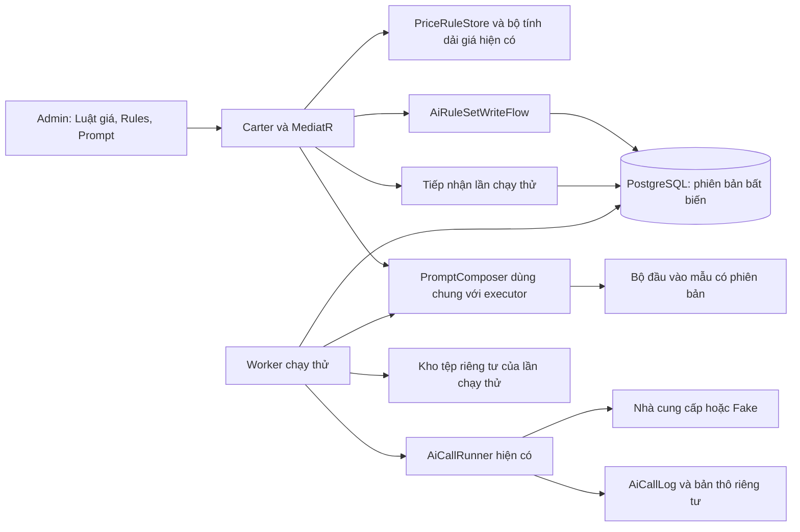
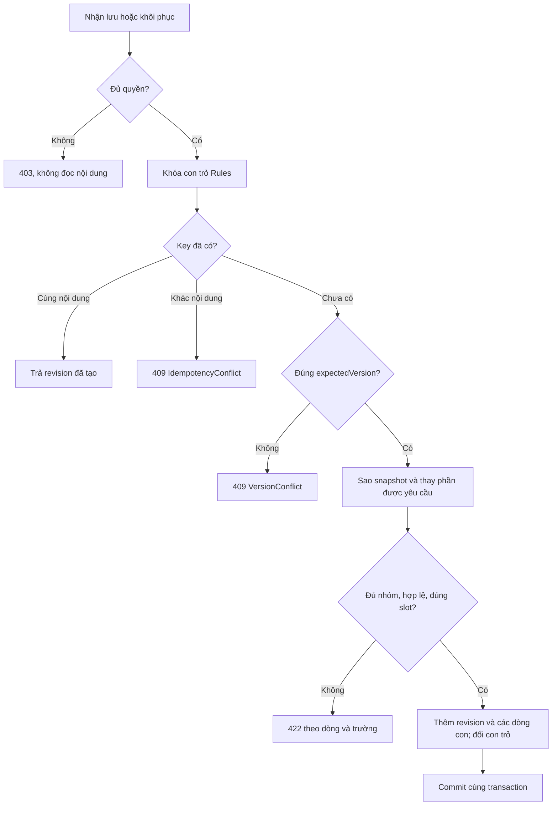
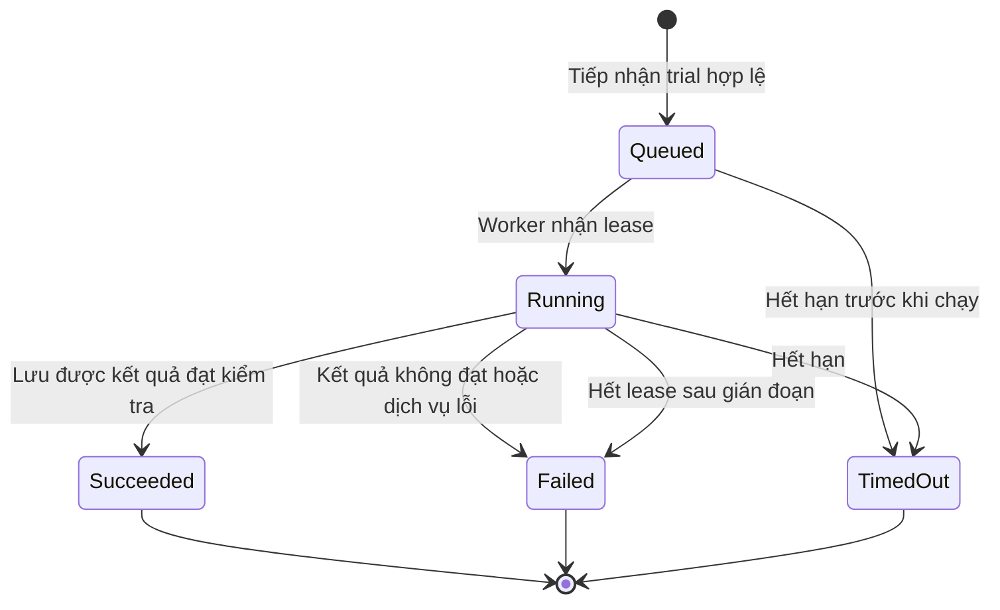
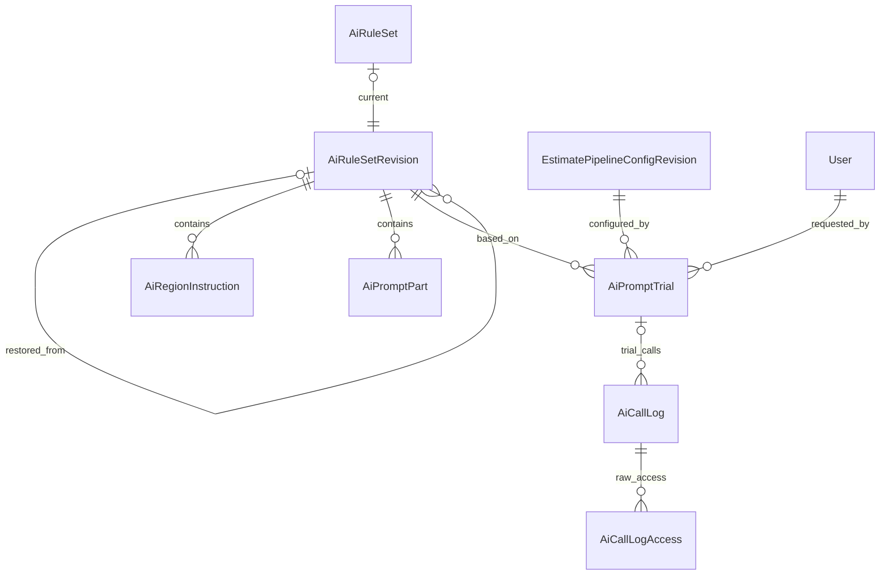

<!-- HƯỚNG DẪN CHO AI KHI ĐIỀN HOẶC CHỈNH SỬA MẪU
- Đọc toàn bộ mẫu, các comment hướng dẫn và tài liệu nguồn được cung cấp trước khi viết. Tuân thủ các quy tắc nghiệp vụ, điều kiện, ngoại lệ và giới hạn đã được xác nhận.
- Không bịa, tự chế hoặc suy đoán thành sự thật: yêu cầu, quy tắc, số liệu, API, schema, mã lỗi, nguồn tham khảo, người phụ trách và kết quả kiểm thử phải có căn cứ. Nội dung ví dụ trong mẫu không phải dữ kiện của dự án.
- Khi thiếu thông tin hoặc các nguồn mâu thuẫn, hỏi người dùng để làm rõ; giữ nguyên placeholder ở phần chưa xác định. Không tự chọn đáp án, lấp chỗ trống hay tuyên bố tài liệu đã hoàn tất.
- Chỉ thay nội dung cần điền hoặc được yêu cầu sửa. Không tự mở rộng phạm vi, sửa nghĩa quy tắc, bỏ điều kiện/ngoại lệ, xoá hay ghi đè nội dung hợp lệ đã có.
- Giữ nguyên tên, cấp và thứ tự heading, nhãn in đậm, tiền tố bullet, cấu trúc danh sách, tên/thứ tự/số cột bảng và cú pháp code fence. Không dịch, đổi tên, gộp hoặc thêm mục ngoài cấu trúc mẫu.
- Chỉ lặp khối luồng, AC hoặc API theo đúng khuôn khi có căn cứ; chỉ bỏ phần tuỳ chọn khi hướng dẫn riêng của mẫu cho phép và đã xác định không áp dụng.
- Mã tham chiếu và section phải trỏ tới tài liệu có thật đã được cung cấp hoặc kiểm chứng. Không giữ mã ví dụ như tham chiếu thật và không tự tạo tài liệu liên quan để hợp thức hoá liên kết.
- Giữ các comment hướng dẫn trong file. Xuất Markdown UTF-8, mỗi file một tài liệu; không bọc toàn bộ file trong code fence, không chèn lời dẫn hay giải thích ngoài mẫu.
- Trước khi bàn giao, đối chiếu nội dung với nguồn, kiểm tra cấu trúc, giá trị cho phép, giới hạn độ dài và tính nhất quán của mã/tham chiếu. Báo rõ phần chưa đủ thông tin; không tuyên bố đã chạy test hoặc import khi chưa thực hiện.
-->

<!-- Thay mã TDD-001 và nội dung ví dụ; giữ nguyên heading và nhãn in đậm.
Sơ đồ dùng mermaid, plantuml hoặc URL. Giữ heading Architecture, Sequence Diagram, Activity Diagram, State Diagram, Data Model.
Ví dụ API phải có heading trùng METHOD /path trong Endpoints. Xoá phần API/sơ đồ không dùng.
Version, Updated At và Change Log do lịch sử phiên bản quản lý, để trống khi nhập mới.
Author/Reviewer là tên hiển thị; gán tài khoản, phê duyệt, giả định và câu hỏi mở trên giao diện sau import.
Thiết kế phải truy vết về Story và Business Rule được cung cấp. Phân biệt thiết kế đề xuất với implementation đã kiểm chứng; không mô tả API/schema/sơ đồ ví dụ như hệ thống thật hoặc tự quyết định nghiệp vụ còn thiếu.
BẮT BUỘC KHI HOÀN THIỆN MẪU: phải có cả Reviewer và Approver, mỗi tên 1–200 ký tự sau khi bỏ khoảng trắng đầu/cuối. Không xoá hai dòng metadata, để trống, dùng tên bịa hoặc giữ placeholder rồi coi là hoàn tất.
Nếu chưa biết người review hoặc người phê duyệt, phải hỏi người dùng và báo tài liệu chưa đủ thông tin; không tự lấy Author/Owner làm người thay thế. Tên trong file không tự gán tài khoản hoặc xác nhận đã duyệt; gán thành viên trên giao diện sau import.
Đây là yêu cầu hoàn thiện mẫu; backend hiện vẫn nhận file cũ thiếu hai trường để tương thích.

VALIDATION CHO FILE NHẬP (đối chiếu ImportSnapshotValidator, MarkdownParser và ImportService):
- Mỗi file .md UTF-8 không rỗng chỉ có một heading cấp 1 chứa mã tài liệu dài 1–100 ký tự. Mã không được trùng trong cùng lần nhập hoặc thuộc loại tài liệu khác đã tồn tại.
- Không dùng tên README.md hoặc sitemap.md vì importer bỏ qua. Giao diện nhận .md/.zip, tối đa 2.000 file, tổng file tải lên 31 MiB; API giới hạn request 32 MiB và tổng nội dung đọc/giải nén 64 MiB.
- Chỉ nhập đè tài liệu cùng loại đang Draft, chưa có phiên bản và chưa lưu trữ. Import thay toàn bộ nội dung bản nháp, vì vậy phải giữ lại nội dung hợp lệ ngoài phần được yêu cầu sửa.
- Không dùng Status trong Markdown hoặc tên Approver để tự xác nhận phê duyệt; import không cấp quyền hay gán tài khoản từ tên. Chạy Kiểm tra file và xử lý lỗi/cảnh báo trước khi nhập.
- Giới hạn độ dài bên dưới tính theo string.Length của .NET (đơn vị UTF-16); không tự cắt ngắn dữ kiện quan trọng để vượt validation, hãy viết lại có căn cứ hoặc hỏi người dùng.
- Feature tối đa 300 ký tự và được dùng làm tiêu đề tài liệu. Status được parser nhận: Draft / In Review / Approved / Deprecated; tài liệu nhập mới vẫn có trạng thái phê duyệt Draft.
- Endpoint: đường dẫn tối đa 500 ký tự; tên/mô tả endpoint được lưu trong Name tối đa 300. HTTP method: GET / POST / PUT / PATCH / DELETE / HEAD / OPTIONS.
- Error Codes: mã tối đa 100 ký tự, không trùng trong tài liệu; giữ dạng - **CODE** (400): mô tả. HTTP status trong Error Codes và Response phải là số nguyên đọc được bằng Int32; không tự đặt status khác hợp đồng API.
- URL sơ đồ tối đa 1.000 ký tự. Mục sơ đồ được sử dụng phải có khối mermaid/plantuml hoặc URL theo mẫu; không để một mục sơ đồ rỗng. Nhãn mục được tách từ bullet như tên External API Fields tối đa 300 ký tự.
- Heading Examples phải khớp METHOD /path ở Endpoints. Giữ các nhãn Request:, Response 200: (thay mã theo contract) và Error Response: để parser tách đúng dữ liệu.
- Tham chiếu dạng DOC-KEY/section: ghi chú: mã đích tối đa 100 ký tự, section tối đa 100, ghi chú tối đa 1.000. Không trùng bộ mã đích + section + loại liên kết trong cùng tài liệu.
ĐỐI CHIẾU FORM TDD (src/features/tdds/validations.ts; form có thể chặt hơn import):
- Điền Feature, Author, Reviewer, Problem và ít nhất một Goal; các Goal/Non-goal/Notes đã thêm không được rỗng. API đã khai báo phải có endpoint và mô tả/mục đích; Fields phải có tên và ý nghĩa; Error Codes phải có mã, HTTP status và điều kiện.
- Form còn kiểm tra Version, Updated At và nội dung Change Log khi khai báo; với file nhập mới, giữ các trường lịch sử này trống theo hợp đồng import, không tự tạo dữ liệu lịch sử.
-->

# TDD-PROJ-012

## Document Info

- **Feature**: Quản trị AI — luật giá, bộ quy tắc, lời dặn prompt, chạy thử và kiểm chứng vận hành
- **Author**: Codex
- **Reviewer**: Tân Trần
- **Approver**: Tân Trần
- **Status**: Draft
- **Version**:
- **Updated At**:

## Context & Goals

### Problem

Người dùng giao triển khai các phần Admin còn thiếu ngày 13/10/2026. STORY-PROJ-011/012/013 đã xác định nghiệp vụ. TDD-PROJ-008 chỉ thiết kế API đọc bộ quy tắc; TDD-PROJ-009 đã thiết kế API luật giá; TDD-PROJ-010 bổ sung dữ liệu prompt và thời tiết 3D. Còn thiếu thiết kế ghi bộ quy tắc, chạy thử prompt và các màn quản trị tương ứng.

Hiện trạng đã đối chiếu source W4:

- `EstimatePipelineAdminApi` đã có API luật giá (đọc, lịch sử, xem trước, lưu, khôi phục), cấu hình AI, vùng giá, tra cứu lần chạy, đặt lại bộ đếm lỗi và xem nhật ký thô có ghi vết.
- Frontend đã có `AiConfigEditor`, `PricingRegionEditor`, `EstimatePipelineInspector`; chưa có màn luật giá, Rules AI hay Prompt.
- `AiRuleSetSnapshot` đọc đủ sáu nhóm dữ liệu nhưng `GetAiRuleSetQueryHandler` chưa trả `regionInstructions`.
- `AiRegionInstruction` chỉ có khóa `(RevisionId, Region, Topic)` và CHECK Topic='Render3dWeather'. Người dùng **đã xác nhận ngày 13/10/2026**: chủ đề mới được chọn chặng 2D, Dự toán hoặc 3D. Cần mở schema và đường ghép prompt theo quyết định này.
- `Render3dPrompts.T` dùng `string.Format` với các biến `{0}`, `{1}`; cho sửa văn bản mà không kiểm biến sẽ gây lỗi runtime.
- `AiCallLog` hiện chỉ nhận lời gọi của một lần chạy khách hoặc soi ảnh. Không thể ghi lần chạy thử bằng cách giả làm soi ảnh hay tạo dự án khách.

Đây là **thiết kế đề xuất để duyệt**, chưa phải báo cáo đã triển khai. Không ghi trạng thái Approved hoặc tạo đặc tả Unit Test trước khi người dùng chốt bản này.

### Goals

- Có ba màn mới: Luật giá, Quy tắc AI, Prompt; dùng API thật, theo quyền hiện có.
- Mỗi lần lưu/khôi phục tạo phiên bản bất biến; chống ghi đè và chống gửi lặp. Các lần chạy và kết quả cũ giữ nguyên.
- Xem trước và chạy thử dùng đúng bộ dựng prompt của luồng thật, với đầu vào mẫu do dự án đóng gói; xem được kết quả, lỗi kiểm đầu ra và chi phí ước tính.
- Quy tắc theo miền có chặng áp dụng; chủ đề mới không cần thêm cột hoặc sửa danh sách chủ đề trong mã.
- Kiểm chứng các thao tác vận hành đang có qua HTTP, PostgreSQL và browser; không coi test handler là bằng chứng phân quyền endpoint.

### Non-goals

- Sửa schema đầu ra, thuật toán, thêm mã gốc loại công trình/kiểu mái mới hoặc tự thay đổi prompt mặc định của demo.
- Admin chạy dự án thay khách, ghi đè kết quả khách, báo cáo chi phí tổng hợp hoặc quản lý khóa API.
- Chạy thử toàn bộ bốn chặng mỗi lần bấm nút; chỉ thử tác vụ đã chọn với nguồn mẫu có sẵn.
- Push, merge hoặc đưa lên môi trường dùng chung. Lần Live 3D được duyệt trước đây đã dùng xong; không dùng lại sự đồng ý đó cho kiểm thử mới.

## Architecture



**Notes**:

**A. Giao diện và phạm vi quyền**

Ba route mới dưới `/{locale}/admin`, thuộc nhóm Cấu hình hệ thống trong menu; Ant Design chỉ nằm trong admin. Không thay các màn bảng đơn giá/vật tư hiện có thành luật giá và không xóa chúng.

| Màn mới | Thành phần và luồng người dùng | Quyền |
|---|---|---|
| `/admin/estimate-price-rules` | Chọn Khung giá tham khảo hoặc Quy tắc bóc tách; sửa văn bản; ghi chú; Xem trước dải giá; Lưu; lịch sử phân trang; chọn hai phiên bản để xem phần khác nhau; Khôi phục có xác nhận. | `estimate.pricing.manage` |
| `/admin/estimate-ai-rules` | Năm nhóm: Theo loại công trình, Ma trận mái, Gói × chặng, Theo miền, Lời dặn chung. Bảng và form theo trường; có lịch sử, so sánh, khôi phục toàn bộ bộ quy tắc. | `estimate.ai-rules.manage` |
| `/admin/estimate-prompts` | Danh sách prompt theo tác vụ; các đoạn lời dặn có thể sửa; biến chèn và schema chỉ đọc; chọn dữ liệu mẫu/tình huống; Xem trước; Chạy thử; kết quả; lịch sử, so sánh và khôi phục lời dặn của prompt đã chọn. | `estimate.ai-rules.manage` |

Màn Prompt giải thích một đoạn dùng chung có thể ảnh hưởng nhiều tác vụ. Ví dụ đoạn mái chung ảnh hưởng prompt ngoại thất. Không biến các slot kỹ thuật thành danh sách tác vụ giả: danh mục trả `affectedTasks` và các tình huống mẫu có thể thử.

Lưu giữ bản nhập khi gặp lỗi 422/409; hiển thị đúng dòng/trường. Lỗi 409 có nút tải bản mới, không tự ghi đè hoặc tự xóa bản đang sửa. Thay đổi đầu vào mẫu/lời dặn làm kết quả xem trước cũ hết hiệu lực. Mutation không tự retry với key mới. So sánh văn bản tô rõ thêm/xóa, không chỉ đặt hai khối JSON cạnh nhau. So sánh Rules ghép theo khóa nghiệp vụ, không theo chỉ số dòng.

Quyền được kiểm cả route frontend lẫn policy API; không có ngoại lệ cho tên vai trò Admin nếu token thiếu quyền. Mọi endpoint quản trị trả `Cache-Control: no-store`. Không đưa prompt, bản nhập hoặc phản hồi vào localStorage. Nhãn/validation đầy đủ vi/en, dùng HTTP client và chuẩn hóa lỗi hiện có.

**B. Luật giá — dùng lại thiết kế đã có**

Giữ contract `PriceRuleDocument` và các endpoint ở TDD-PROJ-009/Internal API; kind chỉ `PriceFramework` hoặc `TakeoffRules`. Không thêm bảng luật giá. API xem trước trả dải mới cùng dải hiện hành và cảnh báo; UI ghi đơn vị triệu đồng/m². Lỗi mục 3–5 phải giữ đường dẫn trường server trả. Sửa chữ mục 2 không tự thay giá neo/hệ số gói: UI nêu rõ việc tính lại dải giá chỉ lấy đơn giá mục 3–5, theo TDD-PROJ-009/Architecture mục H.

Khôi phục dùng API hiện có, tạo phiên bản mới. Lịch sử đọc phân trang `pageIndex`/`pageSize`; so sánh tải đúng hai bản. Không tự tính dải giá trên frontend. Lưu Quy tắc bóc tách không tính lại dải giá. Cảnh báo không chặn lưu.

**C. Lưu bộ quy tắc — một nguồn dữ liệu, nhiều màn chỉnh**

Giữ `AiRuleSet` là con trỏ hiện hành; `AiRuleSetRevision` và sáu bảng con là snapshot bất biến. Rules và Prompt chia sẻ số phiên bản này, không tạo một kho prompt thứ hai.

Lưu một nhóm Rules hoặc một prompt thực hiện theo thứ tự:

1. Kiểm quyền và danh tính từ phiên; kiểm body typed, từ chối trường lạ, kể cả `schema`, `tool`, `model` do caller cố gửi vào API sửa lời dặn.
2. Trong transaction do MediatR quản lý, khóa dòng `AiRuleSet` bằng `FOR UPDATE`. Kiểm `(CreatedBy, MutationKey)` trước kiểm phiên bản: gửi lại cùng key/hash trả revision đã tạo; cùng key khác nội dung trả `IdempotencyConflict`.
3. So `expectedVersion` với con trỏ; sai trả `VersionConflict`. Khóa đọc danh mục hiện hành bằng FOR SHARE để kiểm ID và quan hệ loại–phong cách nhất quán với thao tác lưu danh mục. Đọc đầy đủ revision đang dùng, sao cả sáu nhóm và chỉ thay nhóm hoặc prompt được yêu cầu. Không nhận toàn bộ snapshot từ UI để tránh làm mất nhóm UI chưa đọc.
4. Kiểm toàn bộ snapshot sau thay đổi. Tạo `Number + 1`, `ParentId` là bản hiện hành, người lưu/thời điểm/ghi chú/hash; thêm toàn bộ dòng con; đổi con trỏ và tăng Version; commit cùng nhau.
5. Lần chạy mới chốt revision mới; lần đang chạy dùng revision cũ. Cache nếu có phải khóa theo RevisionId; không ghi nội dung revision mới dưới khóa cũ.

Ví dụ: A và B cùng sửa bản 7; A lưu mái thành bản 8. B lưu prompt với `expectedVersion=7` bị từ chối; khi tải bản 8 và lưu lại, bản 9 chứa cả mái của A và prompt của B. Không tự hòa trộn nội dung xung đột.

Khôi phục bộ quy tắc tạo snapshot mới từ toàn bộ bản nguồn. Khôi phục một prompt chỉ chép các slot của prompt đó vào snapshot hiện hành; UI nói rõ phạm vi để tránh khôi phục nhầm các nhóm khác. `RestoredFromRevisionId` lưu bản nguồn, `ChangeScope` lưu `ruleset`, `group:<key>` hoặc `prompt:<code>`. Bản cũ không đủ slot của phiên bản mã hiện tại bị báo `RuleRevisionIncompatible`, không tự bù văn bản rồi gọi đó là khôi phục nguyên bản.

**D. Kiểm dữ liệu Rules và ghép theo miền**

| Nhóm | Ràng buộc và nơi dùng |
|---|---|
| Loại công trình | BuildingTypeId bắt buộc, có trong danh mục hiện hành, không trùng trong một revision; số tầng 1–4; kích thước/ngưỡng dương, min < max, lô mặc định nằm trong giới hạn của chính dòng. Đối chiếu độ chính xác cột tại TDD-PROJ-008/Data Model; không cắt/tròn âm thầm. |
| Mái | BuildingTypeId bắt buộc; StyleId NULL là mái mặc định. Giữ một dòng mặc định cho mỗi loại có quy tắc; không trùng cặp ID. StyleId phải là phong cách kiến trúc được gán cho loại đó trong danh mục hiện hành. RoofKind từ `AiRoofKinds.All`; giữ CHECK về hệ số của `None`, `FlatConcrete` trong EF hiện có. `Render3dText` là câu tả, không thay RoofKind đã lưu trong kết quả Dự toán. |
| Gói × chặng | Package Basic/Standard/Vip; Stage Plan2d/Estimate/Render3d; mỗi cặp tối đa một dòng, văn bản có nội dung, tối đa 2.000 ký tự. Không lặp số tiền/hệ số đã nằm trong luật giá. Không bắt thêm dòng chưa có ở seed chỉ để mở màn hình. |
| Theo miền | Một dòng `(Stage, Region, Topic)`; Stage Plan2d/Estimate/Render3d, Region North/Central/South. Topic là mã có nội dung, tối đa 32 ký tự; Text có nội dung, tối đa 2.000 ký tự. Mã mới do Admin nhập, không cần sửa enum trong code. Giữ đủ ba dòng `Render3d/Render3dWeather`; chủ đề này dành cho 3D. |
| Lời dặn chung | Stage bắt buộc; BaseCode/Package/Region tùy chọn phải có thật; Text tối đa 2.000 ký tự; Enabled, SortOrder. Giữ ID khi sửa, tạo UUID khi thêm. Không áp trần nghiệp vụ mới về số dòng. |

Quyết định ngày 13/10/2026 được thể hiện bằng cột Stage trên nhóm Theo miền. Khi ghép prompt, chỉ lấy dòng khớp Stage và Region đã chốt. `Render3dWeather` tiếp tục đi vào vị trí khí hậu chuyên biệt của prompt 3D, không chèn lặp lần hai. Chủ đề khác ghép thành các khối văn bản theo Topic, rồi tới lời dặn chung theo SortOrder/Id. Mọi tác vụ của chặng dùng chung bộ lọc này; không chỉ nối vào lượt AI đầu tiên rồi bỏ sót lượt hỏi lại. Không tự sửa kết quả 2D/Estimate cũ để áp quy tắc mới.

Giữ nguồn mô tả mái theo TDD-PROJ-010/Architecture mục D: mái của kết quả Estimate quyết định kind; rule hiện hành chỉ cấp câu tả khi khớp kind, nếu không dùng slot theo kind. Màn Prompt ghi rõ slot `render3d.roof` là câu tả dùng khi không có dòng mái phù hợp; không hứa sửa slot đó luôn thay mọi ảnh.

**E. Danh mục prompt và xem trước**

Thêm abstraction `IAiPromptCatalog` và `IAiPromptPreviewComposer`; implementation ở infrastructure gọi lại `Plan2dPrompts`, `EstimatePrompts`, `Render3dPrompts` và schema/tool hiện có. Không dựng một bản prompt giản lược riêng cho màn Admin.

- Danh mục slot lấy từ `Plan2dSeedData.DefaultPromptSlots`, `EstimatePromptSlots.Keys` và `Render3dPrompts.DefaultTexts`. Ghi rõ prompt code, slot key, task sử dụng, phiên bản mã, biến bắt buộc, schema chỉ đọc và các tình huống mẫu hỗ trợ.
- Nhóm hiện có: soi ảnh lô; phương án 2D; bản vẽ kỹ thuật/nội thất; dự toán chính, bổ sung bóc tách/phân tích, tách giá và rà giá; 3D ngoại thất ngày/đêm, phòng/góc nhìn, đoạn dùng chung và kiểm ảnh. Danh sách chi tiết sinh từ registry và được đối chiếu các call site, không gõ tay một danh sách khác ở frontend.
- Không cho thêm/xóa/đổi tên slot tùy ý. Giữ các tham số định dạng của template 3D: dấu ngoặc hợp lệ, chỉ số biến đúng tập bắt buộc, không thêm biểu thức định dạng không được registry cho phép. Cho đổi vị trí biến trong câu; không chạy mã hay thực thi biểu thức trong văn bản.
- Registry chỉ rõ slot nào được để rỗng theo template hiện có. Không áp cùng quy tắc “có nội dung” cho mọi slot nếu seed có đoạn tùy chọn rỗng. Validator phải chấp nhận toàn bộ snapshot seed trước khi mở quyền lưu.
- Xem trước dùng bản revision gốc + các slot đang sửa, quy tắc cùng revision, phiên bản cấu hình hiện hành và hai luật giá hiện hành nếu tác vụ cần. Response trả riêng system/user, schema/tool, danh sách ảnh mẫu (tên/hash/kích thước), các lời dặn đã khớp, phiên bản và dấu vân tay nội dung. Không gửi bytes hoặc URL kho nội bộ trong JSON.
- Bộ mẫu là tài nguyên đóng gói có ID/version/hash: dữ liệu nhập, phương án 2D, kết quả dự toán, bản vẽ và ảnh tham chiếu cần cho từng tác vụ. Chỉ dùng dữ liệu thử do dự án chuẩn bị, không đọc projectId do Admin nhập, không sao chép dữ liệu khách local vào bộ mẫu. Thiếu ảnh ngày thì không thử prompt ảnh đêm; thiếu nguồn thì báo lỗi trước khi gọi AI.
- Xem trước không ghi revision, không gọi AI, không tăng quota. Response cũ bị loại khi người dùng đổi prompt/mẫu trong lúc request đang chạy.

**F. Chạy thử prompt và ghi chi phí**

Chạy thử là job riêng `AiPromptTrial`, không dùng `EstimateStageRun`. Tiếp nhận trả 202 nhanh; UI hỏi trạng thái tới khi kết thúc và có thể mở lại bằng trialId sau reload. Không giữ transaction hoặc request HTTP mở trong suốt thời gian AI sinh kết quả.

1. POST kiểm quyền, đầu vào và tính lại preview ở server. `previewHash` phải khớp nội dung, fixture và các revision đang được áp dụng; nếu không khớp trả `PromptPreviewStale`, UI yêu cầu xem trước lại.
2. Chốt bản yêu cầu AI đã ghép, schema, slot đang sửa, ID/version mẫu, revision rule/config/luật giá và hạn cuối. Ghi job cùng key/hash chống lặp trong một transaction ngắn. Không nhận model hoặc URL tùy ý từ client.
3. Worker nhận Queued bằng cập nhật có điều kiện/khóa như mẫu worker hiện có, chạy một tác vụ đã chọn qua `AiCallRunner`. Dùng limiter, breaker, model và cách thử lại hiện có; hạn lấy từ cấu hình của tác vụ/chặng tương ứng, tính từ lúc tiếp nhận. `Mode=Fake` phát lại fixture, chi phí 0; UI luôn ghi rõ Fake hay Live.
4. AI call ghi `PromptTrialId` riêng trong `AiCallLog`, không đặt LotVerificationRequest=true. Không tạo Estimate, usage reservation, counter lỗi chặng hoặc artifact khách. Phản hồi/schema validation và ảnh thử lưu dưới vùng riêng tư của trial.
5. JSON/tool kiểm schema thực của tác vụ; ảnh kiểm bytes/kích thước và các điều kiện đang bật. Hiện rõ “đạt cấu trúc” không đồng nghĩa chất lượng thiết kế đã được người dùng duyệt. Kết quả không đạt phải giữ phần trả về để Admin đọc, kèm lỗi, nếu nhà cung cấp có trả nội dung.
6. Worker ghi kết quả với lease/version còn hiệu lực; mất lease không được ghi đè. Nếu tiến trình chết sau khi đã bắt đầu gọi AI, kết thúc lỗi `PromptTrialInterrupted` khi hết lease, không tự phát lại toàn job gây thêm chi phí. Bấm Chạy thử lại là thao tác mới/key mới. Retry ở cấp provider trong một job vẫn theo AiCallRunner.
7. Chi phí đọc từ AiCallLog theo trialId, cộng đủ lần gọi/thử lại. Nếu thiếu giá hoặc ghi log lỗi thì hiện “chưa đủ dữ liệu chi phí”, không hiển thị 0 USD; lưu cảnh báo vận hành. Worker chỉ chốt trạng thái hoàn tất khi kết quả đã lưu; không tự gọi lại AI vì lưu tệp hoặc ghi log lỗi.

Kết quả thử được gắn dấu vân tay của nội dung đã thử. Sửa tiếp lời dặn làm trạng thái “đã thử đạt” hết hiệu lực. Trước khi lưu, UI tải thông tin lần thử tương ứng và cảnh báo nếu lần gần nhất không đạt; Admin vẫn được lưu sau cảnh báo theo STORY-PROJ-013/EXC-04. Không tự biến chạy thử thành điều kiện bắt buộc phải đạt mới cho lưu. API lưu trả thêm cảnh báo; phía server không coi cờ `passed` do client gửi là bằng chứng.

Hàng chờ trial dùng giới hạn MaxQueuedRuns hiện có, tính cùng số job chặng đang chờ; kiểm và ghi job trong cùng cơ chế khóa tiếp nhận để hai loại yêu cầu đồng thời không vượt trần. Không đặt thêm ngưỡng mặc định mới. Worker định kỳ quét Queued theo thời điểm/Id và kết thúc job quá hạn; sau restart không cần tín hiệu trong bộ nhớ để tìm lại job chưa bắt đầu. Task đã Running được heartbeat với LeaseSeconds/HeartbeatSeconds hiện có, nhưng không được tự gọi AI lại sau mất lease. Phần ghi nhận kết quả muộn phải bị từ chối nếu trial đã kết thúc.

Trial preview/result là nội dung quản trị của bộ mẫu, đọc bằng quyền ai-rules.manage. Nhật ký provider thô vẫn dùng endpoint có quyền operate và ghi AiCallLogAccess; không mở rộng quyền xem nhật ký khách cho người chỉ quản lý Rules. Ảnh kết quả thử tải qua endpoint kiểm quyền, link riêng tư có hạn như cơ chế tệp hiện có.

**G. Kiểm chứng vận hành hiện có**

Giữ các màn Cấu hình AI, Vùng giá và Tra cứu lần chạy. Theo yêu cầu ngày 13/10/2026, Tra cứu lần chạy tự tải bảng khách hàng/dự toán/bước/trạng thái/thời gian ngay khi mở, 20 dòng/trang, mới nhất trước. Ô tìm là bộ lọc tùy chọn; có lọc bước và trạng thái, nút Làm mới, làm mới định kỳ 15 giây. Bấm Xem chi tiết mở ngăn bên phải, bung đúng lượt đã chọn; đóng ngăn giữ trang và bộ lọc. API danh sách được mô tả tại TDD-PROJ-006/Internal API. Loading, rỗng và lỗi tải có trạng thái riêng; lỗi không biến thành danh sách rỗng. Kiểm quyền inspect/operate/config.manage riêng, đặt lại lỗi không tự chạy hay đổi quota; mỗi lần mở bản thô ghi vết trước khi trả. Dùng dự án kiểm thử riêng cho thao tác reset; giữ dự án khách local đã có 8 ảnh và hồ sơ.

Các lỗi phát hiện trong kiểm chứng được sửa ở đúng ranh giới. Ví dụ thiếu giá một model không được cộng thành tổng 0 rồi ghi đó là chi phí thực. Những giá trị vận hành chưa được chốt trong TDD-PROJ-008 tiếp tục là cấu hình hiện có, không dùng đợt này để tự đổi chính sách/ngưỡng.

**H. Thứ tự triển khai và kiểm chứng**

1. Sau khi TDD được chốt: ghi nhận SHA trong coverage; bổ sung đặc tả Unit Test từ mã còn trống sau UT-PROJ-509, không tự ghi Pass.
2. Làm giao diện luật giá với API hiện có; bổ sung lịch sử/so sánh/khôi phục; kiểm chứng các thao tác vận hành hiện có.
3. Bổ sung schema theo miền và nơi ghi phiên bản; reader/validator/transaction/API; ghép quy tắc mới vào mọi tác vụ tương ứng.
4. Bổ sung registry, preview, job chạy thử/nhật ký; sau đó nối màn Rules và Prompt, menu và route permissions.
5. Unit cho logic/validation; PostgreSQL cho lưu đồng thời, gửi lặp, khóa/FK, backfill và job; HTTP cho quyền; browser desktop/mobile, vi/en, reload/mất mạng/xung đột. Bộ đối chiếu seed phải giữ prompt cũ khi chưa có tùy chỉnh.
6. Build và chạy bản local mới sau khi kiểm tra đạt. Live chỉ chạy khi có chấp thuận cụ thể về lần thử; Fake không phải bằng chứng chất lượng ảnh thật.

Kiểm tra nền trước triển khai ngày 13/10/2026: chạy bộ test sẵn có `PipelineAdminTests` và `PriceRuleAdminTests` trong application W4 bằng `dotnet test -c Release --no-restore --filter 'FullyQualifiedName~PipelineAdminTests|FullyQualifiedName~PriceRuleAdminTests'`: **76 đạt, 0 lỗi, 0 bỏ qua**. Log `/private/tmp/bmt-admin-baseline-tests.log`. Đây là bằng chứng của phần nền hiện có, chưa chứng minh API/UI mới hoặc toàn bộ System Test ở bảng sau đã đạt.

| Nghiệp vụ | Thiết kế | System Test hiện có |
|---|---|---|
| Luật giá và miền giá | A, B; dùng API TDD-PROJ-008/009 | ST-PROJ-182 đến ST-PROJ-186 |
| Cấu hình/vận hành/phân quyền/ghi vết | G | ST-PROJ-187 đến ST-PROJ-191; ST-PROJ-208 đến ST-PROJ-210 |
| Sửa Rules, phạm vi, phiên bản | C, D | ST-PROJ-192 đến ST-PROJ-194; ST-PROJ-196; ST-PROJ-214; ST-PROJ-215 |
| Prompt, preview, trial, schema chỉ đọc | E, F | ST-PROJ-195, ST-PROJ-196 |

## Sequence Diagram

```mermaid
sequenceDiagram
    actor A as Admin
    participant UI as Màn Prompt
    participant API as Admin API
    participant DB as PostgreSQL
    participant W as Worker trial
    participant AI as AiCallRunner
    A->>UI: Sửa lời dặn, chọn mẫu, xem trước
    UI->>API: POST preview
    API-->>UI: Prompt đã ghép và previewHash
    A->>UI: Chạy thử
    UI->>API: POST trials, key, previewHash
    API->>DB: Ghi Queued và snapshot; commit
    API-->>UI: 202 trialId
    W->>DB: Nhận job bằng lease
    W->>AI: Gọi tác vụ với snapshot
    AI->>DB: Ghi AiCallLog có PromptTrialId
    AI-->>W: Kết quả hoặc lỗi
    W->>DB: Lưu kết quả kiểm tra, chốt trạng thái
    UI->>API: GET trials/trialId
    API-->>UI: Kết quả, lỗi, token và chi phí
    A->>UI: Lưu lời dặn
    UI->>API: PUT prompt, expectedVersion, key
    API->>DB: Khóa con trỏ, sao snapshot, đổi con trỏ; commit
    API-->>UI: Revision mới
```

## Activity Diagram



## State Diagram



Đây là trạng thái của một lần thử. Bấm thử lại tạo trial mới, không chuyển bản Failed về Running. Bộ quy tắc không có trạng thái duyệt mới; con trỏ xác định bản áp dụng, các revision cũ bất biến.

## Data Model

**Bổ sung ngày 13/10/2026 — trạng thái đủ cấu hình theo loại:** dùng `BuildingTypeAiReadiness.Missing(type, catalog, rules)` ở truy vấn Admin, danh mục của khách, lưu lựa chọn mới và kiểm tiếp nhận 2D. Chỉ là projection; không thêm cột/bảng. Mã thiếu: `baseMapping`, `baseRule`, `defaultRoof`, `architectureMapping`, `defaultArchitectureMapping`, `interiorDescriptor`. Khách chỉ nhận boolean `aiAvailable`; Admin nhận danh sách `missingConfiguration`. Không đưa nội dung quy tắc/prompt qua API khách. Danh mục khách vẫn đọc revision đã ghim; bộ quy tắc đọc bản hiện hành. Bản nháp giữ loại chưa sẵn sàng được sửa các trường khác; không tự xóa lựa chọn.

Nhóm Theo loại công trình lấy toàn bộ ID trong danh mục, giữ các cột cấu hình cũ và bổ sung trạng thái/phần thiếu. Nút Cấu hình mở form gồm lô đất, mái mặc định bắt buộc và danh sách mái theo phong cách. Chỉ rõ phần cần sửa trong Danh mục công trình. Cả hai phần lưu một lần; khi lỗi giữ form, 409 có tải lại sau xác nhận. Sao chép từ loại khác chỉ do Admin chủ động chọn; đổi về ID đích và chỉ chép lô đất/mái mặc định, giữ mái theo phong cách đang sửa.


Hai nhóm Theo loại công trình và Ma trận mái dùng ID ổn định của danh mục, không dùng ID dòng chi tiết của revision danh mục. `BaseCode`/`BaseStyleCode` do backend suy từ danh mục và chỉ giữ để chuyển dữ liệu sang thư viện tính của demo. Client không quyết định mã tương thích. Hai loại cùng mã gốc có thể có số liệu và mái khác nhau. Khi tra mái, chọn đúng cặp `(BuildingTypeId, StyleId)` trước, rồi chọn dòng `StyleId=NULL` của chính loại đó. Khi revision đã dùng ID, thiếu dòng không quay về mã gốc.

Giao diện hiển thị tên loại/phong cách, chọn loại trước để lọc phong cách, đổi loại thì xóa phong cách đang chọn. Khi cấu hình loại mới, lưu quy tắc lô đất và toàn bộ mái của loại đó trong cùng một thao tác; không bắt lưu mái trước. API kiểm tra lại quan hệ dù client gửi trực tiếp. Danh mục trả `buildingTypes[{id,name,architectureStyleIds}]` và `architectureStyles[{id,name}]`; body hai nhóm dùng `buildingTypeId`, nhóm mái thêm `styleId` nullable.

Migration thêm khóa chính UUID `Id` cho mỗi dòng, FK `BuildingTypeId` và `StyleId` dùng RESTRICT; index unique có điều kiện tách cặp ID, mặc định NULL và dòng legacy. Không cập nhật nội dung các revision cũ. Khi mở bản cũ để chỉnh, backend ánh xạ mã sang các ID đang có trong danh mục; lần lưu tạo revision mới, bao gồm cả sáu nhóm. Revision cũ tiếp tục tra mã để các lần chạy đã ghim hoàn tất như trước. Mã demo không có danh mục tương ứng chỉ còn trong lịch sử, vì vậy trước chuyển dữ liệu local phải bổ sung hai phong cách đã được người dùng chốt và đối chiếu đủ 5 dòng loại/10 dòng mái.

Ví dụ dữ liệu (ID ngắn là bí danh UUID): RS9 có `(nha-vuon-cap4,nha-vuon-mai-nhat)`. RS10 thêm dòng có `Id=R10`, `RevisionId=RS10`, `BuildingTypeId=T4`, `StyleId=SN`, hai mã cũ giữ metadata, RoofKind=JapaneseTile; RS9 không đổi. T4 tham chiếu EstimateBuildingType, SN tham chiếu EstimateStyle và nằm trong tập architectureStyleIds của T4. Dòng mặc định của T4 có StyleId=NULL, khác R10.

Trước áp dụng phải sao lưu DB và giữ image cũ; migration chạy trong transaction. Kiểm tra unique/FK, số dòng và nội dung quy tắc sau chuyển; kiểm tra kết quả khách không đổi. Down chỉ được chạy khi chưa tồn tại dòng có BuildingTypeId; sau khi đã xuất bản revision ID, migration chủ động từ chối Down để không mất lịch sử. Khôi phục ứng dụng cũ cần phục hồi đồng bộ bản sao lưu DB/image trong thời gian bảo trì, không ép gộp hai loại cùng mã gốc.

PostgreSQL/EF giữ phiên bản đang dùng của repo. Luật giá dùng nguyên schema TDD-PROJ-009; Rules dùng schema TDD-PROJ-008/009/010. Thay đổi định danh quy tắc ngày 13/10/2026 được triển khai bằng migration `20261013045004_AiRulesCatalogIdentity`; việc áp dụng và kiểm tra local ghi trong bàn giao.

| Bảng | Một dòng đại diện cho gì; nguồn ghi |
|---|---|
| `AiRuleSet`, `AiRuleSetRevision` | Con trỏ toàn cục và một snapshot Rules/Prompt. API lưu tạo revision, không chỉnh dòng con của bản đã tồn tại. Không thuộc một khách hàng. |
| `AiBaseTypeRule`, `AiRoofRule`, `AiPackageStageInstruction`, `AiInstruction`, `AiPromptPart` | Các dòng của snapshot, giữ schema/mẫu trong TDD-PROJ-008/009/010. Không thêm kho văn bản thứ hai. |
| `AiRegionInstruction` (sửa) | Một lời dặn cho một chặng, miền và chủ đề trong một snapshot. API Rules tạo cùng revision cha. |
| `AiPromptTrial` (mới) | Một yêu cầu thử chủ động của Admin, bao gồm nguồn đã chốt và trạng thái thực thi. API tạo, worker cập nhật trạng thái/kết quả với lease. Không liên kết Estimate. |
| `AiCallLog` (sửa) | Một lời gọi logic như hiện tại, thêm nguồn trial. Token/chi phí tiếp tục chỉ có một nguồn ở đây. |
| `AiCallLogAccess` | Dùng lại bảng ghi vết xem nhật ký thô; không thay schema/quyền. |

| Thay đổi | Cột, khóa và ràng buộc |
|---|---|
| `AiRuleSetRevision` | Thêm `RestoredFromRevisionId uuid NULL` FK cùng bảng RESTRICT; `ChangeScope varchar(100) NULL` (NULL cho revision cũ). Giữ Number unique và unique `(CreatedBy, MutationKey)`. SourceCommit là nguồn seed kế thừa, không giả là commit của lần sửa Admin. |
| `AiRegionInstruction` | Thêm `Stage varchar(16) NOT NULL`, CHECK Plan2d/Estimate/Render3d. PK mới `(RevisionId, Stage, Region, Topic)`; bỏ CHECK chỉ một Topic, thay bằng Topic có nội dung; giữ maxlength 32 và Text 2000. FK revision RESTRICT. CHECK `Topic <> 'Render3dWeather' OR Stage = 'Render3d'`. |
| `AiPromptTrial` — định danh | `Id uuid PK`; `CreatedBy uuid NOT NULL` FK User RESTRICT; `CreatedAtUtc timestamptz NOT NULL`; `MutationKey varchar(100) NOT NULL`; `RequestHash char(64) NOT NULL`; UNIQUE `(CreatedBy, MutationKey)`. |
| `AiPromptTrial` — nguồn | `PromptCode varchar(64) NOT NULL`; `CaseCode varchar(64) NOT NULL`; `FixtureId varchar(100) NOT NULL`; `FixtureVersion varchar(64) NOT NULL`; `FixtureHash char(64) NOT NULL`; `PreviewHash char(64) NOT NULL`; `ConfigRevisionId uuid NOT NULL` FK config RESTRICT; `RuleSetRevisionId uuid NOT NULL` FK rules RESTRICT; `PriceFrameworkVersionId`, `TakeoffRulesVersionId uuid NULL` FK luật giá RESTRICT, cùng NULL hoặc cùng có. `DraftSlotsJson jsonb NOT NULL` object; `RequestSnapshotJson jsonb NOT NULL` object; `ExecutorVersion varchar(64) NOT NULL`. |
| `AiPromptTrial` — thực thi | `State varchar(16) NOT NULL` CHECK Queued/Running/Succeeded/Failed/TimedOut; `DeadlineUtc timestamptz NOT NULL`; `StartedAtUtc`, `FinishedAtUtc`, `LeaseExpiresAtUtc timestamptz NULL`; `LeaseToken uuid NULL`; `FailureCode varchar(64) NULL`; `ValidationJson jsonb NULL` object; `ResultObjectKey varchar(512) NULL`; `ResultContentType varchar(100) NULL`; `ResultSha256 char(64) NULL`; `ResultBytes bigint NULL` > 0 nếu có; `RowVersion` ánh xạ xmin. |
| `AiCallLog` | Thêm `PromptTrialId uuid NULL` FK trial RESTRICT, index `(PromptTrialId, StartedAtUtc)`. CHECK: khi PromptTrialId có thì RunId/EstimateId NULL và LotVerificationRequest=false; khi PromptTrialId NULL giữ nguyên điều kiện nguồn cũ. Không đổi dữ liệu lời gọi cũ. |

Snapshot yêu cầu lưu đúng chuỗi prompt/schema và metadata ảnh mẫu; bytes ảnh lấy từ tài nguyên có version/hash, không chép ảnh vào JSON. Đây là bản chụp bất biến để tái hiện lời gọi, không phải nơi quản lý cấu hình thứ hai. Kết quả lớn nằm trong kho riêng tư; metadata DB là căn cứ đọc/kiểm hash, không nhận object key từ client.

Ràng buộc trạng thái trial: DeadlineUtc > CreatedAtUtc; Queued chưa có StartedAtUtc/FinishedAtUtc/lease; Running có StartedAtUtc, LeaseToken, LeaseExpiresAtUtc và chưa FinishedAtUtc; trạng thái cuối có FinishedAtUtc, không còn lease; Succeeded có metadata tệp và validation đạt. Failed có mã lỗi, có thể có kết quả không đạt. Kết quả/validation thiếu do lỗi lưu không được báo Succeeded. Nhận job và ghi kết quả đều kiểm trạng thái/token/hạn trong transaction ngắn.

Index trial: `(State, CreatedAtUtc, Id)` cho lấy hàng chờ; `(State, LeaseExpiresAtUtc)` cho thu hồi Running bị gián đoạn; `(CreatedBy, PromptCode, CreatedAtUtc DESC, Id)` cho lịch sử của người thao tác. Giữ khóa unique cho gửi lặp, không coi query kiểm trùng là thay thế constraint.



Các FK mới dùng RESTRICT, không xóa dây chuyền lịch sử. Chưa thêm API xóa trial hoặc job dọn. AiCallLog/AiCallLogAccess giữ chính sách đã chốt trong TDD-PROJ-008. Việc xóa mềm user không làm mất trial; FK ngăn xóa cứng làm mất nguồn ghi nhận.

**Mẫu dữ liệu lưu** — minh họa, ID ngắn là bí danh UUID, giờ UTC, trích cột:

| Bảng | Dữ liệu trước/sau |
|---|---|
| AiRuleSetRevision | RS7 là bản cũ; RS8: Number=8, ParentId=RS7, CreatedBy=A1, CreatedAtUtc=2026-10-13T02:00:00Z, ChangeScope=`group:regionInstructions`, RestoredFromRevisionId=NULL, MutationKey=`rules-8`, RequestHash=SHA-256 của request chuẩn hóa. |
| AiRuleSet | Id=1, CurrentRevisionId=RS8, Version=8. Revision RS7 và tất cả dòng con giữ nguyên. |
| AiRegionInstruction | `(RS7, Render3d, Central, Render3dWeather, 'central Vietnam (storm season, driving rain)')`; RS8 sao dòng đó, thêm `(RS8, Plan2d, Central, HeatProtection, 'Ưu tiên bố trí giúp giảm nắng hướng Tây.')`. |
| AiRuleSetRevision | RS9 khôi phục toàn bộ RS7: ParentId=RS8, RestoredFromRevisionId=RS7, ChangeScope=`ruleset`; các dòng mới mang RevisionId=RS9; RS8 vẫn còn. |
| AiPromptTrial | T1: CreatedBy=A1, State=Queued, PromptCode=`estimate.system`, CaseCode=`main`, FixtureId=`townhouse-standard-central`, FixtureVersion=`1`, RuleSetRevisionId=RS8, ConfigRevisionId=C3, luật giá P2/Q2; DraftSlotsJson chứa slot role đang sửa; snapshot chứa prompt đã ghép. Hạn cuối lấy từ C3, không do client cung cấp. |
| AiPromptTrial | T1 sau chạy: State=Failed, FailureCode=`AiOutputIncomplete`, FinishedAtUtc có giá trị, lease NULL; ValidationJson chỉ ra trường thiếu; có metadata kết quả nếu lưu được phản hồi. T2 với key khác là lần thử tiếp theo, không sửa T1. |
| AiCallLog | AC1: PromptTrialId=T1, RunId=NULL, EstimateId=NULL, LotVerificationRequest=false, AccountId=A1, ConfigRevisionId=C3, Outcome=Error, ErrorCode=AiOutputIncomplete; token theo phản hồi. EstimatedCostUsd=NULL nếu model thiếu giá, không dùng 0 thay thế. |

**Notes**:

- Bảng Rules có phụ thuộc vào toàn bộ khóa revision + phạm vi; không lặp tên tỉnh, model hoặc giá token. Snapshot trial cố ý lưu đầu vào đã ghép vì draft chưa được lưu thành revision; không dùng snapshot này để cập nhật Rules.
- Migration thêm cột Stage tạm nullable, backfill mọi dòng cũ thành Render3d, kiểm không NULL/trùng khóa rồi đổi PK/NOT NULL/CHECK. Thay đổi chỉ ghi rõ phạm vi vốn có, không sửa câu chữ hoặc revision ID cũ. Code cũ đọc dòng cũ vẫn được; phải đưa các instance lên code đọc theo Stage trước khi mở ghi chủ đề mới.
- Thêm trial và PromptTrialId nullable trước khi bật worker/endpoint; kiểm nguồn lời gọi cũ trước khi thay CHECK. Không tạo dữ liệu thử trong migration. Cập nhật danh sách bảng trong `AccessModelTests` khi triển khai.
- Local cần backup trước áp migration, thử Up/Down/Up trên PostgreSQL tạm và đối chiếu nguyên vẹn revision, prompt, kết quả và artifact W4. Down chỉ cho phép khi chưa có trial/log mới và chưa có chủ đề ngoài schema cũ; nếu có dữ liệu, từ chối Down, giữ schema và sửa tiến thay vì xóa lịch sử.
- Chưa có số liệu tải production/RPO/RTO mới; thiết kế dùng hạ tầng sẵn có, không đề xuất replica/sharding. Không chạy migration production trong phạm vi này.

## Internal API

### Endpoints

- **PUT** `/api/v1/admin/estimate-ai-rules/building-types/{buildingTypeId}` — quyền `estimate.ai-rules.manage`, no-store và Idempotency-Key. Body `{expectedVersion,note,configuration:{baseType,roofRules}}`; mọi dòng phải cùng ID route. Dùng `AiRuleSetWriteFlow` với scope `building-type:{id}`: khóa con trỏ/kiểm gửi lặp/phiên bản như API nhóm; thay duy nhất baseType và roofRules của ID đó rồi kiểm toàn bộ snapshot. Thiếu mái mặc định, ID/phong cách sai hoặc trùng cặp trả 422 không tạo revision. Kết quả `{version,revisionId,warnings}`; 409 giữ bản hiện hành. Không nhận nhóm prompt/miền/gói qua thao tác này.
- **GET** `/api/v1/admin/estimate-ai-rules/catalog` — bổ sung `buildingTypes[].missingConfiguration` theo phép kiểm dùng chung.
- **GET** `/api/v1/estimates/{estimateId}/catalog` — khi pipeline bật, bổ sung `buildingTypes[].aiAvailable`; kiểm owner như hiện có. FE giữ loại chưa hỗ trợ trong ô chọn nhưng disabled, cập nhật trạng thái mỗi 15 giây khi màn nhập đang mở. Không thay phiên bản danh mục.

Giữ các API luật giá/vận hành tại TDD-PROJ-008/009. Các endpoint mới bên dưới là đề xuất. Response dùng `Result<T>` và lỗi chuẩn middleware của BMT; mutation phải có Idempotency-Key. Trừ endpoint raw hiện có, tất cả API Rules/Prompt/trial cần `estimate.ai-rules.manage`.

- **GET** `/api/v1/admin/estimate-ai-rules` — Bổ sung `content.regionInstructions` có Stage; giữ các trường hiện tại.
- **GET** `/api/v1/admin/estimate-ai-rules/catalog` — Mã gốc/phong cách/gói/chặng/miền/kiểu mái hợp lệ và metadata giới hạn form; không yêu cầu thêm quyền quản lý danh mục chỉ để chọn phạm vi Rules.
- **PUT** `/api/v1/admin/estimate-ai-rules/groups/{group}` — Body `expectedVersion`, `note`, `items`; group là baseTypes/roofRules/packageStages/regionInstructions/instructions; item có kiểu theo nhóm, không nhận entity EF hoặc RevisionId từ client.
- **GET** `/api/v1/admin/estimate-ai-rules/revisions` — Lịch sử toàn bộ revision, phân trang pageIndex/pageSize theo mẫu luật giá; trả người lưu, thời điểm, ghi chú, phạm vi và nguồn khôi phục.
- **GET** `/api/v1/admin/estimate-ai-rules/revisions/{number}` — Snapshot lịch sử đầy đủ để so sánh; không sửa con trỏ.
- **POST** `/api/v1/admin/estimate-ai-rules/revisions/{number}/restore` — Body `expectedVersion`, `note`; khôi phục toàn bộ thành revision mới.
- **GET** `/api/v1/admin/estimate-prompts` — Registry các prompt/slot/case và revision hiện hành; schema chỉ đọc.
- **PUT** `/api/v1/admin/estimate-prompts/{promptCode}` — Body `expectedVersion`, `note`, `slots` (slotKey/text); sao phần khác từ revision hiện hành. Response version/revisionId/warnings.
- **POST** `/api/v1/admin/estimate-prompts/{promptCode}/revisions/{number}/restore` — Body `expectedVersion`, `note`; chỉ khôi phục các slot của prompt đã chọn, tạo revision bộ quy tắc mới.
- **GET** `/api/v1/admin/estimate-prompts/{promptCode}/fixtures` — Bộ mẫu, phiên bản và các case thử tương ứng; không trả danh sách dự án khách.
- **POST** `/api/v1/admin/estimate-prompts/{promptCode}/preview` — Body `expectedVersion`, `slots`, `fixtureId`, `fixtureVersion`, `caseCode`; không ghi, không gọi AI. Trả prompt/schema/nguồn mẫu và previewHash.
- **POST** `/api/v1/admin/estimate-prompts/{promptCode}/trials` — Body như preview cùng `previewHash`; tạo trial 202, gửi lại key/hash trả cùng trial với 200.
- **GET** `/api/v1/admin/estimate-prompts/{promptCode}/trials` — Lịch sử thử của người đang thao tác, phân trang; hỗ trợ lọc previewHash để nhận đúng lần thử của draft.
- **GET** `/api/v1/admin/estimate-prompts/trials/{trialId}` — Trạng thái, validation, kết quả văn bản, metadata tệp, calls và chi phí; có quyền quản lý Rules mới được đọc.
- **GET** `/api/v1/admin/estimate-prompts/trials/{trialId}/result` — Tải kết quả riêng tư có hạn sau kiểm quyền và metadata; chỉ cấp key đã lưu ở trial.

DTO nhóm baseTypes/roofRules/packageStages/instructions dùng các trường hiện có trong `AiRuleSetView.Content`; regionInstructions thêm `{stage,region,topic,text}`. Các trường note theo giới hạn 500 hiện có; note bắt buộc có nội dung ở thao tác quản trị mới. Không giới hạn số dòng lời dặn chung bằng một con số mới. Unknown group/code/slot không được bỏ qua.

### Examples

#### PUT /api/v1/admin/estimate-ai-rules/groups/{group}

Ví dụ thay trọn nhóm Theo miền; ba dòng thời tiết bắt buộc được gửi cùng dòng mới. ID trong phản hồi là UUID minh họa.

```
Request:
PUT /api/v1/admin/estimate-ai-rules/groups/regionInstructions
Idempotency-Key: region-rules-8
{"expectedVersion":7,"note":"Thêm lời dặn chống nóng cho 2D miền Trung","items":[{"stage":"Render3d","region":"North","topic":"Render3dWeather","text":"northern Vietnam (long humid drizzle, hot rainy summers)"},{"stage":"Render3d","region":"Central","topic":"Render3dWeather","text":"central Vietnam (storm season, driving rain)"},{"stage":"Render3d","region":"South","topic":"Render3dWeather","text":"southern Vietnam (harsh tropical sun, heavy downpours)"},{"stage":"Plan2d","region":"Central","topic":"HeatProtection","text":"Ưu tiên bố trí giúp giảm nắng hướng Tây."}]}

Response 200:
{"value":{"version":8,"revisionId":"10000000-0000-0000-0000-000000000008","warnings":[]},"isSuccess":true,"isFailure":false,"error":{"code":"","message":""}}

Error Response:
{"title":"Conflict","code":"Conflict","status":409,"messageCode":"VersionConflict","detail":"Đã có phiên bản mới hơn, hãy tải lại nội dung mới nhất."}
```

#### POST /api/v1/admin/estimate-prompts/{promptCode}/trials

```
Request:
POST /api/v1/admin/estimate-prompts/estimate.price_split/trials
Idempotency-Key: prompt-trial-1
{"expectedVersion":8,"fixtureId":"townhouse-standard-central","fixtureVersion":"1","caseCode":"price-split","slots":[{"slotKey":"system","text":"Tách đơn giá vật tư và nhân công theo dữ liệu đầu vào."}],"previewHash":"0000000000000000000000000000000000000000000000000000000000000000"}

Response 202:
{"value":{"trialId":"20000000-0000-0000-0000-000000000001","state":"Queued"},"isSuccess":true,"isFailure":false,"error":{"code":"","message":""}}

Error Response:
{"title":"Conflict","code":"Conflict","status":409,"messageCode":"PromptPreviewStale","detail":"Nội dung hoặc phiên bản nguồn đã thay đổi; hãy xem trước lại."}
```

Hash toàn số 0 chỉ minh họa hình dạng; request thực phải gửi hash từ preview và khớp khi server tính lại. Fixture/case ở ví dụ là tên dự kiến của bộ mẫu sẽ đóng gói, chưa phải dữ liệu đã có trên API.

### Error Codes

- **AccessForbidden** (403): thiếu quyền tương ứng.
- **VersionConflict** (409): phiên bản đã cũ.
- **IdempotencyConflict** (409): cùng key nhưng khác nội dung.
- **InvalidAiRuleSet** (422): nhóm, phạm vi, số, dòng trùng hoặc nhóm bắt buộc thiếu; lỗi kèm đường dẫn trường.
- **InvalidPromptInstruction** (422): slot lạ/thiếu, biến định dạng sai hoặc cố gửi schema/tool/model để sửa.
- **AiRuleRevisionNotFound** (404): không có revision yêu cầu.
- **RuleRevisionIncompatible** (409): revision nguồn không đủ hợp đồng slot/nhóm để dùng với phiên bản mã hiện tại.
- **AiPromptNotFound** (404): mã prompt/case không có trong registry.
- **PromptFixtureUnavailable** (422): bộ mẫu không phù hợp hoặc thiếu nguồn bắt buộc.
- **PromptPreviewStale** (409): hash hoặc phiên bản nguồn không còn khớp.
- **PromptTrialNotFound** (404): trial/tệp kết quả không tồn tại.
- **AiServiceUnavailable** (503): đang tạm ngắt nhà cung cấp hoặc chế độ không cho chạy; không tạo trial gọi AI.
- **PipelineBusy** (503): hàng chờ đã đạt giới hạn cấu hình; không nhận thêm lần thử.

Lỗi sau tiếp nhận như `AiOutputIncomplete`, `AiOutputTruncated`, `AiDeadlineExceeded`, `PromptTrialInterrupted` là failureCode trong trial đọc bằng HTTP 200, không biến GET trạng thái thành HTTP 500. Các mã mới được thêm vào ErrorCodes/resources và bảng apiErrors vi/en khi triển khai.

## External API

### Endpoints

- **OpenAI/Anthropic** — Dùng cổng và client đã có trong TDD-PROJ-008/009. Không thêm nhà cung cấp, không nhận endpoint tùy ý từ Admin.
- **Kho tệp riêng tư** — Dùng IPrivateMediaObjectStore hiện có để lưu kết quả thử; namespace `media/site-private/estimate-ai-trials/{trialId}/` do server tạo.

### Fields

- **Prompt và ảnh đầu vào** — Từ preview snapshot và fixture có version/hash; không lấy dữ liệu khách.
- **Usage** — Token và chi phí ước tính dùng công thức/bảng giá của config đã chốt; thiếu giá là NULL.
- **Schema/tool** — Lấy từ mã theo task; chỉ đọc trên giao diện.

### Error Handling

Giữ retry/deadline/limiter/breaker hiện có. Không giữ transaction SQL trong lúc gọi AI. Một lần thử đã bắt đầu nhưng mất tiến trình không tự chạy lại toàn job. Lỗi lưu kết quả không được tạo một lời gọi AI mới chỉ để khôi phục tệp.

### Quirks

- Ảnh đêm và ảnh phòng cần nguồn ảnh tương ứng; fixture phải cung cấp trước khi nhận trial.
- Trial có thể tốn phí dù bị lỗi đầu ra; không đồng nhất Failed với chi phí 0.
- Xem trước không chứng minh chất lượng AI. Fake dùng phản hồi ghi sẵn, không chứng minh model thật hiểu lời dặn mới.

## References

### User Stories

- STORY-PROJ-011
- STORY-PROJ-012
- STORY-PROJ-013

### Business Rules

- BR-PROJ-011/Then
- BR-PROJ-013/Then
- BR-PROJ-014/Then
- BR-PROJ-016/Then
- BR-PROJ-019/Then

### Use Cases

- STORY-PROJ-011/ALT-02
- STORY-PROJ-013/ALT-01
- STORY-PROJ-013/ALT-02
- STORY-PROJ-013/ALT-04
- STORY-PROJ-012/ALT-02
- STORY-PROJ-012/ALT-03

### Others

- TDD-PROJ-008/Architecture
- TDD-PROJ-009/Architecture
- TDD-PROJ-010/Architecture
- ST-PROJ-195
- ST-PROJ-196
- ST-PROJ-208
- ST-PROJ-209
- ST-PROJ-214
- ST-PROJ-215
- Source W4 (tính từ worktree backend): `src/bmt-be.presentation/apis/estimatePipeline/EstimatePipelineAdminApi.cs`; `src/bmt-be.application/usecases/queries/estimatePipeline/PipelineAdminQueryHandlers.cs`; `src/bmt-be.domain/entities/EstimatePipelineConfig.cs`; `src/bmt-be.domain/entities/AiRegionInstruction.cs`; `src/bmt-be.infrastructure/estimatePipeline/ai/AiCallRecorder.cs`; `src/bmt-be.estimatepipeline/Render3d/Render3dPrompts.cs`.
- Frontend W4: `buildx-fe-w4/src/features/admin/components/estimate/`; dự kiến thêm các editor cùng feature và route mỏng trong app.
- Quyết định người dùng ngày 13/10/2026: triển khai Admin còn thiếu; quy tắc theo miền chọn chặng 2D / Dự toán / 3D.

## Change Log
